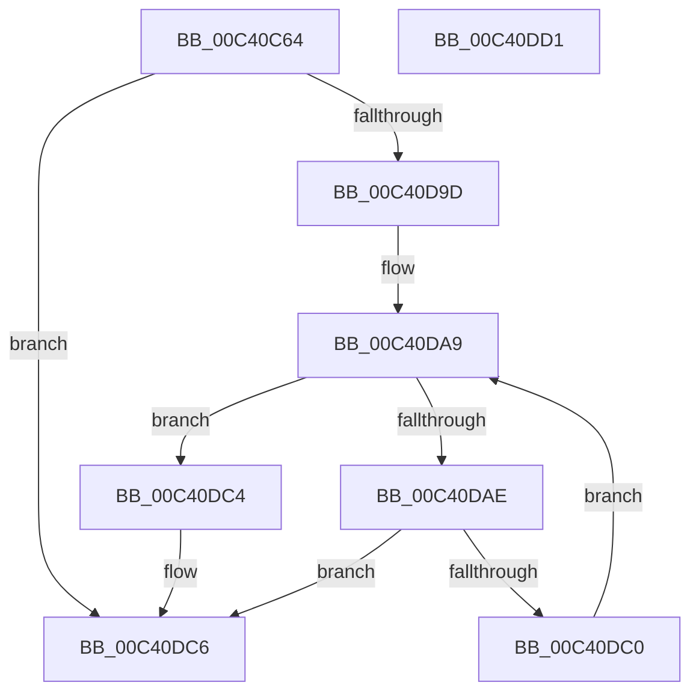

# PopInitializeIrpWorkers

- RVA: `0x00C40C64`–`0x00C40DD2` (길이 `366` bytes)
- VA: `0x0000000140C40C64`
- 실행 섹션: `INIT`
- PDB 이름 있음: `예`; PDB Function 태그: `아니요`
- unwind 정보 RVA: `0x00065960`
- 디코드: `68`개 명령, `366/366` bytes 표시
- 미해석 바이트: `0` (있으면 어셈블리에 `.byte`로 보존)

> 이 문서는 커널 이미지의 기계어와 PDB 기호를 분석해 생성했습니다. 4번과 5번은 함수 원형과 자료형을 바이너리 사용 방식에서 추정한 C 해석이며 원본 소스 복구 결과는 아닙니다.

## 1. Dependencies

- 직접 호출 지점: **3**; 고유 호출 대상: **2**
- 직접 호출자로 확인된 함수: **1**
- RIP 상대 이미지 참조: **36**

### Outgoing calls
- `0x00C40D86` → [ExInitializeNPagedLookasideListInternal](../../text/46/ExInitializeNPagedLookasideListInternal_function_00468720.md) (function, `0x00468720`)
- `0x00C40D94` → [PopCreatePowerThread](../../text/4A/PopCreatePowerThread_function_004A17D8.md) (function, `0x004A17D8`)
- `0x00C40DB7` → [PopCreatePowerThread](../../text/4A/PopCreatePowerThread_function_004A17D8.md) (function, `0x004A17D8`)

### Direct callers
- [PoInitSystem](../C7/PoInitSystem_function_00C72358.md) at `0x00C72674`

### Static image references
- `0x00C40C70` → RVA `0x00F091D8` (`.data`; write)
- `0x00C40C77` → RVA `0x00F091F0` (`.data`; read)
- `0x00C40C82` → RVA `0x00F091F8` (`.data`; write)
- `0x00C40C89` → RVA `0x00E27F00` (`.data`; read)
- `0x00C40C90` → RVA `0x00F091F0` (`.data`; write)
- `0x00C40C9D` → RVA `0x00F0BCF0` (`.data`; read)
- `0x00C40CA9` → RVA `0x00F0BCF8` (`.data`; write)
- `0x00C40CB3` → RVA `0x00F0BCF0` (`.data`; write)
- `0x00C40CBC` → RVA `0x00F0BD08` (`.data`; read)
- `0x00C40CCB` → RVA `0x00F0BD10` (`.data`; write)
- `0x00C40CD2` → RVA `0x00F0BD08` (`.data`; write)
- `0x00C40CD9` → RVA `0x00F09188` (`.data`; read)
- `0x00C40CE0` → RVA `0x00F09190` (`.data`; write)
- `0x00C40CE7` → RVA `0x00F09188` (`.data`; write)
- `0x00C40CEE` → RVA `0x00F091C0` (`.data`; read)
- `0x00C40CF5` → RVA `0x00F091C8` (`.data`; write)
- `0x00C40CFC` → RVA `0x00F091C0` (`.data`; write)
- `0x00C40D03` → RVA `0x00F09198` (`.data`; write)
- `0x00C40D09` → RVA `0x00F0919C` (`.data`; write)
- `0x00C40D0F` → RVA `0x00F091DC` (`.data`; write)
- `0x00C40D15` → RVA `0x00F091E0` (`.data`; write)
- `0x00C40D1C` → RVA `0x00F0BD00` (`.data`; write)
- `0x00C40D23` → RVA `0x00F0BD02` (`.data`; write)
- `0x00C40D2A` → RVA `0x00F0BD04` (`.data`; write)
- `0x00C40D30` → RVA `0x00F0BD18` (`.data`; write)
- `0x00C40D3A` → RVA `0x00F09180` (`.data`; write)
- `0x00C40D43` → RVA `0x00F09182` (`.data`; write)
- `0x00C40D4A` → RVA `0x00F09184` (`.data`; write)
- `0x00C40D50` → RVA `0x00F091A0` (`.data`; write)
- `0x00C40D5A` → RVA `0x00F091A8` (`.data`; write)
- `0x00C40D61` → RVA `0x00F091B0` (`.data`; write)
- `0x00C40D67` → RVA `0x00F091B8` (`.data`; write)
- `0x00C40D70` → RVA `0x00F091BA` (`.data`; write)
- `0x00C40D77` → RVA `0x00F091BC` (`.data`; write)
- `0x00C40D8D` → RVA `0x005D93E0` (`PopIrpWorkerControl`; read)
- `0x00C40DB0` → RVA `0x0026D410` (`PopIrpWorker`; read)

## 2. Other-region calls and transfers

- 다른 실행 섹션으로 향하는 call: **3**
  - `0x00C40D86` → [ExInitializeNPagedLookasideListInternal](../../text/46/ExInitializeNPagedLookasideListInternal_function_00468720.md) (`INIT` → `.text`)
  - `0x00C40D94` → [PopCreatePowerThread](../../text/4A/PopCreatePowerThread_function_004A17D8.md) (`INIT` → `.text`)
  - `0x00C40DB7` → [PopCreatePowerThread](../../text/4A/PopCreatePowerThread_function_004A17D8.md) (`INIT` → `.text`)
- 별도 외부 분기/꼬리 이동을 확인하지 못했습니다.

## 3. Assembly (complete function range)

```asm
00C40C64  48 89 5C 24 08                  mov qword ptr [rsp + 8], rbx
00C40C69  57                              push rdi
00C40C6A  48 83 EC 40                     sub rsp, 0x40
00C40C6E  33 FF                           xor edi, edi
00C40C70  C6 05 61 85 2C 00 01            mov byte ptr [rip + 0x2c8561], 1
00C40C77  48 8D 05 72 85 2C 00            lea rax, [rip + 0x2c8572]
00C40C7E  89 7C 24 38                     mov dword ptr [rsp + 0x38], edi
00C40C82  48 89 05 6F 85 2C 00            mov qword ptr [rip + 0x2c856f], rax
00C40C89  48 8D 0D 70 72 1E 00            lea rcx, [rip + 0x1e7270]
00C40C90  48 89 05 59 85 2C 00            mov qword ptr [rip + 0x2c8559], rax
00C40C97  41 B9 00 02 00 00               mov r9d, 0x200
00C40C9D  48 8D 05 4C B0 2C 00            lea rax, [rip + 0x2cb04c]
00C40CA4  66 89 7C 24 30                  mov word ptr [rsp + 0x30], di
00C40CA9  48 89 05 48 B0 2C 00            mov qword ptr [rip + 0x2cb048], rax
00C40CB0  45 33 C0                        xor r8d, r8d
00C40CB3  48 89 05 36 B0 2C 00            mov qword ptr [rip + 0x2cb036], rax
00C40CBA  33 D2                           xor edx, edx
00C40CBC  48 8D 05 45 B0 2C 00            lea rax, [rip + 0x2cb045]
00C40CC3  C7 44 24 28 50 6F 49 72         mov dword ptr [rsp + 0x28], 0x72496f50
00C40CCB  48 89 05 3E B0 2C 00            mov qword ptr [rip + 0x2cb03e], rax
00C40CD2  48 89 05 2F B0 2C 00            mov qword ptr [rip + 0x2cb02f], rax
00C40CD9  48 8D 05 A8 84 2C 00            lea rax, [rip + 0x2c84a8]
00C40CE0  48 89 05 A9 84 2C 00            mov qword ptr [rip + 0x2c84a9], rax
00C40CE7  48 89 05 9A 84 2C 00            mov qword ptr [rip + 0x2c849a], rax
00C40CEE  48 8D 05 CB 84 2C 00            lea rax, [rip + 0x2c84cb]
00C40CF5  48 89 05 CC 84 2C 00            mov qword ptr [rip + 0x2c84cc], rax
00C40CFC  48 89 05 BD 84 2C 00            mov qword ptr [rip + 0x2c84bd], rax
00C40D03  89 3D 8F 84 2C 00               mov dword ptr [rip + 0x2c848f], edi
00C40D09  89 3D 8D 84 2C 00               mov dword ptr [rip + 0x2c848d], edi
00C40D0F  89 3D C7 84 2C 00               mov dword ptr [rip + 0x2c84c7], edi
00C40D15  40 88 3D C4 84 2C 00            mov byte ptr [rip + 0x2c84c4], dil
00C40D1C  C6 05 DD AF 2C 00 05            mov byte ptr [rip + 0x2cafdd], 5
00C40D23  C6 05 D8 AF 2C 00 08            mov byte ptr [rip + 0x2cafd8], 8
00C40D2A  89 3D D4 AF 2C 00               mov dword ptr [rip + 0x2cafd4], edi
00C40D30  C7 05 DE AF 2C 00 FF FF FF 7F   mov dword ptr [rip + 0x2cafde], 0x7fffffff
00C40D3A  66 C7 05 3D 84 2C 00 01 00      mov word ptr [rip + 0x2c843d], 1
00C40D43  C6 05 38 84 2C 00 06            mov byte ptr [rip + 0x2c8438], 6
00C40D4A  89 3D 34 84 2C 00               mov dword ptr [rip + 0x2c8434], edi
00C40D50  C7 05 46 84 2C 00 01 00 00 00   mov dword ptr [rip + 0x2c8446], 1
00C40D5A  48 89 3D 47 84 2C 00            mov qword ptr [rip + 0x2c8447], rdi
00C40D61  89 3D 49 84 2C 00               mov dword ptr [rip + 0x2c8449], edi
00C40D67  66 C7 05 48 84 2C 00 01 00      mov word ptr [rip + 0x2c8448], 1
00C40D70  C6 05 43 84 2C 00 06            mov byte ptr [rip + 0x2c8443], 6
00C40D77  89 3D 3F 84 2C 00               mov dword ptr [rip + 0x2c843f], edi
00C40D7D  48 C7 44 24 20 08 00 00 00      mov qword ptr [rsp + 0x20], 8
00C40D86  E8 95 79 82 FF                  call 0x140468720
00C40D8B  33 D2                           xor edx, edx
00C40D8D  48 8D 0D 4C 86 99 FF            lea rcx, [rip - 0x6679b4]
00C40D94  E8 3F 0A 86 FF                  call 0x1404a17d8
00C40D99  85 C0                           test eax, eax
00C40D9B  78 29                           js 0x140c40dc6
00C40D9D  C7 05 35 84 2C 00 02 00 00 00   mov dword ptr [rip + 0x2c8435], 2
00C40DA7  8B DF                           mov ebx, edi
00C40DA9  83 FB 02                        cmp ebx, 2
00C40DAC  73 16                           jae 0x140c40dc4
00C40DAE  33 D2                           xor edx, edx
00C40DB0  48 8D 0D 59 C6 62 FF            lea rcx, [rip - 0x9d39a7]
00C40DB7  E8 1C 0A 86 FF                  call 0x1404a17d8
00C40DBC  85 C0                           test eax, eax
00C40DBE  78 06                           js 0x140c40dc6
00C40DC0  FF C3                           inc ebx
00C40DC2  EB E5                           jmp 0x140c40da9
00C40DC4  8B C7                           mov eax, edi
00C40DC6  48 8B 5C 24 50                  mov rbx, qword ptr [rsp + 0x50]
00C40DCB  48 83 C4 40                     add rsp, 0x40
00C40DCF  5F                              pop rdi
00C40DD0  C3                              ret
00C40DD1  CC                              int3
```

## 4. C-style interpretation (structured pseudocode)

```c
__int64 __fastcall PopInitializeIrpWorkers(__int64 a1, int a2, int a3)
{
    __int64 result;
    __int64 v_rbx;
    __int64 v_rdi;
    __int64 v_rsp;
    unsigned int v_stack_m10;
    unsigned __int16 v_stack_m18;
    unsigned int v_stack_m20;
    unsigned __int64 v_stack_m28;
    unsigned __int64 v_stack_p8;

    v_stack_p8 = v_rbx;
    v_rsp = (v_rsp) - (64);
    v_rdi = 0;
    *(unsigned __int8 *)(v_rip + 2917729) = 1;
    v_stack_m10 = 0;
    *(unsigned __int64 *)(v_rip + 2917743) = v_rip + 2917746;
    *(unsigned __int64 *)(v_rip + 2917721) = v_rip + 2917746;
    v_stack_m18 = 0;
    *(unsigned __int64 *)(v_rip + 2928712) = v_rip + 2928716;
    a3 = 0;
    *(unsigned __int64 *)(v_rip + 2928694) = v_rip + 2928716;
    a2 = 0;
    v_stack_m20 = 0x72496F50ULL;
    *(unsigned __int64 *)(v_rip + 2928702) = v_rip + 2928709;
    *(unsigned __int64 *)(v_rip + 2928687) = v_rip + 2928709;
    *(unsigned __int64 *)(v_rip + 2917545) = v_rip + 2917544;
    *(unsigned __int64 *)(v_rip + 2917530) = v_rip + 2917544;
    *(unsigned __int64 *)(v_rip + 2917580) = v_rip + 2917579;
    *(unsigned __int64 *)(v_rip + 2917565) = v_rip + 2917579;
    *(unsigned int *)(v_rip + 2917519) = 0;
    *(unsigned int *)(v_rip + 2917517) = 0;
    *(unsigned int *)(v_rip + 2917575) = 0;
    *(unsigned __int8 *)(v_rip + 2917572) = 0;
    *(unsigned __int8 *)(v_rip + 2928605) = 5;
    *(unsigned __int8 *)(v_rip + 2928600) = 8;
    *(unsigned int *)(v_rip + 2928596) = 0;
    *(unsigned int *)(v_rip + 2928606) = 0x7FFFFFFFULL;
    *(unsigned __int16 *)(v_rip + 2917437) = 1;
    *(unsigned __int8 *)(v_rip + 2917432) = 6;
    *(unsigned int *)(v_rip + 2917428) = 0;
    *(unsigned int *)(v_rip + 2917446) = 1;
    *(unsigned __int64 *)(v_rip + 2917447) = 0;
    *(unsigned int *)(v_rip + 2917449) = 0;
    *(unsigned __int16 *)(v_rip + 2917448) = 1;
    *(unsigned __int8 *)(v_rip + 2917443) = 6;
    *(unsigned int *)(v_rip + 2917439) = 0;
    v_stack_m28 = 8;
    result = ExInitializeNPagedLookasideListInternal(v_rip + 1995376, a2, a3, 512);
    a2 = 0;
    result = PopCreatePowerThread(v_rip - 6715828, a2, a3, 512);
    if (sign_flag) goto loc_00C40DC6;
    *(unsigned int *)(v_rip + 2917429) = 2;
loc_00C40DA9:
    if (0 >= 2) goto loc_00C40DC4;
    a2 = 0;
    result = PopCreatePowerThread(v_rip - 10303911, a2, a3, 512);
    if (sign_flag) goto loc_00C40DC6;
    v_rbx = (unsigned int)((0) + 1);
    goto loc_00C40DA9;
loc_00C40DC4:
loc_00C40DC6:
    v_rsp = (v_rsp) + (64);
    return 0;
}
```

## 5. (Beta) C Style

```c
int64_t PopInitializeIrpWorkers(int64_t Arg1, int32_t Arg2, int32_t Arg3)
{
    int64_t result;
    int64_t local_rbx;
    int64_t local_rdi;
    int64_t local_rsp;
    uint32_t v_stack_m10;
    uint16_t v_stack_m18;
    uint32_t v_stack_m20;
    uint64_t v_stack_m28;
    uint64_t v_stack_p8;

    v_stack_p8 = local_rbx;
    local_rsp = (local_rsp) - (64);
    local_rdi = 0;
    *(uint8_t *)(v_rip + 0x2C8561) = 1;
    v_stack_m10 = 0;
    *(uint64_t *)(v_rip + 0x2C856F) = v_rip + 2917746;
    *(uint64_t *)(v_rip + 0x2C8559) = v_rip + 2917746;
    v_stack_m18 = 0;
    *(uint64_t *)(v_rip + 0x2CB048) = v_rip + 2928716;
    Arg3 = 0;
    *(uint64_t *)(v_rip + 0x2CB036) = v_rip + 2928716;
    Arg2 = 0;
    v_stack_m20 = 0x72496F50ULL;
    *(uint64_t *)(v_rip + 0x2CB03E) = v_rip + 2928709;
    *(uint64_t *)(v_rip + 0x2CB02F) = v_rip + 2928709;
    *(uint64_t *)(v_rip + 0x2C84A9) = v_rip + 2917544;
    *(uint64_t *)(v_rip + 0x2C849A) = v_rip + 2917544;
    *(uint64_t *)(v_rip + 0x2C84CC) = v_rip + 2917579;
    *(uint64_t *)(v_rip + 0x2C84BD) = v_rip + 2917579;
    *(uint32_t *)(v_rip + 0x2C848F) = 0;
    *(uint32_t *)(v_rip + 0x2C848D) = 0;
    *(uint32_t *)(v_rip + 0x2C84C7) = 0;
    *(uint8_t *)(v_rip + 0x2C84C4) = 0;
    *(uint8_t *)(v_rip + 0x2CAFDD) = 5;
    *(uint8_t *)(v_rip + 0x2CAFD8) = 8;
    *(uint32_t *)(v_rip + 0x2CAFD4) = 0;
    *(uint32_t *)(v_rip + 0x2CAFDE) = 0x7FFFFFFFULL;
    *(uint16_t *)(v_rip + 0x2C843D) = 1;
    *(uint8_t *)(v_rip + 0x2C8438) = 6;
    *(uint32_t *)(v_rip + 0x2C8434) = 0;
    *(uint32_t *)(v_rip + 0x2C8446) = 1;
    *(uint64_t *)(v_rip + 0x2C8447) = 0;
    *(uint32_t *)(v_rip + 0x2C8449) = 0;
    *(uint16_t *)(v_rip + 0x2C8448) = 1;
    *(uint8_t *)(v_rip + 0x2C8443) = 6;
    *(uint32_t *)(v_rip + 0x2C843F) = 0;
    v_stack_m28 = 8;
    result = ExInitializeNPagedLookasideListInternal(v_rip + 1995376, Arg2, Arg3, 512);
    Arg2 = 0;
    result = PopCreatePowerThread(v_rip - 6715828, Arg2, Arg3, 512);
    if (sign_flag) goto loc_00C40DC6;
    *(uint32_t *)(v_rip + 0x2C8435) = 2;
loc_00C40DA9:
    if (0 >= 2) goto loc_00C40DC4;
    Arg2 = 0;
    result = PopCreatePowerThread(v_rip - 10303911, Arg2, Arg3, 512);
    if (sign_flag) goto loc_00C40DC6;
    local_rbx = (uint32_t)((0) + 1);
    goto loc_00C40DA9;
loc_00C40DC4:
loc_00C40DC6:
    local_rsp = (local_rsp) + (64);
    return 0;
}
```

## 6. Execution-region graph

[열기: 2D/3D 그래프와 함수 탐색 컨트롤 패널](../../../control-panel.html?section=init&rva=0x00C40C64&view=graph)

- 2D 그래프는 위에서 아래로 흐르고, 3D 그래프는 빈 공간을 드래그해 회전합니다. Shift+드래그는 이동, 휠은 확대·축소, 함수 노드 선택은 대상 보고서 이동입니다.

### Static fallback


