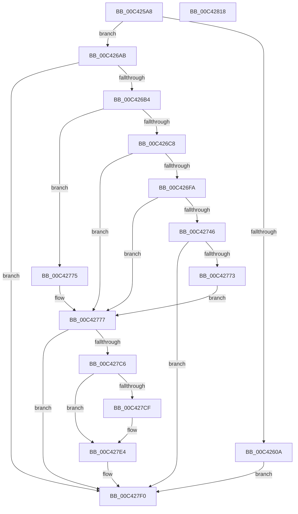

# PopInitializePowerButtonHold

- RVA: `0x00C425A8`–`0x00C42819` (길이 `625` bytes)
- VA: `0x0000000140C425A8`
- 실행 섹션: `INIT`
- PDB 이름 있음: `예`; PDB Function 태그: `아니요`
- unwind 정보 RVA: `0x000CD09C`
- 디코드: `130`개 명령, `625/625` bytes 표시
- 미해석 바이트: `0` (있으면 어셈블리에 `.byte`로 보존)

> 이 문서는 커널 이미지의 기계어와 PDB 기호를 분석해 생성했습니다. 4번과 5번은 함수 원형과 자료형을 바이너리 사용 방식에서 추정한 C 해석이며 원본 소스 복구 결과는 아닙니다.

## 1. Dependencies

- 직접 호출 지점: **12**; 고유 호출 대상: **8**
- 직접 호출자로 확인된 함수: **1**
- RIP 상대 이미지 참조: **24**

### Outgoing calls
- `0x00C4262C` → [memset](../../text/6C/memset_function_006C6C40.md) (function, `0x006C6C40`)
- `0x00C42640` → [memset](../../text/6C/memset_function_006C6C40.md) (function, `0x006C6C40`)
- `0x00C426A1` → [PopInitializeWorkItem](../../page/75/PopInitializeWorkItem_function_007540C8.md) (function, `0x007540C8`)
- `0x00C426B4` → [RtlIsStateSeparationEnabled](../../page/A3/RtlIsStateSeparationEnabled_function_00A3C560.md) (function, `0x00A3C560`)
- `0x00C426F1` → [RtlGetPersistedStateLocation](../../page/8C/RtlGetPersistedStateLocation_function_008C8DE0.md) (function, `0x008C8DE0`)
- `0x00C42702` → [RtlInitUnicodeString](../../text/42/RtlInitUnicodeString_function_0042A780.md) (function, `0x0042A780`)
- `0x00C4273D` → [ZwOpenKey](../../text/6A/ZwOpenKey_function_006AD310.md) (function, `0x006AD310`)
- `0x00C42767` → [PopPowerButtonBugcheckConfigure](../../page/76/PopPowerButtonBugcheckConfigure_function_00768F84.md) (function, `0x00768F84`)
- `0x00C42782` → [RtlInitUnicodeString](../../text/42/RtlInitUnicodeString_function_0042A780.md) (function, `0x0042A780`)
- `0x00C427BD` → [ZwOpenKey](../../text/6A/ZwOpenKey_function_006AD310.md) (function, `0x006AD310`)
- `0x00C427EB` → [PopPowerButtonBugcheckConfigure](../../page/76/PopPowerButtonBugcheckConfigure_function_00768F84.md) (function, `0x00768F84`)
- `0x00C427FA` → [_security_check_cookie](../../text/6A/_security_check_cookie_function_006AC640.md) (function, `0x006AC640`)

### Direct callers
- [PoInitSystem](../C7/PoInitSystem_function_00C72358.md) at `0x00C72C29`
- [PoInitSystem](../C7/PoInitSystem_function_00C72358.md) at `0x00C72D58`

### Static image references
- `0x00C425C6` → RVA `0x00E0A740` (`.data`; read)
- `0x00C4260C` → RVA `0x00F086F4` (`.data`; write)
- `0x00C42618` → RVA `0x00F086F0` (`.data`; write)
- `0x00C4261E` → RVA `0x00F08608` (`.data`; read)
- `0x00C42625` → RVA `0x00F085E0` (`.data`; write)
- `0x00C42633` → RVA `0x00F08520` (`.data`; read)
- `0x00C42645` → RVA `0x00E07800` (`.data`; read)
- `0x00C4264C` → RVA `0x00F08520` (`.data`; write)
- `0x00C42659` → RVA `0x00F085B0` (`.data`; write)
- `0x00C42660` → RVA `0x005D9A70` (`PopPowerButtonWorkCallback`; read)
- `0x00C42667` → RVA `0x00F08590` (`.data`; write)
- `0x00C4266E` → RVA `0x00F08690` (`.data`; read)
- `0x00C42675` → RVA `0x00F08598` (`.data`; write)
- `0x00C4267C` → RVA `0x00F0859C` (`.data`; write)
- `0x00C42682` → RVA `0x00F085A0` (`.data`; write)
- `0x00C42689` → RVA `0x00F085A4` (`.data`; write)
- `0x00C42690` → RVA `0x00F085B8` (`.data`; write)
- `0x00C4269A` → RVA `0x00F08600` (`.data`; write)
- `0x00C426B9` → RVA `0x007690A0` (`PopPowerButtonBugcheckWatchCallback`; read)
- `0x00C426D4` → RVA `0x000294C0` (`.rdata`; read)
- `0x00C42752` → RVA `0x00F085D8` (`.data`; write)
- `0x00C42759` → RVA `0x00F085D0` (`.data`; write)
- `0x00C42760` → RVA `0x00F085C0` (`.data`; write)
- `0x00C42777` → RVA `0x00029610` (`.rdata`; read)

## 2. Other-region calls and transfers

- 다른 실행 섹션으로 향하는 call: **12**
  - `0x00C4262C` → [memset](../../text/6C/memset_function_006C6C40.md) (`INIT` → `.text`)
  - `0x00C42640` → [memset](../../text/6C/memset_function_006C6C40.md) (`INIT` → `.text`)
  - `0x00C426A1` → [PopInitializeWorkItem](../../page/75/PopInitializeWorkItem_function_007540C8.md) (`INIT` → `PAGE`)
  - `0x00C426B4` → [RtlIsStateSeparationEnabled](../../page/A3/RtlIsStateSeparationEnabled_function_00A3C560.md) (`INIT` → `PAGE`)
  - `0x00C426F1` → [RtlGetPersistedStateLocation](../../page/8C/RtlGetPersistedStateLocation_function_008C8DE0.md) (`INIT` → `PAGE`)
  - `0x00C42702` → [RtlInitUnicodeString](../../text/42/RtlInitUnicodeString_function_0042A780.md) (`INIT` → `.text`)
  - `0x00C4273D` → [ZwOpenKey](../../text/6A/ZwOpenKey_function_006AD310.md) (`INIT` → `.text`)
  - `0x00C42767` → [PopPowerButtonBugcheckConfigure](../../page/76/PopPowerButtonBugcheckConfigure_function_00768F84.md) (`INIT` → `PAGE`)
  - `0x00C42782` → [RtlInitUnicodeString](../../text/42/RtlInitUnicodeString_function_0042A780.md) (`INIT` → `.text`)
  - `0x00C427BD` → [ZwOpenKey](../../text/6A/ZwOpenKey_function_006AD310.md) (`INIT` → `.text`)
  - `0x00C427EB` → [PopPowerButtonBugcheckConfigure](../../page/76/PopPowerButtonBugcheckConfigure_function_00768F84.md) (`INIT` → `PAGE`)
  - `0x00C427FA` → [_security_check_cookie](../../text/6A/_security_check_cookie_function_006AC640.md) (`INIT` → `.text`)
- 별도 외부 분기/꼬리 이동을 확인하지 못했습니다.

## 3. Assembly (complete function range)

```asm
00C425A8  48 8B C4                        mov rax, rsp
00C425AB  48 89 58 08                     mov qword ptr [rax + 8], rbx
00C425AF  48 89 70 10                     mov qword ptr [rax + 0x10], rsi
00C425B3  48 89 78 18                     mov qword ptr [rax + 0x18], rdi
00C425B7  55                              push rbp
00C425B8  48 8D A8 38 FE FF FF            lea rbp, [rax - 0x1c8]
00C425BF  48 81 EC C0 02 00 00            sub rsp, 0x2c0
00C425C6  48 8B 05 73 81 1C 00            mov rax, qword ptr [rip + 0x1c8173]
00C425CD  48 33 C4                        xor rax, rsp
00C425D0  48 89 85 B0 01 00 00            mov qword ptr [rbp + 0x1b0], rax
00C425D7  33 FF                           xor edi, edi
00C425D9  33 C0                           xor eax, eax
00C425DB  48 89 7C 24 48                  mov qword ptr [rsp + 0x48], rdi
00C425E0  0F 57 C0                        xorps xmm0, xmm0
00C425E3  48 89 44 24 70                  mov qword ptr [rsp + 0x70], rax
00C425E8  40 8A DF                        mov bl, dil
00C425EB  89 44 24 78                     mov dword ptr [rsp + 0x78], eax
00C425EF  40 88 7C 24 40                  mov byte ptr [rsp + 0x40], dil
00C425F4  0F 11 45 80                     movups xmmword ptr [rbp - 0x80], xmm0
00C425F8  0F 11 44 24 50                  movups xmmword ptr [rsp + 0x50], xmm0
00C425FD  0F 11 44 24 60                  movups xmmword ptr [rsp + 0x60], xmm0
00C42602  85 C9                           test ecx, ecx
00C42604  0F 85 A1 00 00 00               jne 0x140c426ab
00C4260A  33 D2                           xor edx, edx
00C4260C  89 3D E2 60 2C 00               mov dword ptr [rip + 0x2c60e2], edi
00C42612  41 B8 E8 00 00 00               mov r8d, 0xe8
00C42618  89 3D D2 60 2C 00               mov dword ptr [rip + 0x2c60d2], edi
00C4261E  48 8D 0D E3 5F 2C 00            lea rcx, [rip + 0x2c5fe3]
00C42625  48 89 3D B4 5F 2C 00            mov qword ptr [rip + 0x2c5fb4], rdi
00C4262C  E8 0F 46 A8 FF                  call 0x1406c6c40
00C42631  33 D2                           xor edx, edx
00C42633  48 8D 0D E6 5E 2C 00            lea rcx, [rip + 0x2c5ee6]
00C4263A  41 B8 A0 00 00 00               mov r8d, 0xa0
00C42640  E8 FB 45 A8 FF                  call 0x1406c6c40
00C42645  48 8D 05 B4 51 1C 00            lea rax, [rip + 0x1c51b4]
00C4264C  C7 05 CA 5E 2C 00 02 00 00 00   mov dword ptr [rip + 0x2c5eca], 2
00C42656  45 33 C0                        xor r8d, r8d
00C42659  48 89 05 50 5F 2C 00            mov qword ptr [rip + 0x2c5f50], rax
00C42660  48 8D 15 09 74 99 FF            lea rdx, [rip - 0x668bf7]
00C42667  48 89 3D 22 5F 2C 00            mov qword ptr [rip + 0x2c5f22], rdi
00C4266E  48 8D 0D 1B 60 2C 00            lea rcx, [rip + 0x2c601b]
00C42675  66 89 3D 1C 5F 2C 00            mov word ptr [rip + 0x2c5f1c], di
00C4267C  89 3D 1A 5F 2C 00               mov dword ptr [rip + 0x2c5f1a], edi
00C42682  40 88 3D 17 5F 2C 00            mov byte ptr [rip + 0x2c5f17], dil
00C42689  48 89 3D 14 5F 2C 00            mov qword ptr [rip + 0x2c5f14], rdi
00C42690  C7 05 1E 5F 2C 00 19 00 00 00   mov dword ptr [rip + 0x2c5f1e], 0x19
00C4269A  48 89 3D 5F 5F 2C 00            mov qword ptr [rip + 0x2c5f5f], rdi
00C426A1  E8 22 1A B1 FF                  call 0x1407540c8
00C426A6  E9 45 01 00 00                  jmp 0x140c427f0
00C426AB  83 F9 01                        cmp ecx, 1
00C426AE  0F 85 3C 01 00 00               jne 0x140c427f0
00C426B4  E8 A7 9E DF FF                  call 0x140a3c560
00C426B9  48 8D 35 E0 69 B2 FF            lea rsi, [rip - 0x4d9620]
00C426C0  84 C0                           test al, al
00C426C2  0F 84 AD 00 00 00               je 0x140c42775
00C426C8  48 8D 45 90                     lea rax, [rbp - 0x70]
00C426CC  45 33 C9                        xor r9d, r9d
00C426CF  48 89 44 24 30                  mov qword ptr [rsp + 0x30], rax
00C426D4  48 8D 0D E5 6D 3E FF            lea rcx, [rip - 0xc1921b]
00C426DB  48 8D 45 A0                     lea rax, [rbp - 0x60]
00C426DF  C7 44 24 28 08 02 00 00         mov dword ptr [rsp + 0x28], 0x208
00C426E7  45 33 C0                        xor r8d, r8d
00C426EA  48 89 44 24 20                  mov qword ptr [rsp + 0x20], rax
00C426EF  33 D2                           xor edx, edx
00C426F1  E8 EA 66 C8 FF                  call 0x1408c8de0
00C426F6  85 C0                           test eax, eax
00C426F8  78 7D                           js 0x140c42777
00C426FA  48 8D 55 A0                     lea rdx, [rbp - 0x60]
00C426FE  48 8D 4D 80                     lea rcx, [rbp - 0x80]
00C42702  E8 79 80 7E FF                  call 0x14042a780
00C42707  48 8D 45 80                     lea rax, [rbp - 0x80]
00C4270B  C7 44 24 50 30 00 00 00         mov dword ptr [rsp + 0x50], 0x30
00C42713  0F 57 C0                        xorps xmm0, xmm0
00C42716  48 89 44 24 60                  mov qword ptr [rsp + 0x60], rax
00C4271B  4C 8D 44 24 50                  lea r8, [rsp + 0x50]
00C42720  48 89 7C 24 58                  mov qword ptr [rsp + 0x58], rdi
00C42725  BA 11 00 00 00                  mov edx, 0x11
00C4272A  C7 44 24 68 40 02 00 00         mov dword ptr [rsp + 0x68], 0x240
00C42732  48 8D 4C 24 48                  lea rcx, [rsp + 0x48]
00C42737  F3 0F 7F 44 24 70               movdqu xmmword ptr [rsp + 0x70], xmm0
00C4273D  E8 CE AB A6 FF                  call 0x1406ad310
00C42742  85 C0                           test eax, eax
00C42744  78 31                           js 0x140c42777
00C42746  48 8B 4C 24 48                  mov rcx, qword ptr [rsp + 0x48]
00C4274B  4C 8D 44 24 40                  lea r8, [rsp + 0x40]
00C42750  B2 01                           mov dl, 1
00C42752  48 89 0D 7F 5E 2C 00            mov qword ptr [rip + 0x2c5e7f], rcx
00C42759  48 89 35 70 5E 2C 00            mov qword ptr [rip + 0x2c5e70], rsi
00C42760  48 89 3D 59 5E 2C 00            mov qword ptr [rip + 0x2c5e59], rdi
00C42767  E8 18 68 B2 FF                  call 0x140768f84
00C4276C  40 38 7C 24 40                  cmp byte ptr [rsp + 0x40], dil
00C42771  75 7D                           jne 0x140c427f0
00C42773  EB 02                           jmp 0x140c42777
00C42775  B3 01                           mov bl, 1
00C42777  48 8D 15 92 6E 3E FF            lea rdx, [rip - 0xc1916e]
00C4277E  48 8D 4D 80                     lea rcx, [rbp - 0x80]
00C42782  E8 F9 7F 7E FF                  call 0x14042a780
00C42787  48 8D 45 80                     lea rax, [rbp - 0x80]
00C4278B  C7 44 24 50 30 00 00 00         mov dword ptr [rsp + 0x50], 0x30
00C42793  0F 57 C0                        xorps xmm0, xmm0
00C42796  48 89 44 24 60                  mov qword ptr [rsp + 0x60], rax
00C4279B  4C 8D 44 24 50                  lea r8, [rsp + 0x50]
00C427A0  48 89 7C 24 58                  mov qword ptr [rsp + 0x58], rdi
00C427A5  BA 11 00 00 00                  mov edx, 0x11
00C427AA  C7 44 24 68 40 02 00 00         mov dword ptr [rsp + 0x68], 0x240
00C427B2  48 8D 4C 24 48                  lea rcx, [rsp + 0x48]
00C427B7  F3 0F 7F 44 24 70               movdqu xmmword ptr [rsp + 0x70], xmm0
00C427BD  E8 4E AB A6 FF                  call 0x1406ad310
00C427C2  85 C0                           test eax, eax
00C427C4  78 2A                           js 0x140c427f0
00C427C6  48 8B 4C 24 48                  mov rcx, qword ptr [rsp + 0x48]
00C427CB  84 DB                           test bl, bl
00C427CD  74 15                           je 0x140c427e4
00C427CF  48 89 35 FA 5D 2C 00            mov qword ptr [rip + 0x2c5dfa], rsi
00C427D6  48 89 0D FB 5D 2C 00            mov qword ptr [rip + 0x2c5dfb], rcx
00C427DD  48 89 3D DC 5D 2C 00            mov qword ptr [rip + 0x2c5ddc], rdi
00C427E4  4C 8D 44 24 40                  lea r8, [rsp + 0x40]
00C427E9  8A D3                           mov dl, bl
00C427EB  E8 94 67 B2 FF                  call 0x140768f84
00C427F0  48 8B 8D B0 01 00 00            mov rcx, qword ptr [rbp + 0x1b0]
00C427F7  48 33 CC                        xor rcx, rsp
00C427FA  E8 41 9E A6 FF                  call 0x1406ac640
00C427FF  4C 8D 9C 24 C0 02 00 00         lea r11, [rsp + 0x2c0]
00C42807  49 8B 5B 10                     mov rbx, qword ptr [r11 + 0x10]
00C4280B  49 8B 73 18                     mov rsi, qword ptr [r11 + 0x18]
00C4280F  49 8B 7B 20                     mov rdi, qword ptr [r11 + 0x20]
00C42813  49 8B E3                        mov rsp, r11
00C42816  5D                              pop rbp
00C42817  C3                              ret
00C42818  CC                              int3
```

## 4. C-style interpretation (structured pseudocode)

```c
__int64 __fastcall PopInitializePowerButtonHold(int a1, int a2, __int64 a3, int a4)
{
    __int64 result;
    __int64 v_rdi;
    __int64 v_rsp;
    unsigned int v_stack_m250;
    unsigned __int64 v_stack_m258;
    unsigned int v_stack_m260;
    unsigned __int64 v_stack_m268;
    unsigned __int64 v_stack_m270;
    unsigned __int64 v_stack_m278;
    unsigned __int64 v_stack_m280;
    unsigned __int8 v_stack_m288;
    unsigned __int64 v_stack_m298;
    unsigned int v_stack_m2A0;
    unsigned __int64 v_stack_m2A8;
    unsigned __int64 v_stack_m8;

    *(unsigned __int64 *)(v_rsp + 8) = v_rbx;
    *(unsigned __int64 *)(v_rsp + 16) = v_rsi;
    *(unsigned __int64 *)(v_rsp + 24) = v_rdi;
    v_rsp = (v_rsp) - (704);
    result = (*(unsigned __int64 *)(v_rip + 1868147)) ^ (v_rsp);
    *(unsigned __int64 *)(v_rsp - 456 + 432) = result;
    v_rdi = 0;
    result = 0;
    v_stack_m280 = 0;
    v_stack_m258 = 0;
    v_stack_m250 = 0;
    v_stack_m288 = 0;
    *(unsigned __int64 *)(v_rsp - 456 - 128) = v_xmm0;
    v_stack_m278 = v_xmm0;
    v_stack_m268 = v_xmm0;
    if (a1 != 0) goto loc_00C426AB;
    a2 = 0;
    *(unsigned int *)(v_rip + 2908386) = 0;
    *(unsigned int *)(v_rip + 2908370) = 0;
    *(unsigned __int64 *)(v_rip + 2908084) = 0;
    result = memset(v_rip + 2908131, a2, 232, a4);
    a2 = 0;
    result = memset(v_rip + 2907878, a2, 160, a4);
    *(unsigned int *)(v_rip + 2907850) = 2;
    a3 = 0;
    *(unsigned __int64 *)(v_rip + 2907984) = v_rip + 1855924;
    *(unsigned __int64 *)(v_rip + 2907938) = 0;
    *(unsigned __int16 *)(v_rip + 2907932) = 0;
    *(unsigned int *)(v_rip + 2907930) = 0;
    *(unsigned __int8 *)(v_rip + 2907927) = 0;
    *(unsigned __int64 *)(v_rip + 2907924) = 0;
    *(unsigned int *)(v_rip + 2907934) = 25;
    *(unsigned __int64 *)(v_rip + 2907999) = 0;
    result = PopInitializeWorkItem(v_rip + 2908187, v_rip - 6720503, a3, a4);
    goto loc_00C427F0;
loc_00C426AB:
    if (((unsigned int)(v_rip + 2908187)) != 1) goto loc_00C427F0;
    result = RtlIsStateSeparationEnabled(v_rip + 2908187, v_rip - 6720503, a3, a4);
    if ((unsigned __int8)(result) == 0) goto loc_00C42775;
    a4 = 0;
    v_stack_m298 = v_rsp - 456 - 112;
    v_stack_m2A0 = 520;
    a3 = 0;
    v_stack_m2A8 = v_rsp - 456 - 96;
    a2 = 0;
    result = RtlGetPersistedStateLocation(v_rip - 12685851, a2, a3, a4);
    if (sign_flag) goto loc_00C42777;
    result = RtlInitUnicodeString(v_rsp - 456 - 128, v_rsp - 456 - 96, a3, a4);
    v_stack_m278 = 48;
    v_stack_m268 = v_rsp - 456 - 128;
    v_stack_m270 = 0;
    v_stack_m260 = 576;
    v_stack_m258 = v_xmm0;
    result = ZwOpenKey(v_stack_m280, 17, v_stack_m278, a4);
    if (sign_flag) goto loc_00C42777;
    *(unsigned __int64 *)(v_rip + 2907775) = v_stack_m280;
    *(unsigned __int64 *)(v_rip + 2907760) = v_rip - 5084704;
    *(unsigned __int64 *)(v_rip + 2907737) = 0;
    result = PopPowerButtonBugcheckConfigure(v_stack_m280, 1, v_stack_m288, a4);
    if (v_stack_m288 != 0) goto loc_00C427F0;
    goto loc_00C42777;
loc_00C42775:
loc_00C42777:
    result = RtlInitUnicodeString(v_rsp - 456 - 128, v_rip - 12685678, v_stack_m288, a4);
    v_stack_m278 = 48;
    v_stack_m268 = v_rsp - 456 - 128;
    v_stack_m270 = 0;
    v_stack_m260 = 576;
    v_stack_m258 = v_xmm0;
    result = ZwOpenKey(v_stack_m280, 17, v_stack_m278, a4);
    if (sign_flag) goto loc_00C427F0;
    if (1 != 0) {
        *(unsigned __int64 *)(v_rip + 2907642) = v_rip - 5084704;
        *(unsigned __int64 *)(v_rip + 2907643) = v_stack_m280;
        *(unsigned __int64 *)(v_rip + 2907612) = 0;
    }
    result = PopPowerButtonBugcheckConfigure(v_stack_m280, 1, v_stack_m288, a4);
loc_00C427F0:
    a1 = (*(unsigned __int64 *)(v_rsp - 456 + 432)) ^ (v_rsp);
    result = _security_check_cookie(a1, 1, v_stack_m288, a4);
    return result;
}
```

## 5. (Beta) C Style

```c
int64_t PopInitializePowerButtonHold(int32_t Arg1, int32_t Arg2, int64_t Arg3, int32_t Arg4)
{
    int64_t result;
    int64_t local_rdi;
    int64_t local_rsp;
    uint32_t v_stack_m250;
    uint64_t v_stack_m258;
    uint32_t v_stack_m260;
    uint64_t v_stack_m268;
    uint64_t v_stack_m270;
    uint64_t v_stack_m278;
    uint64_t v_stack_m280;
    uint8_t v_stack_m288;
    uint64_t v_stack_m298;
    uint32_t v_stack_m2A0;
    uint64_t v_stack_m2A8;
    uint64_t v_stack_m8;

    *(uint64_t *)(local_rsp + 0x8) = local_rbx;
    *(uint64_t *)(local_rsp + 0x10) = local_rsi;
    *(uint64_t *)(local_rsp + 0x18) = local_rdi;
    local_rsp = (local_rsp) - (704);
    result = (*(uint64_t *)(v_rip + 0x1C8173)) ^ (local_rsp);
    *(uint64_t *)(local_rsp - 0x1C8 + 0x1B0) = result;
    local_rdi = 0;
    result = 0;
    v_stack_m280 = 0;
    v_stack_m258 = 0;
    v_stack_m250 = 0;
    v_stack_m288 = 0;
    *(uint64_t *)(local_rsp - 0x1C8 - 0x80) = v_xmm0;
    v_stack_m278 = v_xmm0;
    v_stack_m268 = v_xmm0;
    if (Arg1 != 0) goto loc_00C426AB;
    Arg2 = 0;
    *(uint32_t *)(v_rip + 0x2C60E2) = 0;
    *(uint32_t *)(v_rip + 0x2C60D2) = 0;
    *(uint64_t *)(v_rip + 0x2C5FB4) = 0;
    result = memset(v_rip + 2908131, Arg2, 232, Arg4);
    Arg2 = 0;
    result = memset(v_rip + 2907878, Arg2, 160, Arg4);
    *(uint32_t *)(v_rip + 0x2C5ECA) = 2;
    Arg3 = 0;
    *(uint64_t *)(v_rip + 0x2C5F50) = v_rip + 1855924;
    *(uint64_t *)(v_rip + 0x2C5F22) = 0;
    *(uint16_t *)(v_rip + 0x2C5F1C) = 0;
    *(uint32_t *)(v_rip + 0x2C5F1A) = 0;
    *(uint8_t *)(v_rip + 0x2C5F17) = 0;
    *(uint64_t *)(v_rip + 0x2C5F14) = 0;
    *(uint32_t *)(v_rip + 0x2C5F1E) = 25;
    *(uint64_t *)(v_rip + 0x2C5F5F) = 0;
    result = PopInitializeWorkItem(v_rip + 2908187, v_rip - 6720503, Arg3, Arg4);
    goto loc_00C427F0;
loc_00C426AB:
    if (((uint32_t)(v_rip + 2908187)) != 1) goto loc_00C427F0;
    result = RtlIsStateSeparationEnabled(v_rip + 2908187, v_rip - 6720503, Arg3, Arg4);
    if ((uint8_t)(result) == 0) goto loc_00C42775;
    Arg4 = 0;
    v_stack_m298 = local_rsp - 456 - 112;
    v_stack_m2A0 = 520;
    Arg3 = 0;
    v_stack_m2A8 = local_rsp - 456 - 96;
    Arg2 = 0;
    result = RtlGetPersistedStateLocation(v_rip - 12685851, Arg2, Arg3, Arg4);
    if (sign_flag) goto loc_00C42777;
    result = RtlInitUnicodeString(local_rsp - 456 - 128, local_rsp - 456 - 96, Arg3, Arg4);
    v_stack_m278 = 48;
    v_stack_m268 = local_rsp - 456 - 128;
    v_stack_m270 = 0;
    v_stack_m260 = 576;
    v_stack_m258 = v_xmm0;
    result = ZwOpenKey(v_stack_m280, 17, v_stack_m278, Arg4);
    if (sign_flag) goto loc_00C42777;
    *(uint64_t *)(v_rip + 0x2C5E7F) = v_stack_m280;
    *(uint64_t *)(v_rip + 0x2C5E70) = v_rip - 5084704;
    *(uint64_t *)(v_rip + 0x2C5E59) = 0;
    result = PopPowerButtonBugcheckConfigure(v_stack_m280, 1, v_stack_m288, Arg4);
    if (v_stack_m288 != 0) goto loc_00C427F0;
    goto loc_00C42777;
loc_00C42775:
loc_00C42777:
    result = RtlInitUnicodeString(local_rsp - 456 - 128, v_rip - 12685678, v_stack_m288, Arg4);
    v_stack_m278 = 48;
    v_stack_m268 = local_rsp - 456 - 128;
    v_stack_m270 = 0;
    v_stack_m260 = 576;
    v_stack_m258 = v_xmm0;
    result = ZwOpenKey(v_stack_m280, 17, v_stack_m278, Arg4);
    if (sign_flag) goto loc_00C427F0;
    if (1 != 0) {
        *(uint64_t *)(v_rip + 0x2C5DFA) = v_rip - 5084704;
        *(uint64_t *)(v_rip + 0x2C5DFB) = v_stack_m280;
        *(uint64_t *)(v_rip + 0x2C5DDC) = 0;
    }
    result = PopPowerButtonBugcheckConfigure(v_stack_m280, 1, v_stack_m288, Arg4);
loc_00C427F0:
    Arg1 = (*(uint64_t *)(local_rsp - 0x1C8 + 0x1B0)) ^ (local_rsp);
    result = _security_check_cookie(Arg1, 1, v_stack_m288, Arg4);
    return result;
}
```

## 6. Execution-region graph

[열기: 2D/3D 그래프와 함수 탐색 컨트롤 패널](../../../control-panel.html?section=init&rva=0x00C425A8&view=graph)

- 2D 그래프는 위에서 아래로 흐르고, 3D 그래프는 빈 공간을 드래그해 회전합니다. Shift+드래그는 이동, 휠은 확대·축소, 함수 노드 선택은 대상 보고서 이동입니다.

### Static fallback


