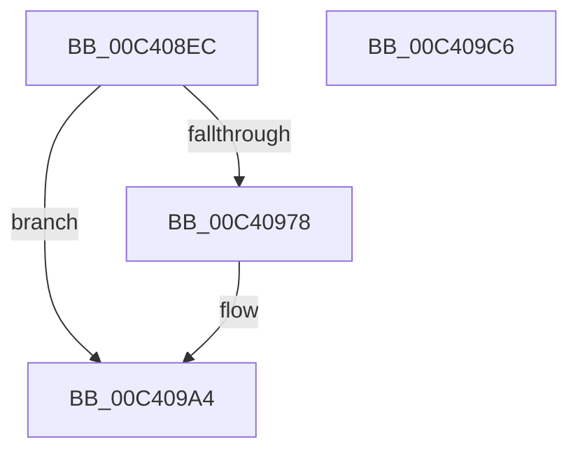

# PopInitializeSystemIdleDetection

- RVA: `0x00C408EC`–`0x00C409C7` (길이 `219` bytes)
- VA: `0x0000000140C408EC`
- 실행 섹션: `INIT`
- PDB 이름 있음: `예`; PDB Function 태그: `아니요`
- unwind 정보 RVA: `0x0005D2F4`
- 디코드: `37`개 명령, `219/219` bytes 표시
- 미해석 바이트: `0` (있으면 어셈블리에 `.byte`로 보존)

> 이 문서는 커널 이미지의 기계어와 PDB 기호를 분석해 생성했습니다. 4번과 5번은 함수 원형과 자료형을 바이너리 사용 방식에서 추정한 C 해석이며 원본 소스 복구 결과는 아닙니다.

## 1. Dependencies

- 직접 호출 지점: **4**; 고유 호출 대상: **4**
- 직접 호출자로 확인된 함수: **1**
- RIP 상대 이미지 참조: **19**

### Outgoing calls
- `0x00C408F7` → [PopAcquireRwLockExclusive](../../text/43/PopAcquireRwLockExclusive_function_00430B44.md) (function, `0x00430B44`)
- `0x00C40901` → [PopPulseSystemIdleEvent](../../page/A3/PopPulseSystemIdleEvent_function_00A31B8C.md) (function, `0x00A31B8C`)
- `0x00C4099F` → [KeSetCoalescableTimer](../../text/22/KeSetCoalescableTimer_function_0022FFD0.md) (function, `0x0022FFD0`)
- `0x00C409BC` → [PopReleaseRwLock](../../text/2D/PopReleaseRwLock_function_002DFBBC.md) (function, `0x002DFBBC`)

### Direct callers
- [PoInitSystem](../C7/PoInitSystem_function_00C72358.md) at `0x00C73155`

### Static image references
- `0x00C408F0` → RVA `0x00F093E0` (`.data`; read)
- `0x00C40906` → RVA `0x00E0B558` (`.data`; read)
- `0x00C4090D` → RVA `0x00482530` (`PopCheckForIdleness`; read)
- `0x00C40916` → RVA `0x00F093B8` (`.data`; write)
- `0x00C4091D` → RVA `0x00F09340` (`.data`; write)
- `0x00C40924` → RVA `0x00F09348` (`.data`; read)
- `0x00C4092B` → RVA `0x00F09350` (`.data`; write)
- `0x00C40932` → RVA `0x00F09348` (`.data`; write)
- `0x00C40939` → RVA `0x00F093A0` (`.data`; write)
- `0x00C40943` → RVA `0x00F093C0` (`.data`; write)
- `0x00C4094A` → RVA `0x00F093D8` (`.data`; write)
- `0x00C40951` → RVA `0x00F093B0` (`.data`; write)
- `0x00C4095F` → RVA `0x00F09358` (`.data`; write)
- `0x00C40966` → RVA `0x00F0937C` (`.data`; write)
- `0x00C4096C` → RVA `0x00F09378` (`.data`; write)
- `0x00C40986` → RVA `0x00F093A0` (`.data`; read)
- `0x00C40993` → RVA `0x00F09340` (`.data`; read)
- `0x00C409AB` → RVA `0x00E0B6B4` (`.data`; write)
- `0x00C409B5` → RVA `0x00E0B6B0` (`.data`; write)

## 2. Other-region calls and transfers

- 다른 실행 섹션으로 향하는 call: **4**
  - `0x00C408F7` → [PopAcquireRwLockExclusive](../../text/43/PopAcquireRwLockExclusive_function_00430B44.md) (`INIT` → `.text`)
  - `0x00C40901` → [PopPulseSystemIdleEvent](../../page/A3/PopPulseSystemIdleEvent_function_00A31B8C.md) (`INIT` → `PAGE`)
  - `0x00C4099F` → [KeSetCoalescableTimer](../../text/22/KeSetCoalescableTimer_function_0022FFD0.md) (`INIT` → `.text`)
  - `0x00C409BC` → [PopReleaseRwLock](../../text/2D/PopReleaseRwLock_function_002DFBBC.md) (`INIT` → `.text`)
- 별도 외부 분기/꼬리 이동을 확인하지 못했습니다.

## 3. Assembly (complete function range)

```asm
00C408EC  48 83 EC 38                     sub rsp, 0x38
00C408F0  48 8D 0D E9 8A 2C 00            lea rcx, [rip + 0x2c8ae9]
00C408F7  E8 48 02 7F FF                  call 0x140430b44
00C408FC  B9 01 00 00 00                  mov ecx, 1
00C40901  E8 86 12 DF FF                  call 0x140a31b8c
00C40906  44 8B 05 4B AC 1C 00            mov r8d, dword ptr [rip + 0x1cac4b]
00C4090D  48 8D 05 1C 1C 84 FF            lea rax, [rip - 0x7be3e4]
00C40914  33 C9                           xor ecx, ecx
00C40916  48 89 05 9B 8A 2C 00            mov qword ptr [rip + 0x2c8a9b], rax
00C4091D  48 89 0D 1C 8A 2C 00            mov qword ptr [rip + 0x2c8a1c], rcx
00C40924  48 8D 05 1D 8A 2C 00            lea rax, [rip + 0x2c8a1d]
00C4092B  48 89 05 1E 8A 2C 00            mov qword ptr [rip + 0x2c8a1e], rax
00C40932  48 89 05 0F 8A 2C 00            mov qword ptr [rip + 0x2c8a0f], rax
00C40939  C7 05 5D 8A 2C 00 13 01 00 00   mov dword ptr [rip + 0x2c8a5d], 0x113
00C40943  48 89 0D 76 8A 2C 00            mov qword ptr [rip + 0x2c8a76], rcx
00C4094A  48 89 0D 87 8A 2C 00            mov qword ptr [rip + 0x2c8a87], rcx
00C40951  48 89 0D 58 8A 2C 00            mov qword ptr [rip + 0x2c8a58], rcx
00C40958  C6 05 E1 89 2C 00 08            mov byte ptr [rip + 0x2c89e1], 8
00C4095F  48 89 0D F2 89 2C 00            mov qword ptr [rip + 0x2c89f2], rcx
00C40966  89 0D 10 8A 2C 00               mov dword ptr [rip + 0x2c8a10], ecx
00C4096C  66 89 0D 05 8A 2C 00            mov word ptr [rip + 0x2c8a05], cx
00C40973  45 85 C0                        test r8d, r8d
00C40976  74 2C                           je 0x140c409a4
00C40978  49 69 D0 80 69 67 FF            imul rdx, r8, -0x989680
00C4097F  45 69 C0 E8 03 00 00            imul r8d, r8d, 0x3e8
00C40986  48 8D 05 13 8A 2C 00            lea rax, [rip + 0x2c8a13]
00C4098D  41 B9 E8 03 00 00               mov r9d, 0x3e8
00C40993  48 8D 0D A6 89 2C 00            lea rcx, [rip + 0x2c89a6]
00C4099A  48 89 44 24 20                  mov qword ptr [rsp + 0x20], rax
00C4099F  E8 2C F6 5E FF                  call 0x14022ffd0
00C409A4  48 8D 0D 35 8A 2C 00            lea rcx, [rip + 0x2c8a35]
00C409AB  C7 05 FF AC 1C 00 05 00 00 00   mov dword ptr [rip + 0x1cacff], 5
00C409B5  C6 05 F4 AC 1C 00 01            mov byte ptr [rip + 0x1cacf4], 1
00C409BC  E8 FB F1 69 FF                  call 0x1402dfbbc
00C409C1  48 83 C4 38                     add rsp, 0x38
00C409C5  C3                              ret
00C409C6  CC                              int3
```

## 4. C-style interpretation (structured pseudocode)

```c
__int64 __fastcall PopInitializeSystemIdleDetection(void)
{
    __int64 result;
    __int64 v_rsp;
    unsigned __int64 v_stack_m18;

    v_rsp = (v_rsp) - (56);
    result = PopAcquireRwLockExclusive(v_rip + 2919145, a2, a3, a4);
    result = PopPulseSystemIdleEvent(1, a2, a3, a4);
    a1 = 0;
    *(unsigned __int64 *)(v_rip + 2919067) = v_rip - 8119268;
    *(unsigned __int64 *)(v_rip + 2918940) = 0;
    *(unsigned __int64 *)(v_rip + 2918942) = v_rip + 2918941;
    *(unsigned __int64 *)(v_rip + 2918927) = v_rip + 2918941;
    *(unsigned int *)(v_rip + 2919005) = 275;
    *(unsigned __int64 *)(v_rip + 2919030) = 0;
    *(unsigned __int64 *)(v_rip + 2919047) = 0;
    *(unsigned __int64 *)(v_rip + 2919000) = 0;
    *(unsigned __int8 *)(v_rip + 2918881) = 8;
    *(unsigned __int64 *)(v_rip + 2918898) = 0;
    *(unsigned int *)(v_rip + 2918928) = 0;
    *(unsigned __int16 *)(v_rip + 2918917) = 0;
    result = v_rip + 2918941;
    if ((unsigned int)((unsigned int)(*(unsigned int *)(v_rip + 1879115))) != 0) {
        a2 = (a2) * ((unsigned int)(*(unsigned int *)(v_rip + 1879115)));
        a3 = (unsigned int)(((unsigned int)(*(unsigned int *)(v_rip + 1879115))) * ((unsigned int)((unsigned int)(*(unsigned int *)(v_rip + 1879115)))));
        result = v_rip + 2918931;
        a4 = 1000;
        a1 = v_rip + 2918822;
        v_stack_m18 = result;
        result = KeSetCoalescableTimer(a1, a2, a3, a4);
    }
    *(unsigned int *)(v_rip + 1879295) = 5;
    *(unsigned __int8 *)(v_rip + 1879284) = 1;
    result = PopReleaseRwLock(v_rip + 2918965, a2, a3, a4);
    v_rsp = (v_rsp) + (56);
    return result;
}
```

## 5. (Beta) C Style

```c
void PopInitializeSystemIdleDetection(void)
{
    int64_t result;
    int64_t local_rsp;
    uint64_t v_stack_m18;

    local_rsp = (local_rsp) - (56);
    result = PopAcquireRwLockExclusive(v_rip + 2919145, a2, a3, a4);
    result = PopPulseSystemIdleEvent(1, a2, a3, a4);
    a1 = 0;
    *(uint64_t *)(v_rip + 0x2C8A9B) = v_rip - 8119268;
    *(uint64_t *)(v_rip + 0x2C8A1C) = 0;
    *(uint64_t *)(v_rip + 0x2C8A1E) = v_rip + 2918941;
    *(uint64_t *)(v_rip + 0x2C8A0F) = v_rip + 2918941;
    *(uint32_t *)(v_rip + 0x2C8A5D) = 275;
    *(uint64_t *)(v_rip + 0x2C8A76) = 0;
    *(uint64_t *)(v_rip + 0x2C8A87) = 0;
    *(uint64_t *)(v_rip + 0x2C8A58) = 0;
    *(uint8_t *)(v_rip + 0x2C89E1) = 8;
    *(uint64_t *)(v_rip + 0x2C89F2) = 0;
    *(uint32_t *)(v_rip + 0x2C8A10) = 0;
    *(uint16_t *)(v_rip + 0x2C8A05) = 0;
    result = v_rip + 2918941;
    if ((uint32_t)((uint32_t)(*(uint32_t *)(v_rip + 0x1CAC4B))) != 0) {
        a2 = (a2) * ((uint32_t)(*(uint32_t *)(v_rip + 0x1CAC4B)));
        a3 = (uint32_t)(((uint32_t)(*(uint32_t *)(v_rip + 0x1CAC4B))) * ((uint32_t)((uint32_t)(*(uint32_t *)(v_rip + 0x1CAC4B)))));
        result = v_rip + 2918931;
        a4 = 1000;
        a1 = v_rip + 2918822;
        v_stack_m18 = result;
        result = KeSetCoalescableTimer(a1, a2, a3, a4);
    }
    *(uint32_t *)(v_rip + 0x1CACFF) = 5;
    *(uint8_t *)(v_rip + 0x1CACF4) = 1;
    result = PopReleaseRwLock(v_rip + 2918965, a2, a3, a4);
    local_rsp = (local_rsp) + (56);
    return result;
}
```

## 6. Execution-region graph

[열기: 2D/3D 그래프와 함수 탐색 컨트롤 패널](../../../control-panel.html?section=init&rva=0x00C408EC&view=graph)

- 2D 그래프는 위에서 아래로 흐르고, 3D 그래프는 빈 공간을 드래그해 회전합니다. Shift+드래그는 이동, 휠은 확대·축소, 함수 노드 선택은 대상 보고서 이동입니다.

### Static fallback


