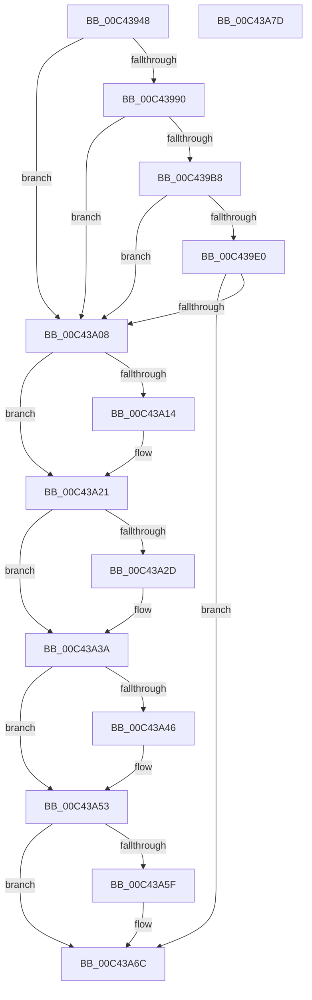

# PopModernStandbyNotificationInit

- RVA: `0x00C43948`–`0x00C43A7E` (길이 `310` bytes)
- VA: `0x0000000140C43948`
- 실행 섹션: `INIT`
- PDB 이름 있음: `예`; PDB Function 태그: `아니요`
- unwind 정보 RVA: `0x0005D2F4`
- 디코드: `66`개 명령, `310/310` bytes 표시
- 미해석 바이트: `0` (있으면 어셈블리에 `.byte`로 보존)

> 이 문서는 커널 이미지의 기계어와 PDB 기호를 분석해 생성했습니다. 4번과 5번은 함수 원형과 자료형을 바이너리 사용 방식에서 추정한 C 해석이며 원본 소스 복구 결과는 아닙니다.

## 1. Dependencies

- 직접 호출 지점: **10**; 고유 호출 대상: **4**
- 직접 호출자로 확인된 함수: **1**
- RIP 상대 이미지 참조: **16**

### Outgoing calls
- `0x00C43963` → [PopAcquireRwLockExclusive](../../text/43/PopAcquireRwLockExclusive_function_00430B44.md) (function, `0x00430B44`)
- `0x00C43987` → [PoRegisterPowerSettingCallback](../../page/A8/PoRegisterPowerSettingCallback_function_00A82150.md) (function, `0x00A82150`)
- `0x00C439AF` → [PoRegisterPowerSettingCallback](../../page/A8/PoRegisterPowerSettingCallback_function_00A82150.md) (function, `0x00A82150`)
- `0x00C439D7` → [PoRegisterPowerSettingCallback](../../page/A8/PoRegisterPowerSettingCallback_function_00A82150.md) (function, `0x00A82150`)
- `0x00C439FF` → [PoRegisterPowerSettingCallback](../../page/A8/PoRegisterPowerSettingCallback_function_00A82150.md) (function, `0x00A82150`)
- `0x00C43A14` → [PoUnregisterPowerSettingCallback](../../page/A8/PoUnregisterPowerSettingCallback_function_00A8E940.md) (function, `0x00A8E940`)
- `0x00C43A2D` → [PoUnregisterPowerSettingCallback](../../page/A8/PoUnregisterPowerSettingCallback_function_00A8E940.md) (function, `0x00A8E940`)
- `0x00C43A46` → [PoUnregisterPowerSettingCallback](../../page/A8/PoUnregisterPowerSettingCallback_function_00A8E940.md) (function, `0x00A8E940`)
- `0x00C43A5F` → [PoUnregisterPowerSettingCallback](../../page/A8/PoUnregisterPowerSettingCallback_function_00A8E940.md) (function, `0x00A8E940`)
- `0x00C43A73` → [PopReleaseRwLock](../../text/2D/PopReleaseRwLock_function_002DFBBC.md) (function, `0x002DFBBC`)

### Direct callers
- [PoInitSystem](../C7/PoInitSystem_function_00C72358.md) at `0x00C72F03`

### Static image references
- `0x00C4394C` → RVA `0x00F08368` (`.data`; read/write)
- `0x00C43954` → RVA `0x00F08360` (`.data`; read)
- `0x00C4395B` → RVA `0x00F08360` (`.data`; read/write)
- `0x00C43968` → RVA `0x00F08380` (`.data`; read)
- `0x00C43972` → RVA `0x0076AE00` (`PopModernStandbyNotificationCallback`; read)
- `0x00C4397E` → RVA `0x0001ED50` (`.rdata`; read)
- `0x00C43990` → RVA `0x00F08388` (`.data`; read)
- `0x00C439A6` → RVA `0x0001C130` (`.rdata`; read)
- `0x00C439B8` → RVA `0x00F08390` (`.data`; read)
- `0x00C439CE` → RVA `0x0001C740` (`.rdata`; read)
- `0x00C439E0` → RVA `0x00F08398` (`.data`; read)
- `0x00C439F6` → RVA `0x0001A268` (`.rdata`; read)
- `0x00C43A19` → RVA `0x00F08398` (`.data`; read/write)
- `0x00C43A32` → RVA `0x00F08390` (`.data`; read/write)
- `0x00C43A4B` → RVA `0x00F08388` (`.data`; read/write)
- `0x00C43A64` → RVA `0x00F08380` (`.data`; read/write)

## 2. Other-region calls and transfers

- 다른 실행 섹션으로 향하는 call: **10**
  - `0x00C43963` → [PopAcquireRwLockExclusive](../../text/43/PopAcquireRwLockExclusive_function_00430B44.md) (`INIT` → `.text`)
  - `0x00C43987` → [PoRegisterPowerSettingCallback](../../page/A8/PoRegisterPowerSettingCallback_function_00A82150.md) (`INIT` → `PAGE`)
  - `0x00C439AF` → [PoRegisterPowerSettingCallback](../../page/A8/PoRegisterPowerSettingCallback_function_00A82150.md) (`INIT` → `PAGE`)
  - `0x00C439D7` → [PoRegisterPowerSettingCallback](../../page/A8/PoRegisterPowerSettingCallback_function_00A82150.md) (`INIT` → `PAGE`)
  - `0x00C439FF` → [PoRegisterPowerSettingCallback](../../page/A8/PoRegisterPowerSettingCallback_function_00A82150.md) (`INIT` → `PAGE`)
  - `0x00C43A14` → [PoUnregisterPowerSettingCallback](../../page/A8/PoUnregisterPowerSettingCallback_function_00A8E940.md) (`INIT` → `PAGE`)
  - `0x00C43A2D` → [PoUnregisterPowerSettingCallback](../../page/A8/PoUnregisterPowerSettingCallback_function_00A8E940.md) (`INIT` → `PAGE`)
  - `0x00C43A46` → [PoUnregisterPowerSettingCallback](../../page/A8/PoUnregisterPowerSettingCallback_function_00A8E940.md) (`INIT` → `PAGE`)
  - `0x00C43A5F` → [PoUnregisterPowerSettingCallback](../../page/A8/PoUnregisterPowerSettingCallback_function_00A8E940.md) (`INIT` → `PAGE`)
  - `0x00C43A73` → [PopReleaseRwLock](../../text/2D/PopReleaseRwLock_function_002DFBBC.md) (`INIT` → `.text`)
- 별도 외부 분기/꼬리 이동을 확인하지 못했습니다.

## 3. Assembly (complete function range)

```asm
00C43948  48 83 EC 38                     sub rsp, 0x38
00C4394C  48 83 25 14 4A 2C 00 00         and qword ptr [rip + 0x2c4a14], 0
00C43954  48 8D 0D 05 4A 2C 00            lea rcx, [rip + 0x2c4a05]
00C4395B  48 83 25 FD 49 2C 00 00         and qword ptr [rip + 0x2c49fd], 0
00C43963  E8 DC D1 7E FF                  call 0x140430b44
00C43968  48 8D 05 11 4A 2C 00            lea rax, [rip + 0x2c4a11]
00C4396F  45 33 C9                        xor r9d, r9d
00C43972  4C 8D 05 87 74 B2 FF            lea r8, [rip - 0x4d8b79]
00C43979  48 89 44 24 20                  mov qword ptr [rsp + 0x20], rax
00C4397E  48 8D 15 CB B3 3D FF            lea rdx, [rip - 0xc24c35]
00C43985  33 C9                           xor ecx, ecx
00C43987  E8 C4 E7 E3 FF                  call 0x140a82150
00C4398C  85 C0                           test eax, eax
00C4398E  78 78                           js 0x140c43a08
00C43990  48 8D 05 F1 49 2C 00            lea rax, [rip + 0x2c49f1]
00C43997  45 33 C9                        xor r9d, r9d
00C4399A  4C 8D 05 5F 74 B2 FF            lea r8, [rip - 0x4d8ba1]
00C439A1  48 89 44 24 20                  mov qword ptr [rsp + 0x20], rax
00C439A6  48 8D 15 83 87 3D FF            lea rdx, [rip - 0xc2787d]
00C439AD  33 C9                           xor ecx, ecx
00C439AF  E8 9C E7 E3 FF                  call 0x140a82150
00C439B4  85 C0                           test eax, eax
00C439B6  78 50                           js 0x140c43a08
00C439B8  48 8D 05 D1 49 2C 00            lea rax, [rip + 0x2c49d1]
00C439BF  45 33 C9                        xor r9d, r9d
00C439C2  4C 8D 05 37 74 B2 FF            lea r8, [rip - 0x4d8bc9]
00C439C9  48 89 44 24 20                  mov qword ptr [rsp + 0x20], rax
00C439CE  48 8D 15 6B 8D 3D FF            lea rdx, [rip - 0xc27295]
00C439D5  33 C9                           xor ecx, ecx
00C439D7  E8 74 E7 E3 FF                  call 0x140a82150
00C439DC  85 C0                           test eax, eax
00C439DE  78 28                           js 0x140c43a08
00C439E0  48 8D 05 B1 49 2C 00            lea rax, [rip + 0x2c49b1]
00C439E7  45 33 C9                        xor r9d, r9d
00C439EA  4C 8D 05 0F 74 B2 FF            lea r8, [rip - 0x4d8bf1]
00C439F1  48 89 44 24 20                  mov qword ptr [rsp + 0x20], rax
00C439F6  48 8D 15 6B 68 3D FF            lea rdx, [rip - 0xc29795]
00C439FD  33 C9                           xor ecx, ecx
00C439FF  E8 4C E7 E3 FF                  call 0x140a82150
00C43A04  85 C0                           test eax, eax
00C43A06  79 64                           jns 0x140c43a6c
00C43A08  48 8B 0D 89 49 2C 00            mov rcx, qword ptr [rip + 0x2c4989]
00C43A0F  48 85 C9                        test rcx, rcx
00C43A12  74 0D                           je 0x140c43a21
00C43A14  E8 27 AF E4 FF                  call 0x140a8e940
00C43A19  48 83 25 77 49 2C 00 00         and qword ptr [rip + 0x2c4977], 0
00C43A21  48 8B 0D 68 49 2C 00            mov rcx, qword ptr [rip + 0x2c4968]
00C43A28  48 85 C9                        test rcx, rcx
00C43A2B  74 0D                           je 0x140c43a3a
00C43A2D  E8 0E AF E4 FF                  call 0x140a8e940
00C43A32  48 83 25 56 49 2C 00 00         and qword ptr [rip + 0x2c4956], 0
00C43A3A  48 8B 0D 47 49 2C 00            mov rcx, qword ptr [rip + 0x2c4947]
00C43A41  48 85 C9                        test rcx, rcx
00C43A44  74 0D                           je 0x140c43a53
00C43A46  E8 F5 AE E4 FF                  call 0x140a8e940
00C43A4B  48 83 25 35 49 2C 00 00         and qword ptr [rip + 0x2c4935], 0
00C43A53  48 8B 0D 26 49 2C 00            mov rcx, qword ptr [rip + 0x2c4926]
00C43A5A  48 85 C9                        test rcx, rcx
00C43A5D  74 0D                           je 0x140c43a6c
00C43A5F  E8 DC AE E4 FF                  call 0x140a8e940
00C43A64  48 83 25 14 49 2C 00 00         and qword ptr [rip + 0x2c4914], 0
00C43A6C  48 8D 0D ED 48 2C 00            lea rcx, [rip + 0x2c48ed]
00C43A73  E8 44 C1 69 FF                  call 0x1402dfbbc
00C43A78  48 83 C4 38                     add rsp, 0x38
00C43A7C  C3                              ret
00C43A7D  CC                              int3
```

## 4. C-style interpretation (structured pseudocode)

```c
__int64 __fastcall PopModernStandbyNotificationInit(__int64 a1, __int64 a2, __int64 a3, int a4)
{
    __int64 result;
    __int64 v_rsp;
    unsigned __int64 v_stack_m18;

    v_rsp = (v_rsp) - (56);
    result = PopAcquireRwLockExclusive(v_rip + 2902533, a2, a3, a4);
    a4 = 0;
    v_stack_m18 = v_rip + 2902545;
    a1 = 0;
    result = PoRegisterPowerSettingCallback(a1, v_rip - 12733493, v_rip - 5081977, a4);
    if (sign_flag) goto loc_00C43A08;
    a4 = 0;
    v_stack_m18 = v_rip + 2902513;
    a1 = 0;
    result = PoRegisterPowerSettingCallback(a1, v_rip - 12744829, v_rip - 5082017, a4);
    if (sign_flag) goto loc_00C43A08;
    a4 = 0;
    v_stack_m18 = v_rip + 2902481;
    a1 = 0;
    result = PoRegisterPowerSettingCallback(a1, v_rip - 12743317, v_rip - 5082057, a4);
    if (sign_flag) goto loc_00C43A08;
    a4 = 0;
    v_stack_m18 = v_rip + 2902449;
    a1 = 0;
    result = PoRegisterPowerSettingCallback(a1, v_rip - 12752789, v_rip - 5082097, a4);
    if (!sign_flag) goto loc_00C43A6C;
loc_00C43A08:
    if (*(unsigned __int64 *)(v_rip + 2902409) != 0) {
        result = PoUnregisterPowerSettingCallback(*(unsigned __int64 *)(v_rip + 2902409), v_rip - 12752789, v_rip - 5082097, a4);
    }
    if (*(unsigned __int64 *)(v_rip + 2902376) != 0) {
        result = PoUnregisterPowerSettingCallback(*(unsigned __int64 *)(v_rip + 2902376), v_rip - 12752789, v_rip - 5082097, a4);
    }
    if (*(unsigned __int64 *)(v_rip + 2902343) != 0) {
        result = PoUnregisterPowerSettingCallback(*(unsigned __int64 *)(v_rip + 2902343), v_rip - 12752789, v_rip - 5082097, a4);
    }
    if (*(unsigned __int64 *)(v_rip + 2902310) != 0) {
        result = PoUnregisterPowerSettingCallback(*(unsigned __int64 *)(v_rip + 2902310), v_rip - 12752789, v_rip - 5082097, a4);
    }
    result = PopReleaseRwLock(v_rip + 2902253, v_rip - 12752789, v_rip - 5082097, a4);
    v_rsp = (v_rsp) + (56);
    return result;
}
```

## 5. (Beta) C Style

```c
int64_t PopModernStandbyNotificationInit(int64_t Arg1, int64_t Arg2, int64_t Arg3, int32_t Arg4)
{
    int64_t result;
    int64_t local_rsp;
    uint64_t v_stack_m18;

    local_rsp = (local_rsp) - (56);
    result = PopAcquireRwLockExclusive(v_rip + 2902533, Arg2, Arg3, Arg4);
    Arg4 = 0;
    v_stack_m18 = v_rip + 2902545;
    Arg1 = 0;
    result = PoRegisterPowerSettingCallback(Arg1, v_rip - 12733493, v_rip - 5081977, Arg4);
    if (sign_flag) goto loc_00C43A08;
    Arg4 = 0;
    v_stack_m18 = v_rip + 2902513;
    Arg1 = 0;
    result = PoRegisterPowerSettingCallback(Arg1, v_rip - 12744829, v_rip - 5082017, Arg4);
    if (sign_flag) goto loc_00C43A08;
    Arg4 = 0;
    v_stack_m18 = v_rip + 2902481;
    Arg1 = 0;
    result = PoRegisterPowerSettingCallback(Arg1, v_rip - 12743317, v_rip - 5082057, Arg4);
    if (sign_flag) goto loc_00C43A08;
    Arg4 = 0;
    v_stack_m18 = v_rip + 2902449;
    Arg1 = 0;
    result = PoRegisterPowerSettingCallback(Arg1, v_rip - 12752789, v_rip - 5082097, Arg4);
    if (!sign_flag) goto loc_00C43A6C;
loc_00C43A08:
    if (*(uint64_t *)(v_rip + 0x2C4989) != 0) {
        result = PoUnregisterPowerSettingCallback(*(uint64_t *)(v_rip + 0x2C4989), v_rip - 12752789, v_rip - 5082097, Arg4);
    }
    if (*(uint64_t *)(v_rip + 0x2C4968) != 0) {
        result = PoUnregisterPowerSettingCallback(*(uint64_t *)(v_rip + 0x2C4968), v_rip - 12752789, v_rip - 5082097, Arg4);
    }
    if (*(uint64_t *)(v_rip + 0x2C4947) != 0) {
        result = PoUnregisterPowerSettingCallback(*(uint64_t *)(v_rip + 0x2C4947), v_rip - 12752789, v_rip - 5082097, Arg4);
    }
    if (*(uint64_t *)(v_rip + 0x2C4926) != 0) {
        result = PoUnregisterPowerSettingCallback(*(uint64_t *)(v_rip + 0x2C4926), v_rip - 12752789, v_rip - 5082097, Arg4);
    }
    result = PopReleaseRwLock(v_rip + 2902253, v_rip - 12752789, v_rip - 5082097, Arg4);
    local_rsp = (local_rsp) + (56);
    return result;
}
```

## 6. Execution-region graph

[열기: 2D/3D 그래프와 함수 탐색 컨트롤 패널](../../../control-panel.html?section=init&rva=0x00C43948&view=graph)

- 2D 그래프는 위에서 아래로 흐르고, 3D 그래프는 빈 공간을 드래그해 회전합니다. Shift+드래그는 이동, 휠은 확대·축소, 함수 노드 선택은 대상 보고서 이동입니다.

### Static fallback


