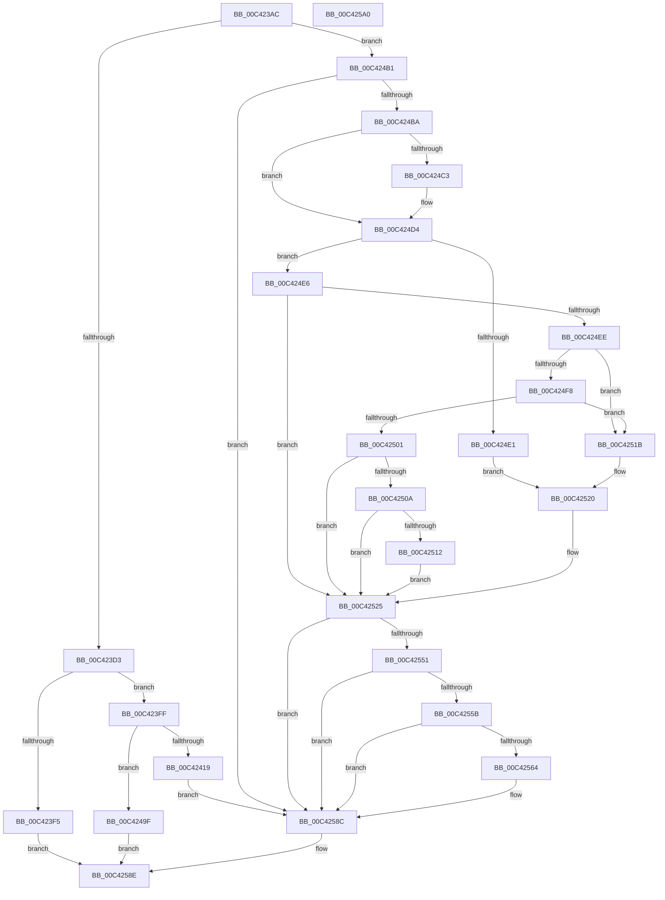

# PopNetInitialize

- RVA: `0x00C423AC`–`0x00C425A1` (길이 `501` bytes)
- VA: `0x0000000140C423AC`
- 실행 섹션: `INIT`
- PDB 이름 있음: `예`; PDB Function 태그: `아니요`
- unwind 정보 RVA: `0x000CD03C`
- 디코드: `112`개 명령, `501/501` bytes 표시
- 미해석 바이트: `0` (있으면 어셈블리에 `.byte`로 보존)

> 이 문서는 커널 이미지의 기계어와 PDB 기호를 분석해 생성했습니다. 4번과 5번은 함수 원형과 자료형을 바이너리 사용 방식에서 추정한 C 해석이며 원본 소스 복구 결과는 아닙니다.

## 1. Dependencies

- 직접 호출 지점: **11**; 고유 호출 대상: **10**
- 직접 호출자로 확인된 함수: **1**
- RIP 상대 이미지 참조: **18**

### Outgoing calls
- `0x00C423D6` → [RtlLengthRequiredSid](../../page/9C/RtlLengthRequiredSid_function_009CA4D0.md) (function, `0x009CA4D0`)
- `0x00C423E8` → [ExAllocatePool2](../../poolcode/B8/ExAllocatePool2_function_00B820F0.md) (function, `0x00B820F0`)
- `0x00C4240A` → [RtlInitializeSid](../../page/9E/RtlInitializeSid_function_009EB720.md) (function, `0x009EB720`)
- `0x00C4246B` → [PopInitializeIRTimer](../../text/5C/PopInitializeIRTimer_function_005CE5D0.md) (function, `0x005CE5D0`)
- `0x00C42495` → [PopInitializeIRTimer](../../text/5C/PopInitializeIRTimer_function_005CE5D0.md) (function, `0x005CE5D0`)
- `0x00C424A7` → [ExFreePoolWithTag](../../poolcode/B8/ExFreePoolWithTag_function_00B82870.md) (function, `0x00B82870`)
- `0x00C424CF` → [PopTraceStandbyConnectivityUpdate](../../page/AD/PopTraceStandbyConnectivityUpdate_function_00AD901C.md) (function, `0x00AD901C`)
- `0x00C42514` → [PopNetPublishWnfStateUpdate](../../page/AA/PopNetPublishWnfStateUpdate_function_00AAF544.md) (function, `0x00AAF544`)
- `0x00C42520` → [PopNetSetConnectivityConstraint](../../page/76/PopNetSetConnectivityConstraint_function_00768E90.md) (function, `0x00768E90`)
- `0x00C42544` → [ZwUpdateWnfStateData](../../text/6B/ZwUpdateWnfStateData_function_006B0D10.md) (function, `0x006B0D10`)
- `0x00C42587` → [ExSubscribeWnfStateChange](../../page/9D/ExSubscribeWnfStateChange_function_009D4BC0.md) (function, `0x009D4BC0`)

### Direct callers
- [PoInitSystem](../C7/PoInitSystem_function_00C72358.md) at `0x00C72C22`
- [PoInitSystem](../C7/PoInitSystem_function_00C72358.md) at `0x00C73141`

### Static image references
- `0x00C42420` → RVA `0x004BE0B0` (`PopNetEvaluationWorkerCallback`; read)
- `0x00C4242E` → RVA `0x004C4D20` (`PopNetEvaluationTimerCallback`; read)
- `0x00C4243C` → RVA `0x00F087C0` (`.data`; read)
- `0x00C42460` → RVA `0x00F08880` (`.data`; write)
- `0x00C42470` → RVA `0x00768D10` (`PopNetRefreshTimerWorkerCallback`; read)
- `0x00C4247F` → RVA `0x005D99D0` (`PopNetRefreshTimerCallback`; read)
- `0x00C4248E` → RVA `0x00F08700` (`.data`; read)
- `0x00C424BA` → RVA `0x00F08870` (`.data`; read)
- `0x00C424C3` → RVA `0x00E678E0` (`.data`; read)
- `0x00C424C9` → RVA `0x00E678DC` (`.data`; read)
- `0x00C424D4` → RVA `0x00FC5280` (`ALMOSTRO`; read)
- `0x00C424E6` → RVA `0x00F08878` (`.data`; read)
- `0x00C424EE` → RVA `0x00E673A0` (`.data`; read)
- `0x00C424F8` → RVA `0x00E6739C` (`.data`; read)
- `0x00C42501` → RVA `0x00F0887D` (`.data`; read)
- `0x00C42532` → RVA `0x000209F8` (`.rdata`; read)
- `0x00C42564` → RVA `0x00A49FB0` (`PopNetWnfLowPowerEpochCallback`; read)
- `0x00C4257B` → RVA `0x00020BB0` (`.rdata`; read)

## 2. Other-region calls and transfers

- 다른 실행 섹션으로 향하는 call: **11**
  - `0x00C423D6` → [RtlLengthRequiredSid](../../page/9C/RtlLengthRequiredSid_function_009CA4D0.md) (`INIT` → `PAGE`)
  - `0x00C423E8` → [ExAllocatePool2](../../poolcode/B8/ExAllocatePool2_function_00B820F0.md) (`INIT` → `POOLCODE`)
  - `0x00C4240A` → [RtlInitializeSid](../../page/9E/RtlInitializeSid_function_009EB720.md) (`INIT` → `PAGE`)
  - `0x00C4246B` → [PopInitializeIRTimer](../../text/5C/PopInitializeIRTimer_function_005CE5D0.md) (`INIT` → `.text`)
  - `0x00C42495` → [PopInitializeIRTimer](../../text/5C/PopInitializeIRTimer_function_005CE5D0.md) (`INIT` → `.text`)
  - `0x00C424A7` → [ExFreePoolWithTag](../../poolcode/B8/ExFreePoolWithTag_function_00B82870.md) (`INIT` → `POOLCODE`)
  - `0x00C424CF` → [PopTraceStandbyConnectivityUpdate](../../page/AD/PopTraceStandbyConnectivityUpdate_function_00AD901C.md) (`INIT` → `PAGE`)
  - `0x00C42514` → [PopNetPublishWnfStateUpdate](../../page/AA/PopNetPublishWnfStateUpdate_function_00AAF544.md) (`INIT` → `PAGE`)
  - `0x00C42520` → [PopNetSetConnectivityConstraint](../../page/76/PopNetSetConnectivityConstraint_function_00768E90.md) (`INIT` → `PAGE`)
  - `0x00C42544` → [ZwUpdateWnfStateData](../../text/6B/ZwUpdateWnfStateData_function_006B0D10.md) (`INIT` → `.text`)
  - `0x00C42587` → [ExSubscribeWnfStateChange](../../page/9D/ExSubscribeWnfStateChange_function_009D4BC0.md) (`INIT` → `PAGE`)
- 별도 외부 분기/꼬리 이동을 확인하지 못했습니다.

## 3. Assembly (complete function range)

```asm
00C423AC  48 8B C4                        mov rax, rsp
00C423AF  48 89 58 18                     mov qword ptr [rax + 0x18], rbx
00C423B3  48 89 70 20                     mov qword ptr [rax + 0x20], rsi
00C423B7  57                              push rdi
00C423B8  48 83 EC 40                     sub rsp, 0x40
00C423BC  33 F6                           xor esi, esi
00C423BE  66 C7 40 14 00 05               mov word ptr [rax + 0x14], 0x500
00C423C4  89 70 10                        mov dword ptr [rax + 0x10], esi
00C423C7  40 88 70 08                     mov byte ptr [rax + 8], sil
00C423CB  85 C9                           test ecx, ecx
00C423CD  0F 85 DE 00 00 00               jne 0x140c424b1
00C423D3  8D 4E 06                        lea ecx, [rsi + 6]
00C423D6  E8 F5 80 D8 FF                  call 0x1409ca4d0
00C423DB  8B D0                           mov edx, eax
00C423DD  B9 00 01 00 00                  mov ecx, 0x100
00C423E2  41 B8 50 4E 65 74               mov r8d, 0x74654e50
00C423E8  E8 03 FD F3 FF                  call 0x140b820f0
00C423ED  48 8B D8                        mov rbx, rax
00C423F0  48 85 C0                        test rax, rax
00C423F3  75 0A                           jne 0x140c423ff
00C423F5  BF 17 00 00 C0                  mov edi, 0xc0000017
00C423FA  E9 8F 01 00 00                  jmp 0x140c4258e
00C423FF  41 B0 06                        mov r8b, 6
00C42402  48 8D 54 24 58                  lea rdx, [rsp + 0x58]
00C42407  48 8B CB                        mov rcx, rbx
00C4240A  E8 11 93 DA FF                  call 0x1409eb720
00C4240F  8B F8                           mov edi, eax
00C42411  85 C0                           test eax, eax
00C42413  0F 88 86 00 00 00               js 0x140c4249f
00C42419  C7 43 08 50 00 00 00            mov dword ptr [rbx + 8], 0x50
00C42420  4C 8D 0D 89 BC 87 FF            lea r9, [rip - 0x784377]
00C42427  C7 43 0C 03 ED 88 76            mov dword ptr [rbx + 0xc], 0x7688ed03
00C4242E  48 8D 15 EB 28 88 FF            lea rdx, [rip - 0x77d715]
00C42435  C7 43 10 E4 AD 83 72            mov dword ptr [rbx + 0x10], 0x7283ade4
00C4243C  48 8D 0D 7D 63 2C 00            lea rcx, [rip + 0x2c637d]
00C42443  C7 43 14 20 5A 8B 16            mov dword ptr [rbx + 0x14], 0x168b5a20
00C4244A  C7 43 18 05 F1 2D A1            mov dword ptr [rbx + 0x18], 0xa12df105
00C42451  C7 44 24 30 02 00 00 00         mov dword ptr [rsp + 0x30], 2
00C42459  C7 43 1C 48 4F 13 35            mov dword ptr [rbx + 0x1c], 0x35134f48
00C42460  48 89 1D 19 64 2C 00            mov qword ptr [rip + 0x2c6419], rbx
00C42467  89 74 24 28                     mov dword ptr [rsp + 0x28], esi
00C4246B  E8 60 C1 98 FF                  call 0x1405ce5d0
00C42470  4C 8D 0D 99 68 B2 FF            lea r9, [rip - 0x4d9767]
00C42477  C7 44 24 30 02 00 00 00         mov dword ptr [rsp + 0x30], 2
00C4247F  48 8D 15 4A 75 99 FF            lea rdx, [rip - 0x668ab6]
00C42486  C7 44 24 28 05 00 00 00         mov dword ptr [rsp + 0x28], 5
00C4248E  48 8D 0D 6B 62 2C 00            lea rcx, [rip + 0x2c626b]
00C42495  E8 36 C1 98 FF                  call 0x1405ce5d0
00C4249A  E9 ED 00 00 00                  jmp 0x140c4258c
00C4249F  BA 50 4E 65 74                  mov edx, 0x74654e50
00C424A4  48 8B CB                        mov rcx, rbx
00C424A7  E8 C4 03 F4 FF                  call 0x140b82870
00C424AC  E9 DD 00 00 00                  jmp 0x140c4258e
00C424B1  83 F9 03                        cmp ecx, 3
00C424B4  0F 85 D2 00 00 00               jne 0x140c4258c
00C424BA  40 38 35 AF 63 2C 00            cmp byte ptr [rip + 0x2c63af], sil
00C424C1  74 11                           je 0x140c424d4
00C424C3  8B 15 17 54 22 00               mov edx, dword ptr [rip + 0x225417]
00C424C9  8B 0D 0D 54 22 00               mov ecx, dword ptr [rip + 0x22540d]
00C424CF  E8 48 6B E9 FF                  call 0x140ad901c
00C424D4  39 35 A6 2D 38 00               cmp dword ptr [rip + 0x382da6], esi
00C424DA  BB 01 00 00 00                  mov ebx, 1
00C424DF  74 05                           je 0x140c424e6
00C424E1  8D 4B 01                        lea ecx, [rbx + 1]
00C424E4  EB 3A                           jmp 0x140c42520
00C424E6  39 35 8C 63 2C 00               cmp dword ptr [rip + 0x2c638c], esi
00C424EC  75 37                           jne 0x140c42525
00C424EE  8B 05 AC 4E 22 00               mov eax, dword ptr [rip + 0x224eac]
00C424F4  85 C0                           test eax, eax
00C424F6  74 23                           je 0x140c4251b
00C424F8  40 38 35 9D 4E 22 00            cmp byte ptr [rip + 0x224e9d], sil
00C424FF  74 1A                           je 0x140c4251b
00C42501  40 38 35 75 63 2C 00            cmp byte ptr [rip + 0x2c6375], sil
00C42508  75 1B                           jne 0x140c42525
00C4250A  39 35 CC 53 22 00               cmp dword ptr [rip + 0x2253cc], esi
00C42510  75 13                           jne 0x140c42525
00C42512  8A CB                           mov cl, bl
00C42514  E8 2B D0 E6 FF                  call 0x140aaf544
00C42519  EB 0A                           jmp 0x140c42525
00C4251B  B9 06 00 00 00                  mov ecx, 6
00C42520  E8 6B 69 B2 FF                  call 0x140768e90
00C42525  89 74 24 30                     mov dword ptr [rsp + 0x30], esi
00C42529  48 8D 54 24 50                  lea rdx, [rsp + 0x50]
00C4252E  89 74 24 28                     mov dword ptr [rsp + 0x28], esi
00C42532  48 8D 0D BF E4 3D FF            lea rcx, [rip - 0xc21b41]
00C42539  45 33 C9                        xor r9d, r9d
00C4253C  48 89 74 24 20                  mov qword ptr [rsp + 0x20], rsi
00C42541  44 8B C3                        mov r8d, ebx
00C42544  E8 C7 E7 A6 FF                  call 0x1406b0d10
00C42549  39 35 31 2D 38 00               cmp dword ptr [rip + 0x382d31], esi
00C4254F  75 3B                           jne 0x140c4258c
00C42551  8B 05 49 4E 22 00               mov eax, dword ptr [rip + 0x224e49]
00C42557  85 C0                           test eax, eax
00C42559  74 31                           je 0x140c4258c
00C4255B  40 38 35 3A 4E 22 00            cmp byte ptr [rip + 0x224e3a], sil
00C42562  74 28                           je 0x140c4258c
00C42564  48 8D 05 45 7A E0 FF            lea rax, [rip - 0x1f85bb]
00C4256B  48 89 74 24 28                  mov qword ptr [rsp + 0x28], rsi
00C42570  45 33 C9                        xor r9d, r9d
00C42573  48 89 44 24 20                  mov qword ptr [rsp + 0x20], rax
00C42578  44 8B C3                        mov r8d, ebx
00C4257B  48 8D 15 2E E6 3D FF            lea rdx, [rip - 0xc219d2]
00C42582  48 8D 4C 24 58                  lea rcx, [rsp + 0x58]
00C42587  E8 34 26 D9 FF                  call 0x1409d4bc0
00C4258C  8B FE                           mov edi, esi
00C4258E  48 8B 5C 24 60                  mov rbx, qword ptr [rsp + 0x60]
00C42593  8B C7                           mov eax, edi
00C42595  48 8B 74 24 68                  mov rsi, qword ptr [rsp + 0x68]
00C4259A  48 83 C4 40                     add rsp, 0x40
00C4259E  5F                              pop rdi
00C4259F  C3                              ret
00C425A0  CC                              int3
```

## 4. C-style interpretation (structured pseudocode)

```c
__int64 __fastcall PopNetInitialize(int a1)
{
    __int64 result;
    __int64 v_rsi;
    __int64 v_rsp;
    unsigned int v_stack_m18;
    unsigned int v_stack_m20;
    unsigned __int64 v_stack_m28;
    unsigned __int64 v_stack_p10;
    unsigned __int64 v_stack_p18;
    unsigned __int64 v_stack_p20;
    unsigned __int64 v_stack_p8;

    *(unsigned __int64 *)(v_rsp + 24) = v_rbx;
    *(unsigned __int64 *)(v_rsp + 32) = v_rsi;
    v_rsp = (v_rsp) - (64);
    v_rsi = 0;
    *(unsigned __int16 *)(v_rsp + 20) = 0x500ULL;
    *(unsigned int *)(v_rsp + 16) = 0;
    *(unsigned __int8 *)(v_rsp + 8) = 0;
    if (a1 != 0) goto loc_00C424B1;
    result = RtlLengthRequiredSid(v_rsi + 6, a2, a3, a4);
    result = ExAllocatePool2(256, (unsigned int)((unsigned int)(result)), (unsigned int)(0x74654E50ULL), a4);
    if (result != 0) goto loc_00C423FF;
    goto loc_00C4258E;
loc_00C423FF:
    result = RtlInitializeSid(result, v_stack_p10, 6, a4);
    if (sign_flag) goto loc_00C4249F;
    *(unsigned int *)(result + 8) = 80;
    *(unsigned int *)(result + 12) = 0x7688ED03ULL;
    *(unsigned int *)(result + 16) = 0x7283ADE4ULL;
    *(unsigned int *)(result + 20) = 0x168B5A20ULL;
    *(unsigned int *)(result + 24) = 0xA12DF105ULL;
    v_stack_m18 = 2;
    *(unsigned int *)(result + 28) = 0x35134F48ULL;
    *(unsigned __int64 *)(v_rip + 2909209) = result;
    v_stack_m20 = 0;
    result = PopInitializeIRTimer(v_rip + 2909053, v_rip - 7853845, 6, v_rip - 7881591);
    v_stack_m18 = 2;
    v_stack_m20 = 5;
    result = PopInitializeIRTimer(v_rip + 2908779, v_rip - 6720182, 6, v_rip - 5085031);
    goto loc_00C4258C;
loc_00C4249F:
    result = ExFreePoolWithTag(result, (unsigned int)(0x74654E50ULL), 6, v_rip - 5085031);
    goto loc_00C4258E;
loc_00C424B1:
    if (((unsigned int)(result)) != 3) goto loc_00C4258C;
    if ((*(unsigned __int8 *)(v_rip + 2909103)) != 0) {
        a2 = *(unsigned int *)(v_rip + 2249751);
        a1 = *(unsigned int *)(v_rip + 2249741);
        result = PopTraceStandbyConnectivityUpdate(a1, a2, 6, v_rip - 5085031);
    }
    if ((*(unsigned int *)(v_rip + 3681702)) == 0) goto loc_00C424E6;
    goto loc_00C42520;
loc_00C424E6:
    if ((*(unsigned int *)(v_rip + 2909068)) != 0) goto loc_00C42525;
    if ((unsigned int)((unsigned int)(*(unsigned int *)(v_rip + 2248364))) == 0) goto loc_00C4251B;
    if ((*(unsigned __int8 *)(v_rip + 2248349)) == 0) goto loc_00C4251B;
    if ((*(unsigned __int8 *)(v_rip + 2909045)) != 0) goto loc_00C42525;
    if ((*(unsigned int *)(v_rip + 2249676)) != 0) goto loc_00C42525;
    result = PopNetPublishWnfStateUpdate(1, a2, 6, v_rip - 5085031);
    goto loc_00C42525;
loc_00C4251B:
loc_00C42520:
    result = PopNetSetConnectivityConstraint(6, a2, 6, v_rip - 5085031);
loc_00C42525:
    v_stack_m18 = 0;
    v_stack_m20 = 0;
    a4 = 0;
    v_stack_m28 = 0;
    result = ZwUpdateWnfStateData(v_rip - 12720961, v_stack_p8, 1, a4);
    if ((*(unsigned int *)(v_rip + 3681585)) != 0) goto loc_00C4258C;
    if ((unsigned int)((unsigned int)(*(unsigned int *)(v_rip + 2248265))) == 0) goto loc_00C4258C;
    result = (unsigned int)(*(unsigned int *)(v_rip + 2248265));
    if ((*(unsigned __int8 *)(v_rip + 2248250)) != 0) {
        result = v_rip - 2065851;
        v_stack_m20 = 0;
        a4 = 0;
        v_stack_m28 = result;
        a3 = 1;
        a2 = v_rip - 12720594;
        a1 = v_stack_p10;
        result = ExSubscribeWnfStateChange(a1, a2, a3, a4);
    }
loc_00C4258E:
    v_rsp = (v_rsp) + (64);
    return 0;
}
```

## 5. (Beta) C Style

```c
int64_t PopNetInitialize(int32_t Arg1)
{
    int64_t result;
    int64_t local_rsi;
    int64_t local_rsp;
    uint32_t v_stack_m18;
    uint32_t v_stack_m20;
    uint64_t v_stack_m28;
    uint64_t v_stack_p10;
    uint64_t v_stack_p18;
    uint64_t v_stack_p20;
    uint64_t v_stack_p8;

    *(uint64_t *)(local_rsp + 0x18) = local_rbx;
    *(uint64_t *)(local_rsp + 0x20) = local_rsi;
    local_rsp = (local_rsp) - (64);
    local_rsi = 0;
    *(uint16_t *)(local_rsp + 0x14) = 0x500ULL;
    *(uint32_t *)(local_rsp + 0x10) = 0;
    *(uint8_t *)(local_rsp + 0x8) = 0;
    if (Arg1 != 0) goto loc_00C424B1;
    result = RtlLengthRequiredSid(local_rsi + 6, a2, a3, a4);
    result = ExAllocatePool2(256, (uint32_t)((uint32_t)(result)), (uint32_t)(0x74654E50ULL), a4);
    if (result != 0) goto loc_00C423FF;
    goto loc_00C4258E;
loc_00C423FF:
    result = RtlInitializeSid(result, v_stack_p10, 6, a4);
    if (sign_flag) goto loc_00C4249F;
    *(uint32_t *)(result + 0x8) = 80;
    *(uint32_t *)(result + 0xC) = 0x7688ED03ULL;
    *(uint32_t *)(result + 0x10) = 0x7283ADE4ULL;
    *(uint32_t *)(result + 0x14) = 0x168B5A20ULL;
    *(uint32_t *)(result + 0x18) = 0xA12DF105ULL;
    v_stack_m18 = 2;
    *(uint32_t *)(result + 0x1C) = 0x35134F48ULL;
    *(uint64_t *)(v_rip + 0x2C6419) = result;
    v_stack_m20 = 0;
    result = PopInitializeIRTimer(v_rip + 2909053, v_rip - 7853845, 6, v_rip - 7881591);
    v_stack_m18 = 2;
    v_stack_m20 = 5;
    result = PopInitializeIRTimer(v_rip + 2908779, v_rip - 6720182, 6, v_rip - 5085031);
    goto loc_00C4258C;
loc_00C4249F:
    result = ExFreePoolWithTag(result, (uint32_t)(0x74654E50ULL), 6, v_rip - 5085031);
    goto loc_00C4258E;
loc_00C424B1:
    if (((uint32_t)(result)) != 3) goto loc_00C4258C;
    if ((*(uint8_t *)(v_rip + 0x2C63AF)) != 0) {
        a2 = *(uint32_t *)(v_rip + 0x225417);
        Arg1 = *(uint32_t *)(v_rip + 0x22540D);
        result = PopTraceStandbyConnectivityUpdate(Arg1, a2, 6, v_rip - 5085031);
    }
    if ((*(uint32_t *)(v_rip + 0x382DA6)) == 0) goto loc_00C424E6;
    goto loc_00C42520;
loc_00C424E6:
    if ((*(uint32_t *)(v_rip + 0x2C638C)) != 0) goto loc_00C42525;
    if ((uint32_t)((uint32_t)(*(uint32_t *)(v_rip + 0x224EAC))) == 0) goto loc_00C4251B;
    if ((*(uint8_t *)(v_rip + 0x224E9D)) == 0) goto loc_00C4251B;
    if ((*(uint8_t *)(v_rip + 0x2C6375)) != 0) goto loc_00C42525;
    if ((*(uint32_t *)(v_rip + 0x2253CC)) != 0) goto loc_00C42525;
    result = PopNetPublishWnfStateUpdate(1, a2, 6, v_rip - 5085031);
    goto loc_00C42525;
loc_00C4251B:
loc_00C42520:
    result = PopNetSetConnectivityConstraint(6, a2, 6, v_rip - 5085031);
loc_00C42525:
    v_stack_m18 = 0;
    v_stack_m20 = 0;
    a4 = 0;
    v_stack_m28 = 0;
    result = ZwUpdateWnfStateData(v_rip - 12720961, v_stack_p8, 1, a4);
    if ((*(uint32_t *)(v_rip + 0x382D31)) != 0) goto loc_00C4258C;
    if ((uint32_t)((uint32_t)(*(uint32_t *)(v_rip + 0x224E49))) == 0) goto loc_00C4258C;
    result = (uint32_t)(*(uint32_t *)(v_rip + 0x224E49));
    if ((*(uint8_t *)(v_rip + 0x224E3A)) != 0) {
        result = v_rip - 2065851;
        v_stack_m20 = 0;
        a4 = 0;
        v_stack_m28 = result;
        a3 = 1;
        a2 = v_rip - 12720594;
        Arg1 = v_stack_p10;
        result = ExSubscribeWnfStateChange(Arg1, a2, a3, a4);
    }
loc_00C4258E:
    local_rsp = (local_rsp) + (64);
    return 0;
}
```

## 6. Execution-region graph

[열기: 2D/3D 그래프와 함수 탐색 컨트롤 패널](../../../control-panel.html?section=init&rva=0x00C423AC&view=graph)

- 2D 그래프는 위에서 아래로 흐르고, 3D 그래프는 빈 공간을 드래그해 회전합니다. Shift+드래그는 이동, 휠은 확대·축소, 함수 노드 선택은 대상 보고서 이동입니다.

### Static fallback


