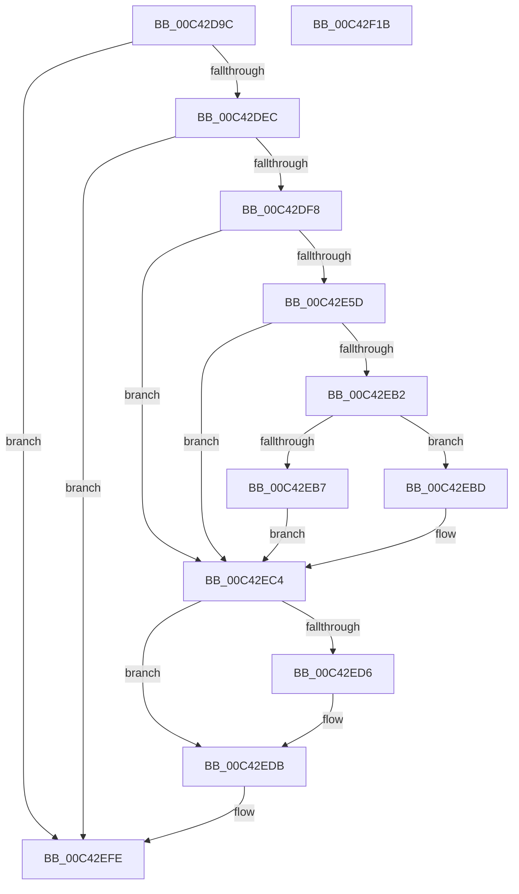

# PopPdcCsCheckSystemVolumeDevice

- RVA: `0x00C42D9C`–`0x00C42F1C` (길이 `384` bytes)
- VA: `0x0000000140C42D9C`
- 실행 섹션: `INIT`
- PDB 이름 있음: `예`; PDB Function 태그: `아니요`
- unwind 정보 RVA: `0x000BA42C`
- 디코드: `91`개 명령, `384/384` bytes 표시
- 미해석 바이트: `0` (있으면 어셈블리에 `.byte`로 보존)

> 이 문서는 커널 이미지의 기계어와 PDB 기호를 분석해 생성했습니다. 4번과 5번은 함수 원형과 자료형을 바이너리 사용 방식에서 추정한 C 해석이며 원본 소스 복구 결과는 아닙니다.

## 1. Dependencies

- 직접 호출 지점: **8**; 고유 호출 대상: **8**
- 직접 호출자로 확인된 함수: **1**
- RIP 상대 이미지 참조: **7**

### Outgoing calls
- `0x00C42E54` → [ZwOpenFile](../../text/6A/ZwOpenFile_function_006AD730.md) (function, `0x006AD730`)
- `0x00C42EA9` → [ZwDeviceIoControlFile](../../text/6A/ZwDeviceIoControlFile_function_006AD1B0.md) (function, `0x006AD1B0`)
- `0x00C42EC8` → [PopPdcCsDeviceNotification](../../page/AA/PopPdcCsDeviceNotification_function_00AA1B28.md) (function, `0x00AA1B28`)
- `0x00C42ED6` → [ZwClose](../../text/6A/ZwClose_function_006AD2B0.md) (function, `0x006AD2B0`)
- `0x00C42EDB` → [PopAcquirePolicyLock](../../pagelk/B7/PopAcquirePolicyLock_function_00B783C0.md) (function, `0x00B783C0`)
- `0x00C42EE4` → [PopNetIsDisconnectStandbyActive](../../page/AB/PopNetIsDisconnectStandbyActive_function_00AB0C10.md) (function, `0x00AB0C10`)
- `0x00C42EF9` → [PopReleasePolicyLock](../../pagelk/B7/PopReleasePolicyLock_function_00B78410.md) (function, `0x00B78410`)
- `0x00C42F05` → [_security_check_cookie](../../text/6A/_security_check_cookie_function_006AC640.md) (function, `0x006AC640`)

### Direct callers
- [PoInitSystem](../C7/PoInitSystem_function_00C72358.md) at `0x00C72E79`

### Static image references
- `0x00C42DAE` → RVA `0x00E0A740` (`.data`; read)
- `0x00C42DD1` → RVA `0x00E673A0` (`.data`; read)
- `0x00C42DEC` → RVA `0x00E6739C` (`.data`; read)
- `0x00C42DF8` → RVA `0x00FDA0A0` (`PAGEDATA`; read)
- `0x00C42E0B` → RVA `0x00FDA098` (`PAGEDATA`; read)
- `0x00C42EBD` → RVA `0x00F0F1F0` (`.data`; write)
- `0x00C42EF2` → RVA `0x00F0CED7` (`.data`; read)

## 2. Other-region calls and transfers

- 다른 실행 섹션으로 향하는 call: **8**
  - `0x00C42E54` → [ZwOpenFile](../../text/6A/ZwOpenFile_function_006AD730.md) (`INIT` → `.text`)
  - `0x00C42EA9` → [ZwDeviceIoControlFile](../../text/6A/ZwDeviceIoControlFile_function_006AD1B0.md) (`INIT` → `.text`)
  - `0x00C42EC8` → [PopPdcCsDeviceNotification](../../page/AA/PopPdcCsDeviceNotification_function_00AA1B28.md) (`INIT` → `PAGE`)
  - `0x00C42ED6` → [ZwClose](../../text/6A/ZwClose_function_006AD2B0.md) (`INIT` → `.text`)
  - `0x00C42EDB` → [PopAcquirePolicyLock](../../pagelk/B7/PopAcquirePolicyLock_function_00B783C0.md) (`INIT` → `PAGELK`)
  - `0x00C42EE4` → [PopNetIsDisconnectStandbyActive](../../page/AB/PopNetIsDisconnectStandbyActive_function_00AB0C10.md) (`INIT` → `PAGE`)
  - `0x00C42EF9` → [PopReleasePolicyLock](../../pagelk/B7/PopReleasePolicyLock_function_00B78410.md) (`INIT` → `PAGELK`)
  - `0x00C42F05` → [_security_check_cookie](../../text/6A/_security_check_cookie_function_006AC640.md) (`INIT` → `.text`)
- 별도 외부 분기/꼬리 이동을 확인하지 못했습니다.

## 3. Assembly (complete function range)

```asm
00C42D9C  48 89 5C 24 08                  mov qword ptr [rsp + 8], rbx
00C42DA1  55                              push rbp
00C42DA2  48 8D 6C 24 A9                  lea rbp, [rsp - 0x57]
00C42DA7  48 81 EC E0 00 00 00            sub rsp, 0xe0
00C42DAE  48 8B 05 8B 79 1C 00            mov rax, qword ptr [rip + 0x1c798b]
00C42DB5  48 33 C4                        xor rax, rsp
00C42DB8  48 89 45 47                     mov qword ptr [rbp + 0x47], rax
00C42DBC  33 C0                           xor eax, eax
00C42DBE  33 DB                           xor ebx, ebx
00C42DC0  48 89 45 27                     mov qword ptr [rbp + 0x27], rax
00C42DC4  0F 57 C0                        xorps xmm0, xmm0
00C42DC7  89 45 2F                        mov dword ptr [rbp + 0x2f], eax
00C42DCA  48 89 45 37                     mov qword ptr [rbp + 0x37], rax
00C42DCE  89 45 3F                        mov dword ptr [rbp + 0x3f], eax
00C42DD1  8B 05 C9 45 22 00               mov eax, dword ptr [rip + 0x2245c9]
00C42DD7  89 5D FB                        mov dword ptr [rbp - 5], ebx
00C42DDA  89 5D 13                        mov dword ptr [rbp + 0x13], ebx
00C42DDD  89 5D C7                        mov dword ptr [rbp - 0x39], ebx
00C42DE0  0F 11 45 E7                     movups xmmword ptr [rbp - 0x19], xmm0
00C42DE4  85 C0                           test eax, eax
00C42DE6  0F 84 12 01 00 00               je 0x140c42efe
00C42DEC  38 1D AA 45 22 00               cmp byte ptr [rip + 0x2245aa], bl
00C42DF2  0F 84 06 01 00 00               je 0x140c42efe
00C42DF8  48 8B 05 A1 72 39 00            mov rax, qword ptr [rip + 0x3972a1]
00C42DFF  4C 8D 4D E7                     lea r9, [rbp - 0x19]
00C42E03  48 89 45 D7                     mov qword ptr [rbp - 0x29], rax
00C42E07  4C 8D 45 F7                     lea r8, [rbp - 9]
00C42E0B  48 8D 05 86 72 39 00            lea rax, [rip + 0x397286]
00C42E12  C7 44 24 28 20 00 00 00         mov dword ptr [rsp + 0x28], 0x20
00C42E1A  BA 00 00 00 80                  mov edx, 0x80000000
00C42E1F  48 89 45 07                     mov qword ptr [rbp + 7], rax
00C42E23  48 8D 4D CF                     lea rcx, [rbp - 0x31]
00C42E27  48 89 5D CF                     mov qword ptr [rbp - 0x31], rbx
00C42E2B  C7 45 E3 01 00 00 00            mov dword ptr [rbp - 0x1d], 1
00C42E32  89 5D DF                        mov dword ptr [rbp - 0x21], ebx
00C42E35  C7 45 F7 30 00 00 00            mov dword ptr [rbp - 9], 0x30
00C42E3C  48 89 5D FF                     mov qword ptr [rbp - 1], rbx
00C42E40  C7 45 0F 40 02 00 00            mov dword ptr [rbp + 0xf], 0x240
00C42E47  F3 0F 7F 45 17                  movdqu xmmword ptr [rbp + 0x17], xmm0
00C42E4C  C7 44 24 20 07 00 00 00         mov dword ptr [rsp + 0x20], 7
00C42E54  E8 D7 A8 A6 FF                  call 0x1406ad730
00C42E59  85 C0                           test eax, eax
00C42E5B  78 67                           js 0x140c42ec4
00C42E5D  8D 4B 0C                        lea ecx, [rbx + 0xc]
00C42E60  48 89 5D 2B                     mov qword ptr [rbp + 0x2b], rbx
00C42E64  89 4C 24 48                     mov dword ptr [rsp + 0x48], ecx
00C42E68  48 8D 45 37                     lea rax, [rbp + 0x37]
00C42E6C  48 89 44 24 40                  mov qword ptr [rsp + 0x40], rax
00C42E71  0F 57 C0                        xorps xmm0, xmm0
00C42E74  89 4C 24 38                     mov dword ptr [rsp + 0x38], ecx
00C42E78  48 8D 45 27                     lea rax, [rbp + 0x27]
00C42E7C  48 8B 4D CF                     mov rcx, qword ptr [rbp - 0x31]
00C42E80  45 33 C9                        xor r9d, r9d
00C42E83  48 89 44 24 30                  mov qword ptr [rsp + 0x30], rax
00C42E88  45 33 C0                        xor r8d, r8d
00C42E8B  48 8D 45 E7                     lea rax, [rbp - 0x19]
00C42E8F  C7 44 24 28 00 14 2D 00         mov dword ptr [rsp + 0x28], 0x2d1400
00C42E97  33 D2                           xor edx, edx
00C42E99  48 89 44 24 20                  mov qword ptr [rsp + 0x20], rax
00C42E9E  0F 11 45 E7                     movups xmmword ptr [rbp - 0x19], xmm0
00C42EA2  C7 45 27 07 00 00 00            mov dword ptr [rbp + 0x27], 7
00C42EA9  E8 02 A3 A6 FF                  call 0x1406ad1b0
00C42EAE  85 C0                           test eax, eax
00C42EB0  78 12                           js 0x140c42ec4
00C42EB2  38 5D 3F                        cmp byte ptr [rbp + 0x3f], bl
00C42EB5  75 06                           jne 0x140c42ebd
00C42EB7  C6 45 E4 01                     mov byte ptr [rbp - 0x1c], 1
00C42EBB  EB 07                           jmp 0x140c42ec4
00C42EBD  C6 05 2C C3 2C 00 01            mov byte ptr [rip + 0x2cc32c], 1
00C42EC4  48 8D 4D D7                     lea rcx, [rbp - 0x29]
00C42EC8  E8 5B EC E5 FF                  call 0x140aa1b28
00C42ECD  48 8B 4D CF                     mov rcx, qword ptr [rbp - 0x31]
00C42ED1  48 85 C9                        test rcx, rcx
00C42ED4  74 05                           je 0x140c42edb
00C42ED6  E8 D5 A3 A6 FF                  call 0x1406ad2b0
00C42EDB  E8 E0 54 F3 FF                  call 0x140b783c0
00C42EE0  48 8D 4D C7                     lea rcx, [rbp - 0x39]
00C42EE4  E8 27 DD E6 FF                  call 0x140ab0c10
00C42EE9  8B 4D C7                        mov ecx, dword ptr [rbp - 0x39]
00C42EEC  83 C1 FD                        add ecx, -3
00C42EEF  83 F9 01                        cmp ecx, 1
00C42EF2  0F 97 05 DE 9F 2C 00            seta byte ptr [rip + 0x2c9fde]
00C42EF9  E8 12 55 F3 FF                  call 0x140b78410
00C42EFE  48 8B 4D 47                     mov rcx, qword ptr [rbp + 0x47]
00C42F02  48 33 CC                        xor rcx, rsp
00C42F05  E8 36 97 A6 FF                  call 0x1406ac640
00C42F0A  48 8B 9C 24 F0 00 00 00         mov rbx, qword ptr [rsp + 0xf0]
00C42F12  48 81 C4 E0 00 00 00            add rsp, 0xe0
00C42F19  5D                              pop rbp
00C42F1A  C3                              ret
00C42F1B  CC                              int3
```

## 4. C-style interpretation (structured pseudocode)

```c
__int64 __fastcall PopPdcCsCheckSystemVolumeDevice(void)
{
    __int64 result;
    __int64 v_rbx;
    __int64 v_rsp;
    unsigned __int64 v_stack_m18;
    unsigned int v_stack_m20;
    unsigned __int64 v_stack_m28;
    unsigned int v_stack_m30;
    unsigned __int64 v_stack_m34;
    unsigned __int64 v_stack_m38;
    unsigned __int64 v_stack_m48;
    unsigned int v_stack_m4C;
    unsigned int v_stack_m50;
    unsigned __int64 v_stack_m58;
    unsigned __int64 v_stack_m5F;
    unsigned __int64 v_stack_m60;
    unsigned int v_stack_m64;
    unsigned __int64 v_stack_m68;
    unsigned __int64 v_stack_m78;
    unsigned __int8 v_stack_m7B;
    unsigned int v_stack_m7C;
    unsigned int v_stack_m80;
    unsigned __int64 v_stack_m88;
    unsigned __int64 v_stack_m90;
    unsigned int v_stack_m98;
    unsigned int v_stack_mA0;
    unsigned __int64 v_stack_mA8;
    unsigned int v_stack_mB0;
    unsigned __int64 v_stack_mB8;
    unsigned int v_stack_mC0;
    unsigned int v_stack_mC8;
    unsigned __int64 v_stack_p8;

    v_stack_p8 = v_rbx;
    v_rsp = (v_rsp) - (224);
    result = (*(unsigned __int64 *)(v_rip + 1866123)) ^ (v_rsp);
    v_stack_m18 = result;
    result = 0;
    v_rbx = 0;
    v_stack_m38 = 0;
    v_stack_m30 = 0;
    v_stack_m28 = 0;
    v_stack_m20 = 0;
    v_stack_m64 = 0;
    v_stack_m4C = 0;
    v_stack_m98 = 0;
    v_stack_m78 = v_xmm0;
    if ((unsigned int)((unsigned int)(*(unsigned int *)(v_rip + 2246089))) == 0) goto loc_00C42EFE;
    if ((*(unsigned __int8 *)(v_rip + 2246058)) == 0) goto loc_00C42EFE;
    v_stack_m88 = *(unsigned __int64 *)(v_rip + 3764897);
    v_stack_mC0 = 32;
    v_stack_m58 = v_rip + 3764870;
    v_stack_m90 = 0;
    v_stack_m7C = 1;
    v_stack_m80 = 0;
    v_stack_m68 = 48;
    v_stack_m60 = 0;
    v_stack_m50 = 576;
    v_stack_m48 = v_xmm0;
    v_stack_mC8 = 7;
    result = ZwOpenFile(v_stack_m90, (unsigned int)(0x80000000ULL), v_stack_m68, v_stack_m78);
    if (sign_flag) goto loc_00C42EC4;
    v_stack_m34 = 0;
    v_stack_mA0 = (unsigned int)(v_rbx + 12);
    v_stack_mA8 = v_stack_m28;
    v_stack_mB0 = (unsigned int)(v_rbx + 12);
    a4 = 0;
    v_stack_mB8 = v_stack_m38;
    a3 = 0;
    v_stack_mC0 = 0x2D1400ULL;
    a2 = 0;
    v_stack_mC8 = v_stack_m78;
    v_stack_m78 = v_xmm0;
    v_stack_m38 = 7;
    result = ZwDeviceIoControlFile(v_stack_m90, a2, a3, a4);
    if (sign_flag) goto loc_00C42EC4;
    if (v_stack_m20 != 0) goto loc_00C42EBD;
    v_stack_m7B = 1;
    goto loc_00C42EC4;
loc_00C42EBD:
    *(unsigned __int8 *)(v_rip + 2933548) = 1;
loc_00C42EC4:
    result = PopPdcCsDeviceNotification(v_stack_m88, a2, a3, a4);
    if (v_stack_m90 != 0) {
        result = ZwClose(v_stack_m90, a2, a3, a4);
    }
    result = PopAcquirePolicyLock(v_stack_m90, a2, a3, a4);
    result = PopNetIsDisconnectStandbyActive(v_stack_m98, a2, a3, a4);
    a1 = (unsigned int)(((unsigned int)(v_stack_m98)) + (-3));
    result = PopReleasePolicyLock(a1, a2, a3, a4);
loc_00C42EFE:
    a1 = (v_stack_m18) ^ (v_rsp);
    result = _security_check_cookie(a1, a2, a3, a4);
    v_rsp = (v_rsp) + (224);
    return result;
}
```

## 5. (Beta) C Style

```c
void PopPdcCsCheckSystemVolumeDevice(void)
{
    int64_t result;
    int64_t local_rbx;
    int64_t local_rsp;
    uint64_t v_stack_m18;
    uint32_t v_stack_m20;
    uint64_t v_stack_m28;
    uint32_t v_stack_m30;
    uint64_t v_stack_m34;
    uint64_t v_stack_m38;
    uint64_t v_stack_m48;
    uint32_t v_stack_m4C;
    uint32_t v_stack_m50;
    uint64_t v_stack_m58;
    uint64_t v_stack_m5F;
    uint64_t v_stack_m60;
    uint32_t v_stack_m64;
    uint64_t v_stack_m68;
    uint64_t v_stack_m78;
    uint8_t v_stack_m7B;
    uint32_t v_stack_m7C;
    uint32_t v_stack_m80;
    uint64_t v_stack_m88;
    uint64_t v_stack_m90;
    uint32_t v_stack_m98;
    uint32_t v_stack_mA0;
    uint64_t v_stack_mA8;
    uint32_t v_stack_mB0;
    uint64_t v_stack_mB8;
    uint32_t v_stack_mC0;
    uint32_t v_stack_mC8;
    uint64_t v_stack_p8;

    v_stack_p8 = local_rbx;
    local_rsp = (local_rsp) - (224);
    result = (*(uint64_t *)(v_rip + 0x1C798B)) ^ (local_rsp);
    v_stack_m18 = result;
    result = 0;
    local_rbx = 0;
    v_stack_m38 = 0;
    v_stack_m30 = 0;
    v_stack_m28 = 0;
    v_stack_m20 = 0;
    v_stack_m64 = 0;
    v_stack_m4C = 0;
    v_stack_m98 = 0;
    v_stack_m78 = v_xmm0;
    if ((uint32_t)((uint32_t)(*(uint32_t *)(v_rip + 0x2245C9))) == 0) goto loc_00C42EFE;
    if ((*(uint8_t *)(v_rip + 0x2245AA)) == 0) goto loc_00C42EFE;
    v_stack_m88 = *(uint64_t *)(v_rip + 0x3972A1);
    v_stack_mC0 = 32;
    v_stack_m58 = v_rip + 3764870;
    v_stack_m90 = 0;
    v_stack_m7C = 1;
    v_stack_m80 = 0;
    v_stack_m68 = 48;
    v_stack_m60 = 0;
    v_stack_m50 = 576;
    v_stack_m48 = v_xmm0;
    v_stack_mC8 = 7;
    result = ZwOpenFile(v_stack_m90, (uint32_t)(0x80000000ULL), v_stack_m68, v_stack_m78);
    if (sign_flag) goto loc_00C42EC4;
    v_stack_m34 = 0;
    v_stack_mA0 = (uint32_t)(local_rbx + 12);
    v_stack_mA8 = v_stack_m28;
    v_stack_mB0 = (uint32_t)(local_rbx + 12);
    a4 = 0;
    v_stack_mB8 = v_stack_m38;
    a3 = 0;
    v_stack_mC0 = 0x2D1400ULL;
    a2 = 0;
    v_stack_mC8 = v_stack_m78;
    v_stack_m78 = v_xmm0;
    v_stack_m38 = 7;
    result = ZwDeviceIoControlFile(v_stack_m90, a2, a3, a4);
    if (sign_flag) goto loc_00C42EC4;
    if (v_stack_m20 != 0) goto loc_00C42EBD;
    v_stack_m7B = 1;
    goto loc_00C42EC4;
loc_00C42EBD:
    *(uint8_t *)(v_rip + 0x2CC32C) = 1;
loc_00C42EC4:
    result = PopPdcCsDeviceNotification(v_stack_m88, a2, a3, a4);
    if (v_stack_m90 != 0) {
        result = ZwClose(v_stack_m90, a2, a3, a4);
    }
    result = PopAcquirePolicyLock(v_stack_m90, a2, a3, a4);
    result = PopNetIsDisconnectStandbyActive(v_stack_m98, a2, a3, a4);
    a1 = (uint32_t)(((uint32_t)(v_stack_m98)) + (-3));
    result = PopReleasePolicyLock(a1, a2, a3, a4);
loc_00C42EFE:
    a1 = (v_stack_m18) ^ (local_rsp);
    result = _security_check_cookie(a1, a2, a3, a4);
    local_rsp = (local_rsp) + (224);
    return result;
}
```

## 6. Execution-region graph

[열기: 2D/3D 그래프와 함수 탐색 컨트롤 패널](../../../control-panel.html?section=init&rva=0x00C42D9C&view=graph)

- 2D 그래프는 위에서 아래로 흐르고, 3D 그래프는 빈 공간을 드래그해 회전합니다. Shift+드래그는 이동, 휠은 확대·축소, 함수 노드 선택은 대상 보고서 이동입니다.

### Static fallback


