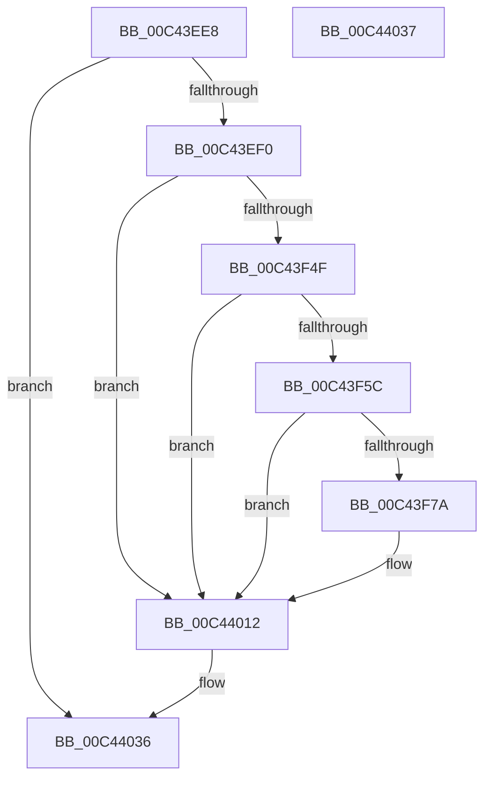

# PopPotsLogDirtyPowerTransition

- RVA: `0x00C43EE8`–`0x00C44038` (길이 `336` bytes)
- VA: `0x0000000140C43EE8`
- 실행 섹션: `INIT`
- PDB 이름 있음: `예`; PDB Function 태그: `아니요`
- unwind 정보 RVA: `0x000CD7EC`
- 디코드: `79`개 명령, `336/336` bytes 표시
- 미해석 바이트: `0` (있으면 어셈블리에 `.byte`로 보존)

> 이 문서는 커널 이미지의 기계어와 PDB 기호를 분석해 생성했습니다. 4번과 5번은 함수 원형과 자료형을 바이너리 사용 방식에서 추정한 C 해석이며 원본 소스 복구 결과는 아닙니다.

## 1. Dependencies

- 직접 호출 지점: **5**; 고유 호출 대상: **5**
- 직접 호출자로 확인된 함수: **1**
- RIP 상대 이미지 참조: **5**

### Outgoing calls
- `0x00C43F3D` → [swprintf_s](../../text/50/swprintf_s_function_00504B20.md) (function, `0x00504B20`)
- `0x00C43F6D` → [tlgKeywordOn](../../text/42/tlgKeywordOn_function_0042EAA0.md) (function, `0x0042EAA0`)
- `0x00C43FC8` → [tlgCreate1Sz_wchar_t](../../text/42/tlgCreate1Sz_wchar_t_function_00426198.md) (function, `0x00426198`)
- `0x00C4400D` → [tlgWriteTransfer_EtwWriteTransfer](../../text/42/tlgWriteTransfer_EtwWriteTransfer_function_004260E0.md) (function, `0x004260E0`)
- `0x00C44019` → [_security_check_cookie](../../text/6A/_security_check_cookie_function_006AC640.md) (function, `0x006AC640`)

### Direct callers
- [PopDiagTraceDirtyTransition](../C3/PopDiagTraceDirtyTransition_function_00C3F6F0.md) at `0x00C3F795`

### Static image references
- `0x00C43F0B` → RVA `0x00E0A740` (`.data`; read)
- `0x00C43F20` → RVA `0x00C7C660` (` ?? ::PBOPGDP::`string'`; read)
- `0x00C43F42` → RVA `0x00F070B8` (`.data`; read)
- `0x00C43F4F` → RVA `0x00E08390` (`.data`; read)
- `0x00C43FD9` → RVA `0x000509D7` (`.rdata`; read)

## 2. Other-region calls and transfers

- 다른 실행 섹션으로 향하는 call: **5**
  - `0x00C43F3D` → [swprintf_s](../../text/50/swprintf_s_function_00504B20.md) (`INIT` → `.text`)
  - `0x00C43F6D` → [tlgKeywordOn](../../text/42/tlgKeywordOn_function_0042EAA0.md) (`INIT` → `.text`)
  - `0x00C43FC8` → [tlgCreate1Sz_wchar_t](../../text/42/tlgCreate1Sz_wchar_t_function_00426198.md) (`INIT` → `.text`)
  - `0x00C4400D` → [tlgWriteTransfer_EtwWriteTransfer](../../text/42/tlgWriteTransfer_EtwWriteTransfer_function_004260E0.md) (`INIT` → `.text`)
  - `0x00C44019` → [_security_check_cookie](../../text/6A/_security_check_cookie_function_006AC640.md) (`INIT` → `.text`)
- 별도 외부 분기/꼬리 이동을 확인하지 못했습니다.

## 3. Assembly (complete function range)

```asm
00C43EE8  85 C9                           test ecx, ecx
00C43EEA  0F 84 46 01 00 00               je 0x140c44036
00C43EF0  48 8B C4                        mov rax, rsp
00C43EF3  48 89 58 08                     mov qword ptr [rax + 8], rbx
00C43EF7  48 89 70 18                     mov qword ptr [rax + 0x18], rsi
00C43EFB  48 89 78 20                     mov qword ptr [rax + 0x20], rdi
00C43EFF  55                              push rbp
00C43F00  48 8D 68 A1                     lea rbp, [rax - 0x5f]
00C43F04  48 81 EC E0 00 00 00            sub rsp, 0xe0
00C43F0B  48 8B 05 2E 68 1C 00            mov rax, qword ptr [rip + 0x1c682e]
00C43F12  48 33 C4                        xor rax, rsp
00C43F15  48 89 45 4F                     mov qword ptr [rbp + 0x4f], rax
00C43F19  8B C2                           mov eax, edx
00C43F1B  41 8B F0                        mov esi, r8d
00C43F1E  F7 D8                           neg eax
00C43F20  4C 8D 05 39 87 03 00            lea r8, [rip + 0x38739]
00C43F27  8B F9                           mov edi, ecx
00C43F29  44 8B CA                        mov r9d, edx
00C43F2C  1B DB                           sbb ebx, ebx
00C43F2E  48 8D 4D 37                     lea rcx, [rbp + 0x37]
00C43F32  BA 09 00 00 00                  mov edx, 9
00C43F37  81 E3 00 00 02 00               and ebx, 0x20000
00C43F3D  E8 DE 0B 8C FF                  call 0x140504b20
00C43F42  80 3D 6F 31 2C 00 00            cmp byte ptr [rip + 0x2c316f], 0
00C43F49  0F 84 C3 00 00 00               je 0x140c44012
00C43F4F  83 3D 3A 44 1C 00 05            cmp dword ptr [rip + 0x1c443a], 5
00C43F56  0F 86 B6 00 00 00               jbe 0x140c44012
00C43F5C  48 BA 00 00 00 00 00 40 00 00   movabs rdx, 0x400000000000
00C43F66  48 8D 0D 23 44 1C 00            lea rcx, [rip + 0x1c4423]
00C43F6D  E8 2E AB 7E FF                  call 0x14042eaa0
00C43F72  84 C0                           test al, al
00C43F74  0F 84 98 00 00 00               je 0x140c44012
00C43F7A  83 65 F3 00                     and dword ptr [rbp - 0xd], 0
00C43F7E  48 8D 45 A7                     lea rax, [rbp - 0x59]
00C43F82  83 65 03 00                     and dword ptr [rbp + 3], 0
00C43F86  48 8D 55 37                     lea rdx, [rbp + 0x37]
00C43F8A  48 89 45 E7                     mov qword ptr [rbp - 0x19], rax
00C43F8E  B9 04 00 00 00                  mov ecx, 4
00C43F93  48 8D 45 AB                     lea rax, [rbp - 0x55]
00C43F97  89 4D EF                        mov dword ptr [rbp - 0x11], ecx
00C43F9A  48 89 45 F7                     mov qword ptr [rbp - 9], rax
00C43F9E  8B C3                           mov eax, ebx
00C43FA0  0F BA E8 0F                     bts eax, 0xf
00C43FA4  89 4D FF                        mov dword ptr [rbp - 1], ecx
00C43FA7  89 4D 0F                        mov dword ptr [rbp + 0xf], ecx
00C43FAA  85 F6                           test esi, esi
00C43FAC  89 4D A7                        mov dword ptr [rbp - 0x59], ecx
00C43FAF  48 8D 4D 17                     lea rcx, [rbp + 0x17]
00C43FB3  0F 44 C3                        cmove eax, ebx
00C43FB6  89 7D AB                        mov dword ptr [rbp - 0x55], edi
00C43FB9  83 65 13 00                     and dword ptr [rbp + 0x13], 0
00C43FBD  89 45 AF                        mov dword ptr [rbp - 0x51], eax
00C43FC0  48 8D 45 AF                     lea rax, [rbp - 0x51]
00C43FC4  48 89 45 07                     mov qword ptr [rbp + 7], rax
00C43FC8  E8 CB 21 7E FF                  call 0x140426198
00C43FCD  83 65 33 00                     and dword ptr [rbp + 0x33], 0
00C43FD1  48 8D 45 B7                     lea rax, [rbp - 0x49]
00C43FD5  48 89 45 27                     mov qword ptr [rbp + 0x27], rax
00C43FD9  48 8D 15 F7 C9 40 FF            lea rdx, [rip - 0xbf3609]
00C43FE0  48 8D 45 C7                     lea rax, [rbp - 0x39]
00C43FE4  48 C7 45 B7 00 00 00 01         mov qword ptr [rbp - 0x49], 0x1000000
00C43FEC  48 89 44 24 28                  mov qword ptr [rsp + 0x28], rax
00C43FF1  48 8D 0D 98 43 1C 00            lea rcx, [rip + 0x1c4398]
00C43FF8  45 33 C9                        xor r9d, r9d
00C43FFB  C7 44 24 20 07 00 00 00         mov dword ptr [rsp + 0x20], 7
00C44003  45 33 C0                        xor r8d, r8d
00C44006  C7 45 2F 08 00 00 00            mov dword ptr [rbp + 0x2f], 8
00C4400D  E8 CE 20 7E FF                  call 0x1404260e0
00C44012  48 8B 4D 4F                     mov rcx, qword ptr [rbp + 0x4f]
00C44016  48 33 CC                        xor rcx, rsp
00C44019  E8 22 86 A6 FF                  call 0x1406ac640
00C4401E  4C 8D 9C 24 E0 00 00 00         lea r11, [rsp + 0xe0]
00C44026  49 8B 5B 10                     mov rbx, qword ptr [r11 + 0x10]
00C4402A  49 8B 73 20                     mov rsi, qword ptr [r11 + 0x20]
00C4402E  49 8B 7B 28                     mov rdi, qword ptr [r11 + 0x28]
00C44032  49 8B E3                        mov rsp, r11
00C44035  5D                              pop rbp
00C44036  C3                              ret
00C44037  CC                              int3
```

## 4. C-style interpretation (structured pseudocode)

```c
__int64 __fastcall PopPotsLogDirtyPowerTransition(int a1, int a2, int a3)
{
    __int64 result;
    __int64 v_rbx;
    __int64 v_rsp;
    unsigned __int64 v_stack_m8;
    unsigned __int64 v_stack_mC0;
    unsigned int v_stack_mC8;

    if (a1 == 0) goto loc_00C44036;
    *(unsigned __int64 *)(v_rsp + 8) = v_rbx;
    *(unsigned __int64 *)(v_rsp + 24) = v_rsi;
    *(unsigned __int64 *)(v_rsp + 32) = v_rdi;
    v_rsp = (v_rsp) - (224);
    result = (*(unsigned __int64 *)(v_rip + 1861678)) ^ (v_rsp);
    *(unsigned __int64 *)(v_rsp - 95 + 79) = result;
    result = (unsigned int)(-((unsigned int)(a2)));
    v_rbx = (unsigned int)((v_rbx) & (0x20000ULL));
    result = swprintf_s(v_rsp - 95 + 55, 9, v_rip + 231225, (unsigned int)(a2));
    if ((*(unsigned __int8 *)(v_rip + 2896239)) == 0) goto loc_00C44012;
    if ((*(unsigned int *)(v_rip + 1852474)) <= 5) goto loc_00C44012;
    result = tlgKeywordOn(v_rip + 1852451, 9, v_rip + 231225, (unsigned int)(a2));
    if ((unsigned __int8)(result) != 0) {
        result = v_rsp - 95 - 89;
        a2 = v_rsp - 95 + 55;
        *(unsigned __int64 *)(v_rsp - 95 - 25) = result;
        a1 = 4;
        result = v_rsp - 95 - 85;
        *(unsigned int *)(v_rsp - 95 - 17) = a1;
        *(unsigned __int64 *)(v_rsp - 95 - 9) = result;
        result = (unsigned int)(v_rbx);
        *(unsigned int *)(v_rsp - 95 - 1) = a1;
        *(unsigned int *)(v_rsp - 95 + 15) = a1;
        *(unsigned int *)(v_rsp - 95 - 89) = a1;
        a1 = v_rsp - 95 + 23;
        if ((unsigned int)((unsigned int)(a3)) == 0) { result = (unsigned int)(v_rbx); }
        *(unsigned int *)(v_rsp - 95 - 85) = (unsigned int)((unsigned int)(a1));
        *(unsigned int *)(v_rsp - 95 - 81) = (unsigned int)(result);
        result = v_rsp - 95 - 81;
        *(unsigned __int64 *)(v_rsp - 95 + 7) = result;
        result = tlgCreate1Sz_wchar_t(a1, a2, v_rip + 231225, (unsigned int)(a2));
        result = v_rsp - 95 - 73;
        *(unsigned __int64 *)(v_rsp - 95 + 39) = result;
        a2 = v_rip - 12531209;
        result = v_rsp - 95 - 57;
        *(unsigned __int64 *)(v_rsp - 95 - 73) = 0x1000000ULL;
        v_stack_mC0 = result;
        a1 = v_rip + 1852312;
        a4 = 0;
        v_stack_mC8 = 7;
        a3 = 0;
        *(unsigned int *)(v_rsp - 95 + 47) = 8;
        result = tlgWriteTransfer_EtwWriteTransfer(a1, a2, a3, a4);
    }
    a1 = (*(unsigned __int64 *)(v_rsp - 95 + 79)) ^ (v_rsp);
    result = _security_check_cookie(a1, a2, a3, a4);
loc_00C44036:
    return result;
}
```

## 5. (Beta) C Style

```c
int64_t PopPotsLogDirtyPowerTransition(int32_t Arg1, int32_t Arg2, int32_t Arg3)
{
    int64_t result;
    int64_t local_rbx;
    int64_t local_rsp;
    uint64_t v_stack_m8;
    uint64_t v_stack_mC0;
    uint32_t v_stack_mC8;

    if (Arg1 == 0) goto loc_00C44036;
    *(uint64_t *)(local_rsp + 0x8) = local_rbx;
    *(uint64_t *)(local_rsp + 0x18) = local_rsi;
    *(uint64_t *)(local_rsp + 0x20) = local_rdi;
    local_rsp = (local_rsp) - (224);
    result = (*(uint64_t *)(v_rip + 0x1C682E)) ^ (local_rsp);
    *(uint64_t *)(local_rsp - 0x5F + 0x4F) = result;
    result = (uint32_t)(-((uint32_t)(Arg2)));
    local_rbx = (uint32_t)((local_rbx) & (0x20000ULL));
    result = swprintf_s(local_rsp - 95 + 55, 9, v_rip + 231225, (uint32_t)(Arg2));
    if ((*(uint8_t *)(v_rip + 0x2C316F)) == 0) goto loc_00C44012;
    if ((*(uint32_t *)(v_rip + 0x1C443A)) <= 5) goto loc_00C44012;
    result = tlgKeywordOn(v_rip + 1852451, 9, v_rip + 231225, (uint32_t)(Arg2));
    if ((uint8_t)(result) != 0) {
        result = local_rsp - 95 - 89;
        Arg2 = local_rsp - 95 + 55;
        *(uint64_t *)(local_rsp - 0x5F - 0x19) = result;
        Arg1 = 4;
        result = local_rsp - 95 - 85;
        *(uint32_t *)(local_rsp - 0x5F - 0x11) = Arg1;
        *(uint64_t *)(local_rsp - 0x5F - 0x9) = result;
        result = (uint32_t)(local_rbx);
        *(uint32_t *)(local_rsp - 0x5F - 0x1) = Arg1;
        *(uint32_t *)(local_rsp - 0x5F + 0xF) = Arg1;
        *(uint32_t *)(local_rsp - 0x5F - 0x59) = Arg1;
        Arg1 = local_rsp - 95 + 23;
        if ((uint32_t)((uint32_t)(Arg3)) == 0) { result = (uint32_t)(local_rbx); }
        *(uint32_t *)(local_rsp - 0x5F - 0x55) = (uint32_t)((uint32_t)(Arg1));
        *(uint32_t *)(local_rsp - 0x5F - 0x51) = (uint32_t)(result);
        result = local_rsp - 95 - 81;
        *(uint64_t *)(local_rsp - 0x5F + 0x7) = result;
        result = tlgCreate1Sz_wchar_t(Arg1, Arg2, v_rip + 231225, (uint32_t)(Arg2));
        result = local_rsp - 95 - 73;
        *(uint64_t *)(local_rsp - 0x5F + 0x27) = result;
        Arg2 = v_rip - 12531209;
        result = local_rsp - 95 - 57;
        *(uint64_t *)(local_rsp - 0x5F - 0x49) = 0x1000000ULL;
        v_stack_mC0 = result;
        Arg1 = v_rip + 1852312;
        a4 = 0;
        v_stack_mC8 = 7;
        Arg3 = 0;
        *(uint32_t *)(local_rsp - 0x5F + 0x2F) = 8;
        result = tlgWriteTransfer_EtwWriteTransfer(Arg1, Arg2, Arg3, a4);
    }
    Arg1 = (*(uint64_t *)(local_rsp - 0x5F + 0x4F)) ^ (local_rsp);
    result = _security_check_cookie(Arg1, Arg2, Arg3, a4);
loc_00C44036:
    return result;
}
```

## 6. Execution-region graph

[열기: 2D/3D 그래프와 함수 탐색 컨트롤 패널](../../../control-panel.html?section=init&rva=0x00C43EE8&view=graph)

- 2D 그래프는 위에서 아래로 흐르고, 3D 그래프는 빈 공간을 드래그해 회전합니다. Shift+드래그는 이동, 휠은 확대·축소, 함수 노드 선택은 대상 보고서 이동입니다.

### Static fallback


