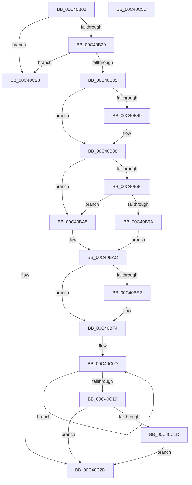

# PopPowerButtonSuppressionInit

- RVA: `0x00C40B00`–`0x00C40C5D` (길이 `349` bytes)
- VA: `0x0000000140C40B00`
- 실행 섹션: `INIT`
- PDB 이름 있음: `예`; PDB Function 태그: `아니요`
- unwind 정보 RVA: `0x0008A658`
- 디코드: `80`개 명령, `349/349` bytes 표시
- 미해석 바이트: `0` (있으면 어셈블리에 `.byte`로 보존)

> 이 문서는 커널 이미지의 기계어와 PDB 기호를 분석해 생성했습니다. 4번과 5번은 함수 원형과 자료형을 바이너리 사용 방식에서 추정한 C 해석이며 원본 소스 복구 결과는 아닙니다.

## 1. Dependencies

- 직접 호출 지점: **6**; 고유 호출 대상: **6**
- 직접 호출자로 확인된 함수: **1**
- RIP 상대 이미지 참조: **16**

### Outgoing calls
- `0x00C40B11` → [PopAcquireRwLockExclusive](../../text/43/PopAcquireRwLockExclusive_function_00430B44.md) (function, `0x00430B44`)
- `0x00C40B70` → [wil_details_FeatureReporting_ReportUsageToService](../../text/53/wil_details_FeatureReporting_ReportUsageToService_function_0053E6E4.md) (function, `0x0053E6E4`)
- `0x00C40B83` → [wil_details_FeatureStateCache_TryEnableDeviceUsageFastPath](../../text/53/wil_details_FeatureStateCache_TryEnableDeviceUsageFastPath_function_0053E774.md) (function, `0x0053E774`)
- `0x00C40BD9` → [ExSubscribeWnfStateChange](../../page/9D/ExSubscribeWnfStateChange_function_009D4BC0.md) (function, `0x009D4BC0`)
- `0x00C40C47` → [PopTracePowerButtonSuppressionOptedIn](PopTracePowerButtonSuppressionOptedIn_function_00C403C4.md) (function, `0x00C403C4`)
- `0x00C40C4C` → [PopEvaluatePowerButtonSuppressionState](../../page/76/PopEvaluatePowerButtonSuppressionState_function_00765954.md) (function, `0x00765954`)

### Direct callers
- [PoInitSystem](../C7/PoInitSystem_function_00C72358.md) at `0x00C7321A`

### Static image references
- `0x00C40B0A` → RVA `0x00F09230` (`.data`; read)
- `0x00C40B16` → RVA `0x00E673A0` (`.data`; read)
- `0x00C40B29` → RVA `0x00E6739C` (`.data`; read)
- `0x00C40B3A` → RVA `0x00FC4778` (`.data`; read)
- `0x00C40B66` → RVA `0x000DD668` (`.rdata`; read)
- `0x00C40B88` → RVA `0x00FC518C` (`ALMOSTRO`; read)
- `0x00C40B9A` → RVA `0x00F09200` (`.data`; write)
- `0x00C40BAF` → RVA `0x00F09200` (`.data`; read)
- `0x00C40BBB` → RVA `0x000208C8` (`.rdata`; read)
- `0x00C40BC2` → RVA `0x00765B50` (`PopWnfInSupCallback`; read)
- `0x00C40BC9` → RVA `0x00F09210` (`.data`; read)
- `0x00C40BE2` → RVA `0x00F09210` (`.data`; read/write)
- `0x00C40BFA` → RVA `0x00F09201` (`.data`; write)
- `0x00C40C00` → RVA `0x00E0B570` (`.data`; read)
- `0x00C40C2D` → RVA `0x00F09201` (`.data`; read)
- `0x00C40C3D` → RVA `0x00F09204` (`.data`; write)

## 2. Other-region calls and transfers

- 다른 실행 섹션으로 향하는 call: **5**
  - `0x00C40B11` → [PopAcquireRwLockExclusive](../../text/43/PopAcquireRwLockExclusive_function_00430B44.md) (`INIT` → `.text`)
  - `0x00C40B70` → [wil_details_FeatureReporting_ReportUsageToService](../../text/53/wil_details_FeatureReporting_ReportUsageToService_function_0053E6E4.md) (`INIT` → `.text`)
  - `0x00C40B83` → [wil_details_FeatureStateCache_TryEnableDeviceUsageFastPath](../../text/53/wil_details_FeatureStateCache_TryEnableDeviceUsageFastPath_function_0053E774.md) (`INIT` → `.text`)
  - `0x00C40BD9` → [ExSubscribeWnfStateChange](../../page/9D/ExSubscribeWnfStateChange_function_009D4BC0.md) (`INIT` → `PAGE`)
  - `0x00C40C4C` → [PopEvaluatePowerButtonSuppressionState](../../page/76/PopEvaluatePowerButtonSuppressionState_function_00765954.md) (`INIT` → `PAGE`)
- 별도 외부 분기/꼬리 이동을 확인하지 못했습니다.

## 3. Assembly (complete function range)

```asm
00C40B00  48 89 5C 24 10                  mov qword ptr [rsp + 0x10], rbx
00C40B05  57                              push rdi
00C40B06  48 83 EC 30                     sub rsp, 0x30
00C40B0A  48 8D 0D 1F 87 2C 00            lea rcx, [rip + 0x2c871f]
00C40B11  E8 2E 00 7F FF                  call 0x140430b44
00C40B16  8B 05 84 68 22 00               mov eax, dword ptr [rip + 0x226884]
00C40B1C  40 32 FF                        xor dil, dil
00C40B1F  33 DB                           xor ebx, ebx
00C40B21  85 C0                           test eax, eax
00C40B23  0F 84 FF 00 00 00               je 0x140c40c28
00C40B29  38 1D 6D 68 22 00               cmp byte ptr [rip + 0x22686d], bl
00C40B2F  0F 84 F3 00 00 00               je 0x140c40c28
00C40B35  48 21 5C 24 40                  and qword ptr [rsp + 0x40], rbx
00C40B3A  8B 0D 38 3C 38 00               mov ecx, dword ptr [rip + 0x383c38]
00C40B40  89 4C 24 40                     mov dword ptr [rsp + 0x40], ecx
00C40B44  F6 C1 10                        test cl, 0x10
00C40B47  75 3F                           jne 0x140c40b88
00C40B49  48 8B 44 24 40                  mov rax, qword ptr [rsp + 0x40]
00C40B4E  8D 7B 03                        lea edi, [rbx + 3]
00C40B51  83 C9 01                        or ecx, 1
00C40B54  48 89 44 24 40                  mov qword ptr [rsp + 0x40], rax
00C40B59  89 4C 24 40                     mov dword ptr [rsp + 0x40], ecx
00C40B5D  44 8D 4B 01                     lea r9d, [rbx + 1]
00C40B61  48 8B 54 24 40                  mov rdx, qword ptr [rsp + 0x40]
00C40B66  48 8D 0D FB CA 49 FF            lea rcx, [rip - 0xb63505]
00C40B6D  44 8B C7                        mov r8d, edi
00C40B70  E8 6F DB 8F FF                  call 0x14053e6e4
00C40B75  48 8B 4C 24 40                  mov rcx, qword ptr [rsp + 0x40]
00C40B7A  4C 8D 05 E7 CA 49 FF            lea r8, [rip - 0xb63519]
00C40B81  8B D7                           mov edx, edi
00C40B83  E8 EC DB 8F FF                  call 0x14053e774
00C40B88  8B 05 FE 45 38 00               mov eax, dword ptr [rip + 0x3845fe]
00C40B8E  40 B7 01                        mov dil, 1
00C40B91  83 F8 FF                        cmp eax, -1
00C40B94  74 0F                           je 0x140c40ba5
00C40B96  85 C0                           test eax, eax
00C40B98  75 0B                           jne 0x140c40ba5
00C40B9A  88 1D 60 86 2C 00               mov byte ptr [rip + 0x2c8660], bl
00C40BA0  8D 58 04                        lea ebx, [rax + 4]
00C40BA3  EB 07                           jmp 0x140c40bac
00C40BA5  40 88 3D 54 86 2C 00            mov byte ptr [rip + 0x2c8654], dil
00C40BAC  45 33 C9                        xor r9d, r9d
00C40BAF  48 8D 05 4A 86 2C 00            lea rax, [rip + 0x2c864a]
00C40BB6  48 89 44 24 28                  mov qword ptr [rsp + 0x28], rax
00C40BBB  48 8D 15 06 FD 3D FF            lea rdx, [rip - 0xc202fa]
00C40BC2  48 8D 05 87 4F B2 FF            lea rax, [rip - 0x4db079]
00C40BC9  48 8D 0D 40 86 2C 00            lea rcx, [rip + 0x2c8640]
00C40BD0  48 89 44 24 20                  mov qword ptr [rsp + 0x20], rax
00C40BD5  45 8D 41 01                     lea r8d, [r9 + 1]
00C40BD9  E8 E2 3F D9 FF                  call 0x1409d4bc0
00C40BDE  85 C0                           test eax, eax
00C40BE0  79 12                           jns 0x140c40bf4
00C40BE2  48 83 25 26 86 2C 00 00         and qword ptr [rip + 0x2c8626], 0
00C40BEA  83 CB 10                        or ebx, 0x10
00C40BED  C6 05 0C 86 2C 00 00            mov byte ptr [rip + 0x2c860c], 0
00C40BF4  8A 05 06 86 2C 00               mov al, byte ptr [rip + 0x2c8606]
00C40BFA  88 05 01 86 2C 00               mov byte ptr [rip + 0x2c8601], al
00C40C00  0F 0D 0D 69 A9 1C 00            prefetchw byte ptr [rip + 0x1ca969]
00C40C07  8B 05 63 A9 1C 00               mov eax, dword ptr [rip + 0x1ca963]
00C40C0D  8B C8                           mov ecx, eax
00C40C0F  F0 0F B1 0D 59 A9 1C 00         lock cmpxchg dword ptr [rip + 0x1ca959], ecx
00C40C17  75 F4                           jne 0x140c40c0d
00C40C19  85 C0                           test eax, eax
00C40C1B  75 10                           jne 0x140c40c2d
00C40C1D  88 05 DE 85 2C 00               mov byte ptr [rip + 0x2c85de], al
00C40C23  83 CB 20                        or ebx, 0x20
00C40C26  EB 05                           jmp 0x140c40c2d
00C40C28  BB 01 00 00 00                  mov ebx, 1
00C40C2D  44 8A 0D CD 85 2C 00            mov r9b, byte ptr [rip + 0x2c85cd]
00C40C34  44 8A C7                        mov r8b, dil
00C40C37  8A 0D C3 85 2C 00               mov cl, byte ptr [rip + 0x2c85c3]
00C40C3D  89 1D C1 85 2C 00               mov dword ptr [rip + 0x2c85c1], ebx
00C40C43  89 5C 24 20                     mov dword ptr [rsp + 0x20], ebx
00C40C47  E8 78 F7 FF FF                  call 0x140c403c4
00C40C4C  E8 03 4D B2 FF                  call 0x140765954
00C40C51  48 8B 5C 24 48                  mov rbx, qword ptr [rsp + 0x48]
00C40C56  48 83 C4 30                     add rsp, 0x30
00C40C5A  5F                              pop rdi
00C40C5B  C3                              ret
00C40C5C  CC                              int3
```

## 4. C-style interpretation (structured pseudocode)

```c
__int64 __fastcall PopPowerButtonSuppressionInit(void)
{
    __int64 result;
    __int64 v_rbx;
    __int64 v_rdi;
    __int64 v_rsp;
    unsigned __int64 v_stack_m10;
    unsigned __int64 v_stack_m18;
    unsigned __int64 v_stack_p10;
    unsigned __int64 v_stack_p8;

    v_stack_p10 = v_rbx;
    v_rsp = (v_rsp) - (48);
    result = PopAcquireRwLockExclusive(v_rip + 2918175, a2, a3, a4);
    v_rdi = 0;
    v_rbx = 0;
    if ((unsigned int)((unsigned int)(*(unsigned int *)(v_rip + 2254980))) == 0) goto loc_00C40C28;
    if ((*(unsigned __int8 *)(v_rip + 2254957)) == 0) goto loc_00C40C28;
    v_stack_p8 = (unsigned int)((unsigned int)(*(unsigned int *)(v_rip + 3685432)));
    result = (unsigned int)(*(unsigned int *)(v_rip + 2254980));
    if ((((unsigned __int8)((unsigned int)(*(unsigned int *)(v_rip + 3685432)))) & (16)) == 0) {
        result = v_stack_p8;
        v_rdi = v_rbx + 3;
        a1 = (unsigned int)(((unsigned int)(*(unsigned int *)(v_rip + 3685432))) | (1));
        v_stack_p8 = result;
        v_stack_p8 = (unsigned int)(a1);
        a4 = v_rbx + 1;
        a2 = v_stack_p8;
        a1 = v_rip - 11941125;
        a3 = (unsigned int)(v_rdi);
        result = wil_details_FeatureReporting_ReportUsageToService(a1, a2, a3, a4);
        a1 = v_stack_p8;
        a3 = v_rip - 11941145;
        a2 = (unsigned int)(v_rdi);
        result = wil_details_FeatureStateCache_TryEnableDeviceUsageFastPath(a1, a2, a3, a4);
    }
    if (((unsigned int)((unsigned int)(*(unsigned int *)(v_rip + 3687934)))) == -1) goto loc_00C40BA5;
    if ((unsigned int)((unsigned int)(*(unsigned int *)(v_rip + 3687934))) != 0) goto loc_00C40BA5;
    *(unsigned __int8 *)(v_rip + 2917984) = 0;
    goto loc_00C40BAC;
loc_00C40BA5:
    *(unsigned __int8 *)(v_rip + 2917972) = 1;
loc_00C40BAC:
    a4 = 0;
    v_stack_m10 = v_rip + 2917962;
    v_stack_m18 = v_rip - 5091449;
    result = ExSubscribeWnfStateChange(v_rip + 2917952, v_rip - 12714746, a4 + 1, a4);
    v_rbx = (unsigned int)(*(unsigned int *)(v_rip + 3687934)) + 4;
    if (sign_flag) {
        v_rbx = (unsigned int)(((unsigned int)(*(unsigned int *)(v_rip + 3687934)) + 4) | (16));
        *(unsigned __int8 *)(v_rip + 2917900) = 0;
    }
    *(unsigned __int8 *)(v_rip + 2917889) = (unsigned __int8)(*(unsigned __int8 *)(v_rip + 2917894));
loc_00C40C0D:
    if (condition_is_not_equal) goto loc_00C40C0D;
    if ((unsigned int)((unsigned int)(*(unsigned int *)(v_rip + 1878371))) != 0) goto loc_00C40C2D;
    *(unsigned __int8 *)(v_rip + 2917854) = (unsigned __int8)((unsigned int)(*(unsigned int *)(v_rip + 1878371)));
    v_rbx = (unsigned int)((v_rbx) | (32));
    goto loc_00C40C2D;
loc_00C40C28:
loc_00C40C2D:
    *(unsigned int *)(v_rip + 2917825) = 1;
    v_stack_m18 = 1;
    result = PopTracePowerButtonSuppressionOptedIn(*(unsigned __int8 *)(v_rip + 2917827), v_rip - 12714746, 1, *(unsigned __int8 *)(v_rip + 2917837));
    result = PopEvaluatePowerButtonSuppressionState(*(unsigned __int8 *)(v_rip + 2917827), v_rip - 12714746, 1, *(unsigned __int8 *)(v_rip + 2917837));
    v_rsp = (v_rsp) + (48);
    return result;
}
```

## 5. (Beta) C Style

```c
void PopPowerButtonSuppressionInit(void)
{
    int64_t result;
    int64_t local_rbx;
    int64_t local_rdi;
    int64_t local_rsp;
    uint64_t v_stack_m10;
    uint64_t v_stack_m18;
    uint64_t v_stack_p10;
    uint64_t v_stack_p8;

    v_stack_p10 = local_rbx;
    local_rsp = (local_rsp) - (48);
    result = PopAcquireRwLockExclusive(v_rip + 2918175, a2, a3, a4);
    local_rdi = 0;
    local_rbx = 0;
    if ((uint32_t)((uint32_t)(*(uint32_t *)(v_rip + 0x226884))) == 0) goto loc_00C40C28;
    if ((*(uint8_t *)(v_rip + 0x22686D)) == 0) goto loc_00C40C28;
    v_stack_p8 = (uint32_t)((uint32_t)(*(uint32_t *)(v_rip + 0x383C38)));
    result = (uint32_t)(*(uint32_t *)(v_rip + 0x226884));
    if ((((uint8_t)((uint32_t)(*(uint32_t *)(v_rip + 0x383C38)))) & (16)) == 0) {
        result = v_stack_p8;
        local_rdi = local_rbx + 3;
        a1 = (uint32_t)(((uint32_t)(*(uint32_t *)(v_rip + 0x383C38))) | (1));
        v_stack_p8 = result;
        v_stack_p8 = (uint32_t)(a1);
        a4 = local_rbx + 1;
        a2 = v_stack_p8;
        a1 = v_rip - 11941125;
        a3 = (uint32_t)(local_rdi);
        result = wil_details_FeatureReporting_ReportUsageToService(a1, a2, a3, a4);
        a1 = v_stack_p8;
        a3 = v_rip - 11941145;
        a2 = (uint32_t)(local_rdi);
        result = wil_details_FeatureStateCache_TryEnableDeviceUsageFastPath(a1, a2, a3, a4);
    }
    if (((uint32_t)((uint32_t)(*(uint32_t *)(v_rip + 0x3845FE)))) == -1) goto loc_00C40BA5;
    if ((uint32_t)((uint32_t)(*(uint32_t *)(v_rip + 0x3845FE))) != 0) goto loc_00C40BA5;
    *(uint8_t *)(v_rip + 0x2C8660) = 0;
    goto loc_00C40BAC;
loc_00C40BA5:
    *(uint8_t *)(v_rip + 0x2C8654) = 1;
loc_00C40BAC:
    a4 = 0;
    v_stack_m10 = v_rip + 2917962;
    v_stack_m18 = v_rip - 5091449;
    result = ExSubscribeWnfStateChange(v_rip + 2917952, v_rip - 12714746, a4 + 1, a4);
    local_rbx = (uint32_t)(*(uint32_t *)(v_rip + 0x3845FE)) + 4;
    if (sign_flag) {
        local_rbx = (uint32_t)(((uint32_t)(*(uint32_t *)(v_rip + 0x3845FE)) + 4) | (16));
        *(uint8_t *)(v_rip + 0x2C860C) = 0;
    }
    *(uint8_t *)(v_rip + 0x2C8601) = (uint8_t)(*(uint8_t *)(v_rip + 0x2C8606));
loc_00C40C0D:
    if (condition_is_not_equal) goto loc_00C40C0D;
    if ((uint32_t)((uint32_t)(*(uint32_t *)(v_rip + 0x1CA963))) != 0) goto loc_00C40C2D;
    *(uint8_t *)(v_rip + 0x2C85DE) = (uint8_t)((uint32_t)(*(uint32_t *)(v_rip + 0x1CA963)));
    local_rbx = (uint32_t)((local_rbx) | (32));
    goto loc_00C40C2D;
loc_00C40C28:
loc_00C40C2D:
    *(uint32_t *)(v_rip + 0x2C85C1) = 1;
    v_stack_m18 = 1;
    result = PopTracePowerButtonSuppressionOptedIn(*(uint8_t *)(v_rip + 0x2C85C3), v_rip - 12714746, 1, *(uint8_t *)(v_rip + 0x2C85CD));
    result = PopEvaluatePowerButtonSuppressionState(*(uint8_t *)(v_rip + 0x2C85C3), v_rip - 12714746, 1, *(uint8_t *)(v_rip + 0x2C85CD));
    local_rsp = (local_rsp) + (48);
    return result;
}
```

## 6. Execution-region graph

[열기: 2D/3D 그래프와 함수 탐색 컨트롤 패널](../../../control-panel.html?section=init&rva=0x00C40B00&view=graph)

- 2D 그래프는 위에서 아래로 흐르고, 3D 그래프는 빈 공간을 드래그해 회전합니다. Shift+드래그는 이동, 휠은 확대·축소, 함수 노드 선택은 대상 보고서 이동입니다.

### Static fallback


