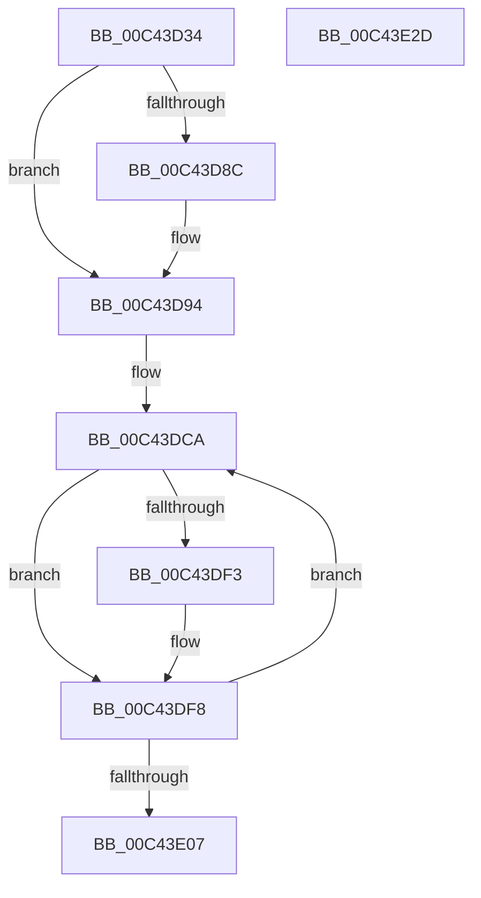

# PopPowerRequestStatsInitialize

- RVA: `0x00C43D34`–`0x00C43E2E` (길이 `250` bytes)
- VA: `0x0000000140C43D34`
- 실행 섹션: `INIT`
- PDB 이름 있음: `예`; PDB Function 태그: `아니요`
- unwind 정보 RVA: `0x000CD6CC`
- 디코드: `61`개 명령, `250/250` bytes 표시
- 미해석 바이트: `0` (있으면 어셈블리에 `.byte`로 보존)

> 이 문서는 커널 이미지의 기계어와 PDB 기호를 분석해 생성했습니다. 4번과 5번은 함수 원형과 자료형을 바이너리 사용 방식에서 추정한 C 해석이며 원본 소스 복구 결과는 아닙니다.

## 1. Dependencies

- 직접 호출 지점: **5**; 고유 호출 대상: **5**
- 직접 호출자로 확인된 함수: **1**
- RIP 상대 이미지 참조: **6**

### Outgoing calls
- `0x00C43D83` → [SleepstudyHelperCreateLibraryEx](../../text/4B/SleepstudyHelperCreateLibraryEx_function_004BAE50.md) (function, `0x004BAE50`)
- `0x00C43D9F` → [memset](../../text/6C/memset_function_006C6C40.md) (function, `0x006C6C40`)
- `0x00C43DD4` → [RtlInitUnicodeString](../../text/42/RtlInitUnicodeString_function_0042A780.md) (function, `0x0042A780`)
- `0x00C43DEA` → [PopPowerRequestStatsCreateSleepstudyBlocker](../../page/A2/PopPowerRequestStatsCreateSleepstudyBlocker_function_00A2D9B0.md) (function, `0x00A2D9B0`)
- `0x00C43E0F` → [_security_check_cookie](../../text/6A/_security_check_cookie_function_006AC640.md) (function, `0x006AC640`)

### Direct callers
- [PopPowerRequestInitialize](../C3/PopPowerRequestInitialize_function_00C3E2AC.md) at `0x00C3E47E`

### Static image references
- `0x00C43D4B` → RVA `0x00E0A740` (`.data`; read)
- `0x00C43D64` → RVA `0x00F07670` (`.data`; read)
- `0x00C43D8C` → RVA `0x00F07670` (`.data`; read/write)
- `0x00C43DA4` → RVA `0x00C7C620` (` ?? ::PBOPGDP::`string'`; read)
- `0x00C43DB2` → RVA `0x00F07660` (`.data`; read)
- `0x00C43DB9` → RVA `0x00C7C640` (` ?? ::PBOPGDP::`string'`; read)

## 2. Other-region calls and transfers

- 다른 실행 섹션으로 향하는 call: **5**
  - `0x00C43D83` → [SleepstudyHelperCreateLibraryEx](../../text/4B/SleepstudyHelperCreateLibraryEx_function_004BAE50.md) (`INIT` → `.text`)
  - `0x00C43D9F` → [memset](../../text/6C/memset_function_006C6C40.md) (`INIT` → `.text`)
  - `0x00C43DD4` → [RtlInitUnicodeString](../../text/42/RtlInitUnicodeString_function_0042A780.md) (`INIT` → `.text`)
  - `0x00C43DEA` → [PopPowerRequestStatsCreateSleepstudyBlocker](../../page/A2/PopPowerRequestStatsCreateSleepstudyBlocker_function_00A2D9B0.md) (`INIT` → `PAGE`)
  - `0x00C43E0F` → [_security_check_cookie](../../text/6A/_security_check_cookie_function_006AC640.md) (`INIT` → `.text`)
- 별도 외부 분기/꼬리 이동을 확인하지 못했습니다.

## 3. Assembly (complete function range)

```asm
00C43D34  4C 8B DC                        mov r11, rsp
00C43D37  49 89 5B 08                     mov qword ptr [r11 + 8], rbx
00C43D3B  49 89 6B 10                     mov qword ptr [r11 + 0x10], rbp
00C43D3F  49 89 73 18                     mov qword ptr [r11 + 0x18], rsi
00C43D43  57                              push rdi
00C43D44  48 81 EC 80 00 00 00            sub rsp, 0x80
00C43D4B  48 8B 05 EE 69 1C 00            mov rax, qword ptr [rip + 0x1c69ee]
00C43D52  48 33 C4                        xor rax, rsp
00C43D55  48 89 44 24 70                  mov qword ptr [rsp + 0x70], rax
00C43D5A  33 C0                           xor eax, eax
00C43D5C  C7 44 24 20 01 00 00 00         mov dword ptr [rsp + 0x20], 1
00C43D64  48 8D 15 05 39 2C 00            lea rdx, [rip + 0x2c3905]
00C43D6B  89 44 24 34                     mov dword ptr [rsp + 0x34], eax
00C43D6F  49 8D 4B 98                     lea rcx, [r11 - 0x68]
00C43D73  C7 44 24 24 50 57 51 54         mov dword ptr [rsp + 0x24], 0x54515750
00C43D7B  C7 44 24 28 04 00 00 00         mov dword ptr [rsp + 0x28], 4
00C43D83  E8 C8 70 87 FF                  call 0x1404bae50
00C43D88  85 C0                           test eax, eax
00C43D8A  79 08                           jns 0x140c43d94
00C43D8C  48 83 25 DC 38 2C 00 00         and qword ptr [rip + 0x2c38dc], 0
00C43D94  33 D2                           xor edx, edx
00C43D96  48 8D 4C 24 30                  lea rcx, [rsp + 0x30]
00C43D9B  44 8D 42 40                     lea r8d, [rdx + 0x40]
00C43D9F  E8 9C 2E A8 FF                  call 0x1406c6c40
00C43DA4  48 8D 05 75 88 03 00            lea rax, [rip + 0x38875]
00C43DAB  33 DB                           xor ebx, ebx
00C43DAD  48 89 44 24 20                  mov qword ptr [rsp + 0x20], rax
00C43DB2  48 8D 2D A7 38 2C 00            lea rbp, [rip + 0x2c38a7]
00C43DB9  48 8D 05 80 88 03 00            lea rax, [rip + 0x38880]
00C43DC0  48 8B F5                        mov rsi, rbp
00C43DC3  48 89 44 24 28                  mov qword ptr [rsp + 0x28], rax
00C43DC8  33 FF                           xor edi, edi
00C43DCA  48 8B 54 3C 20                  mov rdx, qword ptr [rsp + rdi + 0x20]
00C43DCF  48 8D 4C 24 38                  lea rcx, [rsp + 0x38]
00C43DD4  E8 A7 69 7E FF                  call 0x14042a780
00C43DD9  8B C3                           mov eax, ebx
00C43DDB  48 8D 4C 24 30                  lea rcx, [rsp + 0x30]
00C43DE0  F7 D8                           neg eax
00C43DE2  4C 8B C6                        mov r8, rsi
00C43DE5  1B D2                           sbb edx, edx
00C43DE7  83 C2 08                        add edx, 8
00C43DEA  E8 C1 9B DE FF                  call 0x140a2d9b0
00C43DEF  85 C0                           test eax, eax
00C43DF1  79 05                           jns 0x140c43df8
00C43DF3  48 83 24 2F 00                  and qword ptr [rdi + rbp], 0
00C43DF8  FF C3                           inc ebx
00C43DFA  48 83 C6 08                     add rsi, 8
00C43DFE  48 83 C7 08                     add rdi, 8
00C43E02  83 FB 02                        cmp ebx, 2
00C43E05  72 C3                           jb 0x140c43dca
00C43E07  48 8B 4C 24 70                  mov rcx, qword ptr [rsp + 0x70]
00C43E0C  48 33 CC                        xor rcx, rsp
00C43E0F  E8 2C 88 A6 FF                  call 0x1406ac640
00C43E14  4C 8D 9C 24 80 00 00 00         lea r11, [rsp + 0x80]
00C43E1C  49 8B 5B 10                     mov rbx, qword ptr [r11 + 0x10]
00C43E20  49 8B 6B 18                     mov rbp, qword ptr [r11 + 0x18]
00C43E24  49 8B 73 20                     mov rsi, qword ptr [r11 + 0x20]
00C43E28  49 8B E3                        mov rsp, r11
00C43E2B  5F                              pop rdi
00C43E2C  C3                              ret
00C43E2D  CC                              int3
```

## 4. C-style interpretation (structured pseudocode)

```c
__int64 __fastcall PopPowerRequestStatsInitialize(void)
{
    __int64 result;
    __int64 v_rbx;
    __int64 v_rdi;
    __int64 v_rsi;
    __int64 v_rsp;
    unsigned __int64 v_stack_m18;
    unsigned __int64 v_stack_m50;
    unsigned int v_stack_m54;
    unsigned __int64 v_stack_m58;
    unsigned int v_stack_m60;
    unsigned int v_stack_m64;
    unsigned int v_stack_m68;
    unsigned __int64 v_stack_m8;

    *(unsigned __int64 *)(v_rsp + 8) = v_rbx;
    *(unsigned __int64 *)(v_rsp + 16) = v_rbp;
    *(unsigned __int64 *)(v_rsp + 24) = v_rsi;
    v_rsp = (v_rsp) - (128);
    result = (*(unsigned __int64 *)(v_rip + 1862126)) ^ (v_rsp);
    v_stack_m18 = result;
    result = 0;
    v_stack_m68 = 1;
    v_stack_m54 = 0;
    v_stack_m64 = 0x54515750ULL;
    v_stack_m60 = 4;
    result = SleepstudyHelperCreateLibraryEx(v_rsp - 104, v_rip + 2898181, a3, a4);
    if (sign_flag) {
    }
    a2 = 0;
    result = memset(v_stack_m58, a2, a2 + 64, a4);
    v_rbx = 0;
    v_stack_m68 = v_rip + 231541;
    v_stack_m60 = v_rip + 231552;
    v_rdi = 0;
loc_00C43DCA:
    result = RtlInitUnicodeString(v_stack_m50, *(unsigned __int64 *)(v_rsp + v_rdi * 1 + 32), a2 + 64, a4);
    result = (unsigned int)(-(0));
    a2 = (unsigned int)((*(unsigned __int64 *)(v_rsp + v_rdi * 1 + 32)) + (8));
    result = PopPowerRequestStatsCreateSleepstudyBlocker(v_stack_m58, a2, v_rip + 2898087, a4);
    if (sign_flag) {
    }
    v_rbx = (unsigned int)((v_rbx) + 1);
    v_rsi = (v_rip + 2898087) + (8);
    v_rdi = (v_rdi) + (8);
    if (((unsigned int)(v_rbx)) < 2) goto loc_00C43DCA;
    a1 = (v_stack_m18) ^ (v_rsp);
    result = _security_check_cookie(a1, a2, v_rip + 2898087, a4);
    return result;
}
```

## 5. (Beta) C Style

```c
void PopPowerRequestStatsInitialize(void)
{
    int64_t result;
    int64_t local_rbx;
    int64_t local_rdi;
    int64_t local_rsi;
    int64_t local_rsp;
    uint64_t v_stack_m18;
    uint64_t v_stack_m50;
    uint32_t v_stack_m54;
    uint64_t v_stack_m58;
    uint32_t v_stack_m60;
    uint32_t v_stack_m64;
    uint32_t v_stack_m68;
    uint64_t v_stack_m8;

    *(uint64_t *)(local_rsp + 0x8) = local_rbx;
    *(uint64_t *)(local_rsp + 0x10) = local_rbp;
    *(uint64_t *)(local_rsp + 0x18) = local_rsi;
    local_rsp = (local_rsp) - (128);
    result = (*(uint64_t *)(v_rip + 0x1C69EE)) ^ (local_rsp);
    v_stack_m18 = result;
    result = 0;
    v_stack_m68 = 1;
    v_stack_m54 = 0;
    v_stack_m64 = 0x54515750ULL;
    v_stack_m60 = 4;
    result = SleepstudyHelperCreateLibraryEx(local_rsp - 104, v_rip + 2898181, a3, a4);
    if (sign_flag) {
    }
    a2 = 0;
    result = memset(v_stack_m58, a2, a2 + 64, a4);
    local_rbx = 0;
    v_stack_m68 = v_rip + 231541;
    v_stack_m60 = v_rip + 231552;
    local_rdi = 0;
loc_00C43DCA:
    result = RtlInitUnicodeString(v_stack_m50, *(uint64_t *)(local_rsp + local_rdi * 1 + 0x20), a2 + 64, a4);
    result = (uint32_t)(-(0));
    a2 = (uint32_t)((*(uint64_t *)(local_rsp + local_rdi * 1 + 0x20)) + (8));
    result = PopPowerRequestStatsCreateSleepstudyBlocker(v_stack_m58, a2, v_rip + 2898087, a4);
    if (sign_flag) {
    }
    local_rbx = (uint32_t)((local_rbx) + 1);
    local_rsi = (v_rip + 2898087) + (8);
    local_rdi = (local_rdi) + (8);
    if (((uint32_t)(local_rbx)) < 2) goto loc_00C43DCA;
    a1 = (v_stack_m18) ^ (local_rsp);
    result = _security_check_cookie(a1, a2, v_rip + 2898087, a4);
    return result;
}
```

## 6. Execution-region graph

[열기: 2D/3D 그래프와 함수 탐색 컨트롤 패널](../../../control-panel.html?section=init&rva=0x00C43D34&view=graph)

- 2D 그래프는 위에서 아래로 흐르고, 3D 그래프는 빈 공간을 드래그해 회전합니다. Shift+드래그는 이동, 휠은 확대·축소, 함수 노드 선택은 대상 보고서 이동입니다.

### Static fallback


