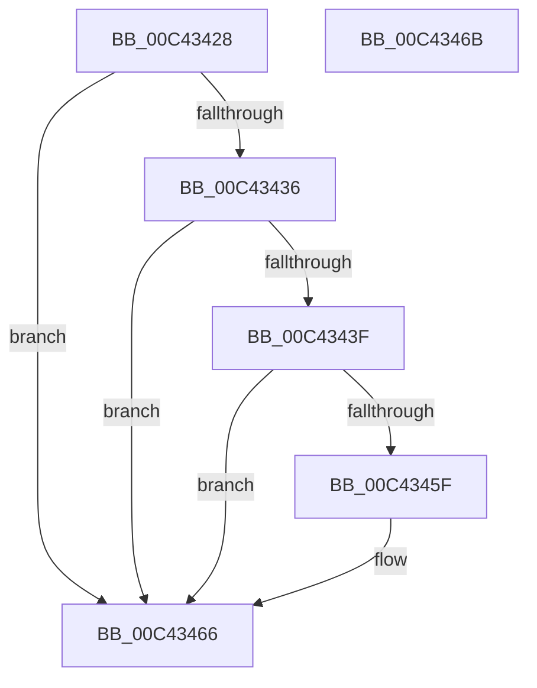

# PopReadErrataForIncorrectLidNotification

- RVA: `0x00C43428`–`0x00C4346C` (길이 `68` bytes)
- VA: `0x0000000140C43428`
- 실행 섹션: `INIT`
- PDB 이름 있음: `예`; PDB Function 태그: `아니요`
- unwind 정보 RVA: `0x0005C788`
- 디코드: `16`개 명령, `68/68` bytes 표시
- 미해석 바이트: `0` (있으면 어셈블리에 `.byte`로 보존)

> 이 문서는 커널 이미지의 기계어와 PDB 기호를 분석해 생성했습니다. 4번과 5번은 함수 원형과 자료형을 바이너리 사용 방식에서 추정한 C 해석이며 원본 소스 복구 결과는 아닙니다.

## 1. Dependencies

- 직접 호출 지점: **1**; 고유 호출 대상: **1**
- 직접 호출자로 확인된 함수: **1**
- RIP 상대 이미지 참조: **4**

### Outgoing calls
- `0x00C43453` → [EmClientQueryRuleState](../../pagelk/B7/EmClientQueryRuleState_function_00B77D70.md) (function, `0x00B77D70`)

### Direct callers
- [PoInitSystem](../C7/PoInitSystem_function_00C72358.md) at `0x00C73206`

### Static image references
- `0x00C4342C` → RVA `0x00E673A0` (`.data`; read)
- `0x00C43436` → RVA `0x00E6739C` (`.data`; read)
- `0x00C4344C` → RVA `0x00029738` (`.rdata`; read)
- `0x00C4345F` → RVA `0x00E67A38` (`.data`; write)

## 2. Other-region calls and transfers

- 다른 실행 섹션으로 향하는 call: **1**
  - `0x00C43453` → [EmClientQueryRuleState](../../pagelk/B7/EmClientQueryRuleState_function_00B77D70.md) (`INIT` → `PAGELK`)
- 별도 외부 분기/꼬리 이동을 확인하지 못했습니다.

## 3. Assembly (complete function range)

```asm
00C43428  48 83 EC 28                     sub rsp, 0x28
00C4342C  8B 05 6E 3F 22 00               mov eax, dword ptr [rip + 0x223f6e]
00C43432  85 C0                           test eax, eax
00C43434  74 30                           je 0x140c43466
00C43436  80 3D 5F 3F 22 00 00            cmp byte ptr [rip + 0x223f5f], 0
00C4343D  74 27                           je 0x140c43466
00C4343F  48 8D 54 24 30                  lea rdx, [rsp + 0x30]
00C43444  C7 44 24 30 01 00 00 00         mov dword ptr [rsp + 0x30], 1
00C4344C  48 8D 0D E5 62 3E FF            lea rcx, [rip - 0xc19d1b]
00C43453  E8 18 49 F3 FF                  call 0x140b77d70
00C43458  83 7C 24 30 02                  cmp dword ptr [rsp + 0x30], 2
00C4345D  75 07                           jne 0x140c43466
00C4345F  C6 05 D2 45 22 00 01            mov byte ptr [rip + 0x2245d2], 1
00C43466  48 83 C4 28                     add rsp, 0x28
00C4346A  C3                              ret
00C4346B  CC                              int3
```

## 4. C-style interpretation (structured pseudocode)

```c
__int64 __fastcall PopReadErrataForIncorrectLidNotification(void)
{
    __int64 result;
    __int64 v_rsp;
    unsigned __int64 v_stack_p8;

    v_rsp = (v_rsp) - (40);
    if ((unsigned int)((unsigned int)(*(unsigned int *)(v_rip + 2244462))) == 0) goto loc_00C43466;
    if ((*(unsigned __int8 *)(v_rip + 2244447)) == 0) goto loc_00C43466;
    v_stack_p8 = 1;
    result = EmClientQueryRuleState(v_rip - 12688667, v_stack_p8, a3, a4);
    if (v_stack_p8 == 2) {
        *(unsigned __int8 *)(v_rip + 2246098) = 1;
    }
    v_rsp = (v_rsp) + (40);
    return result;
}
```

## 5. (Beta) C Style

```c
void PopReadErrataForIncorrectLidNotification(void)
{
    int64_t result;
    int64_t local_rsp;
    uint64_t v_stack_p8;

    local_rsp = (local_rsp) - (40);
    if ((uint32_t)((uint32_t)(*(uint32_t *)(v_rip + 0x223F6E))) == 0) goto loc_00C43466;
    if ((*(uint8_t *)(v_rip + 0x223F5F)) == 0) goto loc_00C43466;
    v_stack_p8 = 1;
    result = EmClientQueryRuleState(v_rip - 12688667, v_stack_p8, a3, a4);
    if (v_stack_p8 == 2) {
        *(uint8_t *)(v_rip + 0x2245D2) = 1;
    }
    local_rsp = (local_rsp) + (40);
    return result;
}
```

## 6. Execution-region graph

[열기: 2D/3D 그래프와 함수 탐색 컨트롤 패널](../../../control-panel.html?section=init&rva=0x00C43428&view=graph)

- 2D 그래프는 위에서 아래로 흐르고, 3D 그래프는 빈 공간을 드래그해 회전합니다. Shift+드래그는 이동, 휠은 확대·축소, 함수 노드 선택은 대상 보고서 이동입니다.

### Static fallback


