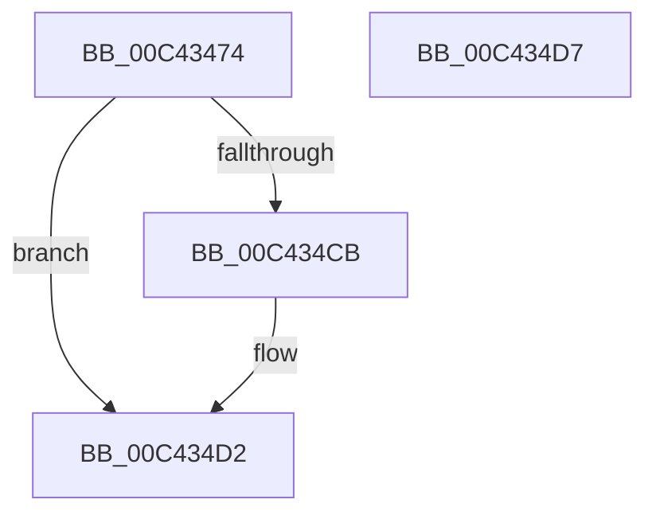

# PopReadErrataSkipMemoryOverwriteRequestControlLockAction

- RVA: `0x00C43474`–`0x00C434D8` (길이 `100` bytes)
- VA: `0x0000000140C43474`
- 실행 섹션: `INIT`
- PDB 이름 있음: `예`; PDB Function 태그: `아니요`
- unwind 정보 RVA: `0x00097934`
- 디코드: `21`개 명령, `100/100` bytes 표시
- 미해석 바이트: `0` (있으면 어셈블리에 `.byte`로 보존)

> 이 문서는 커널 이미지의 기계어와 PDB 기호를 분석해 생성했습니다. 4번과 5번은 함수 원형과 자료형을 바이너리 사용 방식에서 추정한 C 해석이며 원본 소스 복구 결과는 아닙니다.

## 1. Dependencies

- 직접 호출 지점: **1**; 고유 호출 대상: **1**
- 직접 호출자로 확인된 함수: **1**
- RIP 상대 이미지 참조: **3**

### Outgoing calls
- `0x00C434BF` → [EmClientRuleEvaluate](../../pagelk/B7/EmClientRuleEvaluate_function_00B77E90.md) (function, `0x00B77E90`)

### Direct callers
- [PoInitSystem](../C7/PoInitSystem_function_00C72358.md) at `0x00C73231`

### Static image references
- `0x00C43480` → RVA `0x000296E8` (`.rdata`; read)
- `0x00C434B1` → RVA `0x00029708` (`.rdata`; read)
- `0x00C434B8` → RVA `0x00F083F0` (`.data`; write)

## 2. Other-region calls and transfers

- 다른 실행 섹션으로 향하는 call: **1**
  - `0x00C434BF` → [EmClientRuleEvaluate](../../pagelk/B7/EmClientRuleEvaluate_function_00B77E90.md) (`INIT` → `PAGELK`)
- 별도 외부 분기/꼬리 이동을 확인하지 못했습니다.

## 3. Assembly (complete function range)

```asm
00C43474  4C 8B DC                        mov r11, rsp
00C43477  48 83 EC 38                     sub rsp, 0x38
00C4347B  83 64 24 2C 00                  and dword ptr [rsp + 0x2c], 0
00C43480  48 8D 05 61 62 3E FF            lea rax, [rip - 0xc19d9f]
00C43487  C7 44 24 28 10 00 00 00         mov dword ptr [rsp + 0x28], 0x10
00C4348F  4D 8D 4B 08                     lea r9, [r11 + 8]
00C43493  49 89 43 E8                     mov qword ptr [r11 - 0x18], rax
00C43497  49 8D 53 10                     lea rdx, [r11 + 0x10]
00C4349B  49 8D 43 E8                     lea rax, [r11 - 0x18]
00C4349F  C7 44 24 40 01 00 00 00         mov dword ptr [rsp + 0x40], 1
00C434A7  41 B8 01 00 00 00               mov r8d, 1
00C434AD  49 89 43 10                     mov qword ptr [r11 + 0x10], rax
00C434B1  48 8D 0D 50 62 3E FF            lea rcx, [rip - 0xc19db0]
00C434B8  C6 05 31 4F 2C 00 00            mov byte ptr [rip + 0x2c4f31], 0
00C434BF  E8 CC 49 F3 FF                  call 0x140b77e90
00C434C4  83 7C 24 40 02                  cmp dword ptr [rsp + 0x40], 2
00C434C9  75 07                           jne 0x140c434d2
00C434CB  C6 05 1E 4F 2C 00 01            mov byte ptr [rip + 0x2c4f1e], 1
00C434D2  48 83 C4 38                     add rsp, 0x38
00C434D6  C3                              ret
00C434D7  CC                              int3
```

## 4. C-style interpretation (structured pseudocode)

```c
__int64 __fastcall PopReadErrataSkipMemoryOverwriteRequestControlLockAction(void)
{
    __int64 result;
    __int64 v_rsp;
    unsigned int v_stack_m10;
    unsigned int v_stack_mC;
    unsigned int v_stack_p8;

    v_rsp = (v_rsp) - (56);
    v_stack_m10 = 16;
    *(unsigned __int64 *)(v_rsp - 24) = v_rip - 12688799;
    v_stack_p8 = 1;
    *(unsigned __int64 *)(v_rsp + 16) = v_rsp - 24;
    *(unsigned __int8 *)(v_rip + 2903857) = 0;
    result = EmClientRuleEvaluate(v_rip - 12688816, v_rsp + 16, 1, v_rsp + 8);
    if (v_stack_p8 == 2) {
        *(unsigned __int8 *)(v_rip + 2903838) = 1;
    }
    v_rsp = (v_rsp) + (56);
    return result;
}
```

## 5. (Beta) C Style

```c
void PopReadErrataSkipMemoryOverwriteRequestControlLockAction(void)
{
    int64_t result;
    int64_t local_rsp;
    uint32_t v_stack_m10;
    uint32_t v_stack_mC;
    uint32_t v_stack_p8;

    local_rsp = (local_rsp) - (56);
    v_stack_m10 = 16;
    *(uint64_t *)(local_rsp - 0x18) = v_rip - 12688799;
    v_stack_p8 = 1;
    *(uint64_t *)(local_rsp + 0x10) = local_rsp - 24;
    *(uint8_t *)(v_rip + 0x2C4F31) = 0;
    result = EmClientRuleEvaluate(v_rip - 12688816, local_rsp + 16, 1, local_rsp + 8);
    if (v_stack_p8 == 2) {
        *(uint8_t *)(v_rip + 0x2C4F1E) = 1;
    }
    local_rsp = (local_rsp) + (56);
    return result;
}
```

## 6. Execution-region graph

[열기: 2D/3D 그래프와 함수 탐색 컨트롤 패널](../../../control-panel.html?section=init&rva=0x00C43474&view=graph)

- 2D 그래프는 위에서 아래로 흐르고, 3D 그래프는 빈 공간을 드래그해 회전합니다. Shift+드래그는 이동, 휠은 확대·축소, 함수 노드 선택은 대상 보고서 이동입니다.

### Static fallback


