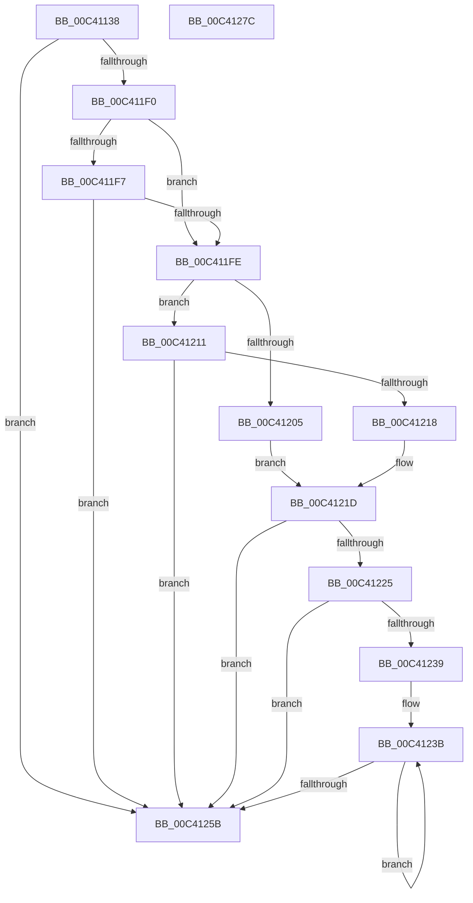

# PopReadLegacySimulatedArchitecturalClasses

- RVA: `0x00C41138`–`0x00C4127D` (길이 `325` bytes)
- VA: `0x0000000140C41138`
- 실행 섹션: `INIT`
- PDB 이름 있음: `예`; PDB Function 태그: `아니요`
- unwind 정보 RVA: `0x000CCDBC`
- 디코드: `90`개 명령, `325/325` bytes 표시
- 미해석 바이트: `0` (있으면 어셈블리에 `.byte`로 보존)

> 이 문서는 커널 이미지의 기계어와 PDB 기호를 분석해 생성했습니다. 4번과 5번은 함수 원형과 자료형을 바이너리 사용 방식에서 추정한 C 해석이며 원본 소스 복구 결과는 아닙니다.

## 1. Dependencies

- 직접 호출 지점: **6**; 고유 호출 대상: **5**
- 직접 호출자로 확인된 함수: **1**
- RIP 상대 이미지 참조: **2**

### Outgoing calls
- `0x00C4118F` → [memset](../../text/6C/memset_function_006C6C40.md) (function, `0x006C6C40`)
- `0x00C411BF` → [memset](../../text/6C/memset_function_006C6C40.md) (function, `0x006C6C40`)
- `0x00C411E7` → [ZwQueryValueKey](../../text/6A/ZwQueryValueKey_function_006AD3B0.md) (function, `0x006AD3B0`)
- `0x00C4122D` → [KeAddGroupAffinityEx](../../text/25/KeAddGroupAffinityEx_function_0025B6C0.md) (function, `0x0025B6C0`)
- `0x00C41242` → [KeCheckProcessorAffinityEx](../../text/30/KeCheckProcessorAffinityEx_function_00305150.md) (function, `0x00305150`)
- `0x00C41265` → [_security_check_cookie](../../text/6A/_security_check_cookie_function_006AC640.md) (function, `0x006AC640`)

### Direct callers
- [PopReadSimulatedArchitecturalClasses](PopReadSimulatedArchitecturalClasses_function_00C41284.md) at `0x00C413E4`

### Static image references
- `0x00C4114F` → RVA `0x00E0A740` (`.data`; read)
- `0x00C41162` → RVA `0x00C7C370` (` ?? ::PBOPGDP::`string'`; read)

## 2. Other-region calls and transfers

- 다른 실행 섹션으로 향하는 call: **6**
  - `0x00C4118F` → [memset](../../text/6C/memset_function_006C6C40.md) (`INIT` → `.text`)
  - `0x00C411BF` → [memset](../../text/6C/memset_function_006C6C40.md) (`INIT` → `.text`)
  - `0x00C411E7` → [ZwQueryValueKey](../../text/6A/ZwQueryValueKey_function_006AD3B0.md) (`INIT` → `.text`)
  - `0x00C4122D` → [KeAddGroupAffinityEx](../../text/25/KeAddGroupAffinityEx_function_0025B6C0.md) (`INIT` → `.text`)
  - `0x00C41242` → [KeCheckProcessorAffinityEx](../../text/30/KeCheckProcessorAffinityEx_function_00305150.md) (`INIT` → `.text`)
  - `0x00C41265` → [_security_check_cookie](../../text/6A/_security_check_cookie_function_006AC640.md) (`INIT` → `.text`)
- 별도 외부 분기/꼬리 이동을 확인하지 못했습니다.

## 3. Assembly (complete function range)

```asm
00C41138  40 55                           push rbp
00C4113A  53                              push rbx
00C4113B  56                              push rsi
00C4113C  57                              push rdi
00C4113D  41 55                           push r13
00C4113F  41 56                           push r14
00C41141  41 57                           push r15
00C41143  48 8D 6C 24 80                  lea rbp, [rsp - 0x80]
00C41148  48 81 EC 80 01 00 00            sub rsp, 0x180
00C4114F  48 8B 05 EA 95 1C 00            mov rax, qword ptr [rip + 0x1c95ea]
00C41156  48 33 C4                        xor rax, rsp
00C41159  48 89 45 70                     mov qword ptr [rbp + 0x70], rax
00C4115D  83 64 24 30 00                  and dword ptr [rsp + 0x30], 0
00C41162  48 8D 05 07 B2 03 00            lea rax, [rip + 0x3b207]
00C41169  49 8B D8                        mov rbx, r8
00C4116C  48 89 44 24 40                  mov qword ptr [rsp + 0x40], rax
00C41171  8B FA                           mov edi, edx
00C41173  48 C7 44 24 38 24 00 26 00      mov qword ptr [rsp + 0x38], 0x260024
00C4117C  4C 8B F1                        mov r14, rcx
00C4117F  33 D2                           xor edx, edx
00C41181  41 B8 00 01 00 00               mov r8d, 0x100
00C41187  48 8D 4C 24 68                  lea rcx, [rsp + 0x68]
00C4118C  45 8B F9                        mov r15d, r9d
00C4118F  E8 AC 5A A8 FF                  call 0x1406c6c40
00C41194  83 64 24 64 00                  and dword ptr [rsp + 0x64], 0
00C41199  48 8D 4C 24 68                  lea rcx, [rsp + 0x68]
00C4119E  0F 57 C0                        xorps xmm0, xmm0
00C411A1  C7 44 24 60 01 00 20 00         mov dword ptr [rsp + 0x60], 0x200001
00C411A9  33 D2                           xor edx, edx
00C411AB  41 B8 00 01 00 00               mov r8d, 0x100
00C411B1  0F 11 44 24 48                  movups xmmword ptr [rsp + 0x48], xmm0
00C411B6  40 32 F6                        xor sil, sil
00C411B9  41 BD 01 00 00 00               mov r13d, 1
00C411BF  E8 7C 5A A8 FF                  call 0x1406c6c40
00C411C4  48 8D 44 24 30                  lea rax, [rsp + 0x30]
00C411C9  48 8B CB                        mov rcx, rbx
00C411CC  48 89 44 24 28                  mov qword ptr [rsp + 0x28], rax
00C411D1  4C 8D 4C 24 48                  lea r9, [rsp + 0x48]
00C411D6  45 8D 45 03                     lea r8d, [r13 + 3]
00C411DA  C7 44 24 20 10 00 00 00         mov dword ptr [rsp + 0x20], 0x10
00C411E2  48 8D 54 24 38                  lea rdx, [rsp + 0x38]
00C411E7  E8 C4 C1 A6 FF                  call 0x1406ad3b0
00C411EC  85 C0                           test eax, eax
00C411EE  78 6B                           js 0x140c4125b
00C411F0  83 7C 24 48 04                  cmp dword ptr [rsp + 0x48], 4
00C411F5  74 07                           je 0x140c411fe
00C411F7  83 7C 24 48 0B                  cmp dword ptr [rsp + 0x48], 0xb
00C411FC  75 5D                           jne 0x140c4125b
00C411FE  83 7C 24 4C 04                  cmp dword ptr [rsp + 0x4c], 4
00C41203  75 0C                           jne 0x140c41211
00C41205  44 8B 44 24 50                  mov r8d, dword ptr [rsp + 0x50]
00C4120A  4C 89 44 24 50                  mov qword ptr [rsp + 0x50], r8
00C4120F  EB 0C                           jmp 0x140c4121d
00C41211  83 7C 24 4C 08                  cmp dword ptr [rsp + 0x4c], 8
00C41216  75 43                           jne 0x140c4125b
00C41218  4C 8B 44 24 50                  mov r8, qword ptr [rsp + 0x50]
00C4121D  41 8A F5                        mov sil, r13b
00C41220  4D 85 F6                        test r14, r14
00C41223  74 36                           je 0x140c4125b
00C41225  0F B7 D7                        movzx edx, di
00C41228  48 8D 4C 24 60                  lea rcx, [rsp + 0x60]
00C4122D  E8 8E A4 61 FF                  call 0x14025b6c0
00C41232  33 DB                           xor ebx, ebx
00C41234  45 85 FF                        test r15d, r15d
00C41237  74 22                           je 0x140c4125b
00C41239  33 FF                           xor edi, edi
00C4123B  8B D3                           mov edx, ebx
00C4123D  48 8D 4C 24 60                  lea rcx, [rsp + 0x60]
00C41242  E8 09 3F 6C FF                  call 0x140305150
00C41247  85 C0                           test eax, eax
00C41249  0F 94 C1                        sete cl
00C4124C  41 03 DD                        add ebx, r13d
00C4124F  41 88 0C 3E                     mov byte ptr [r14 + rdi], cl
00C41253  49 03 FD                        add rdi, r13
00C41256  41 3B DF                        cmp ebx, r15d
00C41259  72 E0                           jb 0x140c4123b
00C4125B  40 8A C6                        mov al, sil
00C4125E  48 8B 4D 70                     mov rcx, qword ptr [rbp + 0x70]
00C41262  48 33 CC                        xor rcx, rsp
00C41265  E8 D6 B3 A6 FF                  call 0x1406ac640
00C4126A  48 81 C4 80 01 00 00            add rsp, 0x180
00C41271  41 5F                           pop r15
00C41273  41 5E                           pop r14
00C41275  41 5D                           pop r13
00C41277  5F                              pop rdi
00C41278  5E                              pop rsi
00C41279  5B                              pop rbx
00C4127A  5D                              pop rbp
00C4127B  C3                              ret
00C4127C  CC                              int3
```

## 4. C-style interpretation (structured pseudocode)

```c
__int64 __fastcall PopReadLegacySimulatedArchitecturalClasses(__int64 a1, int a2, __int64 a3, int a4)
{
    __int64 result;
    __int64 v_rbx;
    __int64 v_rdi;
    __int64 v_rsi;
    __int64 v_rsp;
    unsigned __int64 v_stack_m150;
    unsigned int v_stack_m154;
    unsigned int v_stack_m158;
    unsigned int v_stack_m168;
    unsigned int v_stack_m16C;
    unsigned __int64 v_stack_m170;
    unsigned __int64 v_stack_m178;
    unsigned __int64 v_stack_m180;
    unsigned int v_stack_m188;
    unsigned __int64 v_stack_m190;
    unsigned int v_stack_m198;
    unsigned __int64 v_stack_m48;
    unsigned __int64 v_stack_mB8;

    v_rsp = (v_rsp) - (384);
    result = (*(unsigned __int64 *)(v_rip + 1873386)) ^ (v_rsp);
    v_stack_m48 = result;
    v_stack_m178 = v_rip + 242183;
    v_stack_m180 = 0x260024ULL;
    a2 = 0;
    result = memset(v_stack_m150, a2, 256, a4);
    v_stack_m158 = 0x200001ULL;
    a2 = 0;
    v_stack_m170 = v_xmm0;
    v_rsi = 0;
    result = memset(v_stack_m150, a2, 256, a4);
    v_stack_m190 = v_stack_m188;
    v_stack_m198 = 16;
    result = ZwQueryValueKey(a3, v_stack_m180, 1 + 3, v_stack_m170);
    if (sign_flag) goto loc_00C4125B;
    if (v_stack_m170 == 4) goto loc_00C411FE;
    if (v_stack_m170 != 11) goto loc_00C4125B;
loc_00C411FE:
    if (v_stack_m16C != 4) goto loc_00C41211;
    v_stack_m168 = (unsigned int)(v_stack_m168);
    goto loc_00C4121D;
loc_00C41211:
    if (v_stack_m16C != 8) goto loc_00C4125B;
loc_00C4121D:
    if (a1 == 0) goto loc_00C4125B;
    result = KeAddGroupAffinityEx(v_stack_m158, (unsigned __int16)((unsigned int)(a2)), v_stack_m168, v_stack_m170);
    v_rbx = 0;
    if ((unsigned int)((unsigned int)(a4)) == 0) goto loc_00C4125B;
    v_rdi = 0;
loc_00C4123B:
    result = KeCheckProcessorAffinityEx(v_stack_m158, 0, v_stack_m168, v_stack_m170);
    a1 = ((unsigned int)(result) == 0) ? 1 : 0;
    v_rbx = (unsigned int)((v_rbx) + (1));
    *(unsigned __int8 *)(a1 + v_rdi * 1) = (unsigned __int8)(a1);
    v_rdi = (v_rdi) + (1);
    if (((unsigned int)(v_rbx)) < ((unsigned int)((unsigned int)(a4)))) goto loc_00C4123B;
loc_00C4125B:
    a1 = (v_stack_m48) ^ (v_rsp);
    result = _security_check_cookie(a1, 0, v_stack_m168, v_stack_m170);
    v_rsp = (v_rsp) + (384);
    return result;
}
```

## 5. (Beta) C Style

```c
int64_t PopReadLegacySimulatedArchitecturalClasses(int64_t Arg1, int32_t Arg2, int64_t Arg3, int32_t Arg4)
{
    int64_t result;
    int64_t local_rbx;
    int64_t local_rdi;
    int64_t local_rsi;
    int64_t local_rsp;
    uint64_t v_stack_m150;
    uint32_t v_stack_m154;
    uint32_t v_stack_m158;
    uint32_t v_stack_m168;
    uint32_t v_stack_m16C;
    uint64_t v_stack_m170;
    uint64_t v_stack_m178;
    uint64_t v_stack_m180;
    uint32_t v_stack_m188;
    uint64_t v_stack_m190;
    uint32_t v_stack_m198;
    uint64_t v_stack_m48;
    uint64_t v_stack_mB8;

    local_rsp = (local_rsp) - (384);
    result = (*(uint64_t *)(v_rip + 0x1C95EA)) ^ (local_rsp);
    v_stack_m48 = result;
    v_stack_m178 = v_rip + 242183;
    v_stack_m180 = 0x260024ULL;
    Arg2 = 0;
    result = memset(v_stack_m150, Arg2, 256, Arg4);
    v_stack_m158 = 0x200001ULL;
    Arg2 = 0;
    v_stack_m170 = v_xmm0;
    local_rsi = 0;
    result = memset(v_stack_m150, Arg2, 256, Arg4);
    v_stack_m190 = v_stack_m188;
    v_stack_m198 = 16;
    result = ZwQueryValueKey(Arg3, v_stack_m180, 1 + 3, v_stack_m170);
    if (sign_flag) goto loc_00C4125B;
    if (v_stack_m170 == 4) goto loc_00C411FE;
    if (v_stack_m170 != 11) goto loc_00C4125B;
loc_00C411FE:
    if (v_stack_m16C != 4) goto loc_00C41211;
    v_stack_m168 = (uint32_t)(v_stack_m168);
    goto loc_00C4121D;
loc_00C41211:
    if (v_stack_m16C != 8) goto loc_00C4125B;
loc_00C4121D:
    if (Arg1 == 0) goto loc_00C4125B;
    result = KeAddGroupAffinityEx(v_stack_m158, (uint16_t)((uint32_t)(Arg2)), v_stack_m168, v_stack_m170);
    local_rbx = 0;
    if ((uint32_t)((uint32_t)(Arg4)) == 0) goto loc_00C4125B;
    local_rdi = 0;
loc_00C4123B:
    result = KeCheckProcessorAffinityEx(v_stack_m158, 0, v_stack_m168, v_stack_m170);
    Arg1 = ((uint32_t)(result) == 0) ? 1 : 0;
    local_rbx = (uint32_t)((local_rbx) + (1));
    *(uint8_t *)(Arg1 + local_rdi * 1) = (uint8_t)(Arg1);
    local_rdi = (local_rdi) + (1);
    if (((uint32_t)(local_rbx)) < ((uint32_t)((uint32_t)(Arg4)))) goto loc_00C4123B;
loc_00C4125B:
    Arg1 = (v_stack_m48) ^ (local_rsp);
    result = _security_check_cookie(Arg1, 0, v_stack_m168, v_stack_m170);
    local_rsp = (local_rsp) + (384);
    return result;
}
```

## 6. Execution-region graph

[열기: 2D/3D 그래프와 함수 탐색 컨트롤 패널](../../../control-panel.html?section=init&rva=0x00C41138&view=graph)

- 2D 그래프는 위에서 아래로 흐르고, 3D 그래프는 빈 공간을 드래그해 회전합니다. Shift+드래그는 이동, 휠은 확대·축소, 함수 노드 선택은 대상 보고서 이동입니다.

### Static fallback


