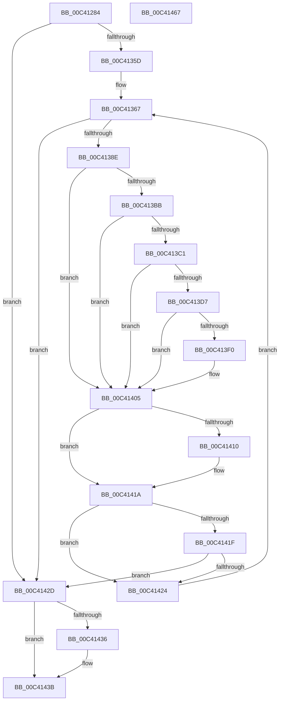

# PopReadSimulatedArchitecturalClasses

- RVA: `0x00C41284`–`0x00C41468` (길이 `484` bytes)
- VA: `0x0000000140C41284`
- 실행 섹션: `INIT`
- PDB 이름 있음: `예`; PDB Function 태그: `아니요`
- unwind 정보 RVA: `0x000CCD70`
- 디코드: `128`개 명령, `484/484` bytes 표시
- 미해석 바이트: `0` (있으면 어셈블리에 `.byte`로 보존)

> 이 문서는 커널 이미지의 기계어와 PDB 기호를 분석해 생성했습니다. 4번과 5번은 함수 원형과 자료형을 바이너리 사용 방식에서 추정한 C 해석이며 원본 소스 복구 결과는 아닙니다.

## 1. Dependencies

- 직접 호출 지점: **9**; 고유 호출 대상: **7**
- 직접 호출자로 확인된 함수: **1**
- RIP 상대 이미지 참조: **2**

### Outgoing calls
- `0x00C41350` → [ZwOpenKey](../../text/6A/ZwOpenKey_function_006AD310.md) (function, `0x006AD310`)
- `0x00C41381` → [ZwEnumerateKey](../../text/6A/ZwEnumerateKey_function_006AD710.md) (function, `0x006AD710`)
- `0x00C413B2` → [RtlUnicodeStringToInteger](../../page/99/RtlUnicodeStringToInteger_function_00993480.md) (function, `0x00993480`)
- `0x00C413CE` → [ZwOpenKey](../../text/6A/ZwOpenKey_function_006AD310.md) (function, `0x006AD310`)
- `0x00C413E4` → [PopReadLegacySimulatedArchitecturalClasses](PopReadLegacySimulatedArchitecturalClasses_function_00C41138.md) (function, `0x00C41138`)
- `0x00C413FD` → [PopReadSimulatedProcessorClass](PopReadSimulatedProcessorClass_function_00C41978.md) (function, `0x00C41978`)
- `0x00C41410` → [ZwClose](../../text/6A/ZwClose_function_006AD2B0.md) (function, `0x006AD2B0`)
- `0x00C41436` → [ZwClose](../../text/6A/ZwClose_function_006AD2B0.md) (function, `0x006AD2B0`)
- `0x00C41445` → [_security_check_cookie](../../text/6A/_security_check_cookie_function_006AC640.md) (function, `0x006AC640`)

### Direct callers
- [PopDetectSimulatedHeteroProcessors](PopDetectSimulatedHeteroProcessors_function_00C40DD8.md) at `0x00C40E1A`
- [PopDetectSimulatedHeteroProcessors](PopDetectSimulatedHeteroProcessors_function_00C40DD8.md) at `0x00C40F27`

### Static image references
- `0x00C412A3` → RVA `0x00E0A740` (`.data`; read)
- `0x00C41305` → RVA `0x00C7C3A0` (` ?? ::PBOPGDP::`string'`; read)

## 2. Other-region calls and transfers

- 다른 실행 섹션으로 향하는 call: **7**
  - `0x00C41350` → [ZwOpenKey](../../text/6A/ZwOpenKey_function_006AD310.md) (`INIT` → `.text`)
  - `0x00C41381` → [ZwEnumerateKey](../../text/6A/ZwEnumerateKey_function_006AD710.md) (`INIT` → `.text`)
  - `0x00C413B2` → [RtlUnicodeStringToInteger](../../page/99/RtlUnicodeStringToInteger_function_00993480.md) (`INIT` → `PAGE`)
  - `0x00C413CE` → [ZwOpenKey](../../text/6A/ZwOpenKey_function_006AD310.md) (`INIT` → `.text`)
  - `0x00C41410` → [ZwClose](../../text/6A/ZwClose_function_006AD2B0.md) (`INIT` → `.text`)
  - `0x00C41436` → [ZwClose](../../text/6A/ZwClose_function_006AD2B0.md) (`INIT` → `.text`)
  - `0x00C41445` → [_security_check_cookie](../../text/6A/_security_check_cookie_function_006AC640.md) (`INIT` → `.text`)
- 별도 외부 분기/꼬리 이동을 확인하지 못했습니다.

## 3. Assembly (complete function range)

```asm
00C41284  48 8B C4                        mov rax, rsp
00C41287  48 89 70 10                     mov qword ptr [rax + 0x10], rsi
00C4128B  48 89 78 18                     mov qword ptr [rax + 0x18], rdi
00C4128F  4C 89 60 20                     mov qword ptr [rax + 0x20], r12
00C41293  55                              push rbp
00C41294  41 56                           push r14
00C41296  41 57                           push r15
00C41298  48 8D 68 A1                     lea rbp, [rax - 0x5f]
00C4129C  48 81 EC F0 00 00 00            sub rsp, 0xf0
00C412A3  48 8B 05 96 94 1C 00            mov rax, qword ptr [rip + 0x1c9496]
00C412AA  48 33 C4                        xor rax, rsp
00C412AD  48 89 45 3F                     mov qword ptr [rbp + 0x3f], rax
00C412B1  83 65 87 00                     and dword ptr [rbp - 0x79], 0
00C412B5  4C 8D 45 F7                     lea r8, [rbp - 9]
00C412B9  83 65 9F 00                     and dword ptr [rbp - 0x61], 0
00C412BD  33 C0                           xor eax, eax
00C412BF  21 45 E3                        and dword ptr [rbp - 0x1d], eax
00C412C2  0F 57 C0                        xorps xmm0, xmm0
00C412C5  83 65 13 00                     and dword ptr [rbp + 0x13], 0
00C412C9  4C 8B F9                        mov r15, rcx
00C412CC  48 83 65 8F 00                  and qword ptr [rbp - 0x71], 0
00C412D1  B9 40 02 00 00                  mov ecx, 0x240
00C412D6  48 83 65 97 00                  and qword ptr [rbp - 0x69], 0
00C412DB  44 8B E2                        mov r12d, edx
00C412DE  48 83 65 FF 00                  and qword ptr [rbp - 1], 0
00C412E3  0F 57 C9                        xorps xmm1, xmm1
00C412E6  48 83 65 CF 00                  and qword ptr [rbp - 0x31], 0
00C412EB  BA 19 00 02 00                  mov edx, 0x20019
00C412F0  48 89 45 37                     mov qword ptr [rbp + 0x37], rax
00C412F4  40 32 F6                        xor sil, sil
00C412F7  48 C7 45 C7 30 00 00 00         mov qword ptr [rbp - 0x39], 0x30
00C412FF  45 32 F6                        xor r14b, r14b
00C41302  21 45 CB                        and dword ptr [rbp - 0x35], eax
00C41305  48 8D 05 94 B0 03 00            lea rax, [rip + 0x3b094]
00C4130C  48 89 45 BF                     mov qword ptr [rbp - 0x41], rax
00C41310  48 8D 45 B7                     lea rax, [rbp - 0x49]
00C41314  48 89 45 07                     mov qword ptr [rbp + 7], rax
00C41318  48 8D 45 A7                     lea rax, [rbp - 0x59]
00C4131C  89 4D 0F                        mov dword ptr [rbp + 0xf], ecx
00C4131F  89 4D DF                        mov dword ptr [rbp - 0x21], ecx
00C41322  48 8D 4D 97                     lea rcx, [rbp - 0x69]
00C41326  48 C7 45 F7 30 00 00 00         mov qword ptr [rbp - 9], 0x30
00C4132E  83 65 FB 00                     and dword ptr [rbp - 5], 0
00C41332  48 89 45 D7                     mov qword ptr [rbp - 0x29], rax
00C41336  0F 11 45 A7                     movups xmmword ptr [rbp - 0x59], xmm0
00C4133A  48 C7 45 B7 A2 00 A4 00         mov qword ptr [rbp - 0x49], 0xa400a2
00C41342  0F 11 4D 27                     movups xmmword ptr [rbp + 0x27], xmm1
00C41346  F3 0F 7F 45 17                  movdqu xmmword ptr [rbp + 0x17], xmm0
00C4134B  F3 0F 7F 45 E7                  movdqu xmmword ptr [rbp - 0x19], xmm0
00C41350  E8 BB BF A6 FF                  call 0x1406ad310
00C41355  85 C0                           test eax, eax
00C41357  0F 88 D0 00 00 00               js 0x140c4142d
00C4135D  48 8B 4D 97                     mov rcx, qword ptr [rbp - 0x69]
00C41361  33 FF                           xor edi, edi
00C41363  48 89 4D CF                     mov qword ptr [rbp - 0x31], rcx
00C41367  48 8D 45 9F                     lea rax, [rbp - 0x61]
00C4136B  45 33 C0                        xor r8d, r8d
00C4136E  48 89 44 24 28                  mov qword ptr [rsp + 0x28], rax
00C41373  4C 8D 4D 27                     lea r9, [rbp + 0x27]
00C41377  8B D7                           mov edx, edi
00C41379  C7 44 24 20 18 00 00 00         mov dword ptr [rsp + 0x20], 0x18
00C41381  E8 8A C3 A6 FF                  call 0x1406ad710
00C41386  85 C0                           test eax, eax
00C41388  0F 88 9F 00 00 00               js 0x140c4142d
00C4138E  48 8D 45 37                     lea rax, [rbp + 0x37]
00C41392  48 89 45 AF                     mov qword ptr [rbp - 0x51], rax
00C41396  4C 8D 45 87                     lea r8, [rbp - 0x79]
00C4139A  0F B7 45 33                     movzx eax, word ptr [rbp + 0x33]
00C4139E  48 8D 4D A7                     lea rcx, [rbp - 0x59]
00C413A2  66 89 45 A7                     mov word ptr [rbp - 0x59], ax
00C413A6  B8 04 00 00 00                  mov eax, 4
00C413AB  66 89 45 A9                     mov word ptr [rbp - 0x57], ax
00C413AF  8D 50 06                        lea edx, [rax + 6]
00C413B2  E8 C9 20 D5 FF                  call 0x140993480
00C413B7  85 C0                           test eax, eax
00C413B9  78 4A                           js 0x140c41405
00C413BB  83 7D 87 20                     cmp dword ptr [rbp - 0x79], 0x20
00C413BF  73 44                           jae 0x140c41405
00C413C1  4C 8D 45 C7                     lea r8, [rbp - 0x39]
00C413C5  BA 19 00 02 00                  mov edx, 0x20019
00C413CA  48 8D 4D 8F                     lea rcx, [rbp - 0x71]
00C413CE  E8 3D BF A6 FF                  call 0x1406ad310
00C413D3  85 C0                           test eax, eax
00C413D5  78 2E                           js 0x140c41405
00C413D7  4C 8B 45 8F                     mov r8, qword ptr [rbp - 0x71]
00C413DB  45 8B CC                        mov r9d, r12d
00C413DE  8B 55 87                        mov edx, dword ptr [rbp - 0x79]
00C413E1  49 8B CF                        mov rcx, r15
00C413E4  E8 4F FD FF FF                  call 0x140c41138
00C413E9  40 8A F0                        mov sil, al
00C413EC  84 C0                           test al, al
00C413EE  75 15                           jne 0x140c41405
00C413F0  4C 8B 45 8F                     mov r8, qword ptr [rbp - 0x71]
00C413F4  45 8B CC                        mov r9d, r12d
00C413F7  8B 55 87                        mov edx, dword ptr [rbp - 0x79]
00C413FA  49 8B CF                        mov rcx, r15
00C413FD  E8 76 05 00 00                  call 0x140c41978
00C41402  40 8A F0                        mov sil, al
00C41405  48 8B 4D 8F                     mov rcx, qword ptr [rbp - 0x71]
00C41409  FF C7                           inc edi
00C4140B  48 85 C9                        test rcx, rcx
00C4140E  74 0A                           je 0x140c4141a
00C41410  E8 9B BE A6 FF                  call 0x1406ad2b0
00C41415  48 83 65 8F 00                  and qword ptr [rbp - 0x71], 0
00C4141A  44 0A F6                        or r14b, sil
00C4141D  74 05                           je 0x140c41424
00C4141F  4D 85 FF                        test r15, r15
00C41422  74 09                           je 0x140c4142d
00C41424  48 8B 4D 97                     mov rcx, qword ptr [rbp - 0x69]
00C41428  E9 3A FF FF FF                  jmp 0x140c41367
00C4142D  48 8B 4D 97                     mov rcx, qword ptr [rbp - 0x69]
00C41431  48 85 C9                        test rcx, rcx
00C41434  74 05                           je 0x140c4143b
00C41436  E8 75 BE A6 FF                  call 0x1406ad2b0
00C4143B  41 8A C6                        mov al, r14b
00C4143E  48 8B 4D 3F                     mov rcx, qword ptr [rbp + 0x3f]
00C41442  48 33 CC                        xor rcx, rsp
00C41445  E8 F6 B1 A6 FF                  call 0x1406ac640
00C4144A  4C 8D 9C 24 F0 00 00 00         lea r11, [rsp + 0xf0]
00C41452  49 8B 73 28                     mov rsi, qword ptr [r11 + 0x28]
00C41456  49 8B 7B 30                     mov rdi, qword ptr [r11 + 0x30]
00C4145A  4D 8B 63 38                     mov r12, qword ptr [r11 + 0x38]
00C4145E  49 8B E3                        mov rsp, r11
00C41461  41 5F                           pop r15
00C41463  41 5E                           pop r14
00C41465  5D                              pop rbp
00C41466  C3                              ret
00C41467  CC                              int3
```

## 4. C-style interpretation (structured pseudocode)

```c
__int64 __fastcall PopReadSimulatedArchitecturalClasses(__int64 a1, int a2)
{
    __int64 result;
    __int64 v_r14;
    __int64 v_rdi;
    __int64 v_rsi;
    __int64 v_rsp;
    unsigned __int64 v_stack_m18;
    unsigned __int64 v_stack_mE0;
    unsigned int v_stack_mE8;

    *(unsigned __int64 *)(v_rsp + 16) = v_rsi;
    *(unsigned __int64 *)(v_rsp + 24) = v_rdi;
    *(unsigned __int64 *)(v_rsp + 32) = v_r12;
    v_rsp = (v_rsp) - (240);
    result = (*(unsigned __int64 *)(v_rip + 1873046)) ^ (v_rsp);
    *(unsigned __int64 *)(v_rsp - 95 + 63) = result;
    result = 0;
    *(unsigned __int64 *)(v_rsp - 95 + 55) = 0;
    v_rsi = 0;
    *(unsigned __int64 *)(v_rsp - 95 - 57) = 48;
    v_r14 = 0;
    *(unsigned __int64 *)(v_rsp - 95 - 65) = v_rip + 241812;
    *(unsigned __int64 *)(v_rsp - 95 + 7) = v_rsp - 95 - 73;
    *(unsigned int *)(v_rsp - 95 + 15) = 576;
    *(unsigned int *)(v_rsp - 95 - 33) = 576;
    *(unsigned __int64 *)(v_rsp - 95 - 9) = 48;
    *(unsigned __int64 *)(v_rsp - 95 - 41) = v_rsp - 95 - 89;
    *(unsigned __int64 *)(v_rsp - 95 - 89) = v_xmm0;
    *(unsigned __int64 *)(v_rsp - 95 - 73) = 0xA400A2ULL;
    *(unsigned __int64 *)(v_rsp - 95 + 39) = v_xmm1;
    *(unsigned __int64 *)(v_rsp - 95 + 23) = v_xmm0;
    *(unsigned __int64 *)(v_rsp - 95 - 25) = v_xmm0;
    result = ZwOpenKey(v_rsp - 95 - 105, (unsigned int)(0x20019ULL), v_rsp - 95 - 9, a4);
    if (sign_flag) goto loc_00C4142D;
    v_rdi = 0;
    *(unsigned __int64 *)(v_rsp - 95 - 49) = *(unsigned __int64 *)(v_rsp - 95 - 105);
loc_00C41367:
    a3 = 0;
    v_stack_mE0 = v_rsp - 95 - 97;
    v_stack_mE8 = 24;
    result = ZwEnumerateKey(*(unsigned __int64 *)(v_rsp - 95 - 105), 0, a3, v_rsp - 95 + 39);
    if (sign_flag) goto loc_00C4142D;
    *(unsigned __int64 *)(v_rsp - 95 - 81) = v_rsp - 95 + 55;
    *(unsigned __int16 *)(v_rsp - 95 - 89) = (unsigned __int16)(*(unsigned __int16 *)(v_rsp - 95 + 51));
    *(unsigned __int16 *)(v_rsp - 95 - 87) = 4;
    result = RtlUnicodeStringToInteger(v_rsp - 95 - 89, 4 + 6, v_rsp - 95 - 121, v_rsp - 95 + 39);
    if (sign_flag) goto loc_00C41405;
    if ((*(unsigned int *)(v_rsp - 95 - 121)) >= 32) goto loc_00C41405;
    result = ZwOpenKey(v_rsp - 95 - 113, (unsigned int)(0x20019ULL), v_rsp - 95 - 57, v_rsp - 95 + 39);
    if (sign_flag) goto loc_00C41405;
    result = PopReadLegacySimulatedArchitecturalClasses(a1, (unsigned int)(*(unsigned int *)(v_rsp - 95 - 121)), *(unsigned __int64 *)(v_rsp - 95 - 113), (unsigned int)((unsigned int)((unsigned int)(a2))));
    v_rsi = (unsigned __int8)(result);
    if ((unsigned __int8)(result) == 0) {
        a3 = *(unsigned __int64 *)(v_rsp - 95 - 113);
        a4 = (unsigned int)((unsigned int)(a2));
        a2 = *(unsigned int *)(v_rsp - 95 - 121);
        a1 = a1;
        result = PopReadSimulatedProcessorClass(a1, a2, a3, a4);
        v_rsi = (unsigned __int8)(result);
    }
    v_rdi = (unsigned int)((v_rdi) + 1);
    if (*(unsigned __int64 *)(v_rsp - 95 - 113) != 0) {
        result = ZwClose(*(unsigned __int64 *)(v_rsp - 95 - 113), a2, a3, a4);
    }
    v_r14 = (unsigned __int8)((v_r14) | ((unsigned __int8)(v_rsi)));
    if (condition_is_equal) goto loc_00C41424;
    if (a1 == 0) goto loc_00C4142D;
loc_00C41424:
    goto loc_00C41367;
loc_00C4142D:
    if (*(unsigned __int64 *)(v_rsp - 95 - 105) != 0) {
        result = ZwClose(*(unsigned __int64 *)(v_rsp - 95 - 105), a2, a3, a4);
    }
    a1 = (*(unsigned __int64 *)(v_rsp - 95 + 63)) ^ (v_rsp);
    result = _security_check_cookie(a1, a2, a3, a4);
    return result;
}
```

## 5. (Beta) C Style

```c
int64_t PopReadSimulatedArchitecturalClasses(int64_t Arg1, int32_t Arg2)
{
    int64_t result;
    int64_t local_r14;
    int64_t local_rdi;
    int64_t local_rsi;
    int64_t local_rsp;
    uint64_t v_stack_m18;
    uint64_t v_stack_mE0;
    uint32_t v_stack_mE8;

    *(uint64_t *)(local_rsp + 0x10) = local_rsi;
    *(uint64_t *)(local_rsp + 0x18) = local_rdi;
    *(uint64_t *)(local_rsp + 0x20) = local_r12;
    local_rsp = (local_rsp) - (240);
    result = (*(uint64_t *)(v_rip + 0x1C9496)) ^ (local_rsp);
    *(uint64_t *)(local_rsp - 0x5F + 0x3F) = result;
    result = 0;
    *(uint64_t *)(local_rsp - 0x5F + 0x37) = 0;
    local_rsi = 0;
    *(uint64_t *)(local_rsp - 0x5F - 0x39) = 48;
    local_r14 = 0;
    *(uint64_t *)(local_rsp - 0x5F - 0x41) = v_rip + 241812;
    *(uint64_t *)(local_rsp - 0x5F + 0x7) = local_rsp - 95 - 73;
    *(uint32_t *)(local_rsp - 0x5F + 0xF) = 576;
    *(uint32_t *)(local_rsp - 0x5F - 0x21) = 576;
    *(uint64_t *)(local_rsp - 0x5F - 0x9) = 48;
    *(uint64_t *)(local_rsp - 0x5F - 0x29) = local_rsp - 95 - 89;
    *(uint64_t *)(local_rsp - 0x5F - 0x59) = v_xmm0;
    *(uint64_t *)(local_rsp - 0x5F - 0x49) = 0xA400A2ULL;
    *(uint64_t *)(local_rsp - 0x5F + 0x27) = v_xmm1;
    *(uint64_t *)(local_rsp - 0x5F + 0x17) = v_xmm0;
    *(uint64_t *)(local_rsp - 0x5F - 0x19) = v_xmm0;
    result = ZwOpenKey(local_rsp - 95 - 105, (uint32_t)(0x20019ULL), local_rsp - 95 - 9, a4);
    if (sign_flag) goto loc_00C4142D;
    local_rdi = 0;
    *(uint64_t *)(local_rsp - 0x5F - 0x31) = *(uint64_t *)(local_rsp - 0x5F - 0x69);
loc_00C41367:
    a3 = 0;
    v_stack_mE0 = local_rsp - 95 - 97;
    v_stack_mE8 = 24;
    result = ZwEnumerateKey(*(uint64_t *)(local_rsp - 0x5F - 0x69), 0, a3, local_rsp - 95 + 39);
    if (sign_flag) goto loc_00C4142D;
    *(uint64_t *)(local_rsp - 0x5F - 0x51) = local_rsp - 95 + 55;
    *(uint16_t *)(local_rsp - 0x5F - 0x59) = (uint16_t)(*(uint16_t *)(local_rsp - 0x5F + 0x33));
    *(uint16_t *)(local_rsp - 0x5F - 0x57) = 4;
    result = RtlUnicodeStringToInteger(local_rsp - 95 - 89, 4 + 6, local_rsp - 95 - 121, local_rsp - 95 + 39);
    if (sign_flag) goto loc_00C41405;
    if ((*(uint32_t *)(local_rsp - 0x5F - 0x79)) >= 32) goto loc_00C41405;
    result = ZwOpenKey(local_rsp - 95 - 113, (uint32_t)(0x20019ULL), local_rsp - 95 - 57, local_rsp - 95 + 39);
    if (sign_flag) goto loc_00C41405;
    result = PopReadLegacySimulatedArchitecturalClasses(Arg1, (uint32_t)(*(uint32_t *)(local_rsp - 0x5F - 0x79)), *(uint64_t *)(local_rsp - 0x5F - 0x71), (uint32_t)((uint32_t)((uint32_t)(Arg2))));
    local_rsi = (uint8_t)(result);
    if ((uint8_t)(result) == 0) {
        a3 = *(uint64_t *)(local_rsp - 0x5F - 0x71);
        a4 = (uint32_t)((uint32_t)(Arg2));
        Arg2 = *(uint32_t *)(local_rsp - 0x5F - 0x79);
        Arg1 = Arg1;
        result = PopReadSimulatedProcessorClass(Arg1, Arg2, a3, a4);
        local_rsi = (uint8_t)(result);
    }
    local_rdi = (uint32_t)((local_rdi) + 1);
    if (*(uint64_t *)(local_rsp - 0x5F - 0x71) != 0) {
        result = ZwClose(*(uint64_t *)(local_rsp - 0x5F - 0x71), Arg2, a3, a4);
    }
    local_r14 = (uint8_t)((local_r14) | ((uint8_t)(local_rsi)));
    if (condition_is_equal) goto loc_00C41424;
    if (Arg1 == 0) goto loc_00C4142D;
loc_00C41424:
    goto loc_00C41367;
loc_00C4142D:
    if (*(uint64_t *)(local_rsp - 0x5F - 0x69) != 0) {
        result = ZwClose(*(uint64_t *)(local_rsp - 0x5F - 0x69), Arg2, a3, a4);
    }
    Arg1 = (*(uint64_t *)(local_rsp - 0x5F + 0x3F)) ^ (local_rsp);
    result = _security_check_cookie(Arg1, Arg2, a3, a4);
    return result;
}
```

## 6. Execution-region graph

[열기: 2D/3D 그래프와 함수 탐색 컨트롤 패널](../../../control-panel.html?section=init&rva=0x00C41284&view=graph)

- 2D 그래프는 위에서 아래로 흐르고, 3D 그래프는 빈 공간을 드래그해 회전합니다. Shift+드래그는 이동, 휠은 확대·축소, 함수 노드 선택은 대상 보고서 이동입니다.

### Static fallback


