# PopReadSimulatedHGSClasses

- RVA: `0x00C41470`–`0x00C41970` (길이 `1,280` bytes)
- VA: `0x0000000140C41470`
- 실행 섹션: `INIT`
- PDB 이름 있음: `예`; PDB Function 태그: `아니요`
- unwind 정보 RVA: `0x000CCD98`
- 디코드: `306`개 명령, `1,280/1,280` bytes 표시
- 미해석 바이트: `0` (있으면 어셈블리에 `.byte`로 보존)

> 이 문서는 커널 이미지의 기계어와 PDB 기호를 분석해 생성했습니다. 4번과 5번은 함수 원형과 자료형을 바이너리 사용 방식에서 추정한 C 해석이며 원본 소스 복구 결과는 아닙니다.

## 1. Dependencies

- 직접 호출 지점: **21**; 고유 호출 대상: **8**
- 직접 호출자로 확인된 함수: **1**
- RIP 상대 이미지 참조: **5**

### Outgoing calls
- `0x00C41654` → [ZwOpenKey](../../text/6A/ZwOpenKey_function_006AD310.md) (function, `0x006AD310`)
- `0x00C4168C` → [ZwEnumerateKey](../../text/6A/ZwEnumerateKey_function_006AD710.md) (function, `0x006AD710`)
- `0x00C416C4` → [RtlUnicodeStringToInteger](../../page/99/RtlUnicodeStringToInteger_function_00993480.md) (function, `0x00993480`)
- `0x00C416EE` → [ZwOpenKey](../../text/6A/ZwOpenKey_function_006AD310.md) (function, `0x006AD310`)
- `0x00C41712` → [ZwOpenKey](../../text/6A/ZwOpenKey_function_006AD310.md) (function, `0x006AD310`)
- `0x00C4174E` → [memset](../../text/6C/memset_function_006C6C40.md) (function, `0x006C6C40`)
- `0x00C4175F` → [RtlIntegerToUnicodeString](../../page/91/RtlIntegerToUnicodeString_function_0091D3E0.md) (function, `0x0091D3E0`)
- `0x00C41772` → [ZwOpenKey](../../text/6A/ZwOpenKey_function_006AD310.md) (function, `0x006AD310`)
- `0x00C41799` → [ZwOpenKey](../../text/6A/ZwOpenKey_function_006AD310.md) (function, `0x006AD310`)
- `0x00C417B2` → [memset](../../text/6C/memset_function_006C6C40.md) (function, `0x006C6C40`)
- `0x00C417C5` → [PopReadSimulatedProcessorClass](PopReadSimulatedProcessorClass_function_00C41978.md) (function, `0x00C41978`)
- `0x00C4181C` → [ZwOpenKey](../../text/6A/ZwOpenKey_function_006AD310.md) (function, `0x006AD310`)
- `0x00C41838` → [memset](../../text/6C/memset_function_006C6C40.md) (function, `0x006C6C40`)
- `0x00C4184B` → [PopReadSimulatedProcessorClass](PopReadSimulatedProcessorClass_function_00C41978.md) (function, `0x00C41978`)
- `0x00C41897` → [ZwClose](../../text/6A/ZwClose_function_006AD2B0.md) (function, `0x006AD2B0`)
- `0x00C418AE` → [ZwClose](../../text/6A/ZwClose_function_006AD2B0.md) (function, `0x006AD2B0`)
- `0x00C418C5` → [ZwClose](../../text/6A/ZwClose_function_006AD2B0.md) (function, `0x006AD2B0`)
- `0x00C418EE` → [ZwClose](../../text/6A/ZwClose_function_006AD2B0.md) (function, `0x006AD2B0`)
- `0x00C41902` → [ZwClose](../../text/6A/ZwClose_function_006AD2B0.md) (function, `0x006AD2B0`)
- `0x00C41944` → [ZwClose](../../text/6A/ZwClose_function_006AD2B0.md) (function, `0x006AD2B0`)
- `0x00C41956` → [_security_check_cookie](../../text/6A/_security_check_cookie_function_006AC640.md) (function, `0x006AC640`)

### Direct callers
- [PopDetectSimulatedHeteroProcessors](PopDetectSimulatedHeteroProcessors_function_00C40DD8.md) at `0x00C40E50`
- [PopDetectSimulatedHeteroProcessors](PopDetectSimulatedHeteroProcessors_function_00C40DD8.md) at `0x00C410D4`

### Static image references
- `0x00C4148C` → RVA `0x00E0A740` (`.data`; read)
- `0x00C414C4` → RVA `0x00C7C450` (` ?? ::PBOPGDP::`string'`; read)
- `0x00C414EA` → RVA `0x00C7C3A0` (` ?? ::PBOPGDP::`string'`; read)
- `0x00C41502` → RVA `0x00C7C490` (` ?? ::PBOPGDP::`string'`; read)
- `0x00C41518` → RVA `0x00C7C470` (` ?? ::PBOPGDP::`string'`; read)

## 2. Other-region calls and transfers

- 다른 실행 섹션으로 향하는 call: **19**
  - `0x00C41654` → [ZwOpenKey](../../text/6A/ZwOpenKey_function_006AD310.md) (`INIT` → `.text`)
  - `0x00C4168C` → [ZwEnumerateKey](../../text/6A/ZwEnumerateKey_function_006AD710.md) (`INIT` → `.text`)
  - `0x00C416C4` → [RtlUnicodeStringToInteger](../../page/99/RtlUnicodeStringToInteger_function_00993480.md) (`INIT` → `PAGE`)
  - `0x00C416EE` → [ZwOpenKey](../../text/6A/ZwOpenKey_function_006AD310.md) (`INIT` → `.text`)
  - `0x00C41712` → [ZwOpenKey](../../text/6A/ZwOpenKey_function_006AD310.md) (`INIT` → `.text`)
  - `0x00C4174E` → [memset](../../text/6C/memset_function_006C6C40.md) (`INIT` → `.text`)
  - `0x00C4175F` → [RtlIntegerToUnicodeString](../../page/91/RtlIntegerToUnicodeString_function_0091D3E0.md) (`INIT` → `PAGE`)
  - `0x00C41772` → [ZwOpenKey](../../text/6A/ZwOpenKey_function_006AD310.md) (`INIT` → `.text`)
  - `0x00C41799` → [ZwOpenKey](../../text/6A/ZwOpenKey_function_006AD310.md) (`INIT` → `.text`)
  - `0x00C417B2` → [memset](../../text/6C/memset_function_006C6C40.md) (`INIT` → `.text`)
  - `0x00C4181C` → [ZwOpenKey](../../text/6A/ZwOpenKey_function_006AD310.md) (`INIT` → `.text`)
  - `0x00C41838` → [memset](../../text/6C/memset_function_006C6C40.md) (`INIT` → `.text`)
  - `0x00C41897` → [ZwClose](../../text/6A/ZwClose_function_006AD2B0.md) (`INIT` → `.text`)
  - `0x00C418AE` → [ZwClose](../../text/6A/ZwClose_function_006AD2B0.md) (`INIT` → `.text`)
  - `0x00C418C5` → [ZwClose](../../text/6A/ZwClose_function_006AD2B0.md) (`INIT` → `.text`)
  - `0x00C418EE` → [ZwClose](../../text/6A/ZwClose_function_006AD2B0.md) (`INIT` → `.text`)
  - `0x00C41902` → [ZwClose](../../text/6A/ZwClose_function_006AD2B0.md) (`INIT` → `.text`)
  - `0x00C41944` → [ZwClose](../../text/6A/ZwClose_function_006AD2B0.md) (`INIT` → `.text`)
  - `0x00C41956` → [_security_check_cookie](../../text/6A/_security_check_cookie_function_006AC640.md) (`INIT` → `.text`)
- 별도 외부 분기/꼬리 이동을 확인하지 못했습니다.

## 3. Assembly (complete function range)

```asm
00C41470  40 55                           push rbp
00C41472  53                              push rbx
00C41473  56                              push rsi
00C41474  57                              push rdi
00C41475  41 54                           push r12
00C41477  41 55                           push r13
00C41479  41 56                           push r14
00C4147B  41 57                           push r15
00C4147D  48 8D AC 24 D8 FE FF FF         lea rbp, [rsp - 0x128]
00C41485  48 81 EC 28 02 00 00            sub rsp, 0x228
00C4148C  48 8B 05 AD 92 1C 00            mov rax, qword ptr [rip + 0x1c92ad]
00C41493  48 33 C4                        xor rax, rsp
00C41496  48 89 85 18 01 00 00            mov qword ptr [rbp + 0x118], rax
00C4149D  33 F6                           xor esi, esi
00C4149F  41 8B F8                        mov edi, r8d
00C414A2  0F 57 C0                        xorps xmm0, xmm0
00C414A5  44 89 4C 24 34                  mov dword ptr [rsp + 0x34], r9d
00C414AA  48 8B DA                        mov rbx, rdx
00C414AD  48 C7 45 B8 14 00 16 00         mov qword ptr [rbp - 0x48], 0x160014
00C414B5  4C 8B F9                        mov r15, rcx
00C414B8  89 75 6C                        mov dword ptr [rbp + 0x6c], esi
00C414BB  8D 56 30                        lea edx, [rsi + 0x30]
00C414BE  89 B5 84 00 00 00               mov dword ptr [rbp + 0x84], esi
00C414C4  48 8D 05 85 AF 03 00            lea rax, [rip + 0x3af85]
00C414CB  89 55 68                        mov dword ptr [rbp + 0x68], edx
00C414CE  48 89 45 C0                     mov qword ptr [rbp - 0x40], rax
00C414D2  4C 8D 85 C8 00 00 00            lea r8, [rbp + 0xc8]
00C414D9  33 C0                           xor eax, eax
00C414DB  89 74 24 30                     mov dword ptr [rsp + 0x30], esi
00C414DF  48 89 85 08 01 00 00            mov qword ptr [rbp + 0x108], rax
00C414E6  44 8D 66 18                     lea r12d, [rsi + 0x18]
00C414EA  48 8D 05 AF AE 03 00            lea rax, [rip + 0x3aeaf]
00C414F1  48 C7 45 D8 30 00 00 00         mov qword ptr [rbp - 0x28], 0x30
00C414F9  48 89 45 A0                     mov qword ptr [rbp - 0x60], rax
00C414FD  B9 40 02 00 00                  mov ecx, 0x240
00C41502  48 8D 05 87 AF 03 00            lea rax, [rip + 0x3af87]
00C41509  89 8D 80 00 00 00               mov dword ptr [rbp + 0x80], ecx
00C4150F  48 89 45 B0                     mov qword ptr [rbp - 0x50], rax
00C41513  48 8D 4C 24 68                  lea rcx, [rsp + 0x68]
00C41518  48 8D 05 51 AF 03 00            lea rax, [rip + 0x3af51]
00C4151F  48 C7 45 F0 40 02 00 00         mov qword ptr [rbp - 0x10], 0x240
00C41527  48 89 45 D0                     mov qword ptr [rbp - 0x30], rax
00C4152B  BA 19 00 02 00                  mov edx, 0x20019
00C41530  48 8D 85 10 01 00 00            lea rax, [rbp + 0x110]
00C41537  48 C7 45 98 A2 00 A4 00         mov qword ptr [rbp - 0x68], 0xa400a2
00C4153F  48 89 44 24 78                  mov qword ptr [rsp + 0x78], rax
00C41544  44 8A F6                        mov r14b, sil
00C41547  48 8D 45 98                     lea rax, [rbp - 0x68]
00C4154B  48 C7 45 A8 14 00 16 00         mov qword ptr [rbp - 0x58], 0x160014
00C41553  48 89 85 D8 00 00 00            mov qword ptr [rbp + 0xd8], rax
00C4155A  48 8D 45 88                     lea rax, [rbp - 0x78]
00C4155E  48 89 45 E8                     mov qword ptr [rbp - 0x18], rax
00C41562  48 8D 45 A8                     lea rax, [rbp - 0x58]
00C41566  48 89 45 18                     mov qword ptr [rbp + 0x18], rax
00C4156A  48 8D 44 24 70                  lea rax, [rsp + 0x70]
00C4156F  48 89 45 48                     mov qword ptr [rbp + 0x48], rax
00C41573  48 8D 45 B8                     lea rax, [rbp - 0x48]
00C41577  48 89 45 78                     mov qword ptr [rbp + 0x78], rax
00C4157B  48 8D 45 C8                     lea rax, [rbp - 0x38]
00C4157F  48 89 85 A8 00 00 00            mov qword ptr [rbp + 0xa8], rax
00C41586  0F 11 85 F8 00 00 00            movups xmmword ptr [rbp + 0xf8], xmm0
00C4158D  48 C7 45 08 30 00 00 00         mov qword ptr [rbp + 8], 0x30
00C41595  0F 11 45 88                     movups xmmword ptr [rbp - 0x78], xmm0
00C41599  48 C7 45 20 40 02 00 00         mov qword ptr [rbp + 0x20], 0x240
00C415A1  48 C7 45 C8 16 00 18 00         mov qword ptr [rbp - 0x38], 0x180016
00C415A9  48 C7 85 98 00 00 00 30 00 00 00  mov qword ptr [rbp + 0x98], 0x30
00C415B4  48 C7 85 B0 00 00 00 40 02 00 00  mov qword ptr [rbp + 0xb0], 0x240
00C415BF  89 75 80                        mov dword ptr [rbp - 0x80], esi
00C415C2  48 C7 85 C8 00 00 00 30 00 00 00  mov qword ptr [rbp + 0xc8], 0x30
00C415CD  48 C7 85 E0 00 00 00 40 02 00 00  mov qword ptr [rbp + 0xe0], 0x240
00C415D8  48 C7 44 24 70 00 00 08 00      mov qword ptr [rsp + 0x70], 0x80000
00C415E1  48 C7 45 38 30 00 00 00         mov qword ptr [rbp + 0x38], 0x30
00C415E9  48 C7 45 50 40 02 00 00         mov qword ptr [rbp + 0x50], 0x240
00C415F1  48 89 74 24 58                  mov qword ptr [rsp + 0x58], rsi
00C415F6  48 89 74 24 60                  mov qword ptr [rsp + 0x60], rsi
00C415FB  48 89 74 24 68                  mov qword ptr [rsp + 0x68], rsi
00C41600  48 89 74 24 48                  mov qword ptr [rsp + 0x48], rsi
00C41605  48 89 74 24 50                  mov qword ptr [rsp + 0x50], rsi
00C4160A  48 89 74 24 40                  mov qword ptr [rsp + 0x40], rsi
00C4160F  48 89 B5 D0 00 00 00            mov qword ptr [rbp + 0xd0], rsi
00C41616  F3 0F 7F 85 E8 00 00 00         movdqu xmmword ptr [rbp + 0xe8], xmm0
00C4161E  48 89 75 E0                     mov qword ptr [rbp - 0x20], rsi
00C41622  F3 0F 7F 45 F8                  movdqu xmmword ptr [rbp - 8], xmm0
00C41627  48 89 75 10                     mov qword ptr [rbp + 0x10], rsi
00C4162B  F3 0F 7F 45 28                  movdqu xmmword ptr [rbp + 0x28], xmm0
00C41630  48 89 75 40                     mov qword ptr [rbp + 0x40], rsi
00C41634  F3 0F 7F 45 58                  movdqu xmmword ptr [rbp + 0x58], xmm0
00C41639  48 89 75 70                     mov qword ptr [rbp + 0x70], rsi
00C4163D  F3 0F 7F 85 88 00 00 00         movdqu xmmword ptr [rbp + 0x88], xmm0
00C41645  48 89 B5 A0 00 00 00            mov qword ptr [rbp + 0xa0], rsi
00C4164C  F3 0F 7F 85 B8 00 00 00         movdqu xmmword ptr [rbp + 0xb8], xmm0
00C41654  E8 B7 BC A6 FF                  call 0x1406ad310
00C41659  85 C0                           test eax, eax
00C4165B  0F 88 D9 02 00 00               js 0x140c4193a
00C41661  48 8B 4C 24 68                  mov rcx, qword ptr [rsp + 0x68]
00C41666  44 8B EE                        mov r13d, esi
00C41669  48 89 4D E0                     mov qword ptr [rbp - 0x20], rcx
00C4166D  89 74 24 38                     mov dword ptr [rsp + 0x38], esi
00C41671  48 8D 45 80                     lea rax, [rbp - 0x80]
00C41675  45 33 C0                        xor r8d, r8d
00C41678  48 89 44 24 28                  mov qword ptr [rsp + 0x28], rax
00C4167D  4C 8D 8D F8 00 00 00            lea r9, [rbp + 0xf8]
00C41684  41 8B D5                        mov edx, r13d
00C41687  44 89 64 24 20                  mov dword ptr [rsp + 0x20], r12d
00C4168C  E8 7F C0 A6 FF                  call 0x1406ad710
00C41691  85 C0                           test eax, eax
00C41693  0F 88 A1 02 00 00               js 0x140c4193a
00C41699  48 8D 85 08 01 00 00            lea rax, [rbp + 0x108]
00C416A0  48 89 45 90                     mov qword ptr [rbp - 0x70], rax
00C416A4  4C 8D 44 24 30                  lea r8, [rsp + 0x30]
00C416A9  0F B7 85 04 01 00 00            movzx eax, word ptr [rbp + 0x104]
00C416B0  48 8D 4D 88                     lea rcx, [rbp - 0x78]
00C416B4  66 89 45 88                     mov word ptr [rbp - 0x78], ax
00C416B8  B8 04 00 00 00                  mov eax, 4
00C416BD  66 89 45 8A                     mov word ptr [rbp - 0x76], ax
00C416C1  8D 50 06                        lea edx, [rax + 6]
00C416C4  E8 B7 1D D5 FF                  call 0x140993480
00C416C9  85 C0                           test eax, eax
00C416CB  0F 88 62 02 00 00               js 0x140c41933
00C416D1  44 8B 64 24 30                  mov r12d, dword ptr [rsp + 0x30]
00C416D6  41 83 FC 20                     cmp r12d, 0x20
00C416DA  0F 83 53 02 00 00               jae 0x140c41933
00C416E0  4C 8D 45 D8                     lea r8, [rbp - 0x28]
00C416E4  BA 19 00 02 00                  mov edx, 0x20019
00C416E9  48 8D 4C 24 60                  lea rcx, [rsp + 0x60]
00C416EE  E8 1D BC A6 FF                  call 0x1406ad310
00C416F3  85 C0                           test eax, eax
00C416F5  0F 88 38 02 00 00               js 0x140c41933
00C416FB  48 8B 44 24 60                  mov rax, qword ptr [rsp + 0x60]
00C41700  4C 8D 45 08                     lea r8, [rbp + 8]
00C41704  BA 19 00 02 00                  mov edx, 0x20019
00C41709  48 89 45 10                     mov qword ptr [rbp + 0x10], rax
00C4170D  48 8D 4C 24 48                  lea rcx, [rsp + 0x48]
00C41712  E8 F9 BB A6 FF                  call 0x1406ad310
00C41717  85 C0                           test eax, eax
00C41719  0F 88 14 02 00 00               js 0x140c41933
00C4171F  48 8B 4C 24 48                  mov rcx, qword ptr [rsp + 0x48]
00C41724  45 33 C0                        xor r8d, r8d
00C41727  48 89 4D 40                     mov qword ptr [rbp + 0x40], rcx
00C4172B  44 39 44 24 34                  cmp dword ptr [rsp + 0x34], r8d
00C41730  0F 86 B1 01 00 00               jbe 0x140c418e7
00C41736  44 8B 6C 24 34                  mov r13d, dword ptr [rsp + 0x34]
00C4173B  48 8B 4C 24 78                  mov rcx, qword ptr [rsp + 0x78]
00C41740  33 D2                           xor edx, edx
00C41742  66 44 89 44 24 70               mov word ptr [rsp + 0x70], r8w
00C41748  44 0F B7 44 24 72               movzx r8d, word ptr [rsp + 0x72]
00C4174E  E8 ED 54 A8 FF                  call 0x1406c6c40
00C41753  4C 8D 44 24 70                  lea r8, [rsp + 0x70]
00C41758  BA 0A 00 00 00                  mov edx, 0xa
00C4175D  8B CE                           mov ecx, esi
00C4175F  E8 7C BC CD FF                  call 0x14091d3e0
00C41764  4C 8D 45 38                     lea r8, [rbp + 0x38]
00C41768  BA 19 00 02 00                  mov edx, 0x20019
00C4176D  48 8D 4C 24 40                  lea rcx, [rsp + 0x40]
00C41772  E8 99 BB A6 FF                  call 0x1406ad310
00C41777  45 33 C0                        xor r8d, r8d
00C4177A  85 C0                           test eax, eax
00C4177C  0F 88 50 01 00 00               js 0x140c418d2
00C41782  48 8B 44 24 40                  mov rax, qword ptr [rsp + 0x40]
00C41787  4C 8D 45 68                     lea r8, [rbp + 0x68]
00C4178B  BA 19 00 02 00                  mov edx, 0x20019
00C41790  48 89 45 70                     mov qword ptr [rbp + 0x70], rax
00C41794  48 8D 4C 24 58                  lea rcx, [rsp + 0x58]
00C41799  E8 72 BB A6 FF                  call 0x1406ad310
00C4179E  85 C0                           test eax, eax
00C417A0  78 5D                           js 0x140c417ff
00C417A2  48 85 DB                        test rbx, rbx
00C417A5  74 10                           je 0x140c417b7
00C417A7  4C 8B C7                        mov r8, rdi
00C417AA  BA 01 00 00 00                  mov edx, 1
00C417AF  48 8B CB                        mov rcx, rbx
00C417B2  E8 89 54 A8 FF                  call 0x1406c6c40
00C417B7  4C 8B 44 24 58                  mov r8, qword ptr [rsp + 0x58]
00C417BC  44 8B CF                        mov r9d, edi
00C417BF  41 8B D4                        mov edx, r12d
00C417C2  48 8B CB                        mov rcx, rbx
00C417C5  E8 AE 01 00 00                  call 0x140c41978
00C417CA  44 8A C8                        mov r9b, al
00C417CD  84 C0                           test al, al
00C417CF  74 2B                           je 0x140c417fc
00C417D1  48 85 DB                        test rbx, rbx
00C417D4  74 26                           je 0x140c417fc
00C417D6  4D 85 FF                        test r15, r15
00C417D9  74 21                           je 0x140c417fc
00C417DB  33 D2                           xor edx, edx
00C417DD  85 FF                           test edi, edi
00C417DF  74 1B                           je 0x140c417fc
00C417E1  4C 8B C3                        mov r8, rbx
00C417E4  41 8A 00                        mov al, byte ptr [r8]
00C417E7  41 8B CD                        mov ecx, r13d
00C417EA  0F AF CA                        imul ecx, edx
00C417ED  49 FF C0                        inc r8
00C417F0  FF C2                           inc edx
00C417F2  03 CE                           add ecx, esi
00C417F4  41 88 04 8F                     mov byte ptr [r15 + rcx*4], al
00C417F8  3B D7                           cmp edx, edi
00C417FA  72 E8                           jb 0x140c417e4
00C417FC  45 0A F1                        or r14b, r9b
00C417FF  48 8B 44 24 40                  mov rax, qword ptr [rsp + 0x40]
00C41804  4C 8D 85 98 00 00 00            lea r8, [rbp + 0x98]
00C4180B  BA 19 00 02 00                  mov edx, 0x20019
00C41810  48 89 85 A0 00 00 00            mov qword ptr [rbp + 0xa0], rax
00C41817  48 8D 4C 24 50                  lea rcx, [rsp + 0x50]
00C4181C  E8 EF BA A6 FF                  call 0x1406ad310
00C41821  45 33 C0                        xor r8d, r8d
00C41824  85 C0                           test eax, eax
00C41826  78 65                           js 0x140c4188d
00C41828  48 85 DB                        test rbx, rbx
00C4182B  74 10                           je 0x140c4183d
00C4182D  4C 8B C7                        mov r8, rdi
00C41830  BA 01 00 00 00                  mov edx, 1
00C41835  48 8B CB                        mov rcx, rbx
00C41838  E8 03 54 A8 FF                  call 0x1406c6c40
00C4183D  4C 8B 44 24 50                  mov r8, qword ptr [rsp + 0x50]
00C41842  44 8B CF                        mov r9d, edi
00C41845  41 8B D4                        mov edx, r12d
00C41848  48 8B CB                        mov rcx, rbx
00C4184B  E8 28 01 00 00                  call 0x140c41978
00C41850  45 33 C0                        xor r8d, r8d
00C41853  44 8A C8                        mov r9b, al
00C41856  84 C0                           test al, al
00C41858  74 30                           je 0x140c4188a
00C4185A  48 85 DB                        test rbx, rbx
00C4185D  74 2B                           je 0x140c4188a
00C4185F  4D 85 FF                        test r15, r15
00C41862  74 26                           je 0x140c4188a
00C41864  41 8B D0                        mov edx, r8d
00C41867  85 FF                           test edi, edi
00C41869  74 1F                           je 0x140c4188a
00C4186B  4C 8B C3                        mov r8, rbx
00C4186E  41 8A 00                        mov al, byte ptr [r8]
00C41871  41 8B CD                        mov ecx, r13d
00C41874  0F AF CA                        imul ecx, edx
00C41877  49 FF C0                        inc r8
00C4187A  FF C2                           inc edx
00C4187C  03 CE                           add ecx, esi
00C4187E  41 88 44 8F 01                  mov byte ptr [r15 + rcx*4 + 1], al
00C41883  3B D7                           cmp edx, edi
00C41885  72 E7                           jb 0x140c4186e
00C41887  45 33 C0                        xor r8d, r8d
00C4188A  45 0A F1                        or r14b, r9b
00C4188D  48 8B 4C 24 50                  mov rcx, qword ptr [rsp + 0x50]
00C41892  48 85 C9                        test rcx, rcx
00C41895  74 0D                           je 0x140c418a4
00C41897  E8 14 BA A6 FF                  call 0x1406ad2b0
00C4189C  45 33 C0                        xor r8d, r8d
00C4189F  4C 89 44 24 50                  mov qword ptr [rsp + 0x50], r8
00C418A4  48 8B 4C 24 58                  mov rcx, qword ptr [rsp + 0x58]
00C418A9  48 85 C9                        test rcx, rcx
00C418AC  74 0D                           je 0x140c418bb
00C418AE  E8 FD B9 A6 FF                  call 0x1406ad2b0
00C418B3  45 33 C0                        xor r8d, r8d
00C418B6  4C 89 44 24 58                  mov qword ptr [rsp + 0x58], r8
00C418BB  48 8B 4C 24 40                  mov rcx, qword ptr [rsp + 0x40]
00C418C0  48 85 C9                        test rcx, rcx
00C418C3  74 0D                           je 0x140c418d2
00C418C5  E8 E6 B9 A6 FF                  call 0x1406ad2b0
00C418CA  45 33 C0                        xor r8d, r8d
00C418CD  4C 89 44 24 40                  mov qword ptr [rsp + 0x40], r8
00C418D2  FF C6                           inc esi
00C418D4  41 3B F5                        cmp esi, r13d
00C418D7  0F 82 5E FE FF FF               jb 0x140c4173b
00C418DD  44 8B 6C 24 38                  mov r13d, dword ptr [rsp + 0x38]
00C418E2  48 8B 4C 24 48                  mov rcx, qword ptr [rsp + 0x48]
00C418E7  33 F6                           xor esi, esi
00C418E9  48 85 C9                        test rcx, rcx
00C418EC  74 0A                           je 0x140c418f8
00C418EE  E8 BD B9 A6 FF                  call 0x1406ad2b0
00C418F3  48 89 74 24 48                  mov qword ptr [rsp + 0x48], rsi
00C418F8  48 8B 4C 24 60                  mov rcx, qword ptr [rsp + 0x60]
00C418FD  48 85 C9                        test rcx, rcx
00C41900  74 0A                           je 0x140c4190c
00C41902  E8 A9 B9 A6 FF                  call 0x1406ad2b0
00C41907  48 89 74 24 60                  mov qword ptr [rsp + 0x60], rsi
00C4190C  41 FF C5                        inc r13d
00C4190F  44 89 6C 24 38                  mov dword ptr [rsp + 0x38], r13d
00C41914  45 84 F6                        test r14b, r14b
00C41917  74 0A                           je 0x140c41923
00C41919  4D 85 FF                        test r15, r15
00C4191C  74 1C                           je 0x140c4193a
00C4191E  48 85 DB                        test rbx, rbx
00C41921  74 17                           je 0x140c4193a
00C41923  48 8B 4C 24 68                  mov rcx, qword ptr [rsp + 0x68]
00C41928  41 BC 18 00 00 00               mov r12d, 0x18
00C4192E  E9 3E FD FF FF                  jmp 0x140c41671
00C41933  48 8B 4C 24 48                  mov rcx, qword ptr [rsp + 0x48]
00C41938  EB AF                           jmp 0x140c418e9
00C4193A  48 8B 4C 24 68                  mov rcx, qword ptr [rsp + 0x68]
00C4193F  48 85 C9                        test rcx, rcx
00C41942  74 05                           je 0x140c41949
00C41944  E8 67 B9 A6 FF                  call 0x1406ad2b0
00C41949  41 8A C6                        mov al, r14b
00C4194C  48 8B 8D 18 01 00 00            mov rcx, qword ptr [rbp + 0x118]
00C41953  48 33 CC                        xor rcx, rsp
00C41956  E8 E5 AC A6 FF                  call 0x1406ac640
00C4195B  48 81 C4 28 02 00 00            add rsp, 0x228
00C41962  41 5F                           pop r15
00C41964  41 5E                           pop r14
00C41966  41 5D                           pop r13
00C41968  41 5C                           pop r12
00C4196A  5F                              pop rdi
00C4196B  5E                              pop rsi
00C4196C  5B                              pop rbx
00C4196D  5D                              pop rbp
00C4196E  C3                              ret
00C4196F  CC                              int3
```

## 4. C-style interpretation (structured pseudocode)

```c
__int64 __fastcall PopReadSimulatedHGSClasses(__int64 a1, __int64 a2, int a3, int a4)
{
    __int64 result;
    __int64 v_r13;
    __int64 v_r14;
    __int64 v_rsi;
    __int64 v_rsp;
    unsigned int v_stack_m100;
    unsigned __int64 v_stack_m110;
    unsigned __int64 v_stack_m118;
    unsigned __int64 v_stack_m120;
    unsigned __int64 v_stack_m128;
    unsigned __int64 v_stack_m130;
    unsigned __int64 v_stack_m140;
    unsigned __int64 v_stack_m148;
    unsigned __int64 v_stack_m150;
    unsigned __int64 v_stack_m158;
    unsigned __int64 v_stack_m160;
    unsigned __int64 v_stack_m168;
    unsigned __int64 v_stack_m170;
    unsigned __int64 v_stack_m178;
    unsigned __int64 v_stack_m180;
    unsigned __int64 v_stack_m188;
    unsigned __int64 v_stack_m190;
    unsigned __int64 v_stack_m198;
    unsigned __int64 v_stack_m1A0;
    unsigned __int64 v_stack_m1A8;
    unsigned __int64 v_stack_m1B0;
    unsigned __int64 v_stack_m1B8;
    unsigned __int64 v_stack_m1C0;
    unsigned __int64 v_stack_m1C8;
    unsigned __int64 v_stack_m1D0;
    unsigned __int64 v_stack_m1D8;
    unsigned __int16 v_stack_m1DE;
    unsigned __int64 v_stack_m1E0;
    unsigned int v_stack_m1E8;
    unsigned __int64 v_stack_m1F0;
    unsigned __int16 v_stack_m1F6;
    unsigned __int64 v_stack_m1F8;
    unsigned __int64 v_stack_m200;
    unsigned __int64 v_stack_m208;
    unsigned __int64 v_stack_m210;
    unsigned __int64 v_stack_m218;
    unsigned __int64 v_stack_m220;
    unsigned __int64 v_stack_m228;
    unsigned int v_stack_m230;
    unsigned int v_stack_m234;
    unsigned int v_stack_m238;
    unsigned __int64 v_stack_m240;
    unsigned int v_stack_m248;
    unsigned __int64 v_stack_m50;
    unsigned __int64 v_stack_m58;
    unsigned __int64 v_stack_m60;
    unsigned __int16 v_stack_m64;
    unsigned __int64 v_stack_m70;
    unsigned __int64 v_stack_m80;
    unsigned __int64 v_stack_m88;
    unsigned __int64 v_stack_m90;
    unsigned __int64 v_stack_m98;
    unsigned __int64 v_stack_mA0;
    unsigned __int64 v_stack_mB0;
    unsigned __int64 v_stack_mB8;
    unsigned __int64 v_stack_mC0;
    unsigned __int64 v_stack_mC8;
    unsigned __int64 v_stack_mD0;
    unsigned __int64 v_stack_mE0;
    unsigned int v_stack_mE4;
    unsigned int v_stack_mE8;
    unsigned __int64 v_stack_mF0;
    unsigned __int64 v_stack_mF8;
    unsigned int v_stack_mFC;

    v_rsp = (v_rsp) - (552);
    result = (*(unsigned __int64 *)(v_rip + 1872557)) ^ (v_rsp);
    v_stack_m50 = result;
    v_rsi = 0;
    v_stack_m234 = a4;
    v_stack_m1B0 = 0x160014ULL;
    v_stack_mFC = 0;
    v_stack_mE4 = 0;
    v_stack_m100 = (unsigned int)(v_rsi + 48);
    v_stack_m1A8 = v_rip + 241541;
    result = 0;
    v_stack_m238 = 0;
    v_stack_m60 = 0;
    v_stack_m190 = 48;
    v_stack_m1C8 = v_rip + 241327;
    v_stack_mE8 = 576;
    v_stack_m1B8 = v_rip + 241543;
    v_stack_m178 = 576;
    v_stack_m198 = v_rip + 241489;
    v_stack_m1D0 = 0xA400A2ULL;
    v_stack_m1F0 = v_stack_m58;
    v_stack_m1C0 = 0x160014ULL;
    v_stack_m90 = v_stack_m1D0;
    v_stack_m180 = v_stack_m1E0;
    v_stack_m150 = v_stack_m1C0;
    v_stack_m120 = v_stack_m1F8;
    v_stack_mF0 = v_stack_m1B0;
    v_stack_mC0 = v_stack_m1A0;
    v_stack_m70 = v_xmm0;
    v_stack_m160 = 48;
    v_stack_m1E0 = v_xmm0;
    v_stack_m148 = 576;
    v_stack_m1A0 = 0x180016ULL;
    v_stack_mD0 = 48;
    v_stack_mB8 = 576;
    v_stack_m1E8 = 0;
    v_stack_mA0 = 48;
    v_stack_m88 = 576;
    v_stack_m1F8 = 0x80000ULL;
    v_stack_m130 = 48;
    v_stack_m118 = 576;
    v_stack_m210 = 0;
    v_stack_m208 = 0;
    v_stack_m200 = 0;
    v_stack_m220 = 0;
    v_stack_m218 = 0;
    v_stack_m228 = 0;
    v_stack_m98 = 0;
    v_stack_m80 = v_xmm0;
    v_stack_m188 = 0;
    v_stack_m170 = v_xmm0;
    v_stack_m158 = 0;
    v_stack_m140 = v_xmm0;
    v_stack_m128 = 0;
    v_stack_m110 = v_xmm0;
    v_stack_mF8 = 0;
    v_stack_mE0 = v_xmm0;
    v_stack_mC8 = 0;
    v_stack_mB0 = v_xmm0;
    result = ZwOpenKey(v_stack_m200, (unsigned int)(0x20019ULL), v_stack_mA0, a4);
    if (sign_flag) goto loc_00C4193A;
    v_stack_m188 = v_stack_m200;
    v_stack_m230 = 0;
loc_00C41671:
    a3 = 0;
    v_stack_m240 = v_stack_m1E8;
    v_stack_m248 = (unsigned int)(v_rsi + 24);
    result = ZwEnumerateKey(v_stack_m200, 0, a3, v_stack_m70);
    if (sign_flag) goto loc_00C4193A;
    v_stack_m1D8 = v_stack_m60;
    v_stack_m1E0 = (unsigned __int16)(v_stack_m64);
    v_stack_m1DE = 4;
    result = RtlUnicodeStringToInteger(v_stack_m1E0, 4 + 6, v_stack_m238, v_stack_m70);
    if (sign_flag) goto loc_00C41933;
    if (((unsigned int)((unsigned int)(v_stack_m238))) >= 32) goto loc_00C41933;
    result = ZwOpenKey(v_stack_m208, (unsigned int)(0x20019ULL), v_stack_m190, v_stack_m70);
    if (sign_flag) goto loc_00C41933;
    v_stack_m158 = v_stack_m208;
    result = ZwOpenKey(v_stack_m220, (unsigned int)(0x20019ULL), v_stack_m160, v_stack_m70);
    if (sign_flag) goto loc_00C41933;
    a3 = 0;
    v_stack_m128 = v_stack_m220;
    if (v_stack_m234 <= 0) goto loc_00C418E7;
loc_00C4173B:
    a2 = 0;
    v_stack_m1F8 = 0;
    result = memset(v_stack_m1F0, a2, v_stack_m1F6, v_stack_m70);
    result = RtlIntegerToUnicodeString(0, 10, v_stack_m1F8, v_stack_m70);
    result = ZwOpenKey(v_stack_m228, (unsigned int)(0x20019ULL), v_stack_m130, v_stack_m70);
    a3 = 0;
    if (sign_flag) goto loc_00C418D2;
    v_stack_mF8 = v_stack_m228;
    result = ZwOpenKey(v_stack_m210, (unsigned int)(0x20019ULL), v_stack_m100, v_stack_m70);
    if (sign_flag) goto loc_00C417FF;
    if (0 != 0) {
        a3 = (unsigned int)(a3);
        a2 = 1;
        a1 = a2;
        result = memset(a1, a2, a3, v_stack_m70);
    }
    result = PopReadSimulatedProcessorClass(a2, (unsigned int)((unsigned int)((unsigned int)(v_stack_m238))), v_stack_m210, (unsigned int)((unsigned int)((unsigned int)(a3))));
    if ((unsigned __int8)(result) == 0) goto loc_00C417FC;
    if (a2 == 0) goto loc_00C417FC;
    if (a1 == 0) goto loc_00C417FC;
    a2 = 0;
    if ((unsigned int)((unsigned int)(a3)) == 0) goto loc_00C417FC;
loc_00C417E4:
    a1 = (unsigned int)(((unsigned int)((unsigned int)((unsigned int)(v_stack_m234)))) * (0));
    a3 = (0) + 1;
    a2 = (unsigned int)((a2) + 1);
    a1 = (unsigned int)((a1) + (0));
    *(unsigned __int8 *)(a1 + a1 * 4) = (unsigned __int8)(*(unsigned __int8 *)(0));
    if (((unsigned int)(a2)) < ((unsigned int)((unsigned int)(a3)))) goto loc_00C417E4;
loc_00C417FC:
    v_r14 = (unsigned __int8)((0) | ((unsigned __int8)((unsigned __int8)(result))));
loc_00C417FF:
    v_stack_mC8 = v_stack_m228;
    result = ZwOpenKey(v_stack_m218, (unsigned int)(0x20019ULL), v_stack_mD0, (unsigned __int8)(result));
    a3 = 0;
    if (sign_flag) goto loc_00C4188D;
    if (a2 != 0) {
        a3 = (unsigned int)(a3);
        a2 = 1;
        a1 = a2;
        result = memset(a1, a2, a3, (unsigned __int8)(result));
    }
    result = PopReadSimulatedProcessorClass(a2, (unsigned int)((unsigned int)((unsigned int)(v_stack_m238))), v_stack_m218, (unsigned int)((unsigned int)((unsigned int)(a3))));
    a3 = 0;
    if ((unsigned __int8)(result) == 0) goto loc_00C4188A;
    if (a2 == 0) goto loc_00C4188A;
    if (a1 == 0) goto loc_00C4188A;
    if ((unsigned int)((unsigned int)(a3)) == 0) goto loc_00C4188A;
loc_00C4186E:
    a1 = (unsigned int)(((unsigned int)((unsigned int)((unsigned int)(v_stack_m234)))) * (0));
    a3 = (a2) + 1;
    a2 = (unsigned int)((0) + 1);
    a1 = (unsigned int)((a1) + (0));
    *(unsigned __int8 *)(a1 + a1 * 4 + 1) = (unsigned __int8)(*(unsigned __int8 *)(a2));
    if (((unsigned int)(a2)) < ((unsigned int)((unsigned int)(a3)))) goto loc_00C4186E;
    a3 = 0;
loc_00C4188A:
    v_r14 = (unsigned __int8)((v_r14) | ((unsigned __int8)((unsigned __int8)(result))));
loc_00C4188D:
    result = *(unsigned __int8 *)(a2);
    if (v_stack_m218 != 0) {
        result = ZwClose(v_stack_m218, a2, a3, (unsigned __int8)(result));
        a3 = 0;
        v_stack_m218 = 0;
    }
    if (v_stack_m210 != 0) {
        result = ZwClose(v_stack_m210, a2, a3, (unsigned __int8)(result));
        a3 = 0;
        v_stack_m210 = 0;
    }
    if (v_stack_m228 != 0) {
        result = ZwClose(v_stack_m228, a2, a3, (unsigned __int8)(result));
        a3 = 0;
        v_stack_m228 = 0;
    }
    v_rsi = (unsigned int)((v_rsi) + 1);
    if (((unsigned int)(v_rsi)) < ((unsigned int)((unsigned int)(v_stack_m234)))) goto loc_00C4173B;
loc_00C418E7:
    v_rsi = 0;
loc_00C418E9:
    if (v_stack_m220 != 0) {
        result = ZwClose(v_stack_m220, a2, a3, (unsigned __int8)(result));
        v_stack_m220 = 0;
    }
    if (v_stack_m208 != 0) {
        result = ZwClose(v_stack_m208, a2, a3, (unsigned __int8)(result));
        v_stack_m208 = 0;
    }
    v_r13 = (unsigned int)(((unsigned int)(v_stack_m230)) + 1);
    v_stack_m230 = (unsigned int)(v_r13);
    if ((unsigned __int8)(v_r14) == 0) goto loc_00C41923;
    if (a1 == 0) goto loc_00C4193A;
    if (a2 == 0) goto loc_00C4193A;
loc_00C41923:
    goto loc_00C41671;
loc_00C41933:
    goto loc_00C418E9;
loc_00C4193A:
    if (v_stack_m200 != 0) {
        result = ZwClose(v_stack_m200, a2, a3, (unsigned __int8)(result));
    }
    a1 = (v_stack_m50) ^ (v_rsp);
    result = _security_check_cookie(a1, a2, a3, (unsigned __int8)(result));
    v_rsp = (v_rsp) + (552);
    return result;
}
```

## 5. (Beta) C Style

```c
int64_t PopReadSimulatedHGSClasses(int64_t Arg1, int64_t Arg2, int32_t Arg3, int32_t Arg4)
{
    int64_t result;
    int64_t local_r13;
    int64_t local_r14;
    int64_t local_rsi;
    int64_t local_rsp;
    uint32_t v_stack_m100;
    uint64_t v_stack_m110;
    uint64_t v_stack_m118;
    uint64_t v_stack_m120;
    uint64_t v_stack_m128;
    uint64_t v_stack_m130;
    uint64_t v_stack_m140;
    uint64_t v_stack_m148;
    uint64_t v_stack_m150;
    uint64_t v_stack_m158;
    uint64_t v_stack_m160;
    uint64_t v_stack_m168;
    uint64_t v_stack_m170;
    uint64_t v_stack_m178;
    uint64_t v_stack_m180;
    uint64_t v_stack_m188;
    uint64_t v_stack_m190;
    uint64_t v_stack_m198;
    uint64_t v_stack_m1A0;
    uint64_t v_stack_m1A8;
    uint64_t v_stack_m1B0;
    uint64_t v_stack_m1B8;
    uint64_t v_stack_m1C0;
    uint64_t v_stack_m1C8;
    uint64_t v_stack_m1D0;
    uint64_t v_stack_m1D8;
    uint16_t v_stack_m1DE;
    uint64_t v_stack_m1E0;
    uint32_t v_stack_m1E8;
    uint64_t v_stack_m1F0;
    uint16_t v_stack_m1F6;
    uint64_t v_stack_m1F8;
    uint64_t v_stack_m200;
    uint64_t v_stack_m208;
    uint64_t v_stack_m210;
    uint64_t v_stack_m218;
    uint64_t v_stack_m220;
    uint64_t v_stack_m228;
    uint32_t v_stack_m230;
    uint32_t v_stack_m234;
    uint32_t v_stack_m238;
    uint64_t v_stack_m240;
    uint32_t v_stack_m248;
    uint64_t v_stack_m50;
    uint64_t v_stack_m58;
    uint64_t v_stack_m60;
    uint16_t v_stack_m64;
    uint64_t v_stack_m70;
    uint64_t v_stack_m80;
    uint64_t v_stack_m88;
    uint64_t v_stack_m90;
    uint64_t v_stack_m98;
    uint64_t v_stack_mA0;
    uint64_t v_stack_mB0;
    uint64_t v_stack_mB8;
    uint64_t v_stack_mC0;
    uint64_t v_stack_mC8;
    uint64_t v_stack_mD0;
    uint64_t v_stack_mE0;
    uint32_t v_stack_mE4;
    uint32_t v_stack_mE8;
    uint64_t v_stack_mF0;
    uint64_t v_stack_mF8;
    uint32_t v_stack_mFC;

    local_rsp = (local_rsp) - (552);
    result = (*(uint64_t *)(v_rip + 0x1C92AD)) ^ (local_rsp);
    v_stack_m50 = result;
    local_rsi = 0;
    v_stack_m234 = Arg4;
    v_stack_m1B0 = 0x160014ULL;
    v_stack_mFC = 0;
    v_stack_mE4 = 0;
    v_stack_m100 = (uint32_t)(local_rsi + 48);
    v_stack_m1A8 = v_rip + 241541;
    result = 0;
    v_stack_m238 = 0;
    v_stack_m60 = 0;
    v_stack_m190 = 48;
    v_stack_m1C8 = v_rip + 241327;
    v_stack_mE8 = 576;
    v_stack_m1B8 = v_rip + 241543;
    v_stack_m178 = 576;
    v_stack_m198 = v_rip + 241489;
    v_stack_m1D0 = 0xA400A2ULL;
    v_stack_m1F0 = v_stack_m58;
    v_stack_m1C0 = 0x160014ULL;
    v_stack_m90 = v_stack_m1D0;
    v_stack_m180 = v_stack_m1E0;
    v_stack_m150 = v_stack_m1C0;
    v_stack_m120 = v_stack_m1F8;
    v_stack_mF0 = v_stack_m1B0;
    v_stack_mC0 = v_stack_m1A0;
    v_stack_m70 = v_xmm0;
    v_stack_m160 = 48;
    v_stack_m1E0 = v_xmm0;
    v_stack_m148 = 576;
    v_stack_m1A0 = 0x180016ULL;
    v_stack_mD0 = 48;
    v_stack_mB8 = 576;
    v_stack_m1E8 = 0;
    v_stack_mA0 = 48;
    v_stack_m88 = 576;
    v_stack_m1F8 = 0x80000ULL;
    v_stack_m130 = 48;
    v_stack_m118 = 576;
    v_stack_m210 = 0;
    v_stack_m208 = 0;
    v_stack_m200 = 0;
    v_stack_m220 = 0;
    v_stack_m218 = 0;
    v_stack_m228 = 0;
    v_stack_m98 = 0;
    v_stack_m80 = v_xmm0;
    v_stack_m188 = 0;
    v_stack_m170 = v_xmm0;
    v_stack_m158 = 0;
    v_stack_m140 = v_xmm0;
    v_stack_m128 = 0;
    v_stack_m110 = v_xmm0;
    v_stack_mF8 = 0;
    v_stack_mE0 = v_xmm0;
    v_stack_mC8 = 0;
    v_stack_mB0 = v_xmm0;
    result = ZwOpenKey(v_stack_m200, (uint32_t)(0x20019ULL), v_stack_mA0, Arg4);
    if (sign_flag) goto loc_00C4193A;
    v_stack_m188 = v_stack_m200;
    v_stack_m230 = 0;
loc_00C41671:
    Arg3 = 0;
    v_stack_m240 = v_stack_m1E8;
    v_stack_m248 = (uint32_t)(local_rsi + 24);
    result = ZwEnumerateKey(v_stack_m200, 0, Arg3, v_stack_m70);
    if (sign_flag) goto loc_00C4193A;
    v_stack_m1D8 = v_stack_m60;
    v_stack_m1E0 = (uint16_t)(v_stack_m64);
    v_stack_m1DE = 4;
    result = RtlUnicodeStringToInteger(v_stack_m1E0, 4 + 6, v_stack_m238, v_stack_m70);
    if (sign_flag) goto loc_00C41933;
    if (((uint32_t)((uint32_t)(v_stack_m238))) >= 32) goto loc_00C41933;
    result = ZwOpenKey(v_stack_m208, (uint32_t)(0x20019ULL), v_stack_m190, v_stack_m70);
    if (sign_flag) goto loc_00C41933;
    v_stack_m158 = v_stack_m208;
    result = ZwOpenKey(v_stack_m220, (uint32_t)(0x20019ULL), v_stack_m160, v_stack_m70);
    if (sign_flag) goto loc_00C41933;
    Arg3 = 0;
    v_stack_m128 = v_stack_m220;
    if (v_stack_m234 <= 0) goto loc_00C418E7;
loc_00C4173B:
    Arg2 = 0;
    v_stack_m1F8 = 0;
    result = memset(v_stack_m1F0, Arg2, v_stack_m1F6, v_stack_m70);
    result = RtlIntegerToUnicodeString(0, 10, v_stack_m1F8, v_stack_m70);
    result = ZwOpenKey(v_stack_m228, (uint32_t)(0x20019ULL), v_stack_m130, v_stack_m70);
    Arg3 = 0;
    if (sign_flag) goto loc_00C418D2;
    v_stack_mF8 = v_stack_m228;
    result = ZwOpenKey(v_stack_m210, (uint32_t)(0x20019ULL), v_stack_m100, v_stack_m70);
    if (sign_flag) goto loc_00C417FF;
    if (0 != 0) {
        Arg3 = (uint32_t)(Arg3);
        Arg2 = 1;
        Arg1 = Arg2;
        result = memset(Arg1, Arg2, Arg3, v_stack_m70);
    }
    result = PopReadSimulatedProcessorClass(Arg2, (uint32_t)((uint32_t)((uint32_t)(v_stack_m238))), v_stack_m210, (uint32_t)((uint32_t)((uint32_t)(Arg3))));
    if ((uint8_t)(result) == 0) goto loc_00C417FC;
    if (Arg2 == 0) goto loc_00C417FC;
    if (Arg1 == 0) goto loc_00C417FC;
    Arg2 = 0;
    if ((uint32_t)((uint32_t)(Arg3)) == 0) goto loc_00C417FC;
loc_00C417E4:
    Arg1 = (uint32_t)(((uint32_t)((uint32_t)((uint32_t)(v_stack_m234)))) * (0));
    Arg3 = (0) + 1;
    Arg2 = (uint32_t)((Arg2) + 1);
    Arg1 = (uint32_t)((Arg1) + (0));
    *(uint8_t *)(Arg1 + Arg1 * 4) = (uint8_t)(*(uint8_t *)(0));
    if (((uint32_t)(Arg2)) < ((uint32_t)((uint32_t)(Arg3)))) goto loc_00C417E4;
loc_00C417FC:
    local_r14 = (uint8_t)((0) | ((uint8_t)((uint8_t)(result))));
loc_00C417FF:
    v_stack_mC8 = v_stack_m228;
    result = ZwOpenKey(v_stack_m218, (uint32_t)(0x20019ULL), v_stack_mD0, (uint8_t)(result));
    Arg3 = 0;
    if (sign_flag) goto loc_00C4188D;
    if (Arg2 != 0) {
        Arg3 = (uint32_t)(Arg3);
        Arg2 = 1;
        Arg1 = Arg2;
        result = memset(Arg1, Arg2, Arg3, (uint8_t)(result));
    }
    result = PopReadSimulatedProcessorClass(Arg2, (uint32_t)((uint32_t)((uint32_t)(v_stack_m238))), v_stack_m218, (uint32_t)((uint32_t)((uint32_t)(Arg3))));
    Arg3 = 0;
    if ((uint8_t)(result) == 0) goto loc_00C4188A;
    if (Arg2 == 0) goto loc_00C4188A;
    if (Arg1 == 0) goto loc_00C4188A;
    if ((uint32_t)((uint32_t)(Arg3)) == 0) goto loc_00C4188A;
loc_00C4186E:
    Arg1 = (uint32_t)(((uint32_t)((uint32_t)((uint32_t)(v_stack_m234)))) * (0));
    Arg3 = (Arg2) + 1;
    Arg2 = (uint32_t)((0) + 1);
    Arg1 = (uint32_t)((Arg1) + (0));
    *(uint8_t *)(Arg1 + Arg1 * 4 + 0x1) = (uint8_t)(*(uint8_t *)(Arg2));
    if (((uint32_t)(Arg2)) < ((uint32_t)((uint32_t)(Arg3)))) goto loc_00C4186E;
    Arg3 = 0;
loc_00C4188A:
    local_r14 = (uint8_t)((local_r14) | ((uint8_t)((uint8_t)(result))));
loc_00C4188D:
    result = *(uint8_t *)(Arg2);
    if (v_stack_m218 != 0) {
        result = ZwClose(v_stack_m218, Arg2, Arg3, (uint8_t)(result));
        Arg3 = 0;
        v_stack_m218 = 0;
    }
    if (v_stack_m210 != 0) {
        result = ZwClose(v_stack_m210, Arg2, Arg3, (uint8_t)(result));
        Arg3 = 0;
        v_stack_m210 = 0;
    }
    if (v_stack_m228 != 0) {
        result = ZwClose(v_stack_m228, Arg2, Arg3, (uint8_t)(result));
        Arg3 = 0;
        v_stack_m228 = 0;
    }
    local_rsi = (uint32_t)((local_rsi) + 1);
    if (((uint32_t)(local_rsi)) < ((uint32_t)((uint32_t)(v_stack_m234)))) goto loc_00C4173B;
loc_00C418E7:
    local_rsi = 0;
loc_00C418E9:
    if (v_stack_m220 != 0) {
        result = ZwClose(v_stack_m220, Arg2, Arg3, (uint8_t)(result));
        v_stack_m220 = 0;
    }
    if (v_stack_m208 != 0) {
        result = ZwClose(v_stack_m208, Arg2, Arg3, (uint8_t)(result));
        v_stack_m208 = 0;
    }
    local_r13 = (uint32_t)(((uint32_t)(v_stack_m230)) + 1);
    v_stack_m230 = (uint32_t)(local_r13);
    if ((uint8_t)(local_r14) == 0) goto loc_00C41923;
    if (Arg1 == 0) goto loc_00C4193A;
    if (Arg2 == 0) goto loc_00C4193A;
loc_00C41923:
    goto loc_00C41671;
loc_00C41933:
    goto loc_00C418E9;
loc_00C4193A:
    if (v_stack_m200 != 0) {
        result = ZwClose(v_stack_m200, Arg2, Arg3, (uint8_t)(result));
    }
    Arg1 = (v_stack_m50) ^ (local_rsp);
    result = _security_check_cookie(Arg1, Arg2, Arg3, (uint8_t)(result));
    local_rsp = (local_rsp) + (552);
    return result;
}
```

## 6. Execution-region graph

[열기: 2D/3D 그래프와 함수 탐색 컨트롤 패널](../../../control-panel.html?section=init&rva=0x00C41470&view=graph)

- 2D 그래프는 위에서 아래로 흐르고, 3D 그래프는 빈 공간을 드래그해 회전합니다. Shift+드래그는 이동, 휠은 확대·축소, 함수 노드 선택은 대상 보고서 이동입니다.

### Static fallback

```mermaid
flowchart TD
  bb_00C41470[BB_00C41470]
  bb_00C41661[BB_00C41661]
  bb_00C41671[BB_00C41671]
  bb_00C41699[BB_00C41699]
  bb_00C416D1[BB_00C416D1]
  bb_00C416E0[BB_00C416E0]
  bb_00C416FB[BB_00C416FB]
  bb_00C4171F[BB_00C4171F]
  bb_00C41736[BB_00C41736]
  bb_00C4173B[BB_00C4173B]
  bb_00C41782[BB_00C41782]
  bb_00C417A2[BB_00C417A2]
  bb_00C417A7[BB_00C417A7]
  bb_00C417B7[BB_00C417B7]
  bb_00C417D1[BB_00C417D1]
  bb_00C417D6[BB_00C417D6]
  bb_00C417DB[BB_00C417DB]
  bb_00C417E1[BB_00C417E1]
  bb_00C417E4[BB_00C417E4]
  bb_00C417FC[BB_00C417FC]
  bb_00C417FF[BB_00C417FF]
  bb_00C41828[BB_00C41828]
  bb_00C4182D[BB_00C4182D]
  bb_00C4183D[BB_00C4183D]
  bb_00C4185A[BB_00C4185A]
  bb_00C4185F[BB_00C4185F]
  bb_00C41864[BB_00C41864]
  bb_00C4186B[BB_00C4186B]
  bb_00C4186E[BB_00C4186E]
  bb_00C41887[BB_00C41887]
  bb_00C4188A[BB_00C4188A]
  bb_00C4188D[BB_00C4188D]
  bb_00C41897[BB_00C41897]
  bb_00C418A4[BB_00C418A4]
  bb_00C418AE[BB_00C418AE]
  bb_00C418BB[BB_00C418BB]
  bb_00C418C5[BB_00C418C5]
  bb_00C418D2[BB_00C418D2]
  bb_00C418DD[BB_00C418DD]
  bb_00C418E7[BB_00C418E7]
  bb_00C418E9[BB_00C418E9]
  bb_00C418EE[BB_00C418EE]
  bb_00C418F8[BB_00C418F8]
  bb_00C41902[BB_00C41902]
  bb_00C4190C[BB_00C4190C]
  bb_00C41919[BB_00C41919]
  bb_00C4191E[BB_00C4191E]
  bb_00C41923[BB_00C41923]
  bb_00C41933[BB_00C41933]
  bb_00C4193A[BB_00C4193A]
  bb_00C41944[BB_00C41944]
  bb_00C41949[BB_00C41949]
  bb_00C4196F[BB_00C4196F]
  bb_00C41470 -->|branch| bb_00C4193A
  bb_00C41470 -->|fallthrough| bb_00C41661
  bb_00C41661 -->|flow| bb_00C41671
  bb_00C41671 -->|branch| bb_00C4193A
  bb_00C41671 -->|fallthrough| bb_00C41699
  bb_00C41699 -->|branch| bb_00C41933
  bb_00C41699 -->|fallthrough| bb_00C416D1
  bb_00C416D1 -->|branch| bb_00C41933
  bb_00C416D1 -->|fallthrough| bb_00C416E0
  bb_00C416E0 -->|branch| bb_00C41933
  bb_00C416E0 -->|fallthrough| bb_00C416FB
  bb_00C416FB -->|branch| bb_00C41933
  bb_00C416FB -->|fallthrough| bb_00C4171F
  bb_00C4171F -->|branch| bb_00C418E7
  bb_00C4171F -->|fallthrough| bb_00C41736
  bb_00C41736 -->|flow| bb_00C4173B
  bb_00C4173B -->|branch| bb_00C418D2
  bb_00C4173B -->|fallthrough| bb_00C41782
  bb_00C41782 -->|branch| bb_00C417FF
  bb_00C41782 -->|fallthrough| bb_00C417A2
  bb_00C417A2 -->|branch| bb_00C417B7
  bb_00C417A2 -->|fallthrough| bb_00C417A7
  bb_00C417A7 -->|flow| bb_00C417B7
  bb_00C417B7 -->|branch| bb_00C417FC
  bb_00C417B7 -->|fallthrough| bb_00C417D1
  bb_00C417D1 -->|branch| bb_00C417FC
  bb_00C417D1 -->|fallthrough| bb_00C417D6
  bb_00C417D6 -->|branch| bb_00C417FC
  bb_00C417D6 -->|fallthrough| bb_00C417DB
  bb_00C417DB -->|branch| bb_00C417FC
  bb_00C417DB -->|fallthrough| bb_00C417E1
  bb_00C417E1 -->|flow| bb_00C417E4
  bb_00C417E4 -->|branch| bb_00C417E4
  bb_00C417E4 -->|fallthrough| bb_00C417FC
  bb_00C417FC -->|flow| bb_00C417FF
  bb_00C417FF -->|branch| bb_00C4188D
  bb_00C417FF -->|fallthrough| bb_00C41828
  bb_00C41828 -->|branch| bb_00C4183D
  bb_00C41828 -->|fallthrough| bb_00C4182D
  bb_00C4182D -->|flow| bb_00C4183D
  bb_00C4183D -->|branch| bb_00C4188A
  bb_00C4183D -->|fallthrough| bb_00C4185A
  bb_00C4185A -->|branch| bb_00C4188A
  bb_00C4185A -->|fallthrough| bb_00C4185F
  bb_00C4185F -->|branch| bb_00C4188A
  bb_00C4185F -->|fallthrough| bb_00C41864
  bb_00C41864 -->|branch| bb_00C4188A
  bb_00C41864 -->|fallthrough| bb_00C4186B
  bb_00C4186B -->|flow| bb_00C4186E
  bb_00C4186E -->|branch| bb_00C4186E
  bb_00C4186E -->|fallthrough| bb_00C41887
  bb_00C41887 -->|flow| bb_00C4188A
  bb_00C4188A -->|flow| bb_00C4188D
  bb_00C4188D -->|branch| bb_00C418A4
  bb_00C4188D -->|fallthrough| bb_00C41897
  bb_00C41897 -->|flow| bb_00C418A4
  bb_00C418A4 -->|branch| bb_00C418BB
  bb_00C418A4 -->|fallthrough| bb_00C418AE
  bb_00C418AE -->|flow| bb_00C418BB
  bb_00C418BB -->|branch| bb_00C418D2
  bb_00C418BB -->|fallthrough| bb_00C418C5
  bb_00C418C5 -->|flow| bb_00C418D2
  bb_00C418D2 -->|branch| bb_00C4173B
  bb_00C418D2 -->|fallthrough| bb_00C418DD
  bb_00C418DD -->|flow| bb_00C418E7
  bb_00C418E7 -->|flow| bb_00C418E9
  bb_00C418E9 -->|branch| bb_00C418F8
  bb_00C418E9 -->|fallthrough| bb_00C418EE
  bb_00C418EE -->|flow| bb_00C418F8
  bb_00C418F8 -->|branch| bb_00C4190C
  bb_00C418F8 -->|fallthrough| bb_00C41902
  bb_00C41902 -->|flow| bb_00C4190C
  bb_00C4190C -->|branch| bb_00C41923
  bb_00C4190C -->|fallthrough| bb_00C41919
  bb_00C41919 -->|branch| bb_00C4193A
  bb_00C41919 -->|fallthrough| bb_00C4191E
  bb_00C4191E -->|branch| bb_00C4193A
  bb_00C4191E -->|fallthrough| bb_00C41923
  bb_00C41923 -->|branch| bb_00C41671
  bb_00C41933 -->|branch| bb_00C418E9
  bb_00C4193A -->|branch| bb_00C41949
  bb_00C4193A -->|fallthrough| bb_00C41944
  bb_00C41944 -->|flow| bb_00C41949
```


