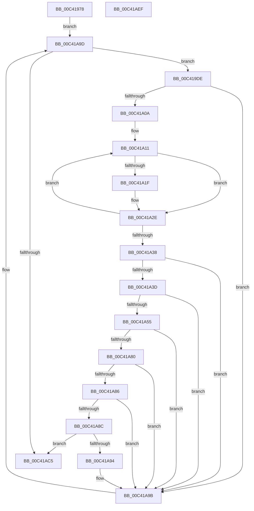

# PopReadSimulatedProcessorClass

- RVA: `0x00C41978`–`0x00C41AF0` (길이 `376` bytes)
- VA: `0x0000000140C41978`
- 실행 섹션: `INIT`
- PDB 이름 있음: `예`; PDB Function 태그: `아니요`
- unwind 정보 RVA: `0x000C8C6C`
- 디코드: `110`개 명령, `376/376` bytes 표시
- 미해석 바이트: `0` (있으면 어셈블리에 `.byte`로 보존)

> 이 문서는 커널 이미지의 기계어와 PDB 기호를 분석해 생성했습니다. 4번과 5번은 함수 원형과 자료형을 바이너리 사용 방식에서 추정한 C 해석이며 원본 소스 복구 결과는 아닙니다.

## 1. Dependencies

- 직접 호출 지점: **4**; 고유 호출 대상: **4**
- 직접 호출자로 확인된 함수: **2**
- RIP 상대 이미지 참조: **1**

### Outgoing calls
- `0x00C41A49` → [KeGetProcessorIndexFromNumber](../../text/2D/KeGetProcessorIndexFromNumber_function_002DD2D0.md) (function, `0x002DD2D0`)
- `0x00C41A77` → [ZwQueryValueKey](../../text/6A/ZwQueryValueKey_function_006AD3B0.md) (function, `0x006AD3B0`)
- `0x00C41AB8` → [ZwEnumerateValueKey](../../text/6A/ZwEnumerateValueKey_function_006AD330.md) (function, `0x006AD330`)
- `0x00C41ACF` → [_security_check_cookie](../../text/6A/_security_check_cookie_function_006AC640.md) (function, `0x006AC640`)

### Direct callers
- [PopReadSimulatedArchitecturalClasses](PopReadSimulatedArchitecturalClasses_function_00C41284.md) at `0x00C413FD`
- [PopReadSimulatedHGSClasses](PopReadSimulatedHGSClasses_function_00C41470.md) at `0x00C417C5`
- [PopReadSimulatedHGSClasses](PopReadSimulatedHGSClasses_function_00C41470.md) at `0x00C4184B`

### Static image references
- `0x00C41994` → RVA `0x00E0A740` (`.data`; read)

## 2. Other-region calls and transfers

- 다른 실행 섹션으로 향하는 call: **4**
  - `0x00C41A49` → [KeGetProcessorIndexFromNumber](../../text/2D/KeGetProcessorIndexFromNumber_function_002DD2D0.md) (`INIT` → `.text`)
  - `0x00C41A77` → [ZwQueryValueKey](../../text/6A/ZwQueryValueKey_function_006AD3B0.md) (`INIT` → `.text`)
  - `0x00C41AB8` → [ZwEnumerateValueKey](../../text/6A/ZwEnumerateValueKey_function_006AD330.md) (`INIT` → `.text`)
  - `0x00C41ACF` → [_security_check_cookie](../../text/6A/_security_check_cookie_function_006AC640.md) (`INIT` → `.text`)
- 별도 외부 분기/꼬리 이동을 확인하지 못했습니다.

## 3. Assembly (complete function range)

```asm
00C41978  48 89 5C 24 20                  mov qword ptr [rsp + 0x20], rbx
00C4197D  55                              push rbp
00C4197E  56                              push rsi
00C4197F  57                              push rdi
00C41980  41 54                           push r12
00C41982  41 55                           push r13
00C41984  41 56                           push r14
00C41986  41 57                           push r15
00C41988  48 8D 6C 24 D9                  lea rbp, [rsp - 0x27]
00C4198D  48 81 EC 90 00 00 00            sub rsp, 0x90
00C41994  48 8B 05 A5 8D 1C 00            mov rax, qword ptr [rip + 0x1c8da5]
00C4199B  48 33 C4                        xor rax, rsp
00C4199E  48 89 45 1F                     mov qword ptr [rbp + 0x1f], rax
00C419A2  33 C0                           xor eax, eax
00C419A4  0F 57 C9                        xorps xmm1, xmm1
00C419A7  0F 57 C0                        xorps xmm0, xmm0
00C419AA  48 89 45 0F                     mov qword ptr [rbp + 0xf], rax
00C419AE  44 8B EA                        mov r13d, edx
00C419B1  89 45 17                        mov dword ptr [rbp + 0x17], eax
00C419B4  0F 11 45 DF                     movups xmmword ptr [rbp - 0x21], xmm0
00C419B8  89 45 CB                        mov dword ptr [rbp - 0x35], eax
00C419BB  40 8A F8                        mov dil, al
00C419BE  0F 11 4D EF                     movups xmmword ptr [rbp - 0x11], xmm1
00C419C2  89 45 D3                        mov dword ptr [rbp - 0x2d], eax
00C419C5  8B F0                           mov esi, eax
00C419C7  0F 11 4D FF                     movups xmmword ptr [rbp - 1], xmm1
00C419CB  89 45 C7                        mov dword ptr [rbp - 0x39], eax
00C419CE  33 D2                           xor edx, edx
00C419D0  45 8B E1                        mov r12d, r9d
00C419D3  4D 8B F8                        mov r15, r8
00C419D6  4C 8B F1                        mov r14, rcx
00C419D9  E9 BF 00 00 00                  jmp 0x140c41a9d
00C419DE  48 8D 45 FB                     lea rax, [rbp - 5]
00C419E2  FF C6                           inc esi
00C419E4  48 89 45 D7                     mov qword ptr [rbp - 0x29], rax
00C419E8  45 33 C0                        xor r8d, r8d
00C419EB  0F B7 45 F7                     movzx eax, word ptr [rbp - 9]
00C419EF  66 89 45 CF                     mov word ptr [rbp - 0x31], ax
00C419F3  B8 20 00 00 00                  mov eax, 0x20
00C419F8  66 89 45 D1                     mov word ptr [rbp - 0x2f], ax
00C419FC  8D 48 20                        lea ecx, [rax + 0x20]
00C419FF  8B 45 F7                        mov eax, dword ptr [rbp - 9]
00C41A02  D1 E8                           shr eax, 1
00C41A04  0F 84 91 00 00 00               je 0x140c41a9b
00C41A0A  48 8D 55 FB                     lea rdx, [rbp - 5]
00C41A0E  44 8B D0                        mov r10d, eax
00C41A11  44 0F B7 0A                     movzx r9d, word ptr [rdx]
00C41A15  41 8D 41 D0                     lea eax, [r9 - 0x30]
00C41A19  66 83 F8 09                     cmp ax, 9
00C41A1D  77 0F                           ja 0x140c41a2e
00C41A1F  41 8D 48 FA                     lea ecx, [r8 - 6]
00C41A23  41 8D 0C 88                     lea ecx, [r8 + rcx*4]
00C41A27  45 8D 04 49                     lea r8d, [r9 + rcx*2]
00C41A2B  41 8B C8                        mov ecx, r8d
00C41A2E  48 83 C2 02                     add rdx, 2
00C41A32  49 83 EA 01                     sub r10, 1
00C41A36  75 D9                           jne 0x140c41a11
00C41A38  83 F9 40                        cmp ecx, 0x40
00C41A3B  73 5E                           jae 0x140c41a9b
00C41A3D  88 4D C9                        mov byte ptr [rbp - 0x37], cl
00C41A40  48 8D 4D C7                     lea rcx, [rbp - 0x39]
00C41A44  66 44 89 6D C7                  mov word ptr [rbp - 0x39], r13w
00C41A49  E8 82 B8 69 FF                  call 0x1402dd2d0
00C41A4E  8B D8                           mov ebx, eax
00C41A50  41 3B C4                        cmp eax, r12d
00C41A53  73 46                           jae 0x140c41a9b
00C41A55  48 8D 45 CB                     lea rax, [rbp - 0x35]
00C41A59  41 B8 02 00 00 00               mov r8d, 2
00C41A5F  48 89 44 24 28                  mov qword ptr [rsp + 0x28], rax
00C41A64  4C 8D 4D DF                     lea r9, [rbp - 0x21]
00C41A68  48 8D 55 CF                     lea rdx, [rbp - 0x31]
00C41A6C  C7 44 24 20 10 00 00 00         mov dword ptr [rsp + 0x20], 0x10
00C41A74  49 8B CF                        mov rcx, r15
00C41A77  E8 34 B9 A6 FF                  call 0x1406ad3b0
00C41A7C  85 C0                           test eax, eax
00C41A7E  78 1B                           js 0x140c41a9b
00C41A80  83 7D E3 04                     cmp dword ptr [rbp - 0x1d], 4
00C41A84  75 15                           jne 0x140c41a9b
00C41A86  83 7D E7 04                     cmp dword ptr [rbp - 0x19], 4
00C41A8A  75 0F                           jne 0x140c41a9b
00C41A8C  40 B7 01                        mov dil, 1
00C41A8F  4D 85 F6                        test r14, r14
00C41A92  74 31                           je 0x140c41ac5
00C41A94  8A 45 EB                        mov al, byte ptr [rbp - 0x15]
00C41A97  42 88 04 33                     mov byte ptr [rbx + r14], al
00C41A9B  8B D6                           mov edx, esi
00C41A9D  48 8D 45 CB                     lea rax, [rbp - 0x35]
00C41AA1  45 33 C0                        xor r8d, r8d
00C41AA4  48 89 44 24 28                  mov qword ptr [rsp + 0x28], rax
00C41AA9  4C 8D 4D EF                     lea r9, [rbp - 0x11]
00C41AAD  49 8B CF                        mov rcx, r15
00C41AB0  C7 44 24 20 2C 00 00 00         mov dword ptr [rsp + 0x20], 0x2c
00C41AB8  E8 73 B8 A6 FF                  call 0x1406ad330
00C41ABD  85 C0                           test eax, eax
00C41ABF  0F 89 19 FF FF FF               jns 0x140c419de
00C41AC5  40 8A C7                        mov al, dil
00C41AC8  48 8B 4D 1F                     mov rcx, qword ptr [rbp + 0x1f]
00C41ACC  48 33 CC                        xor rcx, rsp
00C41ACF  E8 6C AB A6 FF                  call 0x1406ac640
00C41AD4  48 8B 9C 24 E8 00 00 00         mov rbx, qword ptr [rsp + 0xe8]
00C41ADC  48 81 C4 90 00 00 00            add rsp, 0x90
00C41AE3  41 5F                           pop r15
00C41AE5  41 5E                           pop r14
00C41AE7  41 5D                           pop r13
00C41AE9  41 5C                           pop r12
00C41AEB  5F                              pop rdi
00C41AEC  5E                              pop rsi
00C41AED  5D                              pop rbp
00C41AEE  C3                              ret
00C41AEF  CC                              int3
```

## 4. C-style interpretation (structured pseudocode)

```c
__int64 __fastcall PopReadSimulatedProcessorClass(__int64 a1, int a2, __int64 a3, int a4)
{
    __int64 result;
    __int64 v_r10;
    __int64 v_rsi;
    __int64 v_rsp;
    unsigned __int64 v_stack_m40;
    unsigned int v_stack_m48;
    unsigned __int64 v_stack_m50;
    unsigned __int64 v_stack_m5F;
    unsigned __int64 v_stack_m60;
    unsigned __int64 v_stack_m64;
    unsigned __int16 v_stack_m68;
    unsigned __int64 v_stack_m70;
    unsigned __int8 v_stack_m74;
    unsigned int v_stack_m78;
    unsigned int v_stack_m7C;
    unsigned __int64 v_stack_m80;
    unsigned __int64 v_stack_m88;
    unsigned int v_stack_m8C;
    unsigned __int16 v_stack_m8E;
    unsigned __int16 v_stack_m90;
    unsigned int v_stack_m94;
    unsigned __int8 v_stack_m96;
    unsigned int v_stack_m98;
    unsigned __int64 v_stack_mA0;
    unsigned int v_stack_mA8;
    unsigned __int64 v_stack_p20;

    v_stack_p20 = v_rbx;
    v_rsp = (v_rsp) - (144);
    result = (*(unsigned __int64 *)(v_rip + 1871269)) ^ (v_rsp);
    v_stack_m40 = result;
    result = 0;
    v_stack_m50 = 0;
    v_stack_m48 = 0;
    v_stack_m80 = v_xmm0;
    v_stack_m94 = 0;
    v_stack_m70 = v_xmm1;
    v_stack_m8C = 0;
    v_stack_m60 = v_xmm1;
    v_stack_m98 = 0;
    a2 = 0;
    goto loc_00C41A9D;
loc_00C419DE:
    v_rsi = (unsigned int)((0) + 1);
    v_stack_m88 = v_stack_m64;
    a3 = 0;
    v_stack_m90 = (unsigned __int16)(v_stack_m68);
    v_stack_m8E = 32;
    result = (unsigned int)(((unsigned int)(v_stack_m68)) >> (1));
    if (condition_is_equal) goto loc_00C41A9B;
loc_00C41A11:
    if (((unsigned __int16)(*(unsigned __int16 *)(v_stack_m64) - 48)) <= 9) {
        a1 = a3 - 6;
        a1 = a3 + a1 * 4;
        a3 = *(unsigned __int16 *)(v_stack_m64) + a1 * 2;
        a1 = (unsigned int)(a3);
    }
    a2 = (v_stack_m64) + (2);
    v_r10 = ((unsigned int)((unsigned int)(result))) - (1);
    if (condition_is_not_equal) goto loc_00C41A11;
    if (((unsigned int)(a1)) >= 64) goto loc_00C41A9B;
    v_stack_m96 = (unsigned __int8)(a1);
    v_stack_m98 = (unsigned __int16)((unsigned int)(a2));
    result = KeGetProcessorIndexFromNumber(v_stack_m98, a2, a3, *(unsigned __int16 *)(v_stack_m64));
    if (((unsigned int)(result)) >= ((unsigned int)((unsigned int)(a4)))) goto loc_00C41A9B;
    v_stack_mA0 = v_stack_m94;
    v_stack_mA8 = 16;
    result = ZwQueryValueKey(a3, v_stack_m90, 2, v_stack_m80);
    if (sign_flag) goto loc_00C41A9B;
    if (v_stack_m7C != 4) goto loc_00C41A9B;
    if (v_stack_m78 != 4) goto loc_00C41A9B;
    if (a1 == 0) goto loc_00C41AC5;
    *(unsigned __int8 *)((unsigned int)((unsigned int)(result)) + a1 * 1) = (unsigned __int8)(v_stack_m74);
loc_00C41A9B:
loc_00C41A9D:
    a3 = 0;
    v_stack_mA0 = v_stack_m94;
    v_stack_mA8 = 44;
    result = ZwEnumerateValueKey(0, (unsigned int)((unsigned int)(v_rsi)), a3, v_stack_m70);
    if (!sign_flag) goto loc_00C419DE;
loc_00C41AC5:
    a1 = (v_stack_m40) ^ (v_rsp);
    result = _security_check_cookie(a1, (unsigned int)((unsigned int)(v_rsi)), a3, v_stack_m70);
    v_rsp = (v_rsp) + (144);
    return result;
}
```

## 5. (Beta) C Style

```c
int64_t PopReadSimulatedProcessorClass(int64_t Arg1, int32_t Arg2, int64_t Arg3, int32_t Arg4)
{
    int64_t result;
    int64_t local_r10;
    int64_t local_rsi;
    int64_t local_rsp;
    uint64_t v_stack_m40;
    uint32_t v_stack_m48;
    uint64_t v_stack_m50;
    uint64_t v_stack_m5F;
    uint64_t v_stack_m60;
    uint64_t v_stack_m64;
    uint16_t v_stack_m68;
    uint64_t v_stack_m70;
    uint8_t v_stack_m74;
    uint32_t v_stack_m78;
    uint32_t v_stack_m7C;
    uint64_t v_stack_m80;
    uint64_t v_stack_m88;
    uint32_t v_stack_m8C;
    uint16_t v_stack_m8E;
    uint16_t v_stack_m90;
    uint32_t v_stack_m94;
    uint8_t v_stack_m96;
    uint32_t v_stack_m98;
    uint64_t v_stack_mA0;
    uint32_t v_stack_mA8;
    uint64_t v_stack_p20;

    v_stack_p20 = local_rbx;
    local_rsp = (local_rsp) - (144);
    result = (*(uint64_t *)(v_rip + 0x1C8DA5)) ^ (local_rsp);
    v_stack_m40 = result;
    result = 0;
    v_stack_m50 = 0;
    v_stack_m48 = 0;
    v_stack_m80 = v_xmm0;
    v_stack_m94 = 0;
    v_stack_m70 = v_xmm1;
    v_stack_m8C = 0;
    v_stack_m60 = v_xmm1;
    v_stack_m98 = 0;
    Arg2 = 0;
    goto loc_00C41A9D;
loc_00C419DE:
    local_rsi = (uint32_t)((0) + 1);
    v_stack_m88 = v_stack_m64;
    Arg3 = 0;
    v_stack_m90 = (uint16_t)(v_stack_m68);
    v_stack_m8E = 32;
    result = (uint32_t)(((uint32_t)(v_stack_m68)) >> (1));
    if (condition_is_equal) goto loc_00C41A9B;
loc_00C41A11:
    if (((uint16_t)(*(uint16_t *)(v_stack_m64) - 48)) <= 9) {
        Arg1 = Arg3 - 6;
        Arg1 = Arg3 + Arg1 * 4;
        Arg3 = *(uint16_t *)(v_stack_m64) + Arg1 * 2;
        Arg1 = (uint32_t)(Arg3);
    }
    Arg2 = (v_stack_m64) + (2);
    local_r10 = ((uint32_t)((uint32_t)(result))) - (1);
    if (condition_is_not_equal) goto loc_00C41A11;
    if (((uint32_t)(Arg1)) >= 64) goto loc_00C41A9B;
    v_stack_m96 = (uint8_t)(Arg1);
    v_stack_m98 = (uint16_t)((uint32_t)(Arg2));
    result = KeGetProcessorIndexFromNumber(v_stack_m98, Arg2, Arg3, *(uint16_t *)(v_stack_m64));
    if (((uint32_t)(result)) >= ((uint32_t)((uint32_t)(Arg4)))) goto loc_00C41A9B;
    v_stack_mA0 = v_stack_m94;
    v_stack_mA8 = 16;
    result = ZwQueryValueKey(Arg3, v_stack_m90, 2, v_stack_m80);
    if (sign_flag) goto loc_00C41A9B;
    if (v_stack_m7C != 4) goto loc_00C41A9B;
    if (v_stack_m78 != 4) goto loc_00C41A9B;
    if (Arg1 == 0) goto loc_00C41AC5;
    *(uint8_t *)((uint32_t)((uint32_t)(result)) + Arg1 * 1) = (uint8_t)(v_stack_m74);
loc_00C41A9B:
loc_00C41A9D:
    Arg3 = 0;
    v_stack_mA0 = v_stack_m94;
    v_stack_mA8 = 44;
    result = ZwEnumerateValueKey(0, (uint32_t)((uint32_t)(local_rsi)), Arg3, v_stack_m70);
    if (!sign_flag) goto loc_00C419DE;
loc_00C41AC5:
    Arg1 = (v_stack_m40) ^ (local_rsp);
    result = _security_check_cookie(Arg1, (uint32_t)((uint32_t)(local_rsi)), Arg3, v_stack_m70);
    local_rsp = (local_rsp) + (144);
    return result;
}
```

## 6. Execution-region graph

[열기: 2D/3D 그래프와 함수 탐색 컨트롤 패널](../../../control-panel.html?section=init&rva=0x00C41978&view=graph)

- 2D 그래프는 위에서 아래로 흐르고, 3D 그래프는 빈 공간을 드래그해 회전합니다. Shift+드래그는 이동, 휠은 확대·축소, 함수 노드 선택은 대상 보고서 이동입니다.

### Static fallback


