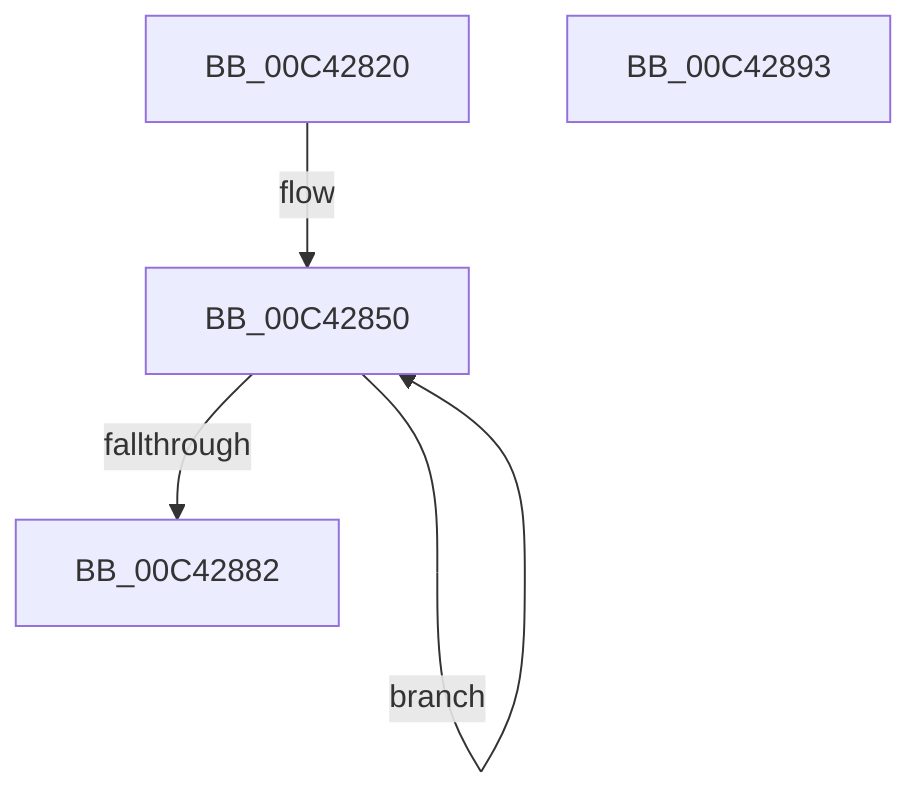

# PopRecorderInit

- RVA: `0x00C42820`–`0x00C42894` (길이 `116` bytes)
- VA: `0x0000000140C42820`
- 실행 섹션: `INIT`
- PDB 이름 있음: `예`; PDB Function 태그: `아니요`
- unwind 정보 RVA: `0x000CD0C0`
- 디코드: `25`개 명령, `116/116` bytes 표시
- 미해석 바이트: `0` (있으면 어셈블리에 `.byte`로 보존)

> 이 문서는 커널 이미지의 기계어와 PDB 기호를 분석해 생성했습니다. 4번과 5번은 함수 원형과 자료형을 바이너리 사용 방식에서 추정한 C 해석이며 원본 소스 복구 결과는 아닙니다.

## 1. Dependencies

- 직접 호출 지점: **1**; 고유 호출 대상: **1**
- 직접 호출자로 확인된 함수: **1**
- RIP 상대 이미지 참조: **6**

### Outgoing calls
- `0x00C42870` → [KeRegisterBugCheckReasonCallback](../../text/47/KeRegisterBugCheckReasonCallback_function_004720A0.md) (function, `0x004720A0`)

### Direct callers
- [PoInitSystem](../C7/PoInitSystem_function_00C72358.md) at `0x00C72C3C`

### Static image references
- `0x00C42830` → RVA `0x00F084E8` (`.data`; read/write)
- `0x00C42838` → RVA `0x00E07844` (`.data`; read)
- `0x00C4283F` → RVA `0x00F084F0` (`.data`; read/write)
- `0x00C42847` → RVA `0x00E07818` (`.data`; read)
- `0x00C42850` → RVA `0x00E07808` (`.data`; read)
- `0x00C42869` → RVA `0x005D9E40` (`PopBlackBoxBugcheckCallback`; read)

## 2. Other-region calls and transfers

- 다른 실행 섹션으로 향하는 call: **1**
  - `0x00C42870` → [KeRegisterBugCheckReasonCallback](../../text/47/KeRegisterBugCheckReasonCallback_function_004720A0.md) (`INIT` → `.text`)
- 별도 외부 분기/꼬리 이동을 확인하지 못했습니다.

## 3. Assembly (complete function range)

```asm
00C42820  48 89 5C 24 08                  mov qword ptr [rsp + 8], rbx
00C42825  48 89 74 24 10                  mov qword ptr [rsp + 0x10], rsi
00C4282A  41 56                           push r14
00C4282C  48 83 EC 20                     sub rsp, 0x20
00C42830  48 83 25 B0 5C 2C 00 00         and qword ptr [rip + 0x2c5cb0], 0
00C42838  48 8D 35 05 50 1C 00            lea rsi, [rip + 0x1c5005]
00C4283F  48 83 25 A9 5C 2C 00 00         and qword ptr [rip + 0x2c5ca9], 0
00C42847  4C 8D 35 CA 4F 1C 00            lea r14, [rip + 0x1c4fca]
00C4284E  33 DB                           xor ebx, ebx
00C42850  4C 8D 0D B1 4F 1C 00            lea r9, [rip + 0x1c4fb1]
00C42857  C6 04 1E 00                     mov byte ptr [rsi + rbx], 0
00C4285B  4E 8B 0C 0B                     mov r9, qword ptr [rbx + r9]
00C4285F  49 8D 0C 1E                     lea rcx, [r14 + rbx]
00C42863  41 B8 02 00 00 00               mov r8d, 2
00C42869  48 8D 15 D0 75 99 FF            lea rdx, [rip - 0x668a30]
00C42870  E8 2B F8 82 FF                  call 0x1404720a0
00C42875  48 83 C3 68                     add rbx, 0x68
00C42879  48 81 FB 28 0A 00 00            cmp rbx, 0xa28
00C42880  72 CE                           jb 0x140c42850
00C42882  48 8B 5C 24 30                  mov rbx, qword ptr [rsp + 0x30]
00C42887  48 8B 74 24 38                  mov rsi, qword ptr [rsp + 0x38]
00C4288C  48 83 C4 20                     add rsp, 0x20
00C42890  41 5E                           pop r14
00C42892  C3                              ret
00C42893  CC                              int3
```

## 4. C-style interpretation (structured pseudocode)

```c
__int64 __fastcall PopRecorderInit(void)
{
    __int64 result;
    __int64 v_rbx;
    __int64 v_rsp;
    unsigned __int64 v_stack_p10;
    unsigned __int64 v_stack_p8;

    v_stack_p8 = v_rbx;
    v_stack_p10 = v_rsi;
    v_rsp = (v_rsp) - (32);
    v_rbx = 0;
loc_00C42850:
    *(unsigned __int8 *)(v_rip + 1855493 + v_rbx * 1) = 0;
    result = KeRegisterBugCheckReasonCallback(v_rip + 1855434 + v_rbx * 1, v_rip - 6720048, 2, *(unsigned __int64 *)(v_rbx + v_rip + 1855409 * 1));
    v_rbx = (v_rbx) + (104);
    if (v_rbx < 0xA28ULL) goto loc_00C42850;
    v_rsp = (v_rsp) + (32);
    return result;
}
```

## 5. (Beta) C Style

```c
void PopRecorderInit(void)
{
    int64_t result;
    int64_t local_rbx;
    int64_t local_rsp;
    uint64_t v_stack_p10;
    uint64_t v_stack_p8;

    v_stack_p8 = local_rbx;
    v_stack_p10 = local_rsi;
    local_rsp = (local_rsp) - (32);
    local_rbx = 0;
loc_00C42850:
    *(uint8_t *)(v_rip + 0x1C5005 + local_rbx * 1) = 0;
    result = KeRegisterBugCheckReasonCallback(v_rip + 1855434 + local_rbx * 1, v_rip - 6720048, 2, *(uint64_t *)(local_rbx + v_rip + 0x1C4FB1 * 1));
    local_rbx = (local_rbx) + (104);
    if (local_rbx < 0xA28ULL) goto loc_00C42850;
    local_rsp = (local_rsp) + (32);
    return result;
}
```

## 6. Execution-region graph

[열기: 2D/3D 그래프와 함수 탐색 컨트롤 패널](../../../control-panel.html?section=init&rva=0x00C42820&view=graph)

- 2D 그래프는 위에서 아래로 흐르고, 3D 그래프는 빈 공간을 드래그해 회전합니다. Shift+드래그는 이동, 휠은 확대·축소, 함수 노드 선택은 대상 보고서 이동입니다.

### Static fallback


