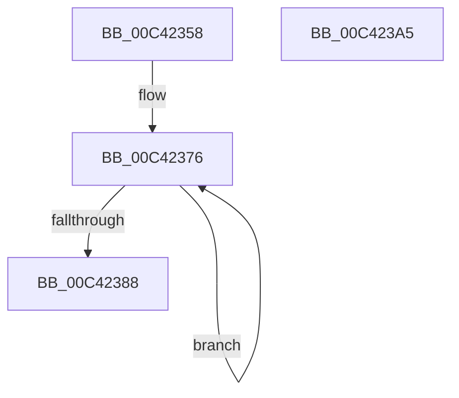

# PopSmartSuspendInit

- RVA: `0x00C42358`–`0x00C423A6` (길이 `78` bytes)
- VA: `0x0000000140C42358`
- 실행 섹션: `INIT`
- PDB 이름 있음: `예`; PDB Function 태그: `아니요`
- unwind 정보 RVA: `0x00060BC4`
- 디코드: `20`개 명령, `78/78` bytes 표시
- 미해석 바이트: `0` (있으면 어셈블리에 `.byte`로 보존)

> 이 문서는 커널 이미지의 기계어와 PDB 기호를 분석해 생성했습니다. 4번과 5번은 함수 원형과 자료형을 바이너리 사용 방식에서 추정한 C 해석이며 원본 소스 복구 결과는 아닙니다.

## 1. Dependencies

- 직접 호출 지점: **1**; 고유 호출 대상: **1**
- 직접 호출자로 확인된 함수: **1**
- RIP 상대 이미지 참조: **3**

### Outgoing calls
- `0x00C42379` → [PopSmartSuspendResetData](../../page/70/PopSmartSuspendResetData_function_00705580.md) (function, `0x00705580`)

### Direct callers
- [PoInitSystem](../C7/PoInitSystem_function_00C72358.md) at `0x00C72BCB`

### Static image references
- `0x00C42367` → RVA `0x00F088A0` (`.data`; read)
- `0x00C42388` → RVA `0x00F0888C` (`.data`; read/write)
- `0x00C42393` → RVA `0x00F08F68` (`.data`; write)

## 2. Other-region calls and transfers

- 다른 실행 섹션으로 향하는 call: **1**
  - `0x00C42379` → [PopSmartSuspendResetData](../../page/70/PopSmartSuspendResetData_function_00705580.md) (`INIT` → `PAGE`)
- 별도 외부 분기/꼬리 이동을 확인하지 못했습니다.

## 3. Assembly (complete function range)

```asm
00C42358  48 89 5C 24 08                  mov qword ptr [rsp + 8], rbx
00C4235D  48 89 74 24 10                  mov qword ptr [rsp + 0x10], rsi
00C42362  57                              push rdi
00C42363  48 83 EC 20                     sub rsp, 0x20
00C42367  48 8D 35 32 65 2C 00            lea rsi, [rip + 0x2c6532]
00C4236E  BF 10 00 00 00                  mov edi, 0x10
00C42373  48 8B DE                        mov rbx, rsi
00C42376  48 8B CB                        mov rcx, rbx
00C42379  E8 02 32 AC FF                  call 0x140705580
00C4237E  48 83 C3 60                     add rbx, 0x60
00C42382  48 83 EF 01                     sub rdi, 1
00C42386  75 EE                           jne 0x140c42376
00C42388  21 3D FE 64 2C 00               and dword ptr [rip + 0x2c64fe], edi
00C4238E  48 8B 5C 24 30                  mov rbx, qword ptr [rsp + 0x30]
00C42393  48 89 35 CE 6B 2C 00            mov qword ptr [rip + 0x2c6bce], rsi
00C4239A  48 8B 74 24 38                  mov rsi, qword ptr [rsp + 0x38]
00C4239F  48 83 C4 20                     add rsp, 0x20
00C423A3  5F                              pop rdi
00C423A4  C3                              ret
00C423A5  CC                              int3
```

## 4. C-style interpretation (structured pseudocode)

```c
__int64 __fastcall PopSmartSuspendInit(void)
{
    __int64 result;
    __int64 v_rbx;
    __int64 v_rdi;
    __int64 v_rsp;
    unsigned __int64 v_stack_p10;
    unsigned __int64 v_stack_p8;

    v_stack_p8 = v_rbx;
    v_stack_p10 = v_rsi;
    v_rsp = (v_rsp) - (32);
loc_00C42376:
    result = PopSmartSuspendResetData(v_rip + 2909490, a2, a3, a4);
    v_rbx = (v_rip + 2909490) + (96);
    v_rdi = (16) - (1);
    if (condition_is_not_equal) goto loc_00C42376;
    *(unsigned __int64 *)(v_rip + 2911182) = v_rip + 2909490;
    v_rsp = (v_rsp) + (32);
    return result;
}
```

## 5. (Beta) C Style

```c
void PopSmartSuspendInit(void)
{
    int64_t result;
    int64_t local_rbx;
    int64_t local_rdi;
    int64_t local_rsp;
    uint64_t v_stack_p10;
    uint64_t v_stack_p8;

    v_stack_p8 = local_rbx;
    v_stack_p10 = local_rsi;
    local_rsp = (local_rsp) - (32);
loc_00C42376:
    result = PopSmartSuspendResetData(v_rip + 2909490, a2, a3, a4);
    local_rbx = (v_rip + 2909490) + (96);
    local_rdi = (16) - (1);
    if (condition_is_not_equal) goto loc_00C42376;
    *(uint64_t *)(v_rip + 0x2C6BCE) = v_rip + 2909490;
    local_rsp = (local_rsp) + (32);
    return result;
}
```

## 6. Execution-region graph

[열기: 2D/3D 그래프와 함수 탐색 컨트롤 패널](../../../control-panel.html?section=init&rva=0x00C42358&view=graph)

- 2D 그래프는 위에서 아래로 흐르고, 3D 그래프는 빈 공간을 드래그해 회전합니다. Shift+드래그는 이동, 휠은 확대·축소, 함수 노드 선택은 대상 보고서 이동입니다.

### Static fallback


