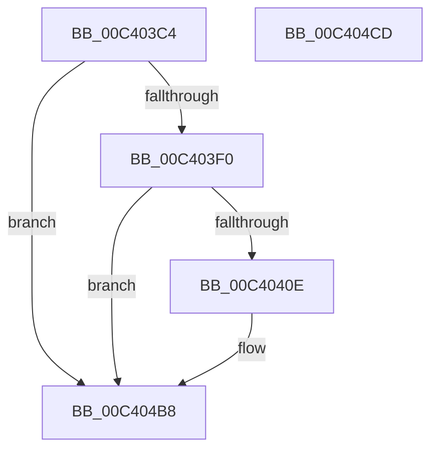

# PopTracePowerButtonSuppressionOptedIn

- RVA: `0x00C403C4`–`0x00C404CE` (길이 `266` bytes)
- VA: `0x0000000140C403C4`
- 실행 섹션: `INIT`
- PDB 이름 있음: `예`; PDB Function 태그: `아니요`
- unwind 정보 RVA: `0x000B43CC`
- 디코드: `56`개 명령, `266/266` bytes 표시
- 미해석 바이트: `0` (있으면 어셈블리에 `.byte`로 보존)

> 이 문서는 커널 이미지의 기계어와 PDB 기호를 분석해 생성했습니다. 4번과 5번은 함수 원형과 자료형을 바이너리 사용 방식에서 추정한 C 해석이며 원본 소스 복구 결과는 아닙니다.

## 1. Dependencies

- 직접 호출 지점: **3**; 고유 호출 대상: **3**
- 직접 호출자로 확인된 함수: **1**
- RIP 상대 이미지 참조: **4**

### Outgoing calls
- `0x00C40401` → [tlgKeywordOn](../../text/42/tlgKeywordOn_function_0042EAA0.md) (function, `0x0042EAA0`)
- `0x00C404B3` → [tlgWriteTransfer_EtwWriteTransfer](../../text/42/tlgWriteTransfer_EtwWriteTransfer_function_004260E0.md) (function, `0x004260E0`)
- `0x00C404BF` → [_security_check_cookie](../../text/6A/_security_check_cookie_function_006AC640.md) (function, `0x006AC640`)

### Direct callers
- [PopPowerButtonSuppressionInit](PopPowerButtonSuppressionInit_function_00C40B00.md) at `0x00C40C47`

### Static image references
- `0x00C403D2` → RVA `0x00E0A740` (`.data`; read)
- `0x00C403E0` → RVA `0x00E07748` (`.data`; read)
- `0x00C40421` → RVA `0x00FC518C` (`ALMOSTRO`; read)
- `0x00C40478` → RVA `0x00049A53` (`.rdata`; read)

## 2. Other-region calls and transfers

- 다른 실행 섹션으로 향하는 call: **3**
  - `0x00C40401` → [tlgKeywordOn](../../text/42/tlgKeywordOn_function_0042EAA0.md) (`INIT` → `.text`)
  - `0x00C404B3` → [tlgWriteTransfer_EtwWriteTransfer](../../text/42/tlgWriteTransfer_EtwWriteTransfer_function_004260E0.md) (`INIT` → `.text`)
  - `0x00C404BF` → [_security_check_cookie](../../text/6A/_security_check_cookie_function_006AC640.md) (`INIT` → `.text`)
- 별도 외부 분기/꼬리 이동을 확인하지 못했습니다.

## 3. Assembly (complete function range)

```asm
00C403C4  40 55                           push rbp
00C403C6  48 8D 6C 24 B1                  lea rbp, [rsp - 0x4f]
00C403CB  48 81 EC E0 00 00 00            sub rsp, 0xe0
00C403D2  48 8B 05 67 A3 1C 00            mov rax, qword ptr [rip + 0x1ca367]
00C403D9  48 33 C4                        xor rax, rsp
00C403DC  48 89 45 3F                     mov qword ptr [rbp + 0x3f], rax
00C403E0  83 3D 61 73 1C 00 05            cmp dword ptr [rip + 0x1c7361], 5
00C403E7  44 8A D1                        mov r10b, cl
00C403EA  0F 86 C8 00 00 00               jbe 0x140c404b8
00C403F0  48 BA 00 00 00 00 00 40 00 00   movabs rdx, 0x400000000000
00C403FA  48 8D 0D 47 73 1C 00            lea rcx, [rip + 0x1c7347]
00C40401  E8 9A E6 7E FF                  call 0x14042eaa0
00C40406  84 C0                           test al, al
00C40408  0F 84 AA 00 00 00               je 0x140c404b8
00C4040E  48 8D 45 9F                     lea rax, [rbp - 0x61]
00C40412  44 88 45 A0                     mov byte ptr [rbp - 0x60], r8b
00C40416  48 89 45 DF                     mov qword ptr [rbp - 0x21], rax
00C4041A  48 8D 0D 27 73 1C 00            lea rcx, [rip + 0x1c7327]
00C40421  8B 05 65 4D 38 00               mov eax, dword ptr [rip + 0x384d65]
00C40427  BA 08 00 00 00                  mov edx, 8
00C4042C  89 45 A3                        mov dword ptr [rbp - 0x5d], eax
00C4042F  45 33 C0                        xor r8d, r8d
00C40432  48 8D 45 A3                     lea rax, [rbp - 0x5d]
00C40436  44 88 4D A1                     mov byte ptr [rbp - 0x5f], r9b
00C4043A  48 89 45 EF                     mov qword ptr [rbp - 0x11], rax
00C4043E  45 33 C9                        xor r9d, r9d
00C40441  48 8D 45 A0                     lea rax, [rbp - 0x60]
00C40445  48 89 55 37                     mov qword ptr [rbp + 0x37], rdx
00C40449  48 89 45 FF                     mov qword ptr [rbp - 1], rax
00C4044D  48 8D 45 A1                     lea rax, [rbp - 0x5f]
00C40451  48 89 45 0F                     mov qword ptr [rbp + 0xf], rax
00C40455  8B 45 7F                        mov eax, dword ptr [rbp + 0x7f]
00C40458  89 45 A7                        mov dword ptr [rbp - 0x59], eax
00C4045B  48 8D 45 A7                     lea rax, [rbp - 0x59]
00C4045F  48 89 45 1F                     mov qword ptr [rbp + 0x1f], rax
00C40463  48 8D 45 AF                     lea rax, [rbp - 0x51]
00C40467  48 89 45 2F                     mov qword ptr [rbp + 0x2f], rax
00C4046B  48 8D 45 BF                     lea rax, [rbp - 0x41]
00C4046F  48 89 44 24 28                  mov qword ptr [rsp + 0x28], rax
00C40474  89 54 24 20                     mov dword ptr [rsp + 0x20], edx
00C40478  48 8D 15 D4 95 40 FF            lea rdx, [rip - 0xbf6a2c]
00C4047F  44 88 55 9F                     mov byte ptr [rbp - 0x61], r10b
00C40483  48 C7 45 E7 01 00 00 00         mov qword ptr [rbp - 0x19], 1
00C4048B  48 C7 45 F7 04 00 00 00         mov qword ptr [rbp - 9], 4
00C40493  48 C7 45 07 01 00 00 00         mov qword ptr [rbp + 7], 1
00C4049B  48 C7 45 17 01 00 00 00         mov qword ptr [rbp + 0x17], 1
00C404A3  48 C7 45 27 04 00 00 00         mov qword ptr [rbp + 0x27], 4
00C404AB  48 C7 45 AF 00 00 00 01         mov qword ptr [rbp - 0x51], 0x1000000
00C404B3  E8 28 5C 7E FF                  call 0x1404260e0
00C404B8  48 8B 4D 3F                     mov rcx, qword ptr [rbp + 0x3f]
00C404BC  48 33 CC                        xor rcx, rsp
00C404BF  E8 7C C1 A6 FF                  call 0x1406ac640
00C404C4  48 81 C4 E0 00 00 00            add rsp, 0xe0
00C404CB  5D                              pop rbp
00C404CC  C3                              ret
00C404CD  CC                              int3
```

## 4. C-style interpretation (structured pseudocode)

```c
__int64 __fastcall PopTracePowerButtonSuppressionOptedIn(unsigned __int8 a1, __int64 a2, int a3, int a4, unsigned int a5)
{
    __int64 result;
    __int64 v_rsp;
    unsigned __int64 v_stack_m18;
    unsigned __int64 v_stack_m20;
    unsigned __int64 v_stack_m28;
    unsigned __int64 v_stack_m30;
    unsigned __int64 v_stack_m38;
    unsigned __int64 v_stack_m40;
    unsigned __int64 v_stack_m48;
    unsigned __int64 v_stack_m50;
    unsigned __int64 v_stack_m57;
    unsigned __int64 v_stack_m58;
    unsigned __int64 v_stack_m60;
    unsigned __int64 v_stack_m68;
    unsigned __int64 v_stack_m70;
    unsigned __int64 v_stack_m78;
    unsigned __int64 v_stack_m98;
    unsigned __int64 v_stack_mA8;
    unsigned int v_stack_mB0;
    unsigned int v_stack_mB4;
    unsigned __int8 v_stack_mB6;
    unsigned __int8 v_stack_mB7;
    unsigned __int64 v_stack_mB8;
    unsigned __int64 v_stack_mC0;
    unsigned int v_stack_mC8;

    v_rsp = (v_rsp) - (224);
    result = (*(unsigned __int64 *)(v_rip + 1876839)) ^ (v_rsp);
    v_stack_m18 = result;
    if ((*(unsigned int *)(v_rip + 1864545)) <= 5) goto loc_00C404B8;
    result = tlgKeywordOn(v_rip + 1864519, a2, a3, a4);
    if ((unsigned __int8)(result) != 0) {
        result = v_stack_mB8;
        v_stack_mB7 = (unsigned __int8)(a3);
        v_stack_m78 = result;
        a1 = v_rip + 1864487;
        result = *(unsigned int *)(v_rip + 3689829);
        a2 = 8;
        v_stack_mB4 = (unsigned int)(result);
        a3 = 0;
        result = v_stack_mB4;
        v_stack_mB6 = (unsigned __int8)(a4);
        v_stack_m68 = result;
        a4 = 0;
        result = v_stack_mB7;
        v_stack_m20 = a2;
        v_stack_m58 = result;
        result = v_stack_mB6;
        v_stack_m48 = result;
        result = a5;
        v_stack_mB0 = (unsigned int)(result);
        result = v_stack_mB0;
        v_stack_m38 = result;
        result = v_stack_mA8;
        v_stack_m28 = result;
        result = v_stack_m98;
        v_stack_mC0 = result;
        v_stack_mC8 = (unsigned int)(a2);
        a2 = v_rip - 12544556;
        v_stack_mB8 = a1;
        v_stack_m70 = 1;
        v_stack_m60 = 4;
        v_stack_m50 = 1;
        v_stack_m40 = 1;
        v_stack_m30 = 4;
        v_stack_mA8 = 0x1000000ULL;
        result = tlgWriteTransfer_EtwWriteTransfer(a1, a2, a3, a4);
    }
    a1 = (v_stack_m18) ^ (v_rsp);
    result = _security_check_cookie(a1, a2, a3, a4);
    v_rsp = (v_rsp) + (224);
    return result;
}
```

## 5. (Beta) C Style

```c
int64_t PopTracePowerButtonSuppressionOptedIn(uint8_t Arg1, int64_t Arg2, int32_t Arg3, int32_t Arg4, uint32_t Arg5)
{
    int64_t result;
    int64_t local_rsp;
    uint64_t v_stack_m18;
    uint64_t v_stack_m20;
    uint64_t v_stack_m28;
    uint64_t v_stack_m30;
    uint64_t v_stack_m38;
    uint64_t v_stack_m40;
    uint64_t v_stack_m48;
    uint64_t v_stack_m50;
    uint64_t v_stack_m57;
    uint64_t v_stack_m58;
    uint64_t v_stack_m60;
    uint64_t v_stack_m68;
    uint64_t v_stack_m70;
    uint64_t v_stack_m78;
    uint64_t v_stack_m98;
    uint64_t v_stack_mA8;
    uint32_t v_stack_mB0;
    uint32_t v_stack_mB4;
    uint8_t v_stack_mB6;
    uint8_t v_stack_mB7;
    uint64_t v_stack_mB8;
    uint64_t v_stack_mC0;
    uint32_t v_stack_mC8;

    local_rsp = (local_rsp) - (224);
    result = (*(uint64_t *)(v_rip + 0x1CA367)) ^ (local_rsp);
    v_stack_m18 = result;
    if ((*(uint32_t *)(v_rip + 0x1C7361)) <= 5) goto loc_00C404B8;
    result = tlgKeywordOn(v_rip + 1864519, Arg2, Arg3, Arg4);
    if ((uint8_t)(result) != 0) {
        result = v_stack_mB8;
        v_stack_mB7 = (uint8_t)(Arg3);
        v_stack_m78 = result;
        Arg1 = v_rip + 1864487;
        result = *(uint32_t *)(v_rip + 0x384D65);
        Arg2 = 8;
        v_stack_mB4 = (uint32_t)(result);
        Arg3 = 0;
        result = v_stack_mB4;
        v_stack_mB6 = (uint8_t)(Arg4);
        v_stack_m68 = result;
        Arg4 = 0;
        result = v_stack_mB7;
        v_stack_m20 = Arg2;
        v_stack_m58 = result;
        result = v_stack_mB6;
        v_stack_m48 = result;
        result = Arg5;
        v_stack_mB0 = (uint32_t)(result);
        result = v_stack_mB0;
        v_stack_m38 = result;
        result = v_stack_mA8;
        v_stack_m28 = result;
        result = v_stack_m98;
        v_stack_mC0 = result;
        v_stack_mC8 = (uint32_t)(Arg2);
        Arg2 = v_rip - 12544556;
        v_stack_mB8 = Arg1;
        v_stack_m70 = 1;
        v_stack_m60 = 4;
        v_stack_m50 = 1;
        v_stack_m40 = 1;
        v_stack_m30 = 4;
        v_stack_mA8 = 0x1000000ULL;
        result = tlgWriteTransfer_EtwWriteTransfer(Arg1, Arg2, Arg3, Arg4);
    }
    Arg1 = (v_stack_m18) ^ (local_rsp);
    result = _security_check_cookie(Arg1, Arg2, Arg3, Arg4);
    local_rsp = (local_rsp) + (224);
    return result;
}
```

## 6. Execution-region graph

[열기: 2D/3D 그래프와 함수 탐색 컨트롤 패널](../../../control-panel.html?section=init&rva=0x00C403C4&view=graph)

- 2D 그래프는 위에서 아래로 흐르고, 3D 그래프는 빈 공간을 드래그해 회전합니다. Shift+드래그는 이동, 휠은 확대·축소, 함수 노드 선택은 대상 보고서 이동입니다.

### Static fallback


