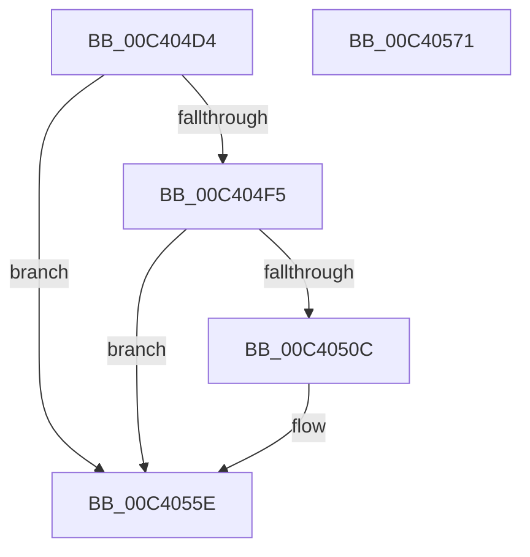

# PopTriggerDiagTraceAoAcCapability

- RVA: `0x00C404D4`–`0x00C40572` (길이 `158` bytes)
- VA: `0x0000000140C404D4`
- 실행 섹션: `INIT`
- PDB 이름 있음: `예`; PDB Function 태그: `아니요`
- unwind 정보 RVA: `0x0009EA50`
- 디코드: `35`개 명령, `158/158` bytes 표시
- 미해석 바이트: `0` (있으면 어셈블리에 `.byte`로 보존)

> 이 문서는 커널 이미지의 기계어와 PDB 기호를 분석해 생성했습니다. 4번과 5번은 함수 원형과 자료형을 바이너리 사용 방식에서 추정한 C 해석이며 원본 소스 복구 결과는 아닙니다.

## 1. Dependencies

- 직접 호출 지점: **3**; 고유 호출 대상: **3**
- 직접 호출자로 확인된 함수: **1**
- RIP 상대 이미지 참조: **4**

### Outgoing calls
- `0x00C40503` → [EtwEventEnabled](../../text/39/EtwEventEnabled_function_00392450.md) (function, `0x00392450`)
- `0x00C40559` → [EtwWriteEx](../../text/25/EtwWriteEx_function_0025F0D0.md) (function, `0x0025F0D0`)
- `0x00C40566` → [_security_check_cookie](../../text/6A/_security_check_cookie_function_006AC640.md) (function, `0x006AC640`)

### Direct callers
- [PoInitSystem](../C7/PoInitSystem_function_00C72358.md) at `0x00C72EF4`

### Static image references
- `0x00C404DA` → RVA `0x00E0A740` (`.data`; read)
- `0x00C404E9` → RVA `0x00E6786C` (`.data`; read)
- `0x00C404F5` → RVA `0x00F0B6D0` (`.data`; read)
- `0x00C404FC` → RVA `0x00022600` (`.rdata`; read)

## 2. Other-region calls and transfers

- 다른 실행 섹션으로 향하는 call: **3**
  - `0x00C40503` → [EtwEventEnabled](../../text/39/EtwEventEnabled_function_00392450.md) (`INIT` → `.text`)
  - `0x00C40559` → [EtwWriteEx](../../text/25/EtwWriteEx_function_0025F0D0.md) (`INIT` → `.text`)
  - `0x00C40566` → [_security_check_cookie](../../text/6A/_security_check_cookie_function_006AC640.md) (`INIT` → `.text`)
- 별도 외부 분기/꼬리 이동을 확인하지 못했습니다.

## 3. Assembly (complete function range)

```asm
00C404D4  40 53                           push rbx
00C404D6  48 83 EC 60                     sub rsp, 0x60
00C404DA  48 8B 05 5F A2 1C 00            mov rax, qword ptr [rip + 0x1ca25f]
00C404E1  48 33 C4                        xor rax, rsp
00C404E4  48 89 44 24 58                  mov qword ptr [rsp + 0x58], rax
00C404E9  80 3D 7C 73 22 00 00            cmp byte ptr [rip + 0x22737c], 0
00C404F0  0F B6 D9                        movzx ebx, cl
00C404F3  74 69                           je 0x140c4055e
00C404F5  48 8B 0D D4 B1 2C 00            mov rcx, qword ptr [rip + 0x2cb1d4]
00C404FC  48 8D 15 FD 20 3E FF            lea rdx, [rip - 0xc1df03]
00C40503  E8 48 1F 75 FF                  call 0x140392450
00C40508  84 C0                           test al, al
00C4050A  74 52                           je 0x140c4055e
00C4050C  83 64 24 54 00                  and dword ptr [rsp + 0x54], 0
00C40511  48 8D 44 24 40                  lea rax, [rsp + 0x40]
00C40516  48 8B 0D B3 B1 2C 00            mov rcx, qword ptr [rip + 0x2cb1b3]
00C4051D  48 8D 15 DC 20 3E FF            lea rdx, [rip - 0xc1df24]
00C40524  48 89 44 24 48                  mov qword ptr [rsp + 0x48], rax
00C40529  45 33 C9                        xor r9d, r9d
00C4052C  48 8D 44 24 48                  lea rax, [rsp + 0x48]
00C40531  89 5C 24 40                     mov dword ptr [rsp + 0x40], ebx
00C40535  48 89 44 24 38                  mov qword ptr [rsp + 0x38], rax
00C4053A  45 33 C0                        xor r8d, r8d
00C4053D  C7 44 24 30 01 00 00 00         mov dword ptr [rsp + 0x30], 1
00C40545  48 83 64 24 28 00               and qword ptr [rsp + 0x28], 0
00C4054B  48 83 64 24 20 00               and qword ptr [rsp + 0x20], 0
00C40551  C7 44 24 50 04 00 00 00         mov dword ptr [rsp + 0x50], 4
00C40559  E8 72 EB 61 FF                  call 0x14025f0d0
00C4055E  48 8B 4C 24 58                  mov rcx, qword ptr [rsp + 0x58]
00C40563  48 33 CC                        xor rcx, rsp
00C40566  E8 D5 C0 A6 FF                  call 0x1406ac640
00C4056B  48 83 C4 60                     add rsp, 0x60
00C4056F  5B                              pop rbx
00C40570  C3                              ret
00C40571  CC                              int3
```

## 4. C-style interpretation (structured pseudocode)

```c
__int64 __fastcall PopTriggerDiagTraceAoAcCapability(unsigned __int8 a1, __int64 a2, int a3, int a4)
{
    __int64 result;
    __int64 v_rsp;
    unsigned __int64 v_stack_m10;
    unsigned int v_stack_m14;
    unsigned int v_stack_m18;
    unsigned __int64 v_stack_m20;
    unsigned __int64 v_stack_m28;
    unsigned __int64 v_stack_m30;
    unsigned int v_stack_m38;
    unsigned __int64 v_stack_m40;
    unsigned __int64 v_stack_m48;

    v_rsp = (v_rsp) - (96);
    result = (*(unsigned __int64 *)(v_rip + 1876575)) ^ (v_rsp);
    v_stack_m10 = result;
    if ((*(unsigned __int8 *)(v_rip + 2257788)) == 0) goto loc_00C4055E;
    result = EtwEventEnabled(*(unsigned __int64 *)(v_rip + 2929108), v_rip - 12705539, a3, a4);
    if ((unsigned __int8)(result) != 0) {
        result = v_stack_m28;
        a1 = *(unsigned __int64 *)(v_rip + 2929075);
        a2 = v_rip - 12705572;
        v_stack_m20 = result;
        a4 = 0;
        result = v_stack_m20;
        v_stack_m28 = a1;
        v_stack_m30 = result;
        a3 = 0;
        v_stack_m38 = 1;
        v_stack_m18 = 4;
        result = EtwWriteEx(a1, a2, a3, a4);
    }
    a1 = (v_stack_m10) ^ (v_rsp);
    result = _security_check_cookie(a1, a2, a3, a4);
    v_rsp = (v_rsp) + (96);
    return result;
}
```

## 5. (Beta) C Style

```c
int64_t PopTriggerDiagTraceAoAcCapability(uint8_t Arg1, int64_t Arg2, int32_t Arg3, int32_t Arg4)
{
    int64_t result;
    int64_t local_rsp;
    uint64_t v_stack_m10;
    uint32_t v_stack_m14;
    uint32_t v_stack_m18;
    uint64_t v_stack_m20;
    uint64_t v_stack_m28;
    uint64_t v_stack_m30;
    uint32_t v_stack_m38;
    uint64_t v_stack_m40;
    uint64_t v_stack_m48;

    local_rsp = (local_rsp) - (96);
    result = (*(uint64_t *)(v_rip + 0x1CA25F)) ^ (local_rsp);
    v_stack_m10 = result;
    if ((*(uint8_t *)(v_rip + 0x22737C)) == 0) goto loc_00C4055E;
    result = EtwEventEnabled(*(uint64_t *)(v_rip + 0x2CB1D4), v_rip - 12705539, Arg3, Arg4);
    if ((uint8_t)(result) != 0) {
        result = v_stack_m28;
        Arg1 = *(uint64_t *)(v_rip + 0x2CB1B3);
        Arg2 = v_rip - 12705572;
        v_stack_m20 = result;
        Arg4 = 0;
        result = v_stack_m20;
        v_stack_m28 = Arg1;
        v_stack_m30 = result;
        Arg3 = 0;
        v_stack_m38 = 1;
        v_stack_m18 = 4;
        result = EtwWriteEx(Arg1, Arg2, Arg3, Arg4);
    }
    Arg1 = (v_stack_m10) ^ (local_rsp);
    result = _security_check_cookie(Arg1, Arg2, Arg3, Arg4);
    local_rsp = (local_rsp) + (96);
    return result;
}
```

## 6. Execution-region graph

[열기: 2D/3D 그래프와 함수 탐색 컨트롤 패널](../../../control-panel.html?section=init&rva=0x00C404D4&view=graph)

- 2D 그래프는 위에서 아래로 흐르고, 3D 그래프는 빈 공간을 드래그해 회전합니다. Shift+드래그는 이동, 휠은 확대·축소, 함수 노드 선택은 대상 보고서 이동입니다.

### Static fallback


