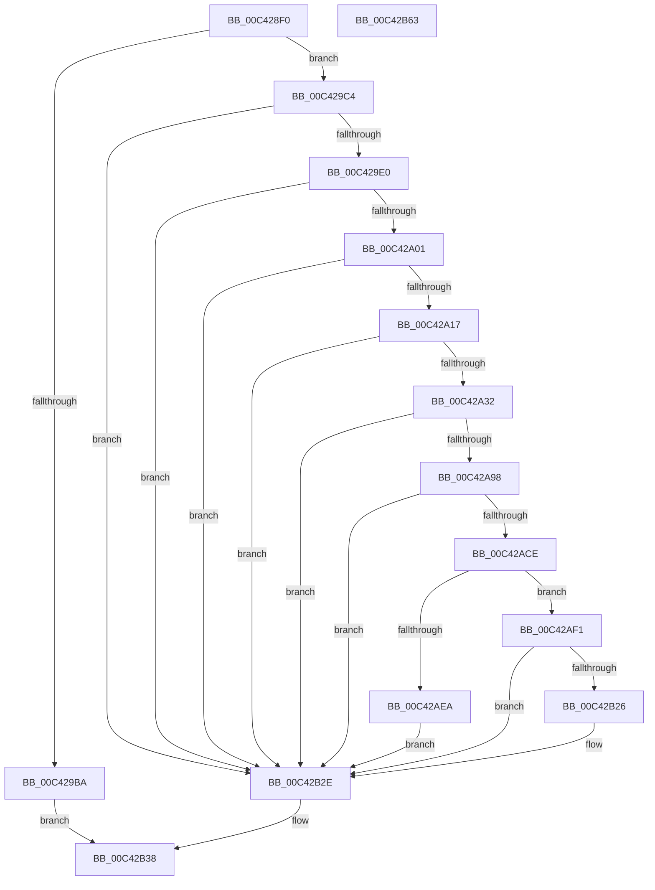

# PopUmpoInitializeChannel

- RVA: `0x00C428F0`–`0x00C42B64` (길이 `628` bytes)
- VA: `0x0000000140C428F0`
- 실행 섹션: `INIT`
- PDB 이름 있음: `예`; PDB Function 태그: `아니요`
- unwind 정보 RVA: `0x000CD0D4`
- 디코드: `154`개 명령, `628/628` bytes 표시
- 미해석 바이트: `0` (있으면 어셈블리에 `.byte`로 보존)

> 이 문서는 커널 이미지의 기계어와 PDB 기호를 분석해 생성했습니다. 4번과 5번은 함수 원형과 자료형을 바이너리 사용 방식에서 추정한 C 해석이며 원본 소스 복구 결과는 아닙니다.

## 1. Dependencies

- 직접 호출 지점: **15**; 고유 호출 대상: **15**
- 직접 호출자로 확인된 함수: **1**
- RIP 상대 이미지 참조: **11**

### Outgoing calls
- `0x00C4293C` → [memset](../../text/6C/memset_function_006C6C40.md) (function, `0x006C6C40`)
- `0x00C429AD` → [ExAllocatePool2](../../poolcode/B8/ExAllocatePool2_function_00B820F0.md) (function, `0x00B820F0`)
- `0x00C429D1` → [RtlCreateAcl](../../page/91/RtlCreateAcl_function_00916F00.md) (function, `0x00916F00`)
- `0x00C429F2` → [RtlAddAccessAllowedAce](../../page/92/RtlAddAccessAllowedAce_function_009298C0.md) (function, `0x009298C0`)
- `0x00C42A08` → [RtlCreateSecurityDescriptor](../../page/9F/RtlCreateSecurityDescriptor_function_009F1DF0.md) (function, `0x009F1DF0`)
- `0x00C42A23` → [RtlSetDaclSecurityDescriptor](../../page/9E/RtlSetDaclSecurityDescriptor_function_009EC210.md) (function, `0x009EC210`)
- `0x00C42A3D` → [RtlInitUnicodeString](../../text/42/RtlInitUnicodeString_function_0042A780.md) (function, `0x0042A780`)
- `0x00C42A89` → [ZwAlpcCreatePort](../../text/6A/ZwAlpcCreatePort_function_006AE070.md) (function, `0x006AE070`)
- `0x00C42AC3` → [ExCreateCallback](../../page/A7/ExCreateCallback_function_00A7B9D0.md) (function, `0x00A7B9D0`)
- `0x00C42AE0` → [ExRegisterCallback](../../text/4B/ExRegisterCallback_function_004BDFC0.md) (function, `0x004BDFC0`)
- `0x00C42B0E` → [ZwAlpcSetInformation](../../text/6A/ZwAlpcSetInformation_function_006AE2B0.md) (function, `0x006AE2B0`)
- `0x00C42B1D` → [ObfDereferenceObjectWithTag](../../text/2F/ObfDereferenceObjectWithTag_function_002F78E0.md) (function, `0x002F78E0`)
- `0x00C42B26` → [PopUmpoProcessMessages](../../page/A2/PopUmpoProcessMessages_function_00A2E790.md) (function, `0x00A2E790`)
- `0x00C42B33` → [ExFreePoolWithTag](../../poolcode/B8/ExFreePoolWithTag_function_00B82870.md) (function, `0x00B82870`)
- `0x00C42B41` → [_security_check_cookie](../../text/6A/_security_check_cookie_function_006AC640.md) (function, `0x006AC640`)

### Direct callers
- [PoInitSystem](../C7/PoInitSystem_function_00C72358.md) at `0x00C72CDA`

### Static image references
- `0x00C4290F` → RVA `0x00E0A740` (`.data`; read)
- `0x00C4294D` → RVA `0x00E67D58` (`.data`; read)
- `0x00C42957` → RVA `0x00F084D0` (`.data`; write)
- `0x00C42964` → RVA `0x00F084E0` (`.data`; write)
- `0x00C4296F` → RVA `0x00F084D8` (`.data`; write)
- `0x00C4297A` → RVA `0x00F084B8` (`.data`; write)
- `0x00C4298E` → RVA `0x00F084C8` (`.data`; write)
- `0x00C42995` → RVA `0x00F084C0` (`.data`; write)
- `0x00C42A32` → RVA `0x00C7C550` (` ?? ::PBOPGDP::`string'`; read)
- `0x00C42A73` → RVA `0x00F084D0` (`.data`; read)
- `0x00C42AD3` → RVA `0x00452600` (`PopUmpoMessageCallback`; read)

## 2. Other-region calls and transfers

- 다른 실행 섹션으로 향하는 call: **15**
  - `0x00C4293C` → [memset](../../text/6C/memset_function_006C6C40.md) (`INIT` → `.text`)
  - `0x00C429AD` → [ExAllocatePool2](../../poolcode/B8/ExAllocatePool2_function_00B820F0.md) (`INIT` → `POOLCODE`)
  - `0x00C429D1` → [RtlCreateAcl](../../page/91/RtlCreateAcl_function_00916F00.md) (`INIT` → `PAGE`)
  - `0x00C429F2` → [RtlAddAccessAllowedAce](../../page/92/RtlAddAccessAllowedAce_function_009298C0.md) (`INIT` → `PAGE`)
  - `0x00C42A08` → [RtlCreateSecurityDescriptor](../../page/9F/RtlCreateSecurityDescriptor_function_009F1DF0.md) (`INIT` → `PAGE`)
  - `0x00C42A23` → [RtlSetDaclSecurityDescriptor](../../page/9E/RtlSetDaclSecurityDescriptor_function_009EC210.md) (`INIT` → `PAGE`)
  - `0x00C42A3D` → [RtlInitUnicodeString](../../text/42/RtlInitUnicodeString_function_0042A780.md) (`INIT` → `.text`)
  - `0x00C42A89` → [ZwAlpcCreatePort](../../text/6A/ZwAlpcCreatePort_function_006AE070.md) (`INIT` → `.text`)
  - `0x00C42AC3` → [ExCreateCallback](../../page/A7/ExCreateCallback_function_00A7B9D0.md) (`INIT` → `PAGE`)
  - `0x00C42AE0` → [ExRegisterCallback](../../text/4B/ExRegisterCallback_function_004BDFC0.md) (`INIT` → `.text`)
  - `0x00C42B0E` → [ZwAlpcSetInformation](../../text/6A/ZwAlpcSetInformation_function_006AE2B0.md) (`INIT` → `.text`)
  - `0x00C42B1D` → [ObfDereferenceObjectWithTag](../../text/2F/ObfDereferenceObjectWithTag_function_002F78E0.md) (`INIT` → `.text`)
  - `0x00C42B26` → [PopUmpoProcessMessages](../../page/A2/PopUmpoProcessMessages_function_00A2E790.md) (`INIT` → `PAGE`)
  - `0x00C42B33` → [ExFreePoolWithTag](../../poolcode/B8/ExFreePoolWithTag_function_00B82870.md) (`INIT` → `POOLCODE`)
  - `0x00C42B41` → [_security_check_cookie](../../text/6A/_security_check_cookie_function_006AC640.md) (`INIT` → `.text`)
- 별도 외부 분기/꼬리 이동을 확인하지 못했습니다.

## 3. Assembly (complete function range)

```asm
00C428F0  48 8B C4                        mov rax, rsp
00C428F3  48 89 58 08                     mov qword ptr [rax + 8], rbx
00C428F7  48 89 70 10                     mov qword ptr [rax + 0x10], rsi
00C428FB  48 89 78 18                     mov qword ptr [rax + 0x18], rdi
00C428FF  4C 89 70 20                     mov qword ptr [rax + 0x20], r14
00C42903  55                              push rbp
00C42904  48 8D 68 A1                     lea rbp, [rax - 0x5f]
00C42908  48 81 EC 00 01 00 00            sub rsp, 0x100
00C4290F  48 8B 05 2A 7E 1C 00            mov rax, qword ptr [rip + 0x1c7e2a]
00C42916  48 33 C4                        xor rax, rsp
00C42919  48 89 45 47                     mov qword ptr [rbp + 0x47], rax
00C4291D  33 C0                           xor eax, eax
00C4291F  48 8D 4D F7                     lea rcx, [rbp - 9]
00C42923  0F 57 C0                        xorps xmm0, xmm0
00C42926  48 89 45 9F                     mov qword ptr [rbp - 0x61], rax
00C4292A  33 D2                           xor edx, edx
00C4292C  89 45 A7                        mov dword ptr [rbp - 0x59], eax
00C4292F  0F 11 44 24 28                  movups xmmword ptr [rsp + 0x28], xmm0
00C42934  44 8D 40 48                     lea r8d, [rax + 0x48]
00C42938  0F 11 45 8F                     movups xmmword ptr [rbp - 0x71], xmm0
00C4293C  E8 FF 42 A8 FF                  call 0x1406c6c40
00C42941  45 33 F6                        xor r14d, r14d
00C42944  33 C0                           xor eax, eax
00C42946  48 89 45 EF                     mov qword ptr [rbp - 0x11], rax
00C4294A  0F 57 C0                        xorps xmm0, xmm0
00C4294D  48 8B 05 04 54 22 00            mov rax, qword ptr [rip + 0x225404]
00C42954  0F 57 C9                        xorps xmm1, xmm1
00C42957  4C 89 35 72 5B 2C 00            mov qword ptr [rip + 0x2c5b72], r14
00C4295E  41 B8 55 6D 70 6F               mov r8d, 0x6f706d55
00C42964  4C 89 35 75 5B 2C 00            mov qword ptr [rip + 0x2c5b75], r14
00C4296B  0F 11 45 BF                     movups xmmword ptr [rbp - 0x41], xmm0
00C4296F  44 88 35 62 5B 2C 00            mov byte ptr [rip + 0x2c5b62], r14b
00C42976  0F 11 4D CF                     movups xmmword ptr [rbp - 0x31], xmm1
00C4297A  4C 89 35 37 5B 2C 00            mov qword ptr [rip + 0x2c5b37], r14
00C42981  0F 11 4D DF                     movups xmmword ptr [rbp - 0x21], xmm1
00C42985  4C 89 74 24 20                  mov qword ptr [rsp + 0x20], r14
00C4298A  0F 11 45 AF                     movups xmmword ptr [rbp - 0x51], xmm0
00C4298E  44 89 35 33 5B 2C 00            mov dword ptr [rip + 0x2c5b33], r14d
00C42995  4C 89 35 24 5B 2C 00            mov qword ptr [rip + 0x2c5b24], r14
00C4299C  0F B6 48 01                     movzx ecx, byte ptr [rax + 1]
00C429A0  8D 1C 8D 1C 00 00 00            lea ebx, [rcx*4 + 0x1c]
00C429A7  8B D3                           mov edx, ebx
00C429A9  41 8D 4E 40                     lea ecx, [r14 + 0x40]
00C429AD  E8 3E F7 F3 FF                  call 0x140b820f0
00C429B2  48 8B F8                        mov rdi, rax
00C429B5  48 85 C0                        test rax, rax
00C429B8  75 0A                           jne 0x140c429c4
00C429BA  BB 9A 00 00 C0                  mov ebx, 0xc000009a
00C429BF  E9 74 01 00 00                  jmp 0x140c42b38
00C429C4  BE 02 00 00 00                  mov esi, 2
00C429C9  8B D3                           mov edx, ebx
00C429CB  44 8B C6                        mov r8d, esi
00C429CE  48 8B CF                        mov rcx, rdi
00C429D1  E8 2A 45 CD FF                  call 0x140916f00
00C429D6  8B D8                           mov ebx, eax
00C429D8  85 C0                           test eax, eax
00C429DA  0F 88 4E 01 00 00               js 0x140c42b2e
00C429E0  4C 8B 0D 71 53 22 00            mov r9, qword ptr [rip + 0x225371]
00C429E7  41 B8 00 00 00 10               mov r8d, 0x10000000
00C429ED  8B D6                           mov edx, esi
00C429EF  48 8B CF                        mov rcx, rdi
00C429F2  E8 C9 6E CE FF                  call 0x1409298c0
00C429F7  8B D8                           mov ebx, eax
00C429F9  85 C0                           test eax, eax
00C429FB  0F 88 2D 01 00 00               js 0x140c42b2e
00C42A01  8D 56 FF                        lea edx, [rsi - 1]
00C42A04  48 8D 4D CF                     lea rcx, [rbp - 0x31]
00C42A08  E8 E3 F3 DA FF                  call 0x1409f1df0
00C42A0D  8B D8                           mov ebx, eax
00C42A0F  85 C0                           test eax, eax
00C42A11  0F 88 17 01 00 00               js 0x140c42b2e
00C42A17  45 33 C9                        xor r9d, r9d
00C42A1A  48 8D 4D CF                     lea rcx, [rbp - 0x31]
00C42A1E  4C 8B C7                        mov r8, rdi
00C42A21  B2 01                           mov dl, 1
00C42A23  E8 E8 97 DA FF                  call 0x1409ec210
00C42A28  8B D8                           mov ebx, eax
00C42A2A  85 C0                           test eax, eax
00C42A2C  0F 88 FC 00 00 00               js 0x140c42b2e
00C42A32  48 8D 15 17 9B 03 00            lea rdx, [rip + 0x39b17]
00C42A39  48 8D 4D BF                     lea rcx, [rbp - 0x41]
00C42A3D  E8 3E 7D 7E FF                  call 0x14042a780
00C42A42  48 8D 45 BF                     lea rax, [rbp - 0x41]
00C42A46  48 C7 45 07 00 10 00 00         mov qword ptr [rbp + 7], 0x1000
00C42A4E  48 89 45 8F                     mov qword ptr [rbp - 0x71], rax
00C42A52  4C 8D 45 F7                     lea r8, [rbp - 9]
00C42A56  48 8D 45 CF                     lea rax, [rbp - 0x31]
00C42A5A  C7 45 F7 00 00 10 00            mov dword ptr [rbp - 9], 0x100000
00C42A61  BE 30 00 00 00                  mov esi, 0x30
00C42A66  48 89 45 9F                     mov qword ptr [rbp - 0x61], rax
00C42A6A  48 8D 54 24 28                  lea rdx, [rsp + 0x28]
00C42A6F  89 74 24 28                     mov dword ptr [rsp + 0x28], esi
00C42A73  48 8D 0D 56 5A 2C 00            lea rcx, [rip + 0x2c5a56]
00C42A7A  4C 89 75 87                     mov qword ptr [rbp - 0x79], r14
00C42A7E  C7 45 97 00 02 00 00            mov dword ptr [rbp - 0x69], 0x200
00C42A85  4C 89 75 A7                     mov qword ptr [rbp - 0x59], r14
00C42A89  E8 E2 B5 A6 FF                  call 0x1406ae070
00C42A8E  8B D8                           mov ebx, eax
00C42A90  85 C0                           test eax, eax
00C42A92  0F 88 96 00 00 00               js 0x140c42b2e
00C42A98  0F 57 C0                        xorps xmm0, xmm0
00C42A9B  89 74 24 28                     mov dword ptr [rsp + 0x28], esi
00C42A9F  45 33 C9                        xor r9d, r9d
00C42AA2  4C 89 75 87                     mov qword ptr [rbp - 0x79], r14
00C42AA6  41 B0 01                        mov r8b, 1
00C42AA9  C7 45 97 00 02 00 00            mov dword ptr [rbp - 0x69], 0x200
00C42AB0  48 8D 54 24 28                  lea rdx, [rsp + 0x28]
00C42AB5  4C 89 75 8F                     mov qword ptr [rbp - 0x71], r14
00C42AB9  48 8D 4C 24 20                  lea rcx, [rsp + 0x20]
00C42ABE  F3 0F 7F 45 9F                  movdqu xmmword ptr [rbp - 0x61], xmm0
00C42AC3  E8 08 8F E3 FF                  call 0x140a7b9d0
00C42AC8  8B D8                           mov ebx, eax
00C42ACA  85 C0                           test eax, eax
00C42ACC  78 60                           js 0x140c42b2e
00C42ACE  48 8B 74 24 20                  mov rsi, qword ptr [rsp + 0x20]
00C42AD3  48 8D 15 26 FB 80 FF            lea rdx, [rip - 0x7f04da]
00C42ADA  48 8B CE                        mov rcx, rsi
00C42ADD  45 33 C0                        xor r8d, r8d
00C42AE0  E8 DB B4 87 FF                  call 0x1404bdfc0
00C42AE5  48 85 C0                        test rax, rax
00C42AE8  75 07                           jne 0x140c42af1
00C42AEA  BB 9A 00 00 C0                  mov ebx, 0xc000009a
00C42AEF  EB 3D                           jmp 0x140c42b2e
00C42AF1  48 8B 0D D8 59 2C 00            mov rcx, qword ptr [rip + 0x2c59d8]
00C42AF8  4C 8D 45 AF                     lea r8, [rbp - 0x51]
00C42AFC  41 B9 10 00 00 00               mov r9d, 0x10
00C42B02  48 89 75 AF                     mov qword ptr [rbp - 0x51], rsi
00C42B06  4C 89 75 B7                     mov qword ptr [rbp - 0x49], r14
00C42B0A  41 8D 51 F9                     lea edx, [r9 - 7]
00C42B0E  E8 9D B7 A6 FF                  call 0x1406ae2b0
00C42B13  BA 44 66 6C 74                  mov edx, 0x746c6644
00C42B18  48 8B CE                        mov rcx, rsi
00C42B1B  8B D8                           mov ebx, eax
00C42B1D  E8 BE 4D 6B FF                  call 0x1402f78e0
00C42B22  85 DB                           test ebx, ebx
00C42B24  78 08                           js 0x140c42b2e
00C42B26  E8 65 BC DE FF                  call 0x140a2e790
00C42B2B  41 8B DE                        mov ebx, r14d
00C42B2E  33 D2                           xor edx, edx
00C42B30  48 8B CF                        mov rcx, rdi
00C42B33  E8 38 FD F3 FF                  call 0x140b82870
00C42B38  8B C3                           mov eax, ebx
00C42B3A  48 8B 4D 47                     mov rcx, qword ptr [rbp + 0x47]
00C42B3E  48 33 CC                        xor rcx, rsp
00C42B41  E8 FA 9A A6 FF                  call 0x1406ac640
00C42B46  4C 8D 9C 24 00 01 00 00         lea r11, [rsp + 0x100]
00C42B4E  49 8B 5B 10                     mov rbx, qword ptr [r11 + 0x10]
00C42B52  49 8B 73 18                     mov rsi, qword ptr [r11 + 0x18]
00C42B56  49 8B 7B 20                     mov rdi, qword ptr [r11 + 0x20]
00C42B5A  4D 8B 73 28                     mov r14, qword ptr [r11 + 0x28]
00C42B5E  49 8B E3                        mov rsp, r11
00C42B61  5D                              pop rbp
00C42B62  C3                              ret
00C42B63  CC                              int3
```

## 4. C-style interpretation (structured pseudocode)

```c
__int64 __fastcall PopUmpoInitializeChannel(__int64 a1, int a2)
{
    __int64 result;
    __int64 v_r14;
    __int64 v_rbx;
    __int64 v_rsp;
    unsigned __int64 v_stack_m8;
    unsigned __int64 v_stack_mE0;
    unsigned __int64 v_stack_mE8;

    *(unsigned __int64 *)(v_rsp + 8) = v_rbx;
    *(unsigned __int64 *)(v_rsp + 16) = v_rsi;
    *(unsigned __int64 *)(v_rsp + 24) = v_rdi;
    *(unsigned __int64 *)(v_rsp + 32) = v_r14;
    v_rsp = (v_rsp) - (256);
    result = (*(unsigned __int64 *)(v_rip + 1867306)) ^ (v_rsp);
    *(unsigned __int64 *)(v_rsp - 95 + 71) = result;
    result = 0;
    *(unsigned __int64 *)(v_rsp - 95 - 97) = 0;
    a2 = 0;
    *(unsigned int *)(v_rsp - 95 - 89) = 0;
    v_stack_mE0 = v_xmm0;
    *(unsigned __int64 *)(v_rsp - 95 - 113) = v_xmm0;
    result = memset(v_rsp - 95 - 9, a2, result + 72, a4);
    v_r14 = 0;
    result = 0;
    *(unsigned __int64 *)(v_rsp - 95 - 17) = 0;
    *(unsigned __int64 *)(v_rip + 2906994) = 0;
    *(unsigned __int64 *)(v_rip + 2906997) = 0;
    *(unsigned __int64 *)(v_rsp - 95 - 65) = v_xmm0;
    *(unsigned __int8 *)(v_rip + 2906978) = 0;
    *(unsigned __int64 *)(v_rsp - 95 - 49) = v_xmm1;
    *(unsigned __int64 *)(v_rip + 2906935) = 0;
    *(unsigned __int64 *)(v_rsp - 95 - 33) = v_xmm1;
    v_stack_mE8 = 0;
    *(unsigned __int64 *)(v_rsp - 95 - 81) = v_xmm0;
    *(unsigned int *)(v_rip + 2906931) = 0;
    *(unsigned __int64 *)(v_rip + 2906916) = 0;
    result = ExAllocatePool2(v_r14 + 64, (unsigned int)((unsigned int)(*(unsigned __int8 *)(*(unsigned __int64 *)(v_rip + 2249732) + 1) * 4 + 28)), (unsigned int)(0x6F706D55ULL), a4);
    if (result != 0) goto loc_00C429C4;
    goto loc_00C42B38;
loc_00C429C4:
    result = RtlCreateAcl(result, (unsigned int)((unsigned int)((unsigned int)(0xC000009AULL))), 2, a4);
    if (sign_flag) goto loc_00C42B2E;
    result = RtlAddAccessAllowedAce(result, 2, (unsigned int)(0x10000000ULL), *(unsigned __int64 *)(v_rip + 2249585));
    if (sign_flag) goto loc_00C42B2E;
    result = RtlCreateSecurityDescriptor(v_rsp - 95 - 49, 2 - 1, (unsigned int)(0x10000000ULL), *(unsigned __int64 *)(v_rip + 2249585));
    if (sign_flag) goto loc_00C42B2E;
    a4 = 0;
    result = RtlSetDaclSecurityDescriptor(v_rsp - 95 - 49, 1, result, a4);
    if (sign_flag) goto loc_00C42B2E;
    result = RtlInitUnicodeString(v_rsp - 95 - 65, v_rip + 236311, result, a4);
    *(unsigned __int64 *)(v_rsp - 95 + 7) = 0x1000ULL;
    *(unsigned __int64 *)(v_rsp - 95 - 113) = v_rsp - 95 - 65;
    *(unsigned int *)(v_rsp - 95 - 9) = 0x100000ULL;
    *(unsigned __int64 *)(v_rsp - 95 - 97) = v_rsp - 95 - 49;
    v_stack_mE0 = 48;
    *(unsigned __int64 *)(v_rsp - 95 - 121) = 0;
    *(unsigned int *)(v_rsp - 95 - 105) = 512;
    *(unsigned __int64 *)(v_rsp - 95 - 89) = 0;
    result = ZwAlpcCreatePort(v_rip + 2906710, v_stack_mE0, v_rsp - 95 - 9, a4);
    if (sign_flag) goto loc_00C42B2E;
    v_stack_mE0 = 48;
    a4 = 0;
    *(unsigned __int64 *)(v_rsp - 95 - 121) = 0;
    *(unsigned int *)(v_rsp - 95 - 105) = 512;
    *(unsigned __int64 *)(v_rsp - 95 - 113) = 0;
    *(unsigned __int64 *)(v_rsp - 95 - 97) = v_xmm0;
    result = ExCreateCallback(v_stack_mE8, v_stack_mE0, 1, a4);
    if (sign_flag) goto loc_00C42B2E;
    a3 = 0;
    result = ExRegisterCallback(v_stack_mE8, v_rip - 8324314, a3, a4);
    if (result != 0) goto loc_00C42AF1;
    goto loc_00C42B2E;
loc_00C42AF1:
    *(unsigned __int64 *)(v_rsp - 95 - 81) = v_stack_mE8;
    *(unsigned __int64 *)(v_rsp - 95 - 73) = 0;
    result = ZwAlpcSetInformation(*(unsigned __int64 *)(v_rip + 2906584), 16 - 7, v_rsp - 95 - 81, 16);
    result = ObfDereferenceObjectWithTag(v_stack_mE8, (unsigned int)(0x746C6644ULL), v_rsp - 95 - 81, 16);
    v_rbx = (unsigned int)((unsigned int)(result));
    if (!(sign_flag)) {
        result = PopUmpoProcessMessages(v_stack_mE8, (unsigned int)(0x746C6644ULL), v_rsp - 95 - 81, 16);
        v_rbx = 0;
    }
    a2 = 0;
    result = ExFreePoolWithTag(result, a2, v_rsp - 95 - 81, 16);
loc_00C42B38:
    a1 = (*(unsigned __int64 *)(v_rsp - 95 + 71)) ^ (v_rsp);
    result = _security_check_cookie(a1, a2, v_rsp - 95 - 81, 16);
    return result;
}
```

## 5. (Beta) C Style

```c
int64_t PopUmpoInitializeChannel(int64_t Arg1, int32_t Arg2)
{
    int64_t result;
    int64_t local_r14;
    int64_t local_rbx;
    int64_t local_rsp;
    uint64_t v_stack_m8;
    uint64_t v_stack_mE0;
    uint64_t v_stack_mE8;

    *(uint64_t *)(local_rsp + 0x8) = local_rbx;
    *(uint64_t *)(local_rsp + 0x10) = local_rsi;
    *(uint64_t *)(local_rsp + 0x18) = local_rdi;
    *(uint64_t *)(local_rsp + 0x20) = local_r14;
    local_rsp = (local_rsp) - (256);
    result = (*(uint64_t *)(v_rip + 0x1C7E2A)) ^ (local_rsp);
    *(uint64_t *)(local_rsp - 0x5F + 0x47) = result;
    result = 0;
    *(uint64_t *)(local_rsp - 0x5F - 0x61) = 0;
    Arg2 = 0;
    *(uint32_t *)(local_rsp - 0x5F - 0x59) = 0;
    v_stack_mE0 = v_xmm0;
    *(uint64_t *)(local_rsp - 0x5F - 0x71) = v_xmm0;
    result = memset(local_rsp - 95 - 9, Arg2, result + 72, a4);
    local_r14 = 0;
    result = 0;
    *(uint64_t *)(local_rsp - 0x5F - 0x11) = 0;
    *(uint64_t *)(v_rip + 0x2C5B72) = 0;
    *(uint64_t *)(v_rip + 0x2C5B75) = 0;
    *(uint64_t *)(local_rsp - 0x5F - 0x41) = v_xmm0;
    *(uint8_t *)(v_rip + 0x2C5B62) = 0;
    *(uint64_t *)(local_rsp - 0x5F - 0x31) = v_xmm1;
    *(uint64_t *)(v_rip + 0x2C5B37) = 0;
    *(uint64_t *)(local_rsp - 0x5F - 0x21) = v_xmm1;
    v_stack_mE8 = 0;
    *(uint64_t *)(local_rsp - 0x5F - 0x51) = v_xmm0;
    *(uint32_t *)(v_rip + 0x2C5B33) = 0;
    *(uint64_t *)(v_rip + 0x2C5B24) = 0;
    result = ExAllocatePool2(local_r14 + 64, (uint32_t)((uint32_t)(*(uint8_t *)(*(uint64_t *)(v_rip + 0x225404) + 0x1) * 4 + 28)), (uint32_t)(0x6F706D55ULL), a4);
    if (result != 0) goto loc_00C429C4;
    goto loc_00C42B38;
loc_00C429C4:
    result = RtlCreateAcl(result, (uint32_t)((uint32_t)((uint32_t)(0xC000009AULL))), 2, a4);
    if (sign_flag) goto loc_00C42B2E;
    result = RtlAddAccessAllowedAce(result, 2, (uint32_t)(0x10000000ULL), *(uint64_t *)(v_rip + 0x225371));
    if (sign_flag) goto loc_00C42B2E;
    result = RtlCreateSecurityDescriptor(local_rsp - 95 - 49, 2 - 1, (uint32_t)(0x10000000ULL), *(uint64_t *)(v_rip + 0x225371));
    if (sign_flag) goto loc_00C42B2E;
    a4 = 0;
    result = RtlSetDaclSecurityDescriptor(local_rsp - 95 - 49, 1, result, a4);
    if (sign_flag) goto loc_00C42B2E;
    result = RtlInitUnicodeString(local_rsp - 95 - 65, v_rip + 236311, result, a4);
    *(uint64_t *)(local_rsp - 0x5F + 0x7) = 0x1000ULL;
    *(uint64_t *)(local_rsp - 0x5F - 0x71) = local_rsp - 95 - 65;
    *(uint32_t *)(local_rsp - 0x5F - 0x9) = 0x100000ULL;
    *(uint64_t *)(local_rsp - 0x5F - 0x61) = local_rsp - 95 - 49;
    v_stack_mE0 = 48;
    *(uint64_t *)(local_rsp - 0x5F - 0x79) = 0;
    *(uint32_t *)(local_rsp - 0x5F - 0x69) = 512;
    *(uint64_t *)(local_rsp - 0x5F - 0x59) = 0;
    result = ZwAlpcCreatePort(v_rip + 2906710, v_stack_mE0, local_rsp - 95 - 9, a4);
    if (sign_flag) goto loc_00C42B2E;
    v_stack_mE0 = 48;
    a4 = 0;
    *(uint64_t *)(local_rsp - 0x5F - 0x79) = 0;
    *(uint32_t *)(local_rsp - 0x5F - 0x69) = 512;
    *(uint64_t *)(local_rsp - 0x5F - 0x71) = 0;
    *(uint64_t *)(local_rsp - 0x5F - 0x61) = v_xmm0;
    result = ExCreateCallback(v_stack_mE8, v_stack_mE0, 1, a4);
    if (sign_flag) goto loc_00C42B2E;
    a3 = 0;
    result = ExRegisterCallback(v_stack_mE8, v_rip - 8324314, a3, a4);
    if (result != 0) goto loc_00C42AF1;
    goto loc_00C42B2E;
loc_00C42AF1:
    *(uint64_t *)(local_rsp - 0x5F - 0x51) = v_stack_mE8;
    *(uint64_t *)(local_rsp - 0x5F - 0x49) = 0;
    result = ZwAlpcSetInformation(*(uint64_t *)(v_rip + 0x2C59D8), 16 - 7, local_rsp - 95 - 81, 16);
    result = ObfDereferenceObjectWithTag(v_stack_mE8, (uint32_t)(0x746C6644ULL), local_rsp - 95 - 81, 16);
    local_rbx = (uint32_t)((uint32_t)(result));
    if (!(sign_flag)) {
        result = PopUmpoProcessMessages(v_stack_mE8, (uint32_t)(0x746C6644ULL), local_rsp - 95 - 81, 16);
        local_rbx = 0;
    }
    Arg2 = 0;
    result = ExFreePoolWithTag(result, Arg2, local_rsp - 95 - 81, 16);
loc_00C42B38:
    Arg1 = (*(uint64_t *)(local_rsp - 0x5F + 0x47)) ^ (local_rsp);
    result = _security_check_cookie(Arg1, Arg2, local_rsp - 95 - 81, 16);
    return result;
}
```

## 6. Execution-region graph

[열기: 2D/3D 그래프와 함수 탐색 컨트롤 패널](../../../control-panel.html?section=init&rva=0x00C428F0&view=graph)

- 2D 그래프는 위에서 아래로 흐르고, 3D 그래프는 빈 공간을 드래그해 회전합니다. Shift+드래그는 이동, 휠은 확대·축소, 함수 노드 선택은 대상 보고서 이동입니다.

### Static fallback


