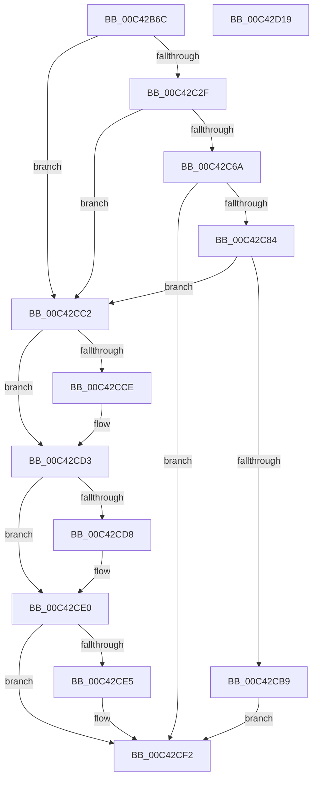

# PopUmpoInitializeMonitorChannel

- RVA: `0x00C42B6C`–`0x00C42D1A` (길이 `430` bytes)
- VA: `0x0000000140C42B6C`
- 실행 섹션: `INIT`
- PDB 이름 있음: `예`; PDB Function 태그: `아니요`
- unwind 정보 RVA: `0x000C37CC`
- 디코드: `108`개 명령, `430/430` bytes 표시
- 미해석 바이트: `0` (있으면 어셈블리에 `.byte`로 보존)

> 이 문서는 커널 이미지의 기계어와 PDB 기호를 분석해 생성했습니다. 4번과 5번은 함수 원형과 자료형을 바이너리 사용 방식에서 추정한 C 해석이며 원본 소스 복구 결과는 아닙니다.

## 1. Dependencies

- 직접 호출 지점: **12**; 고유 호출 대상: **11**
- 직접 호출자로 확인된 함수: **1**
- RIP 상대 이미지 참조: **6**

### Outgoing calls
- `0x00C42BCC` → [RtlInitUnicodeString](../../text/42/RtlInitUnicodeString_function_0042A780.md) (function, `0x0042A780`)
- `0x00C42BDB` → [memset](../../text/6C/memset_function_006C6C40.md) (function, `0x006C6C40`)
- `0x00C42C20` → [ZwAlpcCreatePort](../../text/6A/ZwAlpcCreatePort_function_006AE070.md) (function, `0x006AE070`)
- `0x00C42C5B` → [ExCreateCallback](../../page/A7/ExCreateCallback_function_00A7B9D0.md) (function, `0x00A7B9D0`)
- `0x00C42C77` → [ExRegisterCallback](../../text/4B/ExRegisterCallback_function_004BDFC0.md) (function, `0x004BDFC0`)
- `0x00C42CA1` → [ZwAlpcSetInformation](../../text/6A/ZwAlpcSetInformation_function_006AE2B0.md) (function, `0x006AE2B0`)
- `0x00C42CB0` → [ObfDereferenceObjectWithTag](../../text/2F/ObfDereferenceObjectWithTag_function_002F78E0.md) (function, `0x002F78E0`)
- `0x00C42CB9` → [PopMonitorProcessLoop](../../page/A9/PopMonitorProcessLoop_function_00A97228.md) (function, `0x00A97228`)
- `0x00C42CCE` → [ZwClose](../../text/6A/ZwClose_function_006AD2B0.md) (function, `0x006AD2B0`)
- `0x00C42CDB` → [ExUnregisterCallback](../../text/4B/ExUnregisterCallback_function_004B7F80.md) (function, `0x004B7F80`)
- `0x00C42CED` → [ObfDereferenceObjectWithTag](../../text/2F/ObfDereferenceObjectWithTag_function_002F78E0.md) (function, `0x002F78E0`)
- `0x00C42CFB` → [_security_check_cookie](../../text/6A/_security_check_cookie_function_006AC640.md) (function, `0x006AC640`)

### Direct callers
- [PoInitSystem](../C7/PoInitSystem_function_00C72358.md) at `0x00C72CDF`

### Static image references
- `0x00C42B87` → RVA `0x00E0A740` (`.data`; read)
- `0x00C42B97` → RVA `0x00C7C570` (` ?? ::PBOPGDP::`string'`; read)
- `0x00C42BA5` → RVA `0x00F084A8` (`.data`; read/write)
- `0x00C42BAF` → RVA `0x00F084B0` (`.data`; read/write)
- `0x00C42C06` → RVA `0x00F084A8` (`.data`; read)
- `0x00C42C6D` → RVA `0x00A97210` (`PopMonitorAlpcCallback`; read)

## 2. Other-region calls and transfers

- 다른 실행 섹션으로 향하는 call: **12**
  - `0x00C42BCC` → [RtlInitUnicodeString](../../text/42/RtlInitUnicodeString_function_0042A780.md) (`INIT` → `.text`)
  - `0x00C42BDB` → [memset](../../text/6C/memset_function_006C6C40.md) (`INIT` → `.text`)
  - `0x00C42C20` → [ZwAlpcCreatePort](../../text/6A/ZwAlpcCreatePort_function_006AE070.md) (`INIT` → `.text`)
  - `0x00C42C5B` → [ExCreateCallback](../../page/A7/ExCreateCallback_function_00A7B9D0.md) (`INIT` → `PAGE`)
  - `0x00C42C77` → [ExRegisterCallback](../../text/4B/ExRegisterCallback_function_004BDFC0.md) (`INIT` → `.text`)
  - `0x00C42CA1` → [ZwAlpcSetInformation](../../text/6A/ZwAlpcSetInformation_function_006AE2B0.md) (`INIT` → `.text`)
  - `0x00C42CB0` → [ObfDereferenceObjectWithTag](../../text/2F/ObfDereferenceObjectWithTag_function_002F78E0.md) (`INIT` → `.text`)
  - `0x00C42CB9` → [PopMonitorProcessLoop](../../page/A9/PopMonitorProcessLoop_function_00A97228.md) (`INIT` → `PAGE`)
  - `0x00C42CCE` → [ZwClose](../../text/6A/ZwClose_function_006AD2B0.md) (`INIT` → `.text`)
  - `0x00C42CDB` → [ExUnregisterCallback](../../text/4B/ExUnregisterCallback_function_004B7F80.md) (`INIT` → `.text`)
  - `0x00C42CED` → [ObfDereferenceObjectWithTag](../../text/2F/ObfDereferenceObjectWithTag_function_002F78E0.md) (`INIT` → `.text`)
  - `0x00C42CFB` → [_security_check_cookie](../../text/6A/_security_check_cookie_function_006AC640.md) (`INIT` → `.text`)
- 별도 외부 분기/꼬리 이동을 확인하지 못했습니다.

## 3. Assembly (complete function range)

```asm
00C42B6C  48 8B C4                        mov rax, rsp
00C42B6F  48 89 58 08                     mov qword ptr [rax + 8], rbx
00C42B73  48 89 70 10                     mov qword ptr [rax + 0x10], rsi
00C42B77  48 89 78 18                     mov qword ptr [rax + 0x18], rdi
00C42B7B  55                              push rbp
00C42B7C  48 8D 68 A1                     lea rbp, [rax - 0x5f]
00C42B80  48 81 EC E0 00 00 00            sub rsp, 0xe0
00C42B87  48 8B 05 B2 7B 1C 00            mov rax, qword ptr [rip + 0x1c7bb2]
00C42B8E  48 33 C4                        xor rax, rsp
00C42B91  48 89 45 47                     mov qword ptr [rbp + 0x47], rax
00C42B95  33 C0                           xor eax, eax
00C42B97  48 8D 15 D2 99 03 00            lea rdx, [rip + 0x399d2]
00C42B9E  21 45 BB                        and dword ptr [rbp - 0x45], eax
00C42BA1  48 8D 4D DF                     lea rcx, [rbp - 0x21]
00C42BA5  48 21 05 FC 58 2C 00            and qword ptr [rip + 0x2c58fc], rax
00C42BAC  0F 57 C0                        xorps xmm0, xmm0
00C42BAF  48 21 05 FA 58 2C 00            and qword ptr [rip + 0x2c58fa], rax
00C42BB6  33 DB                           xor ebx, ebx
00C42BB8  89 45 A3                        mov dword ptr [rbp - 0x5d], eax
00C42BBB  33 F6                           xor esi, esi
00C42BBD  21 45 A3                        and dword ptr [rbp - 0x5d], eax
00C42BC0  0F 11 45 CF                     movups xmmword ptr [rbp - 0x31], xmm0
00C42BC4  48 89 5D 97                     mov qword ptr [rbp - 0x69], rbx
00C42BC8  0F 11 45 DF                     movups xmmword ptr [rbp - 0x21], xmm0
00C42BCC  E8 AF 7B 7E FF                  call 0x14042a780
00C42BD1  33 D2                           xor edx, edx
00C42BD3  44 8D 43 48                     lea r8d, [rbx + 0x48]
00C42BD7  48 8D 4D F7                     lea rcx, [rbp - 9]
00C42BDB  E8 60 40 A8 FF                  call 0x1406c6c40
00C42BE0  48 21 5D A7                     and qword ptr [rbp - 0x59], rbx
00C42BE4  48 8D 45 DF                     lea rax, [rbp - 0x21]
00C42BE8  0F 57 C0                        xorps xmm0, xmm0
00C42BEB  48 89 45 AF                     mov qword ptr [rbp - 0x51], rax
00C42BEF  4C 8D 45 F7                     lea r8, [rbp - 9]
00C42BF3  C7 45 F7 00 00 10 00            mov dword ptr [rbp - 9], 0x100000
00C42BFA  48 8D 55 9F                     lea rdx, [rbp - 0x61]
00C42BFE  48 C7 45 07 00 01 00 00         mov qword ptr [rbp + 7], 0x100
00C42C06  48 8D 0D 9B 58 2C 00            lea rcx, [rip + 0x2c589b]
00C42C0D  C7 45 9F 30 00 00 00            mov dword ptr [rbp - 0x61], 0x30
00C42C14  F3 0F 7F 45 BF                  movdqu xmmword ptr [rbp - 0x41], xmm0
00C42C19  C7 45 B7 00 02 00 00            mov dword ptr [rbp - 0x49], 0x200
00C42C20  E8 4B B4 A6 FF                  call 0x1406ae070
00C42C25  8B F8                           mov edi, eax
00C42C27  85 C0                           test eax, eax
00C42C29  0F 88 93 00 00 00               js 0x140c42cc2
00C42C2F  48 21 5D A7                     and qword ptr [rbp - 0x59], rbx
00C42C33  48 8D 55 9F                     lea rdx, [rbp - 0x61]
00C42C37  48 21 5D AF                     and qword ptr [rbp - 0x51], rbx
00C42C3B  48 8D 4D 97                     lea rcx, [rbp - 0x69]
00C42C3F  41 B1 01                        mov r9b, 1
00C42C42  C7 45 9F 30 00 00 00            mov dword ptr [rbp - 0x61], 0x30
00C42C49  0F 57 C0                        xorps xmm0, xmm0
00C42C4C  C7 45 B7 00 02 00 00            mov dword ptr [rbp - 0x49], 0x200
00C42C53  45 8A C1                        mov r8b, r9b
00C42C56  F3 0F 7F 45 BF                  movdqu xmmword ptr [rbp - 0x41], xmm0
00C42C5B  E8 70 8D E3 FF                  call 0x140a7b9d0
00C42C60  48 8B 5D 97                     mov rbx, qword ptr [rbp - 0x69]
00C42C64  8B F8                           mov edi, eax
00C42C66  85 C0                           test eax, eax
00C42C68  78 58                           js 0x140c42cc2
00C42C6A  45 33 C0                        xor r8d, r8d
00C42C6D  48 8D 15 9C 45 E5 FF            lea rdx, [rip - 0x1aba64]
00C42C74  48 8B CB                        mov rcx, rbx
00C42C77  E8 44 B3 87 FF                  call 0x1404bdfc0
00C42C7C  48 8B F0                        mov rsi, rax
00C42C7F  48 85 C0                        test rax, rax
00C42C82  74 6E                           je 0x140c42cf2
00C42C84  48 8B 0D 1D 58 2C 00            mov rcx, qword ptr [rip + 0x2c581d]
00C42C8B  4C 8D 45 CF                     lea r8, [rbp - 0x31]
00C42C8F  41 B9 10 00 00 00               mov r9d, 0x10
00C42C95  48 89 5D CF                     mov qword ptr [rbp - 0x31], rbx
00C42C99  48 89 4D D7                     mov qword ptr [rbp - 0x29], rcx
00C42C9D  41 8D 51 F9                     lea edx, [r9 - 7]
00C42CA1  E8 0A B6 A6 FF                  call 0x1406ae2b0
00C42CA6  BA 44 66 6C 74                  mov edx, 0x746c6644
00C42CAB  48 8B CB                        mov rcx, rbx
00C42CAE  8B F8                           mov edi, eax
00C42CB0  E8 2B 4C 6B FF                  call 0x1402f78e0
00C42CB5  85 FF                           test edi, edi
00C42CB7  78 09                           js 0x140c42cc2
00C42CB9  E8 6A 45 E5 FF                  call 0x140a97228
00C42CBE  33 FF                           xor edi, edi
00C42CC0  EB 30                           jmp 0x140c42cf2
00C42CC2  48 8B 0D DF 57 2C 00            mov rcx, qword ptr [rip + 0x2c57df]
00C42CC9  48 85 C9                        test rcx, rcx
00C42CCC  74 05                           je 0x140c42cd3
00C42CCE  E8 DD A5 A6 FF                  call 0x1406ad2b0
00C42CD3  48 85 F6                        test rsi, rsi
00C42CD6  74 08                           je 0x140c42ce0
00C42CD8  48 8B CE                        mov rcx, rsi
00C42CDB  E8 A0 52 87 FF                  call 0x1404b7f80
00C42CE0  48 85 DB                        test rbx, rbx
00C42CE3  74 0D                           je 0x140c42cf2
00C42CE5  BA 44 66 6C 74                  mov edx, 0x746c6644
00C42CEA  48 8B CB                        mov rcx, rbx
00C42CED  E8 EE 4B 6B FF                  call 0x1402f78e0
00C42CF2  8B C7                           mov eax, edi
00C42CF4  48 8B 4D 47                     mov rcx, qword ptr [rbp + 0x47]
00C42CF8  48 33 CC                        xor rcx, rsp
00C42CFB  E8 40 99 A6 FF                  call 0x1406ac640
00C42D00  4C 8D 9C 24 E0 00 00 00         lea r11, [rsp + 0xe0]
00C42D08  49 8B 5B 10                     mov rbx, qword ptr [r11 + 0x10]
00C42D0C  49 8B 73 18                     mov rsi, qword ptr [r11 + 0x18]
00C42D10  49 8B 7B 20                     mov rdi, qword ptr [r11 + 0x20]
00C42D14  49 8B E3                        mov rsp, r11
00C42D17  5D                              pop rbp
00C42D18  C3                              ret
00C42D19  CC                              int3
```

## 4. C-style interpretation (structured pseudocode)

```c
__int64 __fastcall PopUmpoInitializeMonitorChannel(void)
{
    __int64 result;
    __int64 v_rbx;
    __int64 v_rdi;
    __int64 v_rsi;
    __int64 v_rsp;
    unsigned __int64 v_stack_m8;

    *(unsigned __int64 *)(v_rsp + 8) = v_rbx;
    *(unsigned __int64 *)(v_rsp + 16) = v_rsi;
    *(unsigned __int64 *)(v_rsp + 24) = v_rdi;
    v_rsp = (v_rsp) - (224);
    result = (*(unsigned __int64 *)(v_rip + 1866674)) ^ (v_rsp);
    *(unsigned __int64 *)(v_rsp - 95 + 71) = result;
    result = 0;
    v_rbx = 0;
    *(unsigned int *)(v_rsp - 95 - 93) = 0;
    v_rsi = 0;
    *(unsigned __int64 *)(v_rsp - 95 - 49) = v_xmm0;
    *(unsigned __int64 *)(v_rsp - 95 - 105) = 0;
    *(unsigned __int64 *)(v_rsp - 95 - 33) = v_xmm0;
    result = RtlInitUnicodeString(v_rsp - 95 - 33, v_rip + 235986, a3, a4);
    a2 = 0;
    result = memset(v_rsp - 95 - 9, a2, v_rbx + 72, a4);
    *(unsigned __int64 *)(v_rsp - 95 - 81) = v_rsp - 95 - 33;
    *(unsigned int *)(v_rsp - 95 - 9) = 0x100000ULL;
    *(unsigned __int64 *)(v_rsp - 95 + 7) = 256;
    *(unsigned int *)(v_rsp - 95 - 97) = 48;
    *(unsigned __int64 *)(v_rsp - 95 - 65) = v_xmm0;
    *(unsigned int *)(v_rsp - 95 - 73) = 512;
    result = ZwAlpcCreatePort(v_rip + 2906267, v_rsp - 95 - 97, v_rsp - 95 - 9, a4);
    if (sign_flag) goto loc_00C42CC2;
    *(unsigned int *)(v_rsp - 95 - 97) = 48;
    *(unsigned int *)(v_rsp - 95 - 73) = 512;
    *(unsigned __int64 *)(v_rsp - 95 - 65) = v_xmm0;
    result = ExCreateCallback(v_rsp - 95 - 105, v_rsp - 95 - 97, 1, 1);
    if (sign_flag) goto loc_00C42CC2;
    a3 = 0;
    result = ExRegisterCallback(*(unsigned __int64 *)(v_rsp - 95 - 105), v_rip - 1751652, a3, 1);
    if (result == 0) goto loc_00C42CF2;
    *(unsigned __int64 *)(v_rsp - 95 - 49) = *(unsigned __int64 *)(v_rsp - 95 - 105);
    *(unsigned __int64 *)(v_rsp - 95 - 41) = *(unsigned __int64 *)(v_rip + 2906141);
    result = ZwAlpcSetInformation(*(unsigned __int64 *)(v_rip + 2906141), 16 - 7, v_rsp - 95 - 49, 16);
    result = ObfDereferenceObjectWithTag(*(unsigned __int64 *)(v_rsp - 95 - 105), (unsigned int)(0x746C6644ULL), v_rsp - 95 - 49, 16);
    if (sign_flag) goto loc_00C42CC2;
    result = PopMonitorProcessLoop(*(unsigned __int64 *)(v_rsp - 95 - 105), (unsigned int)(0x746C6644ULL), v_rsp - 95 - 49, 16);
    v_rdi = 0;
    goto loc_00C42CF2;
loc_00C42CC2:
    if (*(unsigned __int64 *)(v_rip + 2906079) != 0) {
        result = ZwClose(*(unsigned __int64 *)(v_rip + 2906079), (unsigned int)(0x746C6644ULL), v_rsp - 95 - 49, 16);
    }
    if (result != 0) {
        a1 = result;
        result = ExUnregisterCallback(a1, (unsigned int)(0x746C6644ULL), v_rsp - 95 - 49, 16);
    }
    if (*(unsigned __int64 *)(v_rsp - 95 - 105) != 0) {
        a2 = 0x746C6644ULL;
        a1 = *(unsigned __int64 *)(v_rsp - 95 - 105);
        result = ObfDereferenceObjectWithTag(a1, a2, v_rsp - 95 - 49, 16);
    }
    a1 = (*(unsigned __int64 *)(v_rsp - 95 + 71)) ^ (v_rsp);
    result = _security_check_cookie(a1, a2, v_rsp - 95 - 49, 16);
    return result;
}
```

## 5. (Beta) C Style

```c
void PopUmpoInitializeMonitorChannel(void)
{
    int64_t result;
    int64_t local_rbx;
    int64_t local_rdi;
    int64_t local_rsi;
    int64_t local_rsp;
    uint64_t v_stack_m8;

    *(uint64_t *)(local_rsp + 0x8) = local_rbx;
    *(uint64_t *)(local_rsp + 0x10) = local_rsi;
    *(uint64_t *)(local_rsp + 0x18) = local_rdi;
    local_rsp = (local_rsp) - (224);
    result = (*(uint64_t *)(v_rip + 0x1C7BB2)) ^ (local_rsp);
    *(uint64_t *)(local_rsp - 0x5F + 0x47) = result;
    result = 0;
    local_rbx = 0;
    *(uint32_t *)(local_rsp - 0x5F - 0x5D) = 0;
    local_rsi = 0;
    *(uint64_t *)(local_rsp - 0x5F - 0x31) = v_xmm0;
    *(uint64_t *)(local_rsp - 0x5F - 0x69) = 0;
    *(uint64_t *)(local_rsp - 0x5F - 0x21) = v_xmm0;
    result = RtlInitUnicodeString(local_rsp - 95 - 33, v_rip + 235986, a3, a4);
    a2 = 0;
    result = memset(local_rsp - 95 - 9, a2, local_rbx + 72, a4);
    *(uint64_t *)(local_rsp - 0x5F - 0x51) = local_rsp - 95 - 33;
    *(uint32_t *)(local_rsp - 0x5F - 0x9) = 0x100000ULL;
    *(uint64_t *)(local_rsp - 0x5F + 0x7) = 256;
    *(uint32_t *)(local_rsp - 0x5F - 0x61) = 48;
    *(uint64_t *)(local_rsp - 0x5F - 0x41) = v_xmm0;
    *(uint32_t *)(local_rsp - 0x5F - 0x49) = 512;
    result = ZwAlpcCreatePort(v_rip + 2906267, local_rsp - 95 - 97, local_rsp - 95 - 9, a4);
    if (sign_flag) goto loc_00C42CC2;
    *(uint32_t *)(local_rsp - 0x5F - 0x61) = 48;
    *(uint32_t *)(local_rsp - 0x5F - 0x49) = 512;
    *(uint64_t *)(local_rsp - 0x5F - 0x41) = v_xmm0;
    result = ExCreateCallback(local_rsp - 95 - 105, local_rsp - 95 - 97, 1, 1);
    if (sign_flag) goto loc_00C42CC2;
    a3 = 0;
    result = ExRegisterCallback(*(uint64_t *)(local_rsp - 0x5F - 0x69), v_rip - 1751652, a3, 1);
    if (result == 0) goto loc_00C42CF2;
    *(uint64_t *)(local_rsp - 0x5F - 0x31) = *(uint64_t *)(local_rsp - 0x5F - 0x69);
    *(uint64_t *)(local_rsp - 0x5F - 0x29) = *(uint64_t *)(v_rip + 0x2C581D);
    result = ZwAlpcSetInformation(*(uint64_t *)(v_rip + 0x2C581D), 16 - 7, local_rsp - 95 - 49, 16);
    result = ObfDereferenceObjectWithTag(*(uint64_t *)(local_rsp - 0x5F - 0x69), (uint32_t)(0x746C6644ULL), local_rsp - 95 - 49, 16);
    if (sign_flag) goto loc_00C42CC2;
    result = PopMonitorProcessLoop(*(uint64_t *)(local_rsp - 0x5F - 0x69), (uint32_t)(0x746C6644ULL), local_rsp - 95 - 49, 16);
    local_rdi = 0;
    goto loc_00C42CF2;
loc_00C42CC2:
    if (*(uint64_t *)(v_rip + 0x2C57DF) != 0) {
        result = ZwClose(*(uint64_t *)(v_rip + 0x2C57DF), (uint32_t)(0x746C6644ULL), local_rsp - 95 - 49, 16);
    }
    if (result != 0) {
        a1 = result;
        result = ExUnregisterCallback(a1, (uint32_t)(0x746C6644ULL), local_rsp - 95 - 49, 16);
    }
    if (*(uint64_t *)(local_rsp - 0x5F - 0x69) != 0) {
        a2 = 0x746C6644ULL;
        a1 = *(uint64_t *)(local_rsp - 0x5F - 0x69);
        result = ObfDereferenceObjectWithTag(a1, a2, local_rsp - 95 - 49, 16);
    }
    a1 = (*(uint64_t *)(local_rsp - 0x5F + 0x47)) ^ (local_rsp);
    result = _security_check_cookie(a1, a2, local_rsp - 95 - 49, 16);
    return result;
}
```

## 6. Execution-region graph

[열기: 2D/3D 그래프와 함수 탐색 컨트롤 패널](../../../control-panel.html?section=init&rva=0x00C42B6C&view=graph)

- 2D 그래프는 위에서 아래로 흐르고, 3D 그래프는 빈 공간을 드래그해 회전합니다. Shift+드래그는 이동, 휠은 확대·축소, 함수 노드 선택은 대상 보고서 이동입니다.

### Static fallback


