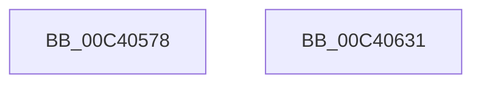

# PpmCheckInit

- RVA: `0x00C40578`–`0x00C40632` (길이 `186` bytes)
- VA: `0x0000000140C40578`
- 실행 섹션: `INIT`
- PDB 이름 있음: `예`; PDB Function 태그: `아니요`
- unwind 정보 RVA: `0x0005CF00`
- 디코드: `32`개 명령, `186/186` bytes 표시
- 미해석 바이트: `0` (있으면 어셈블리에 `.byte`로 보존)

> 이 문서는 커널 이미지의 기계어와 PDB 기호를 분석해 생성했습니다. 4번과 5번은 함수 원형과 자료형을 바이너리 사용 방식에서 추정한 C 해석이며 원본 소스 복구 결과는 아닙니다.

## 1. Dependencies

- 직접 호출 지점: **2**; 고유 호출 대상: **2**
- 직접 호출자로 확인된 함수: **1**
- RIP 상대 이미지 참조: **19**

### Outgoing calls
- `0x00C405FE` → [memset](../../text/6C/memset_function_006C6C40.md) (function, `0x006C6C40`)
- `0x00C40626` → [KiInitializeTimer2](../../text/3A/KiInitializeTimer2_function_003A3288.md) (function, `0x003A3288`)

### Direct callers
- [PoInitSystem](../C7/PoInitSystem_function_00C72358.md) at `0x00C7266F`

### Static image references
- `0x00C40580` → RVA `0x00F0B244` (`.data`; write)
- `0x00C4058A` → RVA `0x002DA0C0` (`PpmCheckRun`; read)
- `0x00C40591` → RVA `0x00F0B280` (`.data`; write)
- `0x00C4059B` → RVA `0x00F0B298` (`.data`; write)
- `0x00C405A2` → RVA `0x00F07108` (`.data`; read)
- `0x00C405A9` → RVA `0x003BED70` (`PpmCheckPeriodicStart`; read)
- `0x00C405B0` → RVA `0x00F0B2A0` (`.data`; write)
- `0x00C405B9` → RVA `0x00F0B2D8` (`.data`; write)
- `0x00C405C6` → RVA `0x00F0B2B8` (`.data`; write)
- `0x00C405CD` → RVA `0x00F0B290` (`.data`; write)
- `0x00C405D4` → RVA `0x00F0B2C0` (`.data`; write)
- `0x00C405DE` → RVA `0x00F0B2E0` (`.data`; write)
- `0x00C405E5` → RVA `0x00F0B2F8` (`.data`; write)
- `0x00C405EC` → RVA `0x00F0B2D0` (`.data`; write)
- `0x00C405F3` → RVA `0x00F07100` (`.data`; write)
- `0x00C40607` → RVA `0x00F0B340` (`.data`; write)
- `0x00C40611` → RVA `0x00F0B362` (`.data`; write)
- `0x00C40618` → RVA `0x005D85B0` (`PpmCheckTimerCallback`; read)
- `0x00C4061F` → RVA `0x00F0B360` (`.data`; read)

## 2. Other-region calls and transfers

- 다른 실행 섹션으로 향하는 call: **2**
  - `0x00C405FE` → [memset](../../text/6C/memset_function_006C6C40.md) (`INIT` → `.text`)
  - `0x00C40626` → [KiInitializeTimer2](../../text/3A/KiInitializeTimer2_function_003A3288.md) (`INIT` → `.text`)
- 별도 외부 분기/꼬리 이동을 확인하지 못했습니다.

## 3. Assembly (complete function range)

```asm
00C40578  40 53                           push rbx
00C4057A  48 83 EC 20                     sub rsp, 0x20
00C4057E  33 DB                           xor ebx, ebx
00C40580  C7 05 BA AC 2C 00 06 00 00 00   mov dword ptr [rip + 0x2cacba], 6
00C4058A  48 8D 05 2F 9B 69 FF            lea rax, [rip - 0x9664d1]
00C40591  C7 05 E5 AC 2C 00 13 03 00 00   mov dword ptr [rip + 0x2cace5], 0x313
00C4059B  48 89 05 F6 AC 2C 00            mov qword ptr [rip + 0x2cacf6], rax
00C405A2  48 8D 0D 5F 6B 2C 00            lea rcx, [rip + 0x2c6b5f]
00C405A9  48 8D 05 C0 E7 77 FF            lea rax, [rip - 0x881840]
00C405B0  48 89 1D E9 AC 2C 00            mov qword ptr [rip + 0x2cace9], rbx
00C405B7  33 D2                           xor edx, edx
00C405B9  48 89 05 18 AD 2C 00            mov qword ptr [rip + 0x2cad18], rax
00C405C0  41 B8 00 01 00 00               mov r8d, 0x100
00C405C6  48 89 1D EB AC 2C 00            mov qword ptr [rip + 0x2caceb], rbx
00C405CD  48 89 1D BC AC 2C 00            mov qword ptr [rip + 0x2cacbc], rbx
00C405D4  C7 05 E2 AC 2C 00 13 03 00 00   mov dword ptr [rip + 0x2cace2], 0x313
00C405DE  48 89 1D FB AC 2C 00            mov qword ptr [rip + 0x2cacfb], rbx
00C405E5  48 89 1D 0C AD 2C 00            mov qword ptr [rip + 0x2cad0c], rbx
00C405EC  48 89 1D DD AC 2C 00            mov qword ptr [rip + 0x2cacdd], rbx
00C405F3  48 C7 05 02 6B 2C 00 01 00 20 00  mov qword ptr [rip + 0x2c6b02], 0x200001
00C405FE  E8 3D 66 A8 FF                  call 0x1406c6c40
00C40603  44 8D 4B 0C                     lea r9d, [rbx + 0xc]
00C40607  48 89 1D 32 AD 2C 00            mov qword ptr [rip + 0x2cad32], rbx
00C4060E  45 33 C0                        xor r8d, r8d
00C40611  66 89 1D 4A AD 2C 00            mov word ptr [rip + 0x2cad4a], bx
00C40618  48 8D 15 91 7F 99 FF            lea rdx, [rip - 0x66806f]
00C4061F  48 8D 0D 3A AD 2C 00            lea rcx, [rip + 0x2cad3a]
00C40626  E8 5D 2C 76 FF                  call 0x1403a3288
00C4062B  48 83 C4 20                     add rsp, 0x20
00C4062F  5B                              pop rbx
00C40630  C3                              ret
00C40631  CC                              int3
```

## 4. C-style interpretation (structured pseudocode)

```c
__int64 __fastcall PpmCheckInit(__int64 a1, int a2)
{
    __int64 result;
    __int64 v_rbx;
    __int64 v_rsp;

    v_rsp = (v_rsp) - (32);
    v_rbx = 0;
    *(unsigned int *)(v_rip + 2927802) = 6;
    *(unsigned int *)(v_rip + 2927845) = 787;
    *(unsigned __int64 *)(v_rip + 2927862) = v_rip - 9856209;
    *(unsigned __int64 *)(v_rip + 2927849) = 0;
    a2 = 0;
    *(unsigned __int64 *)(v_rip + 2927896) = v_rip - 8919104;
    *(unsigned __int64 *)(v_rip + 2927851) = 0;
    *(unsigned __int64 *)(v_rip + 2927804) = 0;
    *(unsigned int *)(v_rip + 2927842) = 787;
    *(unsigned __int64 *)(v_rip + 2927867) = 0;
    *(unsigned __int64 *)(v_rip + 2927884) = 0;
    *(unsigned __int64 *)(v_rip + 2927837) = 0;
    *(unsigned __int64 *)(v_rip + 2910978) = 0x200001ULL;
    result = memset(v_rip + 2911071, a2, 256, a4);
    *(unsigned __int64 *)(v_rip + 2927922) = 0;
    a3 = 0;
    *(unsigned __int16 *)(v_rip + 2927946) = 0;
    result = KiInitializeTimer2(v_rip + 2927930, v_rip - 6717551, a3, v_rbx + 12);
    v_rsp = (v_rsp) + (32);
    return result;
}
```

## 5. (Beta) C Style

```c
int64_t PpmCheckInit(int64_t Arg1, int32_t Arg2)
{
    int64_t result;
    int64_t local_rbx;
    int64_t local_rsp;

    local_rsp = (local_rsp) - (32);
    local_rbx = 0;
    *(uint32_t *)(v_rip + 0x2CACBA) = 6;
    *(uint32_t *)(v_rip + 0x2CACE5) = 787;
    *(uint64_t *)(v_rip + 0x2CACF6) = v_rip - 9856209;
    *(uint64_t *)(v_rip + 0x2CACE9) = 0;
    Arg2 = 0;
    *(uint64_t *)(v_rip + 0x2CAD18) = v_rip - 8919104;
    *(uint64_t *)(v_rip + 0x2CACEB) = 0;
    *(uint64_t *)(v_rip + 0x2CACBC) = 0;
    *(uint32_t *)(v_rip + 0x2CACE2) = 787;
    *(uint64_t *)(v_rip + 0x2CACFB) = 0;
    *(uint64_t *)(v_rip + 0x2CAD0C) = 0;
    *(uint64_t *)(v_rip + 0x2CACDD) = 0;
    *(uint64_t *)(v_rip + 0x2C6B02) = 0x200001ULL;
    result = memset(v_rip + 2911071, Arg2, 256, a4);
    *(uint64_t *)(v_rip + 0x2CAD32) = 0;
    a3 = 0;
    *(uint16_t *)(v_rip + 0x2CAD4A) = 0;
    result = KiInitializeTimer2(v_rip + 2927930, v_rip - 6717551, a3, local_rbx + 12);
    local_rsp = (local_rsp) + (32);
    return result;
}
```

## 6. Execution-region graph

[열기: 2D/3D 그래프와 함수 탐색 컨트롤 패널](../../../control-panel.html?section=init&rva=0x00C40578&view=graph)

- 2D 그래프는 위에서 아래로 흐르고, 3D 그래프는 빈 공간을 드래그해 회전합니다. Shift+드래그는 이동, 휠은 확대·축소, 함수 노드 선택은 대상 보고서 이동입니다.

### Static fallback


