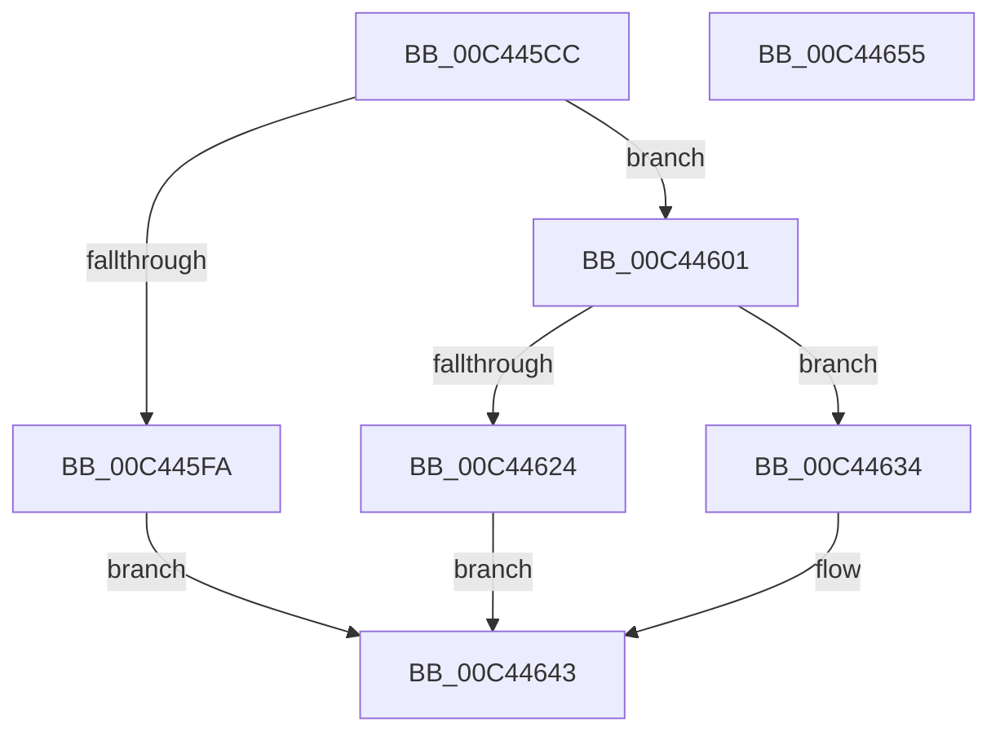

# PpmEventInitializeEx

- RVA: `0x00C445CC`–`0x00C44656` (길이 `138` bytes)
- VA: `0x0000000140C445CC`
- 실행 섹션: `INIT`
- PDB 이름 있음: `예`; PDB Function 태그: `아니요`
- unwind 정보 RVA: `0x00060BC4`
- 디코드: `36`개 명령, `138/138` bytes 표시
- 미해석 바이트: `0` (있으면 어셈블리에 `.byte`로 보존)

> 이 문서는 커널 이미지의 기계어와 PDB 기호를 분석해 생성했습니다. 4번과 5번은 함수 원형과 자료형을 바이너리 사용 방식에서 추정한 C 해석이며 원본 소스 복구 결과는 아닙니다.

## 1. Dependencies

- 직접 호출 지점: **3**; 고유 호출 대상: **3**
- 직접 호출자로 확인된 함수: **1**
- RIP 상대 이미지 참조: **5**

### Outgoing calls
- `0x00C445EB` → [ExAllocatePool2](../../poolcode/B8/ExAllocatePool2_function_00B820F0.md) (function, `0x00B820F0`)
- `0x00C44619` → [EtwRegister](../../page/92/EtwRegister_function_00920960.md) (function, `0x00920960`)
- `0x00C4463C` → [ExFreePoolWithTag](../../poolcode/B8/ExFreePoolWithTag_function_00B82870.md) (function, `0x00B82870`)

### Direct callers
- [PpmEventInitialize](PpmEventInitialize_function_00C437A0.md) at `0x00C437AD`

### Static image references
- `0x00C44601` → RVA `0x00F083E8` (`.data`; read)
- `0x00C4460B` → RVA `0x00A51F60` (`PpmEventTraceControlCallback`; read)
- `0x00C44612` → RVA `0x000216F0` (`.rdata`; read)
- `0x00C44624` → RVA `0x00E67A39` (`.data`; write)
- `0x00C4462B` → RVA `0x00E67A70` (`.data`; write)

## 2. Other-region calls and transfers

- 다른 실행 섹션으로 향하는 call: **3**
  - `0x00C445EB` → [ExAllocatePool2](../../poolcode/B8/ExAllocatePool2_function_00B820F0.md) (`INIT` → `POOLCODE`)
  - `0x00C44619` → [EtwRegister](../../page/92/EtwRegister_function_00920960.md) (`INIT` → `PAGE`)
  - `0x00C4463C` → [ExFreePoolWithTag](../../poolcode/B8/ExFreePoolWithTag_function_00B82870.md) (`INIT` → `POOLCODE`)
- 별도 외부 분기/꼬리 이동을 확인하지 못했습니다.

## 3. Assembly (complete function range)

```asm
00C445CC  48 89 5C 24 08                  mov qword ptr [rsp + 8], rbx
00C445D1  48 89 74 24 10                  mov qword ptr [rsp + 0x10], rsi
00C445D6  57                              push rdi
00C445D7  48 83 EC 20                     sub rsp, 0x20
00C445DB  BA F0 28 00 00                  mov edx, 0x28f0
00C445E0  B9 40 00 00 00                  mov ecx, 0x40
00C445E5  41 B8 50 50 4D 70               mov r8d, 0x704d5050
00C445EB  E8 00 DB F3 FF                  call 0x140b820f0
00C445F0  33 DB                           xor ebx, ebx
00C445F2  48 8B F8                        mov rdi, rax
00C445F5  48 85 C0                        test rax, rax
00C445F8  75 07                           jne 0x140c44601
00C445FA  BB 9A 00 00 C0                  mov ebx, 0xc000009a
00C445FF  EB 42                           jmp 0x140c44643
00C44601  4C 8D 0D E0 3D 2C 00            lea r9, [rip + 0x2c3de0]
00C44608  45 33 C0                        xor r8d, r8d
00C4460B  48 8D 15 4E D9 E0 FF            lea rdx, [rip - 0x1f26b2]
00C44612  48 8D 0D D7 D0 3D FF            lea rcx, [rip - 0xc22f29]
00C44619  E8 42 C3 CD FF                  call 0x140920960
00C4461E  8B F0                           mov esi, eax
00C44620  85 C0                           test eax, eax
00C44622  78 10                           js 0x140c44634
00C44624  C6 05 0E 34 22 00 01            mov byte ptr [rip + 0x22340e], 1
00C4462B  48 89 3D 3E 34 22 00            mov qword ptr [rip + 0x22343e], rdi
00C44632  EB 0F                           jmp 0x140c44643
00C44634  BA 50 50 4D 70                  mov edx, 0x704d5050
00C44639  48 8B CF                        mov rcx, rdi
00C4463C  E8 2F E2 F3 FF                  call 0x140b82870
00C44641  8B DE                           mov ebx, esi
00C44643  48 8B 74 24 38                  mov rsi, qword ptr [rsp + 0x38]
00C44648  8B C3                           mov eax, ebx
00C4464A  48 8B 5C 24 30                  mov rbx, qword ptr [rsp + 0x30]
00C4464F  48 83 C4 20                     add rsp, 0x20
00C44653  5F                              pop rdi
00C44654  C3                              ret
00C44655  CC                              int3
```

## 4. C-style interpretation (structured pseudocode)

```c
__int64 __fastcall PpmEventInitializeEx(void)
{
    __int64 result;
    __int64 v_rbx;
    __int64 v_rsp;
    unsigned __int64 v_stack_p10;
    unsigned __int64 v_stack_p8;

    v_stack_p8 = v_rbx;
    v_stack_p10 = v_rsi;
    v_rsp = (v_rsp) - (32);
    result = ExAllocatePool2(64, (unsigned int)(0x28F0ULL), (unsigned int)(0x704D5050ULL), a4);
    v_rbx = 0;
    if (result != 0) goto loc_00C44601;
    goto loc_00C44643;
loc_00C44601:
    a3 = 0;
    result = EtwRegister(v_rip - 12726057, v_rip - 2041522, a3, v_rip + 2899424);
    if (sign_flag) goto loc_00C44634;
    *(unsigned __int8 *)(v_rip + 2241550) = 1;
    *(unsigned __int64 *)(v_rip + 2241598) = result;
    goto loc_00C44643;
loc_00C44634:
    result = ExFreePoolWithTag(result, (unsigned int)(0x704D5050ULL), a3, v_rip + 2899424);
loc_00C44643:
    v_rsp = (v_rsp) + (32);
    return (unsigned int)((unsigned int)((unsigned int)((unsigned int)((unsigned int)((unsigned int)(result))))));
}
```

## 5. (Beta) C Style

```c
void PpmEventInitializeEx(void)
{
    int64_t result;
    int64_t local_rbx;
    int64_t local_rsp;
    uint64_t v_stack_p10;
    uint64_t v_stack_p8;

    v_stack_p8 = local_rbx;
    v_stack_p10 = local_rsi;
    local_rsp = (local_rsp) - (32);
    result = ExAllocatePool2(64, (uint32_t)(0x28F0ULL), (uint32_t)(0x704D5050ULL), a4);
    local_rbx = 0;
    if (result != 0) goto loc_00C44601;
    goto loc_00C44643;
loc_00C44601:
    a3 = 0;
    result = EtwRegister(v_rip - 12726057, v_rip - 2041522, a3, v_rip + 2899424);
    if (sign_flag) goto loc_00C44634;
    *(uint8_t *)(v_rip + 0x22340E) = 1;
    *(uint64_t *)(v_rip + 0x22343E) = result;
    goto loc_00C44643;
loc_00C44634:
    result = ExFreePoolWithTag(result, (uint32_t)(0x704D5050ULL), a3, v_rip + 2899424);
loc_00C44643:
    local_rsp = (local_rsp) + (32);
    return (uint32_t)((uint32_t)((uint32_t)((uint32_t)((uint32_t)((uint32_t)(result))))));
}
```

## 6. Execution-region graph

[열기: 2D/3D 그래프와 함수 탐색 컨트롤 패널](../../../control-panel.html?section=init&rva=0x00C445CC&view=graph)

- 2D 그래프는 위에서 아래로 흐르고, 3D 그래프는 빈 공간을 드래그해 회전합니다. Shift+드래그는 이동, 휠은 확대·축소, 함수 노드 선택은 대상 보고서 이동입니다.

### Static fallback


