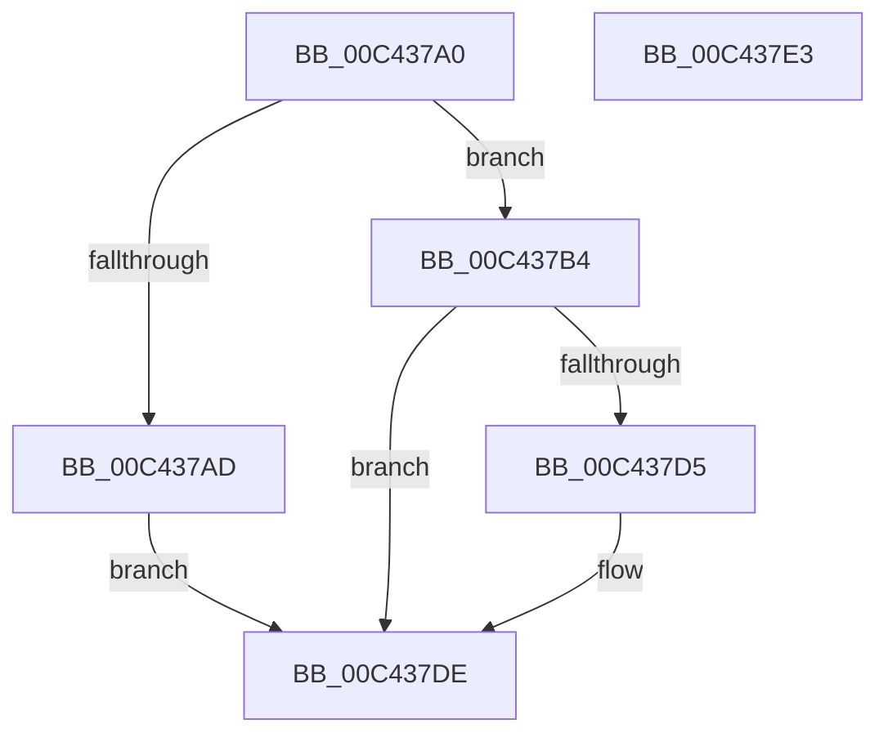

# PpmEventInitialize

- RVA: `0x00C437A0`–`0x00C437E4` (길이 `68` bytes)
- VA: `0x0000000140C437A0`
- 실행 섹션: `INIT`
- PDB 이름 있음: `예`; PDB Function 태그: `아니요`
- unwind 정보 RVA: `0x0005C788`
- 디코드: `18`개 명령, `68/68` bytes 표시
- 미해석 바이트: `0` (있으면 어셈블리에 `.byte`로 보존)

> 이 문서는 커널 이미지의 기계어와 PDB 기호를 분석해 생성했습니다. 4번과 5번은 함수 원형과 자료형을 바이너리 사용 방식에서 추정한 C 해석이며 원본 소스 복구 결과는 아닙니다.

## 1. Dependencies

- 직접 호출 지점: **3**; 고유 호출 대상: **3**
- 직접 호출자로 확인된 함수: **1**
- RIP 상대 이미지 참조: **4**

### Outgoing calls
- `0x00C437A4` → [Feature_PpmParkEx__private_IsEnabledDeviceUsageNoInline](../../text/4F/Feature_PpmParkEx__private_IsEnabledDeviceUsageNoInline_function_004F135C.md) (function, `0x004F135C`)
- `0x00C437AD` → [PpmEventInitializeEx](PpmEventInitializeEx_function_00C445CC.md) (function, `0x00C445CC`)
- `0x00C437CC` → [EtwRegister](../../page/92/EtwRegister_function_00920960.md) (function, `0x00920960`)

### Direct callers
- [PoInitSystem](../C7/PoInitSystem_function_00C72358.md) at `0x00C72DE9`

### Static image references
- `0x00C437B4` → RVA `0x00F083E8` (`.data`; read)
- `0x00C437BE` → RVA `0x00A51F60` (`PpmEventTraceControlCallback`; read)
- `0x00C437C5` → RVA `0x000216F0` (`.rdata`; read)
- `0x00C437D5` → RVA `0x00E67A39` (`.data`; write)

## 2. Other-region calls and transfers

- 다른 실행 섹션으로 향하는 call: **2**
  - `0x00C437A4` → [Feature_PpmParkEx__private_IsEnabledDeviceUsageNoInline](../../text/4F/Feature_PpmParkEx__private_IsEnabledDeviceUsageNoInline_function_004F135C.md) (`INIT` → `.text`)
  - `0x00C437CC` → [EtwRegister](../../page/92/EtwRegister_function_00920960.md) (`INIT` → `PAGE`)
- 별도 외부 분기/꼬리 이동을 확인하지 못했습니다.

## 3. Assembly (complete function range)

```asm
00C437A0  48 83 EC 28                     sub rsp, 0x28
00C437A4  E8 B3 DB 8A FF                  call 0x1404f135c
00C437A9  85 C0                           test eax, eax
00C437AB  74 07                           je 0x140c437b4
00C437AD  E8 1A 0E 00 00                  call 0x140c445cc
00C437B2  EB 2A                           jmp 0x140c437de
00C437B4  4C 8D 0D 2D 4C 2C 00            lea r9, [rip + 0x2c4c2d]
00C437BB  45 33 C0                        xor r8d, r8d
00C437BE  48 8D 15 9B E7 E0 FF            lea rdx, [rip - 0x1f1865]
00C437C5  48 8D 0D 24 DF 3D FF            lea rcx, [rip - 0xc220dc]
00C437CC  E8 8F D1 CD FF                  call 0x140920960
00C437D1  85 C0                           test eax, eax
00C437D3  78 09                           js 0x140c437de
00C437D5  C6 05 5D 42 22 00 01            mov byte ptr [rip + 0x22425d], 1
00C437DC  33 C0                           xor eax, eax
00C437DE  48 83 C4 28                     add rsp, 0x28
00C437E2  C3                              ret
00C437E3  CC                              int3
```

## 4. C-style interpretation (structured pseudocode)

```c
__int64 __fastcall PpmEventInitialize(__int64 a1, __int64 a2, int a3)
{
    __int64 result;
    __int64 v_rsp;

    v_rsp = (v_rsp) - (40);
    result = Feature_PpmParkEx__private_IsEnabledDeviceUsageNoInline(a1, a2, a3, a4);
    if ((unsigned int)(result) == 0) goto loc_00C437B4;
    result = PpmEventInitializeEx(a1, a2, a3, a4);
    goto loc_00C437DE;
loc_00C437B4:
    a3 = 0;
    result = EtwRegister(v_rip - 12722396, v_rip - 2037861, a3, v_rip + 2903085);
    if (!(sign_flag)) {
        *(unsigned __int8 *)(v_rip + 2245213) = 1;
        result = 0;
    }
    v_rsp = (v_rsp) + (40);
    return result;
}
```

## 5. (Beta) C Style

```c
int64_t PpmEventInitialize(int64_t Arg1, int64_t Arg2, int32_t Arg3)
{
    int64_t result;
    int64_t local_rsp;

    local_rsp = (local_rsp) - (40);
    result = Feature_PpmParkEx__private_IsEnabledDeviceUsageNoInline(Arg1, Arg2, Arg3, a4);
    if ((uint32_t)(result) == 0) goto loc_00C437B4;
    result = PpmEventInitializeEx(Arg1, Arg2, Arg3, a4);
    goto loc_00C437DE;
loc_00C437B4:
    Arg3 = 0;
    result = EtwRegister(v_rip - 12722396, v_rip - 2037861, Arg3, v_rip + 2903085);
    if (!(sign_flag)) {
        *(uint8_t *)(v_rip + 0x22425D) = 1;
        result = 0;
    }
    local_rsp = (local_rsp) + (40);
    return result;
}
```

## 6. Execution-region graph

[열기: 2D/3D 그래프와 함수 탐색 컨트롤 패널](../../../control-panel.html?section=init&rva=0x00C437A0&view=graph)

- 2D 그래프는 위에서 아래로 흐르고, 3D 그래프는 빈 공간을 드래그해 회전합니다. Shift+드래그는 이동, 휠은 확대·축소, 함수 노드 선택은 대상 보고서 이동입니다.

### Static fallback


