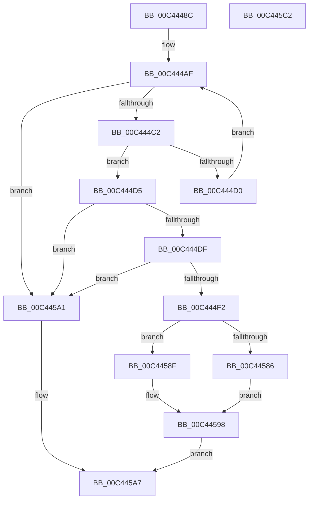

# PpmHeteroInitializeAmdWpsSupport

- RVA: `0x00C4448C`–`0x00C445C3` (길이 `311` bytes)
- VA: `0x0000000140C4448C`
- 실행 섹션: `INIT`
- PDB 이름 있음: `예`; PDB Function 태그: `아니요`
- unwind 정보 RVA: `0x000BE218`
- 디코드: `64`개 명령, `311/311` bytes 표시
- 미해석 바이트: `0` (있으면 어셈블리에 `.byte`로 보존)

> 이 문서는 커널 이미지의 기계어와 PDB 기호를 분석해 생성했습니다. 4번과 5번은 함수 원형과 자료형을 바이너리 사용 방식에서 추정한 C 해석이며 원본 소스 복구 결과는 아닙니다.

## 1. Dependencies

- 직접 호출 지점: **2**; 고유 호출 대상: **2**
- 직접 호출자로 확인된 함수: **1**
- RIP 상대 이미지 참조: **23**

### Outgoing calls
- `0x00C4457D` → [PoGetWorkloadClassCount](../../pagelk/B7/PoGetWorkloadClassCount_function_00B71508.md) (function, `0x00B71508`)
- `0x00C445B2` → [_security_check_cookie](../../text/6A/_security_check_cookie_function_006AC640.md) (function, `0x006AC640`)

### Direct callers
- [PoInitHeteroDetection](../C3/PoInitHeteroDetection_function_00C3D244.md) at `0x00C3D27B`

### Static image references
- `0x00C44496` → RVA `0x00E0A740` (`.data`; read)
- `0x00C444F2` → RVA `0x00772B10` (`PpmHeteroRegisterWpsUpdatesAmd`; read)
- `0x00C444F9` → RVA `0x00FC6C2C` (`ALMOSTRO`; write)
- `0x00C44503` → RVA `0x00F0B218` (`.data`; write)
- `0x00C4450A` → RVA `0x00E0B804` (`.data`; read)
- `0x00C44511` → RVA `0x004C6FD0` (`PpmHeteroHgsUpdateDpcRoutine`; read)
- `0x00C44518` → RVA `0x00FC6AF4` (`ALMOSTRO`; write)
- `0x00C4451F` → RVA `0x00FC7658` (`ALMOSTRO`; write)
- `0x00C44526` → RVA `0x005D8F70` (`PpmHeteroHgsUpdateWorker`; read)
- `0x00C4452D` → RVA `0x00FC7590` (`ALMOSTRO`; write)
- `0x00C44534` → RVA `0x00FC6AEE` (`ALMOSTRO`; write)
- `0x00C4453B` → RVA `0x00FC6AEF` (`ALMOSTRO`; write)
- `0x00C44542` → RVA `0x00FC6A94` (`ALMOSTRO`; write)
- `0x00C44549` → RVA `0x00FC5003` (`ALMOSTRO`; write)
- `0x00C44550` → RVA `0x00FC7640` (`ALMOSTRO`; write)
- `0x00C4455A` → RVA `0x00FC7660` (`ALMOSTRO`; write)
- `0x00C44561` → RVA `0x00FC7678` (`ALMOSTRO`; write)
- `0x00C44568` → RVA `0x00FC7650` (`ALMOSTRO`; write)
- `0x00C4456F` → RVA `0x00FC7598` (`ALMOSTRO`; write)
- `0x00C44576` → RVA `0x00FC7580` (`ALMOSTRO`; write)
- `0x00C44586` → RVA `0x00FC6ADE` (`ALMOSTRO`; write)
- `0x00C4458F` → RVA `0x00E0B804` (`.data`; write)
- `0x00C44598` → RVA `0x00FC6A96` (`ALMOSTRO`; write)

## 2. Other-region calls and transfers

- 다른 실행 섹션으로 향하는 call: **2**
  - `0x00C4457D` → [PoGetWorkloadClassCount](../../pagelk/B7/PoGetWorkloadClassCount_function_00B71508.md) (`INIT` → `PAGELK`)
  - `0x00C445B2` → [_security_check_cookie](../../text/6A/_security_check_cookie_function_006AC640.md) (`INIT` → `.text`)
- 별도 외부 분기/꼬리 이동을 확인하지 못했습니다.

## 3. Assembly (complete function range)

```asm
00C4448C  48 89 5C 24 08                  mov qword ptr [rsp + 8], rbx
00C44491  57                              push rdi
00C44492  48 83 EC 40                     sub rsp, 0x40
00C44496  48 8B 05 A3 62 1C 00            mov rax, qword ptr [rip + 0x1c62a3]
00C4449D  48 33 C4                        xor rax, rsp
00C444A0  48 89 44 24 30                  mov qword ptr [rsp + 0x30], rax
00C444A5  45 33 DB                        xor r11d, r11d
00C444A8  45 8B C3                        mov r8d, r11d
00C444AB  41 8D 7B 01                     lea edi, [r11 + 1]
00C444AF  B8 26 00 00 80                  mov eax, 0x80000026
00C444B4  41 8B C8                        mov ecx, r8d
00C444B7  0F A2                           cpuid
00C444B9  66 85 DB                        test bx, bx
00C444BC  0F 84 DF 00 00 00               je 0x140c445a1
00C444C2  81 E1 00 FF 00 00               and ecx, 0xff00
00C444C8  81 F9 00 01 00 00               cmp ecx, 0x100
00C444CE  74 05                           je 0x140c444d5
00C444D0  44 03 C7                        add r8d, edi
00C444D3  EB DA                           jmp 0x140c444af
00C444D5  0F BA E0 1E                     bt eax, 0x1e
00C444D9  0F 83 C2 00 00 00               jae 0x140c445a1
00C444DF  33 C9                           xor ecx, ecx
00C444E1  B8 21 00 00 80                  mov eax, 0x80000021
00C444E6  0F A2                           cpuid
00C444E8  0F BA E0 16                     bt eax, 0x16
00C444EC  0F 83 AF 00 00 00               jae 0x140c445a1
00C444F2  48 8D 05 17 E6 B2 FF            lea rax, [rip - 0x4d19e9]
00C444F9  C7 05 29 27 38 00 02 00 00 00   mov dword ptr [rip + 0x382729], 2
00C44503  48 89 05 0E 6D 2C 00            mov qword ptr [rip + 0x2c6d0e], rax
00C4450A  48 8D 0D F3 72 1C 00            lea rcx, [rip + 0x1c72f3]
00C44511  48 8D 05 B8 2A 88 FF            lea rax, [rip - 0x77d548]
00C44518  44 88 1D D5 25 38 00            mov byte ptr [rip + 0x3825d5], r11b
00C4451F  48 89 05 32 31 38 00            mov qword ptr [rip + 0x383132], rax
00C44526  48 8D 05 43 4A 99 FF            lea rax, [rip - 0x66b5bd]
00C4452D  48 89 05 5C 30 38 00            mov qword ptr [rip + 0x38305c], rax
00C44534  44 88 1D B3 25 38 00            mov byte ptr [rip + 0x3825b3], r11b
00C4453B  44 88 1D AD 25 38 00            mov byte ptr [rip + 0x3825ad], r11b
00C44542  40 88 3D 4B 25 38 00            mov byte ptr [rip + 0x38254b], dil
00C44549  40 88 3D B3 0A 38 00            mov byte ptr [rip + 0x380ab3], dil
00C44550  C7 05 E6 30 38 00 13 03 00 00   mov dword ptr [rip + 0x3830e6], 0x313
00C4455A  4C 89 1D FF 30 38 00            mov qword ptr [rip + 0x3830ff], r11
00C44561  4C 89 1D 10 31 38 00            mov qword ptr [rip + 0x383110], r11
00C44568  4C 89 1D E1 30 38 00            mov qword ptr [rip + 0x3830e1], r11
00C4456F  4C 89 1D 22 30 38 00            mov qword ptr [rip + 0x383022], r11
00C44576  4C 89 1D 03 30 38 00            mov qword ptr [rip + 0x383003], r11
00C4457D  E8 86 CF F2 FF                  call 0x140b71508
00C44582  84 C0                           test al, al
00C44584  74 09                           je 0x140c4458f
00C44586  40 88 3D 51 25 38 00            mov byte ptr [rip + 0x382551], dil
00C4458D  EB 09                           jmp 0x140c44598
00C4458F  89 3D 6F 72 1C 00               mov dword ptr [rip + 0x1c726f], edi
00C44595  41 8A FB                        mov dil, r11b
00C44598  40 88 3D F7 24 38 00            mov byte ptr [rip + 0x3824f7], dil
00C4459F  EB 06                           jmp 0x140c445a7
00C445A1  41 BB BB 00 00 C0               mov r11d, 0xc00000bb
00C445A7  41 8B C3                        mov eax, r11d
00C445AA  48 8B 4C 24 30                  mov rcx, qword ptr [rsp + 0x30]
00C445AF  48 33 CC                        xor rcx, rsp
00C445B2  E8 89 80 A6 FF                  call 0x1406ac640
00C445B7  48 8B 5C 24 50                  mov rbx, qword ptr [rsp + 0x50]
00C445BC  48 83 C4 40                     add rsp, 0x40
00C445C0  5F                              pop rdi
00C445C1  C3                              ret
00C445C2  CC                              int3
```

## 4. C-style interpretation (structured pseudocode)

```c
__int64 __fastcall PpmHeteroInitializeAmdWpsSupport(void)
{
    __int64 result;
    __int64 v_r11;
    __int64 v_rsp;
    unsigned __int64 v_stack_m18;
    unsigned __int64 v_stack_p8;

    v_stack_p8 = v_rbx;
    v_rsp = (v_rsp) - (64);
    result = (*(unsigned __int64 *)(v_rip + 1860259)) ^ (v_rsp);
    v_stack_m18 = result;
    v_r11 = 0;
loc_00C444AF:
    if ((unsigned __int16)(v_rbx) == 0) goto loc_00C445A1;
    a1 = (unsigned int)((0) & (0xFF00ULL));
    if (((unsigned int)(a1)) == 256) goto loc_00C444D5;
    a3 = (unsigned int)((0) + ((unsigned int)(v_r11 + 1)));
    goto loc_00C444AF;
loc_00C444D5:
    if (condition_is_above_or_equal) goto loc_00C445A1;
    a1 = 0;
    if (condition_is_above_or_equal) goto loc_00C445A1;
    *(unsigned int *)(v_rip + 3680041) = 2;
    *(unsigned __int64 *)(v_rip + 2911502) = v_rip - 5052905;
    *(unsigned __int8 *)(v_rip + 3679701) = 0;
    *(unsigned __int64 *)(v_rip + 3682610) = v_rip - 7853384;
    *(unsigned __int64 *)(v_rip + 3682396) = v_rip - 6731197;
    *(unsigned __int8 *)(v_rip + 3679667) = 0;
    *(unsigned __int8 *)(v_rip + 3679661) = 0;
    *(unsigned __int8 *)(v_rip + 3679563) = (unsigned __int8)(v_r11 + 1);
    *(unsigned __int8 *)(v_rip + 3672755) = (unsigned __int8)(v_r11 + 1);
    *(unsigned int *)(v_rip + 3682534) = 787;
    *(unsigned __int64 *)(v_rip + 3682559) = 0;
    *(unsigned __int64 *)(v_rip + 3682576) = 0;
    *(unsigned __int64 *)(v_rip + 3682529) = 0;
    *(unsigned __int64 *)(v_rip + 3682338) = 0;
    *(unsigned __int64 *)(v_rip + 3682307) = 0;
    result = PoGetWorkloadClassCount(v_rip + 1864435, a2, a3, a4);
    if ((unsigned __int8)(result) == 0) goto loc_00C4458F;
    *(unsigned __int8 *)(v_rip + 3679569) = (unsigned __int8)(v_r11 + 1);
    goto loc_00C44598;
loc_00C4458F:
    *(unsigned int *)(v_rip + 1864303) = (unsigned int)(v_r11 + 1);
loc_00C44598:
    *(unsigned __int8 *)(v_rip + 3679479) = 0;
    goto loc_00C445A7;
loc_00C445A1:
loc_00C445A7:
    a1 = (v_stack_m18) ^ (v_rsp);
    result = _security_check_cookie(a1, a2, a3, a4);
    v_rsp = (v_rsp) + (64);
    return result;
}
```

## 5. (Beta) C Style

```c
void PpmHeteroInitializeAmdWpsSupport(void)
{
    int64_t result;
    int64_t local_r11;
    int64_t local_rsp;
    uint64_t v_stack_m18;
    uint64_t v_stack_p8;

    v_stack_p8 = local_rbx;
    local_rsp = (local_rsp) - (64);
    result = (*(uint64_t *)(v_rip + 0x1C62A3)) ^ (local_rsp);
    v_stack_m18 = result;
    local_r11 = 0;
loc_00C444AF:
    if ((uint16_t)(local_rbx) == 0) goto loc_00C445A1;
    a1 = (uint32_t)((0) & (0xFF00ULL));
    if (((uint32_t)(a1)) == 256) goto loc_00C444D5;
    a3 = (uint32_t)((0) + ((uint32_t)(local_r11 + 1)));
    goto loc_00C444AF;
loc_00C444D5:
    if (condition_is_above_or_equal) goto loc_00C445A1;
    a1 = 0;
    if (condition_is_above_or_equal) goto loc_00C445A1;
    *(uint32_t *)(v_rip + 0x382729) = 2;
    *(uint64_t *)(v_rip + 0x2C6D0E) = v_rip - 5052905;
    *(uint8_t *)(v_rip + 0x3825D5) = 0;
    *(uint64_t *)(v_rip + 0x383132) = v_rip - 7853384;
    *(uint64_t *)(v_rip + 0x38305C) = v_rip - 6731197;
    *(uint8_t *)(v_rip + 0x3825B3) = 0;
    *(uint8_t *)(v_rip + 0x3825AD) = 0;
    *(uint8_t *)(v_rip + 0x38254B) = (uint8_t)(local_r11 + 1);
    *(uint8_t *)(v_rip + 0x380AB3) = (uint8_t)(local_r11 + 1);
    *(uint32_t *)(v_rip + 0x3830E6) = 787;
    *(uint64_t *)(v_rip + 0x3830FF) = 0;
    *(uint64_t *)(v_rip + 0x383110) = 0;
    *(uint64_t *)(v_rip + 0x3830E1) = 0;
    *(uint64_t *)(v_rip + 0x383022) = 0;
    *(uint64_t *)(v_rip + 0x383003) = 0;
    result = PoGetWorkloadClassCount(v_rip + 1864435, a2, a3, a4);
    if ((uint8_t)(result) == 0) goto loc_00C4458F;
    *(uint8_t *)(v_rip + 0x382551) = (uint8_t)(local_r11 + 1);
    goto loc_00C44598;
loc_00C4458F:
    *(uint32_t *)(v_rip + 0x1C726F) = (uint32_t)(local_r11 + 1);
loc_00C44598:
    *(uint8_t *)(v_rip + 0x3824F7) = 0;
    goto loc_00C445A7;
loc_00C445A1:
loc_00C445A7:
    a1 = (v_stack_m18) ^ (local_rsp);
    result = _security_check_cookie(a1, a2, a3, a4);
    local_rsp = (local_rsp) + (64);
    return result;
}
```

## 6. Execution-region graph

[열기: 2D/3D 그래프와 함수 탐색 컨트롤 패널](../../../control-panel.html?section=init&rva=0x00C4448C&view=graph)

- 2D 그래프는 위에서 아래로 흐르고, 3D 그래프는 빈 공간을 드래그해 회전합니다. Shift+드래그는 이동, 휠은 확대·축소, 함수 노드 선택은 대상 보고서 이동입니다.

### Static fallback


