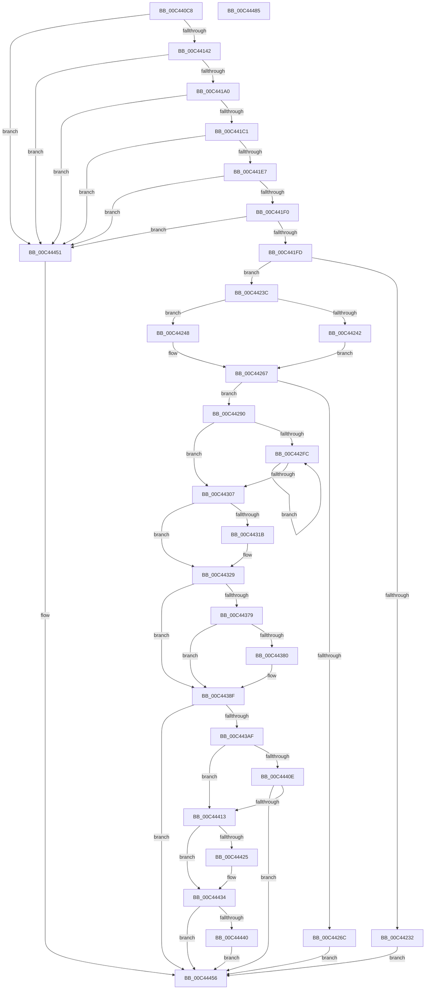

# PpmHeteroInitializeIntelWpsSupport

- RVA: `0x00C440C8`–`0x00C44486` (길이 `958` bytes)
- VA: `0x0000000140C440C8`
- 실행 섹션: `INIT`
- PDB 이름 있음: `예`; PDB Function 태그: `아니요`
- unwind 정보 RVA: `0x000CD850`
- 디코드: `225`개 명령, `958/958` bytes 표시
- 미해석 바이트: `0` (있으면 어셈블리에 `.byte`로 보존)

> 이 문서는 커널 이미지의 기계어와 PDB 기호를 분석해 생성했습니다. 4번과 5번은 함수 원형과 자료형을 바이너리 사용 방식에서 추정한 C 해석이며 원본 소스 복구 결과는 아닙니다.

## 1. Dependencies

- 직접 호출 지점: **14**; 고유 호출 대상: **10**
- 직접 호출자로 확인된 함수: **1**
- RIP 상대 이미지 참조: **35**

### Outgoing calls
- `0x00C4411E` → [memset](../../text/6C/memset_function_006C6C40.md) (function, `0x006C6C40`)
- `0x00C4415D` → [memset](../../text/6C/memset_function_006C6C40.md) (function, `0x006C6C40`)
- `0x00C44173` → [KiCopyAffinityEx](../../text/2C/KiCopyAffinityEx_function_002CE860.md) (function, `0x002CE860`)
- `0x00C44193` → [KeIsEqualAffinityEx](../../text/30/KeIsEqualAffinityEx_function_00305230.md) (function, `0x00305230`)
- `0x00C44225` → [MmAllocatePagesForMdlEx](../../text/3E/MmAllocatePagesForMdlEx_function_003EA8C0.md) (function, `0x003EA8C0`)
- `0x00C4425F` → [MmMapLockedPagesSpecifyCache](../../text/31/MmMapLockedPagesSpecifyCache_function_00318800.md) (function, `0x00318800`)
- `0x00C4427C` → [MiFreePagesFromMdl](../../text/3F/MiFreePagesFromMdl_function_003F8300.md) (function, `0x003F8300`)
- `0x00C44286` → [ExFreePoolWithTag](../../poolcode/B8/ExFreePoolWithTag_function_00B82870.md) (function, `0x00B82870`)
- `0x00C44312` → [PoGetWorkloadClassCount](../../pagelk/B7/PoGetWorkloadClassCount_function_00B71508.md) (function, `0x00B71508`)
- `0x00C443D9` → [ExAllocatePool2](../../poolcode/B8/ExAllocatePool2_function_00B820F0.md) (function, `0x00B820F0`)
- `0x00C443EC` → [ExAllocatePool2](../../poolcode/B8/ExAllocatePool2_function_00B820F0.md) (function, `0x00B820F0`)
- `0x00C44428` → [ExFreePoolWithTag](../../poolcode/B8/ExFreePoolWithTag_function_00B82870.md) (function, `0x00B82870`)
- `0x00C44443` → [ExFreePoolWithTag](../../poolcode/B8/ExFreePoolWithTag_function_00B82870.md) (function, `0x00B82870`)
- `0x00C4445F` → [_security_check_cookie](../../text/6A/_security_check_cookie_function_006AC640.md) (function, `0x006AC640`)

### Direct callers
- [PoInitHeteroDetection](../C3/PoInitHeteroDetection_function_00C3D244.md) at `0x00C3D270`

### Static image references
- `0x00C440EC` → RVA `0x00E0A740` (`.data`; read)
- `0x00C44167` → RVA `0x00FC7120` (`ALMOSTRO`; read)
- `0x00C44178` → RVA `0x00FC6A80` (`ALMOSTRO`; read)
- `0x00C442A9` → RVA `0x004C6FD0` (`PpmHeteroHgsUpdateDpcRoutine`; read)
- `0x00C442B3` → RVA `0x00FC7658` (`ALMOSTRO`; write)
- `0x00C442BA` → RVA `0x005D8F70` (`PpmHeteroHgsUpdateWorker`; read)
- `0x00C442C1` → RVA `0x00FC7590` (`ALMOSTRO`; write)
- `0x00C442CA` → RVA `0x00FC7640` (`ALMOSTRO`; write)
- `0x00C442D4` → RVA `0x00FC7660` (`ALMOSTRO`; write)
- `0x00C442DB` → RVA `0x00FC7678` (`ALMOSTRO`; write)
- `0x00C442E2` → RVA `0x00FC7650` (`ALMOSTRO`; write)
- `0x00C442E9` → RVA `0x00FC7598` (`ALMOSTRO`; write)
- `0x00C442F0` → RVA `0x00FC7580` (`ALMOSTRO`; write)
- `0x00C4430B` → RVA `0x00E0B804` (`.data`; read)
- `0x00C4431B` → RVA `0x00E0B804` (`.data`; write)
- `0x00C44322` → RVA `0x00FC6D4C` (`ALMOSTRO`; write)
- `0x00C44329` → RVA `0x00FC6D4C` (`ALMOSTRO`; read)
- `0x00C4432F` → RVA `0x00772AB0` (`PpmHeteroRegisterWpsUpdatesIntel`; read)
- `0x00C44340` → RVA `0x00FC6E10` (`ALMOSTRO`; write)
- `0x00C44347` → RVA `0x00F0B218` (`.data`; write)
- `0x00C4434E` → RVA `0x00FC6C2C` (`ALMOSTRO`; write)
- `0x00C44354` → RVA `0x00FC72E8` (`ALMOSTRO`; write)
- `0x00C4435B` → RVA `0x00FC6A94` (`ALMOSTRO`; write)
- `0x00C44362` → RVA `0x00FC6AF4` (`ALMOSTRO`; write)
- `0x00C44369` → RVA `0x00FC6AEF` (`ALMOSTRO`; write)
- `0x00C44370` → RVA `0x00FC5003` (`ALMOSTRO`; write)
- `0x00C44388` → RVA `0x00FC6A96` (`ALMOSTRO`; write)
- `0x00C443A2` → RVA `0x00FC6A96` (`ALMOSTRO`; read)
- `0x00C443BD` → RVA `0x00FC6ADE` (`ALMOSTRO`; write)
- `0x00C443CE` → RVA `0x00FC6AEE` (`ALMOSTRO`; write)
- `0x00C443E1` → RVA `0x00F0B228` (`.data`; write)
- `0x00C443F1` → RVA `0x00F0B228` (`.data`; read)
- `0x00C443F8` → RVA `0x00F0B220` (`.data`; write)
- `0x00C443FF` → RVA `0x00F0B240` (`.data`; write)
- `0x00C44434` → RVA `0x00F0B220` (`.data`; read)

## 2. Other-region calls and transfers

- 다른 실행 섹션으로 향하는 call: **14**
  - `0x00C4411E` → [memset](../../text/6C/memset_function_006C6C40.md) (`INIT` → `.text`)
  - `0x00C4415D` → [memset](../../text/6C/memset_function_006C6C40.md) (`INIT` → `.text`)
  - `0x00C44173` → [KiCopyAffinityEx](../../text/2C/KiCopyAffinityEx_function_002CE860.md) (`INIT` → `.text`)
  - `0x00C44193` → [KeIsEqualAffinityEx](../../text/30/KeIsEqualAffinityEx_function_00305230.md) (`INIT` → `.text`)
  - `0x00C44225` → [MmAllocatePagesForMdlEx](../../text/3E/MmAllocatePagesForMdlEx_function_003EA8C0.md) (`INIT` → `.text`)
  - `0x00C4425F` → [MmMapLockedPagesSpecifyCache](../../text/31/MmMapLockedPagesSpecifyCache_function_00318800.md) (`INIT` → `.text`)
  - `0x00C4427C` → [MiFreePagesFromMdl](../../text/3F/MiFreePagesFromMdl_function_003F8300.md) (`INIT` → `.text`)
  - `0x00C44286` → [ExFreePoolWithTag](../../poolcode/B8/ExFreePoolWithTag_function_00B82870.md) (`INIT` → `POOLCODE`)
  - `0x00C44312` → [PoGetWorkloadClassCount](../../pagelk/B7/PoGetWorkloadClassCount_function_00B71508.md) (`INIT` → `PAGELK`)
  - `0x00C443D9` → [ExAllocatePool2](../../poolcode/B8/ExAllocatePool2_function_00B820F0.md) (`INIT` → `POOLCODE`)
  - `0x00C443EC` → [ExAllocatePool2](../../poolcode/B8/ExAllocatePool2_function_00B820F0.md) (`INIT` → `POOLCODE`)
  - `0x00C44428` → [ExFreePoolWithTag](../../poolcode/B8/ExFreePoolWithTag_function_00B82870.md) (`INIT` → `POOLCODE`)
  - `0x00C44443` → [ExFreePoolWithTag](../../poolcode/B8/ExFreePoolWithTag_function_00B82870.md) (`INIT` → `POOLCODE`)
  - `0x00C4445F` → [_security_check_cookie](../../text/6A/_security_check_cookie_function_006AC640.md) (`INIT` → `.text`)
- 별도 외부 분기/꼬리 이동을 확인하지 못했습니다.

## 3. Assembly (complete function range)

```asm
00C440C8  48 8B C4                        mov rax, rsp
00C440CB  48 89 58 08                     mov qword ptr [rax + 8], rbx
00C440CF  48 89 70 10                     mov qword ptr [rax + 0x10], rsi
00C440D3  48 89 78 18                     mov qword ptr [rax + 0x18], rdi
00C440D7  4C 89 60 20                     mov qword ptr [rax + 0x20], r12
00C440DB  55                              push rbp
00C440DC  41 56                           push r14
00C440DE  41 57                           push r15
00C440E0  48 8D 6C 24 80                  lea rbp, [rsp - 0x80]
00C440E5  48 81 EC 80 01 00 00            sub rsp, 0x180
00C440EC  48 8B 05 4D 66 1C 00            mov rax, qword ptr [rip + 0x1c664d]
00C440F3  48 33 C4                        xor rax, rsp
00C440F6  48 89 45 70                     mov qword ptr [rbp + 0x70], rax
00C440FA  0F 57 C0                        xorps xmm0, xmm0
00C440FD  48 8D 4C 24 68                  lea rcx, [rsp + 0x68]
00C44102  0F 57 C9                        xorps xmm1, xmm1
00C44105  BE 00 01 00 00                  mov esi, 0x100
00C4410A  44 8B C6                        mov r8d, esi
00C4410D  33 D2                           xor edx, edx
00C4410F  0F 11 44 24 30                  movups xmmword ptr [rsp + 0x30], xmm0
00C44114  0F 11 4C 24 50                  movups xmmword ptr [rsp + 0x50], xmm1
00C44119  0F 11 44 24 40                  movups xmmword ptr [rsp + 0x40], xmm0
00C4411E  E8 1D 2B A8 FF                  call 0x1406c6c40
00C44123  33 C0                           xor eax, eax
00C44125  33 C9                           xor ecx, ecx
00C44127  0F A2                           cpuid
00C44129  89 44 24 30                     mov dword ptr [rsp + 0x30], eax
00C4412D  89 5C 24 34                     mov dword ptr [rsp + 0x34], ebx
00C44131  89 4C 24 38                     mov dword ptr [rsp + 0x38], ecx
00C44135  89 54 24 3C                     mov dword ptr [rsp + 0x3c], edx
00C44139  83 F8 07                        cmp eax, 7
00C4413C  0F 82 0F 03 00 00               jb 0x140c44451
00C44142  44 8B C6                        mov r8d, esi
00C44145  48 C7 44 24 60 01 00 20 00      mov qword ptr [rsp + 0x60], 0x200001
00C4414E  33 D2                           xor edx, edx
00C44150  48 8D 4C 24 68                  lea rcx, [rsp + 0x68]
00C44155  41 BF 01 00 00 00               mov r15d, 1
00C4415B  33 FF                           xor edi, edi
00C4415D  E8 DE 2A A8 FF                  call 0x1406c6c40
00C44162  0F B7 54 24 62                  movzx edx, word ptr [rsp + 0x62]
00C44167  4C 8D 05 B2 2F 38 00            lea r8, [rip + 0x382fb2]
00C4416E  48 8D 4C 24 60                  lea rcx, [rsp + 0x60]
00C44173  E8 E8 A6 68 FF                  call 0x1402ce860
00C44178  8B 05 02 29 38 00               mov eax, dword ptr [rip + 0x382902]
00C4417E  48 8D 4C 24 60                  lea rcx, [rsp + 0x60]
00C44183  65 48 8B 14 25 20 00 00 00      mov rdx, qword ptr gs:[0x20]
00C4418C  48 81 C2 10 8C 00 00            add rdx, 0x8c10
00C44193  E8 98 10 6C FF                  call 0x140305230
00C44198  85 C0                           test eax, eax
00C4419A  0F 84 B1 02 00 00               je 0x140c44451
00C441A0  33 C9                           xor ecx, ecx
00C441A2  8D 47 07                        lea eax, [rdi + 7]
00C441A5  0F A2                           cpuid
00C441A7  89 44 24 40                     mov dword ptr [rsp + 0x40], eax
00C441AB  89 5C 24 44                     mov dword ptr [rsp + 0x44], ebx
00C441AF  89 4C 24 48                     mov dword ptr [rsp + 0x48], ecx
00C441B3  89 54 24 4C                     mov dword ptr [rsp + 0x4c], edx
00C441B7  0F BA E2 0F                     bt edx, 0xf
00C441BB  0F 83 90 02 00 00               jae 0x140c44451
00C441C1  33 C9                           xor ecx, ecx
00C441C3  8D 47 06                        lea eax, [rdi + 6]
00C441C6  0F A2                           cpuid
00C441C8  89 44 24 50                     mov dword ptr [rsp + 0x50], eax
00C441CC  8B F2                           mov esi, edx
00C441CE  89 5C 24 54                     mov dword ptr [rsp + 0x54], ebx
00C441D2  44 8B F0                        mov r14d, eax
00C441D5  89 4C 24 58                     mov dword ptr [rsp + 0x58], ecx
00C441D9  89 54 24 5C                     mov dword ptr [rsp + 0x5c], edx
00C441DD  0F BA E0 13                     bt eax, 0x13
00C441E1  0F 83 6A 02 00 00               jae 0x140c44451
00C441E7  41 84 F7                        test r15b, sil
00C441EA  0F 84 61 02 00 00               je 0x140c44451
00C441F0  45 8D 67 01                     lea r12d, [r15 + 1]
00C441F4  41 84 F4                        test r12b, sil
00C441F7  0F 84 54 02 00 00               je 0x140c44451
00C441FD  44 8B CA                        mov r9d, edx
00C44200  C7 44 24 28 24 00 00 00         mov dword ptr [rsp + 0x28], 0x24
00C44208  41 C1 E9 08                     shr r9d, 8
00C4420C  44 8B C7                        mov r8d, edi
00C4420F  41 83 E1 0F                     and r9d, 0xf
00C44213  44 89 7C 24 20                  mov dword ptr [rsp + 0x20], r15d
00C44218  45 03 CF                        add r9d, r15d
00C4421B  48 83 CA FF                     or rdx, 0xffffffffffffffff
00C4421F  41 C1 E1 0C                     shl r9d, 0xc
00C44223  8B CF                           mov ecx, edi
00C44225  E8 96 66 7A FF                  call 0x1403ea8c0
00C4422A  48 8B D8                        mov rbx, rax
00C4422D  48 85 C0                        test rax, rax
00C44230  75 0A                           jne 0x140c4423c
00C44232  BF 9A 00 00 C0                  mov edi, 0xc000009a
00C44237  E9 1A 02 00 00                  jmp 0x140c44456
00C4423C  F6 40 0A 05                     test byte ptr [rax + 0xa], 5
00C44240  74 06                           je 0x140c44248
00C44242  4C 8B 58 18                     mov r11, qword ptr [rax + 0x18]
00C44246  EB 1F                           jmp 0x140c44267
00C44248  C7 44 24 28 00 00 00 40         mov dword ptr [rsp + 0x28], 0x40000000
00C44250  45 33 C9                        xor r9d, r9d
00C44253  45 8B C7                        mov r8d, r15d
00C44256  89 7C 24 20                     mov dword ptr [rsp + 0x20], edi
00C4425A  33 D2                           xor edx, edx
00C4425C  48 8B CB                        mov rcx, rbx
00C4425F  E8 9C 45 6D FF                  call 0x140318800
00C44264  4C 8B D8                        mov r11, rax
00C44267  4D 85 DB                        test r11, r11
00C4426A  75 24                           jne 0x140c44290
00C4426C  45 33 C9                        xor r9d, r9d
00C4426F  45 33 C0                        xor r8d, r8d
00C44272  33 D2                           xor edx, edx
00C44274  48 8B CB                        mov rcx, rbx
00C44277  BF 9A 00 00 C0                  mov edi, 0xc000009a
00C4427C  E8 7F 40 7B FF                  call 0x1403f8300
00C44281  33 D2                           xor edx, edx
00C44283  48 8B CB                        mov rcx, rbx
00C44286  E8 E5 E5 F3 FF                  call 0x140b82870
00C4428B  E9 C6 01 00 00                  jmp 0x140c44456
00C44290  48 8B 53 30                     mov rdx, qword ptr [rbx + 0x30]
00C44294  B9 D0 17 00 00                  mov ecx, 0x17d0
00C44299  48 C1 E2 0C                     shl rdx, 0xc
00C4429D  49 0B D7                        or rdx, r15
00C442A0  48 8B C2                        mov rax, rdx
00C442A3  48 C1 EA 20                     shr rdx, 0x20
00C442A7  0F 30                           wrmsr
00C442A9  48 8D 05 20 2D 88 FF            lea rax, [rip - 0x77d2e0]
00C442B0  C1 EE 02                        shr esi, 2
00C442B3  48 89 05 9E 33 38 00            mov qword ptr [rip + 0x38339e], rax
00C442BA  48 8D 05 AF 4C 99 FF            lea rax, [rip - 0x66b351]
00C442C1  48 89 05 C8 32 38 00            mov qword ptr [rip + 0x3832c8], rax
00C442C8  8B CF                           mov ecx, edi
00C442CA  C7 05 6C 33 38 00 13 03 00 00   mov dword ptr [rip + 0x38336c], 0x313
00C442D4  48 89 3D 85 33 38 00            mov qword ptr [rip + 0x383385], rdi
00C442DB  48 89 3D 96 33 38 00            mov qword ptr [rip + 0x383396], rdi
00C442E2  48 89 3D 67 33 38 00            mov qword ptr [rip + 0x383367], rdi
00C442E9  48 89 3D A8 32 38 00            mov qword ptr [rip + 0x3832a8], rdi
00C442F0  48 89 3D 89 32 38 00            mov qword ptr [rip + 0x383289], rdi
00C442F7  83 E6 3F                        and esi, 0x3f
00C442FA  74 0B                           je 0x140c44307
00C442FC  8B C6                           mov eax, esi
00C442FE  41 23 C7                        and eax, r15d
00C44301  03 C8                           add ecx, eax
00C44303  D1 EE                           shr esi, 1
00C44305  75 F5                           jne 0x140c442fc
00C44307  41 8D 34 0C                     lea esi, [r12 + rcx]
00C4430B  48 8D 0D F2 74 1C 00            lea rcx, [rip + 0x1c74f2]
00C44312  E8 F1 D1 F2 FF                  call 0x140b71508
00C44317  84 C0                           test al, al
00C44319  75 0E                           jne 0x140c44329
00C4431B  44 89 3D E2 74 1C 00            mov dword ptr [rip + 0x1c74e2], r15d
00C44322  44 89 3D 23 2A 38 00            mov dword ptr [rip + 0x382a23], r15d
00C44329  39 3D 1D 2A 38 00               cmp dword ptr [rip + 0x382a1d], edi
00C4432F  48 8D 05 7A E7 B2 FF            lea rax, [rip - 0x4d1886]
00C44336  48 89 7C 24 30                  mov qword ptr [rsp + 0x30], rdi
00C4433B  44 89 7C 24 30                  mov dword ptr [rsp + 0x30], r15d
00C44340  4C 89 1D C9 2A 38 00            mov qword ptr [rip + 0x382ac9], r11
00C44347  48 89 05 CA 6E 2C 00            mov qword ptr [rip + 0x2c6eca], rax
00C4434E  89 35 D8 28 38 00               mov dword ptr [rip + 0x3828d8], esi
00C44354  48 89 1D 8D 2F 38 00            mov qword ptr [rip + 0x382f8d], rbx
00C4435B  44 88 3D 32 27 38 00            mov byte ptr [rip + 0x382732], r15b
00C44362  44 88 3D 8B 27 38 00            mov byte ptr [rip + 0x38278b], r15b
00C44369  44 88 3D 7F 27 38 00            mov byte ptr [rip + 0x38277f], r15b
00C44370  44 88 25 8C 0C 38 00            mov byte ptr [rip + 0x380c8c], r12b
00C44377  75 16                           jne 0x140c4438f
00C44379  41 0F BA E6 17                  bt r14d, 0x17
00C4437E  73 0F                           jae 0x140c4438f
00C44380  C7 44 24 30 03 00 00 00         mov dword ptr [rsp + 0x30], 3
00C44388  44 88 3D 07 27 38 00            mov byte ptr [rip + 0x382707], r15b
00C4438F  48 8B 54 24 30                  mov rdx, qword ptr [rsp + 0x30]
00C44394  B9 D1 17 00 00                  mov ecx, 0x17d1
00C44399  48 8B C2                        mov rax, rdx
00C4439C  48 C1 EA 20                     shr rdx, 0x20
00C443A0  0F 30                           wrmsr
00C443A2  40 38 3D ED 26 38 00            cmp byte ptr [rip + 0x3826ed], dil
00C443A9  0F 84 A7 00 00 00               je 0x140c44456
00C443AF  8B 05 4F 74 1C 00               mov eax, dword ptr [rip + 0x1c744f]
00C443B5  41 BE 50 50 4D 70               mov r14d, 0x704d5050
00C443BB  03 C0                           add eax, eax
00C443BD  44 88 3D 1A 27 38 00            mov byte ptr [rip + 0x38271a], r15b
00C443C4  BE 40 00 00 00                  mov esi, 0x40
00C443C9  8B D0                           mov edx, eax
00C443CB  45 8B C6                        mov r8d, r14d
00C443CE  44 88 3D 19 27 38 00            mov byte ptr [rip + 0x382719], r15b
00C443D5  8B CE                           mov ecx, esi
00C443D7  8B D8                           mov ebx, eax
00C443D9  E8 12 DD F3 FF                  call 0x140b820f0
00C443DE  45 8B C6                        mov r8d, r14d
00C443E1  48 89 05 40 6E 2C 00            mov qword ptr [rip + 0x2c6e40], rax
00C443E8  8B D3                           mov edx, ebx
00C443EA  8B CE                           mov ecx, esi
00C443EC  E8 FF DC F3 FF                  call 0x140b820f0
00C443F1  48 8B 0D 30 6E 2C 00            mov rcx, qword ptr [rip + 0x2c6e30]
00C443F8  48 89 05 21 6E 2C 00            mov qword ptr [rip + 0x2c6e21], rax
00C443FF  C7 05 37 6E 2C 00 08 00 00 00   mov dword ptr [rip + 0x2c6e37], 8
00C44409  48 85 C9                        test rcx, rcx
00C4440C  74 05                           je 0x140c44413
00C4440E  48 85 C0                        test rax, rax
00C44411  75 43                           jne 0x140c44456
00C44413  40 88 3D D4 26 38 00            mov byte ptr [rip + 0x3826d4], dil
00C4441A  89 3D 20 6E 2C 00               mov dword ptr [rip + 0x2c6e20], edi
00C44420  48 85 C9                        test rcx, rcx
00C44423  74 0F                           je 0x140c44434
00C44425  41 8B D6                        mov edx, r14d
00C44428  E8 43 E4 F3 FF                  call 0x140b82870
00C4442D  48 89 3D F4 6D 2C 00            mov qword ptr [rip + 0x2c6df4], rdi
00C44434  48 8B 0D E5 6D 2C 00            mov rcx, qword ptr [rip + 0x2c6de5]
00C4443B  48 85 C9                        test rcx, rcx
00C4443E  74 16                           je 0x140c44456
00C44440  41 8B D6                        mov edx, r14d
00C44443  E8 28 E4 F3 FF                  call 0x140b82870
00C44448  48 89 3D D1 6D 2C 00            mov qword ptr [rip + 0x2c6dd1], rdi
00C4444F  EB 05                           jmp 0x140c44456
00C44451  BF BB 00 00 C0                  mov edi, 0xc00000bb
00C44456  8B C7                           mov eax, edi
00C44458  48 8B 4D 70                     mov rcx, qword ptr [rbp + 0x70]
00C4445C  48 33 CC                        xor rcx, rsp
00C4445F  E8 DC 81 A6 FF                  call 0x1406ac640
00C44464  4C 8D 9C 24 80 01 00 00         lea r11, [rsp + 0x180]
00C4446C  49 8B 5B 20                     mov rbx, qword ptr [r11 + 0x20]
00C44470  49 8B 73 28                     mov rsi, qword ptr [r11 + 0x28]
00C44474  49 8B 7B 30                     mov rdi, qword ptr [r11 + 0x30]
00C44478  4D 8B 63 38                     mov r12, qword ptr [r11 + 0x38]
00C4447C  49 8B E3                        mov rsp, r11
00C4447F  41 5F                           pop r15
00C44481  41 5E                           pop r14
00C44483  5D                              pop rbp
00C44484  C3                              ret
00C44485  CC                              int3
```

## 4. C-style interpretation (structured pseudocode)

```c
__int64 __fastcall PpmHeteroInitializeIntelWpsSupport(__int64 a1, int a2)
{
    __int64 result;
    __int64 v_rdi;
    __int64 v_rsi;
    __int64 v_rsp;
    unsigned __int64 v_stack_m130;
    unsigned __int16 v_stack_m136;
    unsigned __int64 v_stack_m138;
    unsigned int v_stack_m13C;
    unsigned int v_stack_m140;
    unsigned int v_stack_m144;
    unsigned __int64 v_stack_m148;
    unsigned int v_stack_m14C;
    unsigned int v_stack_m150;
    unsigned int v_stack_m154;
    unsigned __int64 v_stack_m158;
    unsigned int v_stack_m15C;
    unsigned int v_stack_m160;
    unsigned int v_stack_m164;
    unsigned __int64 v_stack_m168;
    unsigned int v_stack_m170;
    unsigned int v_stack_m178;
    unsigned __int64 v_stack_m18;
    unsigned __int64 v_stack_m28;
    unsigned __int64 v_stack_m98;

    *(unsigned __int64 *)(v_rsp + 8) = v_rbx;
    *(unsigned __int64 *)(v_rsp + 16) = v_rsi;
    *(unsigned __int64 *)(v_rsp + 24) = v_rdi;
    *(unsigned __int64 *)(v_rsp + 32) = v_r12;
    v_rsp = (v_rsp) - (384);
    result = (*(unsigned __int64 *)(v_rip + 1861197)) ^ (v_rsp);
    v_stack_m28 = result;
    a2 = 0;
    v_stack_m168 = v_xmm0;
    v_stack_m148 = v_xmm1;
    v_stack_m158 = v_xmm0;
    result = memset(v_stack_m130, a2, 256, a4);
    result = 0;
    a1 = 0;
    v_stack_m168 = 0;
    v_stack_m164 = (unsigned int)(v_rbx);
    v_stack_m160 = 0;
    v_stack_m15C = 0;
    if (0 < 7) goto loc_00C44451;
    v_stack_m138 = 0x200001ULL;
    a2 = 0;
    v_rdi = 0;
    result = memset(v_stack_m130, a2, 256, a4);
    result = KiCopyAffinityEx(v_stack_m138, v_stack_m136, v_rip + 3682226, a4);
    a2 = (*(unsigned __int64 *)(gs_base + (0 + 32))) + (0x8C10ULL);
    result = KeIsEqualAffinityEx(v_stack_m138, a2, v_rip + 3682226, a4);
    if ((unsigned int)(result) == 0) goto loc_00C44451;
    a1 = 0;
    v_stack_m158 = (unsigned int)(v_rdi + 7);
    v_stack_m154 = (unsigned int)(v_rbx);
    v_stack_m150 = 0;
    v_stack_m14C = a2;
    if (condition_is_above_or_equal) goto loc_00C44451;
    a1 = 0;
    v_stack_m148 = (unsigned int)(v_rdi + 6);
    v_stack_m144 = (unsigned int)(v_rbx);
    v_stack_m140 = 0;
    v_stack_m13C = a2;
    if (condition_is_above_or_equal) goto loc_00C44451;
    if (((1) & ((unsigned __int8)((unsigned int)(a2)))) == 0) goto loc_00C44451;
    if ((((unsigned __int8)(1 + 1)) & ((unsigned __int8)((unsigned int)(a2)))) == 0) goto loc_00C44451;
    v_stack_m170 = 36;
    a4 = (unsigned int)(((unsigned int)(a2)) >> (8));
    a4 = (unsigned int)((a4) & (15));
    v_stack_m178 = 1;
    a4 = (unsigned int)((a4) + (1));
    a2 = (a2) | (-1);
    a4 = (unsigned int)((a4) << (12));
    result = MmAllocatePagesForMdlEx(0, a2, 0, a4);
    if (result != 0) goto loc_00C4423C;
    goto loc_00C44456;
loc_00C4423C:
    if (((*(unsigned __int8 *)(result + 10)) & (5)) == 0) goto loc_00C44248;
    goto loc_00C44267;
loc_00C44248:
    v_stack_m170 = 0x40000000ULL;
    a4 = 0;
    v_stack_m178 = (unsigned int)((unsigned int)(0xC000009AULL));
    a2 = 0;
    result = MmMapLockedPagesSpecifyCache(result, a2, 1, a4);
loc_00C44267:
    if (result != 0) goto loc_00C44290;
    a4 = 0;
    a3 = 0;
    a2 = 0;
    result = MiFreePagesFromMdl(result, a2, a3, a4);
    a2 = 0;
    result = ExFreePoolWithTag(result, a2, a3, a4);
    goto loc_00C44456;
loc_00C44290:
    a2 = (*(unsigned __int64 *)(result + 48)) << (12);
    a2 = (a2) | (1);
    a2 = (a2) >> (32);
    v_rsi = (unsigned int)(((unsigned int)(a2)) >> (2));
    *(unsigned __int64 *)(v_rip + 3683230) = v_rip - 7852768;
    *(unsigned __int64 *)(v_rip + 3683016) = v_rip - 6730577;
    *(unsigned int *)(v_rip + 3683180) = 787;
    *(unsigned __int64 *)(v_rip + 3683205) = (unsigned int)(0xC000009AULL);
    *(unsigned __int64 *)(v_rip + 3683222) = (unsigned int)(0xC000009AULL);
    *(unsigned __int64 *)(v_rip + 3683175) = (unsigned int)(0xC000009AULL);
    *(unsigned __int64 *)(v_rip + 3682984) = (unsigned int)(0xC000009AULL);
    *(unsigned __int64 *)(v_rip + 3682953) = (unsigned int)(0xC000009AULL);
    v_rsi = (unsigned int)((v_rsi) & (63));
    if (condition_is_equal) goto loc_00C44307;
loc_00C442FC:
    result = (unsigned int)(((unsigned int)((unsigned int)(v_rsi))) & (1));
    a1 = (unsigned int)(((unsigned int)((unsigned int)((unsigned int)(0xC000009AULL)))) + ((unsigned int)(result)));
    v_rsi = (unsigned int)((v_rsi) >> (1));
    if (condition_is_not_equal) goto loc_00C442FC;
loc_00C44307:
    result = PoGetWorkloadClassCount(v_rip + 1864946, a2, a3, a4);
    if ((unsigned __int8)(result) == 0) {
        *(unsigned int *)(v_rip + 1864930) = 1;
        *(unsigned int *)(v_rip + 3680803) = 1;
    }
    v_stack_m168 = (unsigned int)(0xC000009AULL);
    v_stack_m168 = 1;
    *(unsigned __int64 *)(v_rip + 3680969) = result;
    *(unsigned __int64 *)(v_rip + 2911946) = v_rip - 5052550;
    *(unsigned int *)(v_rip + 3680472) = (unsigned int)(1 + 1 + a1 * 1);
    *(unsigned __int64 *)(v_rip + 3682189) = result;
    *(unsigned __int8 *)(v_rip + 3680050) = 1;
    *(unsigned __int8 *)(v_rip + 3680139) = 1;
    *(unsigned __int8 *)(v_rip + 3680127) = 1;
    *(unsigned __int8 *)(v_rip + 3673228) = (unsigned __int8)(1 + 1);
    if ((*(unsigned int *)(v_rip + 3680797)) != ((unsigned int)((unsigned int)(0xC000009AULL)))) goto loc_00C4438F;
    if ((*(unsigned int *)(v_rip + 3680797)) < ((unsigned int)((unsigned int)(0xC000009AULL)))) {
        v_stack_m168 = 3;
        *(unsigned __int8 *)(v_rip + 3680007) = 1;
    }
    a2 = (v_stack_m168) >> (32);
    if ((*(unsigned __int8 *)(v_rip + 3679981)) == ((unsigned __int8)((unsigned int)(0xC000009AULL)))) goto loc_00C44456;
    result = (unsigned int)(((unsigned int)(*(unsigned int *)(v_rip + 1864783))) + ((unsigned int)((unsigned int)(*(unsigned int *)(v_rip + 1864783)))));
    *(unsigned __int8 *)(v_rip + 3680026) = 1;
    *(unsigned __int8 *)(v_rip + 3680025) = 1;
    result = ExAllocatePool2(64, (unsigned int)((unsigned int)(result)), (unsigned int)((unsigned int)((unsigned int)(0x704D5050ULL))), a4);
    *(unsigned __int64 *)(v_rip + 2911808) = result;
    result = ExAllocatePool2(64, (unsigned int)((unsigned int)((unsigned int)((unsigned int)(result)))), (unsigned int)((unsigned int)((unsigned int)(0x704D5050ULL))), a4);
    *(unsigned __int64 *)(v_rip + 2911777) = result;
    *(unsigned int *)(v_rip + 2911799) = 8;
    if (*(unsigned __int64 *)(v_rip + 2911792) == 0) goto loc_00C44413;
    if (result != 0) goto loc_00C44456;
loc_00C44413:
    *(unsigned __int8 *)(v_rip + 3679956) = (unsigned __int8)((unsigned int)(0xC000009AULL));
    *(unsigned int *)(v_rip + 2911776) = (unsigned int)((unsigned int)(0xC000009AULL));
    if (*(unsigned __int64 *)(v_rip + 2911792) != 0) {
        a2 = (unsigned int)((unsigned int)(0x704D5050ULL));
        result = ExFreePoolWithTag(*(unsigned __int64 *)(v_rip + 2911792), a2, (unsigned int)((unsigned int)((unsigned int)(0x704D5050ULL))), a4);
        *(unsigned __int64 *)(v_rip + 2911732) = (unsigned int)(0xC000009AULL);
    }
    if (*(unsigned __int64 *)(v_rip + 2911717) == 0) goto loc_00C44456;
    result = ExFreePoolWithTag(*(unsigned __int64 *)(v_rip + 2911717), (unsigned int)((unsigned int)((unsigned int)(0x704D5050ULL))), (unsigned int)((unsigned int)((unsigned int)(0x704D5050ULL))), a4);
    *(unsigned __int64 *)(v_rip + 2911697) = (unsigned int)(0xC000009AULL);
    goto loc_00C44456;
loc_00C44451:
loc_00C44456:
    a1 = (v_stack_m28) ^ (v_rsp);
    result = _security_check_cookie(a1, (unsigned int)((unsigned int)((unsigned int)(0x704D5050ULL))), (unsigned int)((unsigned int)((unsigned int)(0x704D5050ULL))), a4);
    return result;
}
```

## 5. (Beta) C Style

```c
int64_t PpmHeteroInitializeIntelWpsSupport(int64_t Arg1, int32_t Arg2)
{
    int64_t result;
    int64_t local_rdi;
    int64_t local_rsi;
    int64_t local_rsp;
    uint64_t v_stack_m130;
    uint16_t v_stack_m136;
    uint64_t v_stack_m138;
    uint32_t v_stack_m13C;
    uint32_t v_stack_m140;
    uint32_t v_stack_m144;
    uint64_t v_stack_m148;
    uint32_t v_stack_m14C;
    uint32_t v_stack_m150;
    uint32_t v_stack_m154;
    uint64_t v_stack_m158;
    uint32_t v_stack_m15C;
    uint32_t v_stack_m160;
    uint32_t v_stack_m164;
    uint64_t v_stack_m168;
    uint32_t v_stack_m170;
    uint32_t v_stack_m178;
    uint64_t v_stack_m18;
    uint64_t v_stack_m28;
    uint64_t v_stack_m98;

    *(uint64_t *)(local_rsp + 0x8) = local_rbx;
    *(uint64_t *)(local_rsp + 0x10) = local_rsi;
    *(uint64_t *)(local_rsp + 0x18) = local_rdi;
    *(uint64_t *)(local_rsp + 0x20) = local_r12;
    local_rsp = (local_rsp) - (384);
    result = (*(uint64_t *)(v_rip + 0x1C664D)) ^ (local_rsp);
    v_stack_m28 = result;
    Arg2 = 0;
    v_stack_m168 = v_xmm0;
    v_stack_m148 = v_xmm1;
    v_stack_m158 = v_xmm0;
    result = memset(v_stack_m130, Arg2, 256, a4);
    result = 0;
    Arg1 = 0;
    v_stack_m168 = 0;
    v_stack_m164 = (uint32_t)(local_rbx);
    v_stack_m160 = 0;
    v_stack_m15C = 0;
    if (0 < 7) goto loc_00C44451;
    v_stack_m138 = 0x200001ULL;
    Arg2 = 0;
    local_rdi = 0;
    result = memset(v_stack_m130, Arg2, 256, a4);
    result = KiCopyAffinityEx(v_stack_m138, v_stack_m136, v_rip + 3682226, a4);
    Arg2 = (*(uint64_t *)(gs_base + (0 + 0x20))) + (0x8C10ULL);
    result = KeIsEqualAffinityEx(v_stack_m138, Arg2, v_rip + 3682226, a4);
    if ((uint32_t)(result) == 0) goto loc_00C44451;
    Arg1 = 0;
    v_stack_m158 = (uint32_t)(local_rdi + 7);
    v_stack_m154 = (uint32_t)(local_rbx);
    v_stack_m150 = 0;
    v_stack_m14C = Arg2;
    if (condition_is_above_or_equal) goto loc_00C44451;
    Arg1 = 0;
    v_stack_m148 = (uint32_t)(local_rdi + 6);
    v_stack_m144 = (uint32_t)(local_rbx);
    v_stack_m140 = 0;
    v_stack_m13C = Arg2;
    if (condition_is_above_or_equal) goto loc_00C44451;
    if (((1) & ((uint8_t)((uint32_t)(Arg2)))) == 0) goto loc_00C44451;
    if ((((uint8_t)(1 + 1)) & ((uint8_t)((uint32_t)(Arg2)))) == 0) goto loc_00C44451;
    v_stack_m170 = 36;
    a4 = (uint32_t)(((uint32_t)(Arg2)) >> (8));
    a4 = (uint32_t)((a4) & (15));
    v_stack_m178 = 1;
    a4 = (uint32_t)((a4) + (1));
    Arg2 = (Arg2) | (-1);
    a4 = (uint32_t)((a4) << (12));
    result = MmAllocatePagesForMdlEx(0, Arg2, 0, a4);
    if (result != 0) goto loc_00C4423C;
    goto loc_00C44456;
loc_00C4423C:
    if (((*(uint8_t *)(result + 0xA)) & (5)) == 0) goto loc_00C44248;
    goto loc_00C44267;
loc_00C44248:
    v_stack_m170 = 0x40000000ULL;
    a4 = 0;
    v_stack_m178 = (uint32_t)((uint32_t)(0xC000009AULL));
    Arg2 = 0;
    result = MmMapLockedPagesSpecifyCache(result, Arg2, 1, a4);
loc_00C44267:
    if (result != 0) goto loc_00C44290;
    a4 = 0;
    a3 = 0;
    Arg2 = 0;
    result = MiFreePagesFromMdl(result, Arg2, a3, a4);
    Arg2 = 0;
    result = ExFreePoolWithTag(result, Arg2, a3, a4);
    goto loc_00C44456;
loc_00C44290:
    Arg2 = (*(uint64_t *)(result + 0x30)) << (12);
    Arg2 = (Arg2) | (1);
    Arg2 = (Arg2) >> (32);
    local_rsi = (uint32_t)(((uint32_t)(Arg2)) >> (2));
    *(uint64_t *)(v_rip + 0x38339E) = v_rip - 7852768;
    *(uint64_t *)(v_rip + 0x3832C8) = v_rip - 6730577;
    *(uint32_t *)(v_rip + 0x38336C) = 787;
    *(uint64_t *)(v_rip + 0x383385) = (uint32_t)(0xC000009AULL);
    *(uint64_t *)(v_rip + 0x383396) = (uint32_t)(0xC000009AULL);
    *(uint64_t *)(v_rip + 0x383367) = (uint32_t)(0xC000009AULL);
    *(uint64_t *)(v_rip + 0x3832A8) = (uint32_t)(0xC000009AULL);
    *(uint64_t *)(v_rip + 0x383289) = (uint32_t)(0xC000009AULL);
    local_rsi = (uint32_t)((local_rsi) & (63));
    if (condition_is_equal) goto loc_00C44307;
loc_00C442FC:
    result = (uint32_t)(((uint32_t)((uint32_t)(local_rsi))) & (1));
    Arg1 = (uint32_t)(((uint32_t)((uint32_t)((uint32_t)(0xC000009AULL)))) + ((uint32_t)(result)));
    local_rsi = (uint32_t)((local_rsi) >> (1));
    if (condition_is_not_equal) goto loc_00C442FC;
loc_00C44307:
    result = PoGetWorkloadClassCount(v_rip + 1864946, Arg2, a3, a4);
    if ((uint8_t)(result) == 0) {
        *(uint32_t *)(v_rip + 0x1C74E2) = 1;
        *(uint32_t *)(v_rip + 0x382A23) = 1;
    }
    v_stack_m168 = (uint32_t)(0xC000009AULL);
    v_stack_m168 = 1;
    *(uint64_t *)(v_rip + 0x382AC9) = result;
    *(uint64_t *)(v_rip + 0x2C6ECA) = v_rip - 5052550;
    *(uint32_t *)(v_rip + 0x3828D8) = (uint32_t)(1 + 1 + Arg1 * 1);
    *(uint64_t *)(v_rip + 0x382F8D) = result;
    *(uint8_t *)(v_rip + 0x382732) = 1;
    *(uint8_t *)(v_rip + 0x38278B) = 1;
    *(uint8_t *)(v_rip + 0x38277F) = 1;
    *(uint8_t *)(v_rip + 0x380C8C) = (uint8_t)(1 + 1);
    if ((*(uint32_t *)(v_rip + 0x382A1D)) != ((uint32_t)((uint32_t)(0xC000009AULL)))) goto loc_00C4438F;
    if ((*(uint32_t *)(v_rip + 0x382A1D)) < ((uint32_t)((uint32_t)(0xC000009AULL)))) {
        v_stack_m168 = 3;
        *(uint8_t *)(v_rip + 0x382707) = 1;
    }
    Arg2 = (v_stack_m168) >> (32);
    if ((*(uint8_t *)(v_rip + 0x3826ED)) == ((uint8_t)((uint32_t)(0xC000009AULL)))) goto loc_00C44456;
    result = (uint32_t)(((uint32_t)(*(uint32_t *)(v_rip + 0x1C744F))) + ((uint32_t)((uint32_t)(*(uint32_t *)(v_rip + 0x1C744F)))));
    *(uint8_t *)(v_rip + 0x38271A) = 1;
    *(uint8_t *)(v_rip + 0x382719) = 1;
    result = ExAllocatePool2(64, (uint32_t)((uint32_t)(result)), (uint32_t)((uint32_t)((uint32_t)(0x704D5050ULL))), a4);
    *(uint64_t *)(v_rip + 0x2C6E40) = result;
    result = ExAllocatePool2(64, (uint32_t)((uint32_t)((uint32_t)((uint32_t)(result)))), (uint32_t)((uint32_t)((uint32_t)(0x704D5050ULL))), a4);
    *(uint64_t *)(v_rip + 0x2C6E21) = result;
    *(uint32_t *)(v_rip + 0x2C6E37) = 8;
    if (*(uint64_t *)(v_rip + 0x2C6E30) == 0) goto loc_00C44413;
    if (result != 0) goto loc_00C44456;
loc_00C44413:
    *(uint8_t *)(v_rip + 0x3826D4) = (uint8_t)((uint32_t)(0xC000009AULL));
    *(uint32_t *)(v_rip + 0x2C6E20) = (uint32_t)((uint32_t)(0xC000009AULL));
    if (*(uint64_t *)(v_rip + 0x2C6E30) != 0) {
        Arg2 = (uint32_t)((uint32_t)(0x704D5050ULL));
        result = ExFreePoolWithTag(*(uint64_t *)(v_rip + 0x2C6E30), Arg2, (uint32_t)((uint32_t)((uint32_t)(0x704D5050ULL))), a4);
        *(uint64_t *)(v_rip + 0x2C6DF4) = (uint32_t)(0xC000009AULL);
    }
    if (*(uint64_t *)(v_rip + 0x2C6DE5) == 0) goto loc_00C44456;
    result = ExFreePoolWithTag(*(uint64_t *)(v_rip + 0x2C6DE5), (uint32_t)((uint32_t)((uint32_t)(0x704D5050ULL))), (uint32_t)((uint32_t)((uint32_t)(0x704D5050ULL))), a4);
    *(uint64_t *)(v_rip + 0x2C6DD1) = (uint32_t)(0xC000009AULL);
    goto loc_00C44456;
loc_00C44451:
loc_00C44456:
    Arg1 = (v_stack_m28) ^ (local_rsp);
    result = _security_check_cookie(Arg1, (uint32_t)((uint32_t)((uint32_t)(0x704D5050ULL))), (uint32_t)((uint32_t)((uint32_t)(0x704D5050ULL))), a4);
    return result;
}
```

## 6. Execution-region graph

[열기: 2D/3D 그래프와 함수 탐색 컨트롤 패널](../../../control-panel.html?section=init&rva=0x00C440C8&view=graph)

- 2D 그래프는 위에서 아래로 흐르고, 3D 그래프는 빈 공간을 드래그해 회전합니다. Shift+드래그는 이동, 휠은 확대·축소, 함수 노드 선택은 대상 보고서 이동입니다.

### Static fallback


