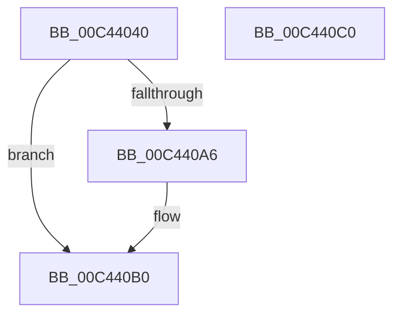

# PpmHeteroInitializeWpsSimSupport

- RVA: `0x00C44040`–`0x00C440C1` (길이 `129` bytes)
- VA: `0x0000000140C44040`
- 실행 섹션: `INIT`
- PDB 이름 있음: `예`; PDB Function 태그: `아니요`
- unwind 정보 RVA: `0x000DB714`
- 디코드: `28`개 명령, `129/129` bytes 표시
- 미해석 바이트: `0` (있으면 어셈블리에 `.byte`로 보존)

> 이 문서는 커널 이미지의 기계어와 PDB 기호를 분석해 생성했습니다. 4번과 5번은 함수 원형과 자료형을 바이너리 사용 방식에서 추정한 C 해석이며 원본 소스 복구 결과는 아닙니다.

## 1. Dependencies

- 직접 호출 지점: **0**; 고유 호출 대상: **0**
- 직접 호출자로 확인된 함수: **1**
- RIP 상대 이미지 참조: **12**

### Outgoing calls
- 직접 디코드된 call 명령이 없습니다.

### Direct callers
- [PoInitHeteroDetection](../C3/PoInitHeteroDetection_function_00C3D244.md) at `0x00C3D25F`

### Static image references
- `0x00C44040` → RVA `0x00FC7048` (`ALMOSTRO`; read)
- `0x00C44047` → RVA `0x005D8F70` (`PpmHeteroHgsUpdateWorker`; read)
- `0x00C4404E` → RVA `0x00FC7598` (`ALMOSTRO`; read/write)
- `0x00C44056` → RVA `0x00FC7580` (`ALMOSTRO`; read/write)
- `0x00C4405E` → RVA `0x00FC7590` (`ALMOSTRO`; write)
- `0x00C44069` → RVA `0x00FC5003` (`ALMOSTRO`; write)
- `0x00C44070` → RVA `0x00FC6A94` (`ALMOSTRO`; write)
- `0x00C44076` → RVA `0x00772A50` (`PpmHeteroRegisterWpsUpdatesSim`; read)
- `0x00C4407D` → RVA `0x00F0B218` (`.data`; write)
- `0x00C4408B` → RVA `0x00FC6AF4` (`ALMOSTRO`; write)
- `0x00C4409B` → RVA `0x00E0B804` (`.data`; write)
- `0x00C440B9` → RVA `0x00FC6C2C` (`ALMOSTRO`; write)

## 2. Other-region calls and transfers

- 다른 실행 섹션으로 향하는 call: **0**
- 별도 외부 분기/꼬리 이동을 확인하지 못했습니다.

## 3. Assembly (complete function range)

```asm
00C44040  48 8B 0D 01 30 38 00            mov rcx, qword ptr [rip + 0x383001]
00C44047  48 8D 05 22 4F 99 FF            lea rax, [rip - 0x66b0de]
00C4404E  48 83 25 42 35 38 00 00         and qword ptr [rip + 0x383542], 0
00C44056  48 83 25 22 35 38 00 00         and qword ptr [rip + 0x383522], 0
00C4405E  48 89 05 2B 35 38 00            mov qword ptr [rip + 0x38352b], rax
00C44065  8A C1                           mov al, cl
00C44067  24 01                           and al, 1
00C44069  C6 05 93 0F 38 00 0F            mov byte ptr [rip + 0x380f93], 0xf
00C44070  88 05 1E 2A 38 00               mov byte ptr [rip + 0x382a1e], al
00C44076  48 8D 05 D3 E9 B2 FF            lea rax, [rip - 0x4d162d]
00C4407D  48 89 05 94 71 2C 00            mov qword ptr [rip + 0x2c7194], rax
00C44084  8A C1                           mov al, cl
00C44086  C0 E8 03                        shr al, 3
00C44089  24 01                           and al, 1
00C4408B  88 05 63 2A 38 00               mov byte ptr [rip + 0x382a63], al
00C44091  48 8B C1                        mov rax, rcx
00C44094  48 C1 E8 34                     shr rax, 0x34
00C44098  83 E0 0F                        and eax, 0xf
00C4409B  89 05 63 77 1C 00               mov dword ptr [rip + 0x1c7763], eax
00C440A1  83 F8 08                        cmp eax, 8
00C440A4  72 0A                           jb 0x140c440b0
00C440A6  C7 05 54 77 1C 00 08 00 00 00   mov dword ptr [rip + 0x1c7754], 8
00C440B0  48 C1 E9 38                     shr rcx, 0x38
00C440B4  33 C0                           xor eax, eax
00C440B6  83 E1 0F                        and ecx, 0xf
00C440B9  89 0D 6D 2B 38 00               mov dword ptr [rip + 0x382b6d], ecx
00C440BF  C3                              ret
00C440C0  CC                              int3
```

## 4. C-style interpretation (structured pseudocode)

```c
__int64 __fastcall PpmHeteroInitializeWpsSimSupport(void)
{
    __int64 result;

    *(unsigned __int64 *)(v_rip + 3683627) = v_rip - 6729950;
    result = (unsigned __int8)(((unsigned __int8)(*(unsigned __int64 *)(v_rip + 3682305))) & (1));
    *(unsigned __int8 *)(v_rip + 3674003) = 15;
    *(unsigned __int8 *)(v_rip + 3680798) = (unsigned __int8)(result);
    *(unsigned __int64 *)(v_rip + 2912660) = v_rip - 5051949;
    result = (unsigned __int8)(((unsigned __int8)(*(unsigned __int64 *)(v_rip + 3682305))) >> (3));
    result = (unsigned __int8)((result) & (1));
    *(unsigned __int8 *)(v_rip + 3680867) = (unsigned __int8)(result);
    result = (*(unsigned __int64 *)(v_rip + 3682305)) >> (52);
    result = (unsigned int)((result) & (15));
    *(unsigned int *)(v_rip + 1865571) = (unsigned int)(result);
    if (((unsigned int)(result)) >= 8) {
        *(unsigned int *)(v_rip + 1865556) = 8;
    }
    a1 = (*(unsigned __int64 *)(v_rip + 3682305)) >> (56);
    result = 0;
    a1 = (unsigned int)((a1) & (15));
    *(unsigned int *)(v_rip + 3681133) = (unsigned int)(a1);
    return result;
}
```

## 5. (Beta) C Style

```c
void PpmHeteroInitializeWpsSimSupport(void)
{
    int64_t result;

    *(uint64_t *)(v_rip + 0x38352B) = v_rip - 6729950;
    result = (uint8_t)(((uint8_t)(*(uint64_t *)(v_rip + 0x383001))) & (1));
    *(uint8_t *)(v_rip + 0x380F93) = 15;
    *(uint8_t *)(v_rip + 0x382A1E) = (uint8_t)(result);
    *(uint64_t *)(v_rip + 0x2C7194) = v_rip - 5051949;
    result = (uint8_t)(((uint8_t)(*(uint64_t *)(v_rip + 0x383001))) >> (3));
    result = (uint8_t)((result) & (1));
    *(uint8_t *)(v_rip + 0x382A63) = (uint8_t)(result);
    result = (*(uint64_t *)(v_rip + 0x383001)) >> (52);
    result = (uint32_t)((result) & (15));
    *(uint32_t *)(v_rip + 0x1C7763) = (uint32_t)(result);
    if (((uint32_t)(result)) >= 8) {
        *(uint32_t *)(v_rip + 0x1C7754) = 8;
    }
    a1 = (*(uint64_t *)(v_rip + 0x383001)) >> (56);
    result = 0;
    a1 = (uint32_t)((a1) & (15));
    *(uint32_t *)(v_rip + 0x382B6D) = (uint32_t)(a1);
    return result;
}
```

## 6. Execution-region graph

[열기: 2D/3D 그래프와 함수 탐색 컨트롤 패널](../../../control-panel.html?section=init&rva=0x00C44040&view=graph)

- 2D 그래프는 위에서 아래로 흐르고, 3D 그래프는 빈 공간을 드래그해 회전합니다. Shift+드래그는 이동, 휠은 확대·축소, 함수 노드 선택은 대상 보고서 이동입니다.

### Static fallback


