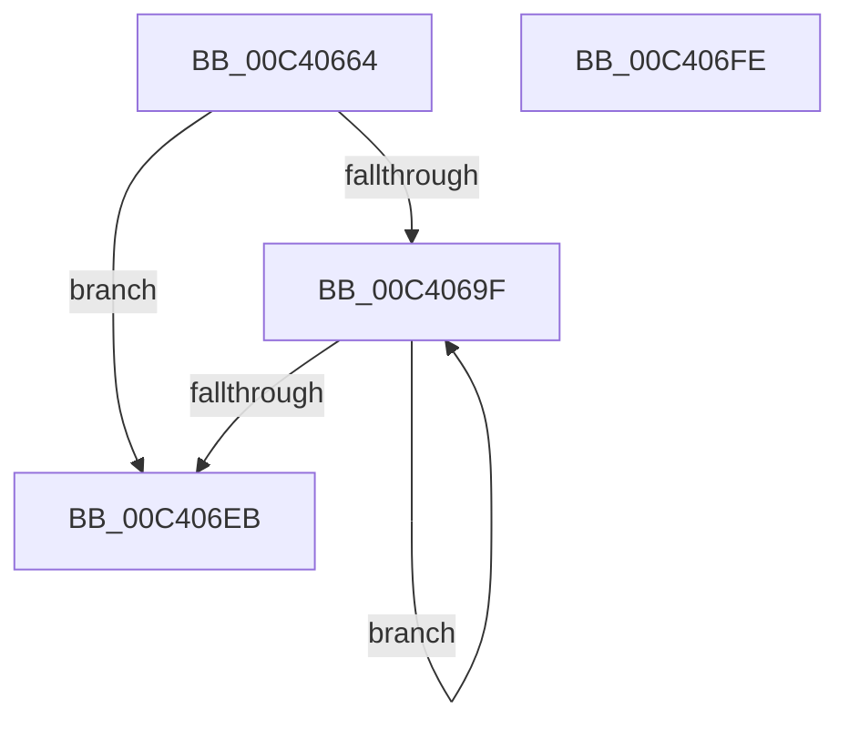

# PpmInfoRegisterCallbacks

- RVA: `0x00C40664`–`0x00C406FF` (길이 `155` bytes)
- VA: `0x0000000140C40664`
- 실행 섹션: `INIT`
- PDB 이름 있음: `예`; PDB Function 태그: `아니요`
- unwind 정보 RVA: `0x0005F638`
- 디코드: `38`개 명령, `155/155` bytes 표시
- 미해석 바이트: `0` (있으면 어셈블리에 `.byte`로 보존)

> 이 문서는 커널 이미지의 기계어와 PDB 기호를 분석해 생성했습니다. 4번과 5번은 함수 원형과 자료형을 바이너리 사용 방식에서 추정한 C 해석이며 원본 소스 복구 결과는 아닙니다.

## 1. Dependencies

- 직접 호출 지점: **3**; 고유 호출 대상: **2**
- 직접 호출자로 확인된 함수: **1**
- RIP 상대 이미지 참조: **5**

### Outgoing calls
- `0x00C406BE` → [PoRegisterPowerSettingCallback](../../page/A8/PoRegisterPowerSettingCallback_function_00A82150.md) (function, `0x00A82150`)
- `0x00C406DA` → [PoRegisterPowerSettingCallback](../../page/A8/PoRegisterPowerSettingCallback_function_00A82150.md) (function, `0x00A82150`)
- `0x00C406F3` → [_security_check_cookie](../../text/6A/_security_check_cookie_function_006AC640.md) (function, `0x006AC640`)

### Direct callers
- [PopInitializePowerSettingCallbacks](../C3/PopInitializePowerSettingCallbacks_function_00C3E6E8.md) at `0x00C3E72A`

### Static image references
- `0x00C4066A` → RVA `0x00E0A740` (`.data`; read)
- `0x00C40679` → RVA `0x00026AB8` (`.rdata`; read)
- `0x00C40680` → RVA `0x00FC6A80` (`ALMOSTRO`; read)
- `0x00C40688` → RVA `0x00026AC8` (`.rdata`; read)
- `0x00C406A5` → RVA `0x007641B0` (`PpmPerfProcCapFloorSettingCallback`; read)

## 2. Other-region calls and transfers

- 다른 실행 섹션으로 향하는 call: **3**
  - `0x00C406BE` → [PoRegisterPowerSettingCallback](../../page/A8/PoRegisterPowerSettingCallback_function_00A82150.md) (`INIT` → `PAGE`)
  - `0x00C406DA` → [PoRegisterPowerSettingCallback](../../page/A8/PoRegisterPowerSettingCallback_function_00A82150.md) (`INIT` → `PAGE`)
  - `0x00C406F3` → [_security_check_cookie](../../text/6A/_security_check_cookie_function_006AC640.md) (`INIT` → `.text`)
- 별도 외부 분기/꼬리 이동을 확인하지 못했습니다.

## 3. Assembly (complete function range)

```asm
00C40664  40 53                           push rbx
00C40666  48 83 EC 60                     sub rsp, 0x60
00C4066A  48 8B 05 CF A0 1C 00            mov rax, qword ptr [rip + 0x1ca0cf]
00C40671  48 33 C4                        xor rax, rsp
00C40674  48 89 44 24 50                  mov qword ptr [rsp + 0x50], rax
00C40679  0F 10 05 38 64 3E FF            movups xmm0, xmmword ptr [rip - 0xc19bc8]
00C40680  8B 05 FA 63 38 00               mov eax, dword ptr [rip + 0x3863fa]
00C40686  33 DB                           xor ebx, ebx
00C40688  0F 10 0D 39 64 3E FF            movups xmm1, xmmword ptr [rip - 0xc19bc7]
00C4068F  F3 0F 7F 44 24 30               movdqu xmmword ptr [rsp + 0x30], xmm0
00C40695  F3 0F 7F 4C 24 40               movdqu xmmword ptr [rsp + 0x40], xmm1
00C4069B  85 C0                           test eax, eax
00C4069D  74 4C                           je 0x140c406eb
00C4069F  48 83 64 24 20 00               and qword ptr [rsp + 0x20], 0
00C406A5  4C 8D 05 04 3B B2 FF            lea r8, [rip - 0x4dc4fc]
00C406AC  45 33 C9                        xor r9d, r9d
00C406AF  88 5C 24 3F                     mov byte ptr [rsp + 0x3f], bl
00C406B3  48 8D 54 24 30                  lea rdx, [rsp + 0x30]
00C406B8  88 5C 24 4F                     mov byte ptr [rsp + 0x4f], bl
00C406BC  33 C9                           xor ecx, ecx
00C406BE  E8 8D 1A E4 FF                  call 0x140a82150
00C406C3  48 83 64 24 20 00               and qword ptr [rsp + 0x20], 0
00C406C9  4C 8D 05 E0 3A B2 FF            lea r8, [rip - 0x4dc520]
00C406D0  45 33 C9                        xor r9d, r9d
00C406D3  48 8D 54 24 40                  lea rdx, [rsp + 0x40]
00C406D8  33 C9                           xor ecx, ecx
00C406DA  E8 71 1A E4 FF                  call 0x140a82150
00C406DF  8B 05 9B 63 38 00               mov eax, dword ptr [rip + 0x38639b]
00C406E5  FF C3                           inc ebx
00C406E7  3B D8                           cmp ebx, eax
00C406E9  72 B4                           jb 0x140c4069f
00C406EB  48 8B 4C 24 50                  mov rcx, qword ptr [rsp + 0x50]
00C406F0  48 33 CC                        xor rcx, rsp
00C406F3  E8 48 BF A6 FF                  call 0x1406ac640
00C406F8  48 83 C4 60                     add rsp, 0x60
00C406FC  5B                              pop rbx
00C406FD  C3                              ret
00C406FE  CC                              int3
```

## 4. C-style interpretation (structured pseudocode)

```c
__int64 __fastcall PpmInfoRegisterCallbacks(int a1, __int64 a2, __int64 a3, int a4)
{
    __int64 result;
    __int64 v_rbx;
    __int64 v_rsp;
    unsigned __int64 v_stack_m18;
    unsigned __int8 v_stack_m19;
    unsigned __int64 v_stack_m28;
    unsigned __int8 v_stack_m29;
    unsigned __int64 v_stack_m38;
    unsigned __int64 v_stack_m48;

    v_rsp = (v_rsp) - (96);
    result = (*(unsigned __int64 *)(v_rip + 1876175)) ^ (v_rsp);
    v_stack_m18 = result;
    v_rbx = 0;
    v_stack_m38 = v_xmm0;
    v_stack_m28 = v_xmm1;
    if ((unsigned int)((unsigned int)(*(unsigned int *)(v_rip + 3695610))) == 0) goto loc_00C406EB;
loc_00C4069F:
    a4 = 0;
    v_stack_m29 = 0;
    v_stack_m19 = 0;
    a1 = 0;
    result = PoRegisterPowerSettingCallback(a1, v_stack_m38, v_rip - 5096700, a4);
    a4 = 0;
    a1 = 0;
    result = PoRegisterPowerSettingCallback(a1, v_stack_m28, v_rip - 5096736, a4);
    v_rbx = (unsigned int)((v_rbx) + 1);
    if (((unsigned int)(v_rbx)) < ((unsigned int)((unsigned int)(*(unsigned int *)(v_rip + 3695515))))) goto loc_00C4069F;
loc_00C406EB:
    a1 = (v_stack_m18) ^ (v_rsp);
    result = _security_check_cookie(a1, v_stack_m28, v_rip - 5096736, a4);
    v_rsp = (v_rsp) + (96);
    return result;
}
```

## 5. (Beta) C Style

```c
int64_t PpmInfoRegisterCallbacks(int32_t Arg1, int64_t Arg2, int64_t Arg3, int32_t Arg4)
{
    int64_t result;
    int64_t local_rbx;
    int64_t local_rsp;
    uint64_t v_stack_m18;
    uint8_t v_stack_m19;
    uint64_t v_stack_m28;
    uint8_t v_stack_m29;
    uint64_t v_stack_m38;
    uint64_t v_stack_m48;

    local_rsp = (local_rsp) - (96);
    result = (*(uint64_t *)(v_rip + 0x1CA0CF)) ^ (local_rsp);
    v_stack_m18 = result;
    local_rbx = 0;
    v_stack_m38 = v_xmm0;
    v_stack_m28 = v_xmm1;
    if ((uint32_t)((uint32_t)(*(uint32_t *)(v_rip + 0x3863FA))) == 0) goto loc_00C406EB;
loc_00C4069F:
    Arg4 = 0;
    v_stack_m29 = 0;
    v_stack_m19 = 0;
    Arg1 = 0;
    result = PoRegisterPowerSettingCallback(Arg1, v_stack_m38, v_rip - 5096700, Arg4);
    Arg4 = 0;
    Arg1 = 0;
    result = PoRegisterPowerSettingCallback(Arg1, v_stack_m28, v_rip - 5096736, Arg4);
    local_rbx = (uint32_t)((local_rbx) + 1);
    if (((uint32_t)(local_rbx)) < ((uint32_t)((uint32_t)(*(uint32_t *)(v_rip + 0x38639B))))) goto loc_00C4069F;
loc_00C406EB:
    Arg1 = (v_stack_m18) ^ (local_rsp);
    result = _security_check_cookie(Arg1, v_stack_m28, v_rip - 5096736, Arg4);
    local_rsp = (local_rsp) + (96);
    return result;
}
```

## 6. Execution-region graph

[열기: 2D/3D 그래프와 함수 탐색 컨트롤 패널](../../../control-panel.html?section=init&rva=0x00C40664&view=graph)

- 2D 그래프는 위에서 아래로 흐르고, 3D 그래프는 빈 공간을 드래그해 회전합니다. Shift+드래그는 이동, 휠은 확대·축소, 함수 노드 선택은 대상 보고서 이동입니다.

### Static fallback


