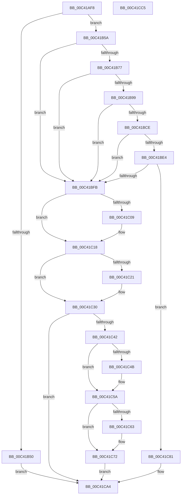

# PpmInitHeteroEngine

- RVA: `0x00C41AF8`–`0x00C41CC6` (길이 `462` bytes)
- VA: `0x0000000140C41AF8`
- 실행 섹션: `INIT`
- PDB 이름 있음: `예`; PDB Function 태그: `아니요`
- unwind 정보 RVA: `0x0005FEF8`
- 디코드: `122`개 명령, `462/462` bytes 표시
- 미해석 바이트: `0` (있으면 어셈블리에 `.byte`로 보존)

> 이 문서는 커널 이미지의 기계어와 PDB 기호를 분석해 생성했습니다. 4번과 5번은 함수 원형과 자료형을 바이너리 사용 방식에서 추정한 C 해석이며 원본 소스 복구 결과는 아닙니다.

## 1. Dependencies

- 직접 호출 지점: **13**; 고유 호출 대상: **3**
- 직접 호출자로 확인된 함수: **1**
- RIP 상대 이미지 참조: **3**

### Outgoing calls
- `0x00C41B1C` → [KeQueryMaximumProcessorCountEx](../../text/26/KeQueryMaximumProcessorCountEx_function_00264D60.md) (function, `0x00264D60`)
- `0x00C41B43` → [ExAllocatePool2](../../poolcode/B8/ExAllocatePool2_function_00B820F0.md) (function, `0x00B820F0`)
- `0x00C41B66` → [ExAllocatePool2](../../poolcode/B8/ExAllocatePool2_function_00B820F0.md) (function, `0x00B820F0`)
- `0x00C41B8F` → [ExAllocatePool2](../../poolcode/B8/ExAllocatePool2_function_00B820F0.md) (function, `0x00B820F0`)
- `0x00C41BC1` → [ExAllocatePool2](../../poolcode/B8/ExAllocatePool2_function_00B820F0.md) (function, `0x00B820F0`)
- `0x00C41BD7` → [ExAllocatePool2](../../poolcode/B8/ExAllocatePool2_function_00B820F0.md) (function, `0x00B820F0`)
- `0x00C41BED` → [ExAllocatePool2](../../poolcode/B8/ExAllocatePool2_function_00B820F0.md) (function, `0x00B820F0`)
- `0x00C41C0E` → [ExFreePoolWithTag](../../poolcode/B8/ExFreePoolWithTag_function_00B82870.md) (function, `0x00B82870`)
- `0x00C41C26` → [ExFreePoolWithTag](../../poolcode/B8/ExFreePoolWithTag_function_00B82870.md) (function, `0x00B82870`)
- `0x00C41C38` → [ExFreePoolWithTag](../../poolcode/B8/ExFreePoolWithTag_function_00B82870.md) (function, `0x00B82870`)
- `0x00C41C50` → [ExFreePoolWithTag](../../poolcode/B8/ExFreePoolWithTag_function_00B82870.md) (function, `0x00B82870`)
- `0x00C41C68` → [ExFreePoolWithTag](../../poolcode/B8/ExFreePoolWithTag_function_00B82870.md) (function, `0x00B82870`)
- `0x00C41C7A` → [ExFreePoolWithTag](../../poolcode/B8/ExFreePoolWithTag_function_00B82870.md) (function, `0x00B82870`)

### Direct callers
- [PoInitHeteroDetection](../C3/PoInitHeteroDetection_function_00C3D244.md) at `0x00C3D280`

### Static image references
- `0x00C41B27` → RVA `0x00E0B804` (`.data`; read)
- `0x00C41C96` → RVA `0x00FC6BC8` (`ALMOSTRO`; write)
- `0x00C41C9D` → RVA `0x00FC72F0` (`ALMOSTRO`; write)

## 2. Other-region calls and transfers

- 다른 실행 섹션으로 향하는 call: **13**
  - `0x00C41B1C` → [KeQueryMaximumProcessorCountEx](../../text/26/KeQueryMaximumProcessorCountEx_function_00264D60.md) (`INIT` → `.text`)
  - `0x00C41B43` → [ExAllocatePool2](../../poolcode/B8/ExAllocatePool2_function_00B820F0.md) (`INIT` → `POOLCODE`)
  - `0x00C41B66` → [ExAllocatePool2](../../poolcode/B8/ExAllocatePool2_function_00B820F0.md) (`INIT` → `POOLCODE`)
  - `0x00C41B8F` → [ExAllocatePool2](../../poolcode/B8/ExAllocatePool2_function_00B820F0.md) (`INIT` → `POOLCODE`)
  - `0x00C41BC1` → [ExAllocatePool2](../../poolcode/B8/ExAllocatePool2_function_00B820F0.md) (`INIT` → `POOLCODE`)
  - `0x00C41BD7` → [ExAllocatePool2](../../poolcode/B8/ExAllocatePool2_function_00B820F0.md) (`INIT` → `POOLCODE`)
  - `0x00C41BED` → [ExAllocatePool2](../../poolcode/B8/ExAllocatePool2_function_00B820F0.md) (`INIT` → `POOLCODE`)
  - `0x00C41C0E` → [ExFreePoolWithTag](../../poolcode/B8/ExFreePoolWithTag_function_00B82870.md) (`INIT` → `POOLCODE`)
  - `0x00C41C26` → [ExFreePoolWithTag](../../poolcode/B8/ExFreePoolWithTag_function_00B82870.md) (`INIT` → `POOLCODE`)
  - `0x00C41C38` → [ExFreePoolWithTag](../../poolcode/B8/ExFreePoolWithTag_function_00B82870.md) (`INIT` → `POOLCODE`)
  - `0x00C41C50` → [ExFreePoolWithTag](../../poolcode/B8/ExFreePoolWithTag_function_00B82870.md) (`INIT` → `POOLCODE`)
  - `0x00C41C68` → [ExFreePoolWithTag](../../poolcode/B8/ExFreePoolWithTag_function_00B82870.md) (`INIT` → `POOLCODE`)
  - `0x00C41C7A` → [ExFreePoolWithTag](../../poolcode/B8/ExFreePoolWithTag_function_00B82870.md) (`INIT` → `POOLCODE`)
- 별도 외부 분기/꼬리 이동을 확인하지 못했습니다.

## 3. Assembly (complete function range)

```asm
00C41AF8  48 8B C4                        mov rax, rsp
00C41AFB  48 89 58 08                     mov qword ptr [rax + 8], rbx
00C41AFF  48 89 68 10                     mov qword ptr [rax + 0x10], rbp
00C41B03  48 89 70 18                     mov qword ptr [rax + 0x18], rsi
00C41B07  48 89 78 20                     mov qword ptr [rax + 0x20], rdi
00C41B0B  41 54                           push r12
00C41B0D  41 56                           push r14
00C41B0F  41 57                           push r15
00C41B11  48 83 EC 20                     sub rsp, 0x20
00C41B15  B9 FF FF 00 00                  mov ecx, 0xffff
00C41B1A  33 FF                           xor edi, edi
00C41B1C  E8 3F 32 62 FF                  call 0x140264d60
00C41B21  8B D8                           mov ebx, eax
00C41B23  44 8D 77 40                     lea r14d, [rdi + 0x40]
00C41B27  0F AF 05 D6 9C 1C 00            imul eax, dword ptr [rip + 0x1c9cd6]
00C41B2E  41 B8 50 50 4D 70               mov r8d, 0x704d5050
00C41B34  41 8B CE                        mov ecx, r14d
00C41B37  8D 04 85 18 00 00 00            lea eax, [rax*4 + 0x18]
00C41B3E  8B D0                           mov edx, eax
00C41B40  44 8B F8                        mov r15d, eax
00C41B43  E8 A8 05 F4 FF                  call 0x140b820f0
00C41B48  48 8B F0                        mov rsi, rax
00C41B4B  48 85 C0                        test rax, rax
00C41B4E  75 0A                           jne 0x140c41b5a
00C41B50  BB 9A 00 00 C0                  mov ebx, 0xc000009a
00C41B55  E9 4A 01 00 00                  jmp 0x140c41ca4
00C41B5A  41 B8 50 50 4D 70               mov r8d, 0x704d5050
00C41B60  48 8B D3                        mov rdx, rbx
00C41B63  49 8B CE                        mov rcx, r14
00C41B66  E8 85 05 F4 FF                  call 0x140b820f0
00C41B6B  4C 8B F0                        mov r14, rax
00C41B6E  48 85 C0                        test rax, rax
00C41B71  0F 84 84 00 00 00               je 0x140c41bfb
00C41B77  8B 05 87 9C 1C 00               mov eax, dword ptr [rip + 0x1c9c87]
00C41B7D  41 B8 50 50 4D 70               mov r8d, 0x704d5050
00C41B83  03 C0                           add eax, eax
00C41B85  B9 40 00 00 00                  mov ecx, 0x40
00C41B8A  8B D0                           mov edx, eax
00C41B8C  44 8B E0                        mov r12d, eax
00C41B8F  E8 5C 05 F4 FF                  call 0x140b820f0
00C41B94  48 85 C0                        test rax, rax
00C41B97  74 62                           je 0x140c41bfb
00C41B99  4C 89 76 08                     mov qword ptr [rsi + 8], r14
00C41B9D  49 8B D7                        mov rdx, r15
00C41BA0  48 89 46 10                     mov qword ptr [rsi + 0x10], rax
00C41BA4  41 BE 50 50 4D 70               mov r14d, 0x704d5050
00C41BAA  8B 05 54 9C 1C 00               mov eax, dword ptr [rip + 0x1c9c54]
00C41BB0  41 BF 40 00 00 00               mov r15d, 0x40
00C41BB6  45 8B C6                        mov r8d, r14d
00C41BB9  89 46 04                        mov dword ptr [rsi + 4], eax
00C41BBC  41 8B CF                        mov ecx, r15d
00C41BBF  89 1E                           mov dword ptr [rsi], ebx
00C41BC1  E8 2A 05 F4 FF                  call 0x140b820f0
00C41BC6  48 8B F8                        mov rdi, rax
00C41BC9  48 85 C0                        test rax, rax
00C41BCC  74 2D                           je 0x140c41bfb
00C41BCE  45 8B C6                        mov r8d, r14d
00C41BD1  48 8B D3                        mov rdx, rbx
00C41BD4  41 8B CF                        mov ecx, r15d
00C41BD7  E8 14 05 F4 FF                  call 0x140b820f0
00C41BDC  48 8B E8                        mov rbp, rax
00C41BDF  48 85 C0                        test rax, rax
00C41BE2  74 17                           je 0x140c41bfb
00C41BE4  45 8B C6                        mov r8d, r14d
00C41BE7  41 8B D4                        mov edx, r12d
00C41BEA  41 8B CF                        mov ecx, r15d
00C41BED  E8 FE 04 F4 FF                  call 0x140b820f0
00C41BF2  48 85 C0                        test rax, rax
00C41BF5  0F 85 86 00 00 00               jne 0x140c41c81
00C41BFB  48 8B 4E 10                     mov rcx, qword ptr [rsi + 0x10]
00C41BFF  BB 9A 00 00 C0                  mov ebx, 0xc000009a
00C41C04  48 85 C9                        test rcx, rcx
00C41C07  74 0F                           je 0x140c41c18
00C41C09  BA 50 50 4D 70                  mov edx, 0x704d5050
00C41C0E  E8 5D 0C F4 FF                  call 0x140b82870
00C41C13  48 83 66 10 00                  and qword ptr [rsi + 0x10], 0
00C41C18  48 8B 4E 08                     mov rcx, qword ptr [rsi + 8]
00C41C1C  48 85 C9                        test rcx, rcx
00C41C1F  74 0F                           je 0x140c41c30
00C41C21  BA 50 50 4D 70                  mov edx, 0x704d5050
00C41C26  E8 45 0C F4 FF                  call 0x140b82870
00C41C2B  48 83 66 08 00                  and qword ptr [rsi + 8], 0
00C41C30  BA 50 50 4D 70                  mov edx, 0x704d5050
00C41C35  48 8B CE                        mov rcx, rsi
00C41C38  E8 33 0C F4 FF                  call 0x140b82870
00C41C3D  48 85 FF                        test rdi, rdi
00C41C40  74 62                           je 0x140c41ca4
00C41C42  48 8B 4F 10                     mov rcx, qword ptr [rdi + 0x10]
00C41C46  48 85 C9                        test rcx, rcx
00C41C49  74 0F                           je 0x140c41c5a
00C41C4B  BA 50 50 4D 70                  mov edx, 0x704d5050
00C41C50  E8 1B 0C F4 FF                  call 0x140b82870
00C41C55  48 83 67 10 00                  and qword ptr [rdi + 0x10], 0
00C41C5A  48 8B 4F 08                     mov rcx, qword ptr [rdi + 8]
00C41C5E  48 85 C9                        test rcx, rcx
00C41C61  74 0F                           je 0x140c41c72
00C41C63  BA 50 50 4D 70                  mov edx, 0x704d5050
00C41C68  E8 03 0C F4 FF                  call 0x140b82870
00C41C6D  48 83 67 08 00                  and qword ptr [rdi + 8], 0
00C41C72  BA 50 50 4D 70                  mov edx, 0x704d5050
00C41C77  48 8B CF                        mov rcx, rdi
00C41C7A  E8 F1 0B F4 FF                  call 0x140b82870
00C41C7F  EB 23                           jmp 0x140c41ca4
00C41C81  48 89 6F 08                     mov qword ptr [rdi + 8], rbp
00C41C85  48 89 47 10                     mov qword ptr [rdi + 0x10], rax
00C41C89  8B 05 75 9B 1C 00               mov eax, dword ptr [rip + 0x1c9b75]
00C41C8F  89 1F                           mov dword ptr [rdi], ebx
00C41C91  33 DB                           xor ebx, ebx
00C41C93  89 47 04                        mov dword ptr [rdi + 4], eax
00C41C96  48 89 35 2B 4F 38 00            mov qword ptr [rip + 0x384f2b], rsi
00C41C9D  48 89 3D 4C 56 38 00            mov qword ptr [rip + 0x38564c], rdi
00C41CA4  48 8B 6C 24 48                  mov rbp, qword ptr [rsp + 0x48]
00C41CA9  8B C3                           mov eax, ebx
00C41CAB  48 8B 5C 24 40                  mov rbx, qword ptr [rsp + 0x40]
00C41CB0  48 8B 74 24 50                  mov rsi, qword ptr [rsp + 0x50]
00C41CB5  48 8B 7C 24 58                  mov rdi, qword ptr [rsp + 0x58]
00C41CBA  48 83 C4 20                     add rsp, 0x20
00C41CBE  41 5F                           pop r15
00C41CC0  41 5E                           pop r14
00C41CC2  41 5C                           pop r12
00C41CC4  C3                              ret
00C41CC5  CC                              int3
```

## 4. C-style interpretation (structured pseudocode)

```c
__int64 __fastcall PpmInitHeteroEngine(void)
{
    __int64 result;
    __int64 v_rbx;
    __int64 v_rdi;
    __int64 v_rsp;
    unsigned __int64 v_stack_p10;
    unsigned __int64 v_stack_p18;
    unsigned __int64 v_stack_p20;
    unsigned __int64 v_stack_p8;

    *(unsigned __int64 *)(v_rsp + 8) = v_rbx;
    *(unsigned __int64 *)(v_rsp + 16) = v_rbp;
    *(unsigned __int64 *)(v_rsp + 24) = v_rsi;
    *(unsigned __int64 *)(v_rsp + 32) = v_rdi;
    v_rsp = (v_rsp) - (32);
    v_rdi = 0;
    result = KeQueryMaximumProcessorCountEx((unsigned int)(0xFFFFULL), a2, a3, a4);
    result = (unsigned int)((result) * (*(unsigned int *)(v_rip + 1875158)));
    result = ExAllocatePool2((unsigned int)((unsigned int)(v_rdi + 64)), (unsigned int)((unsigned int)(result * 4 + 24)), (unsigned int)(0x704D5050ULL), a4);
    if (result != 0) goto loc_00C41B5A;
    goto loc_00C41CA4;
loc_00C41B5A:
    result = ExAllocatePool2(v_rdi + 64, (unsigned int)(0xC000009AULL), (unsigned int)(0x704D5050ULL), a4);
    if (result == 0) goto loc_00C41BFB;
    result = (unsigned int)(((unsigned int)(*(unsigned int *)(v_rip + 1875079))) + ((unsigned int)((unsigned int)(*(unsigned int *)(v_rip + 1875079)))));
    result = ExAllocatePool2(64, (unsigned int)((unsigned int)(result)), (unsigned int)(0x704D5050ULL), a4);
    if (result == 0) goto loc_00C41BFB;
    *(unsigned __int64 *)(result + 8) = result;
    *(unsigned __int64 *)(result + 16) = result;
    *(unsigned int *)(result + 4) = (unsigned int)((unsigned int)(*(unsigned int *)(v_rip + 1875028)));
    *(unsigned int *)(result) = (unsigned int)((unsigned int)(0xC000009AULL));
    result = ExAllocatePool2(64, (unsigned int)((unsigned int)(result * 4 + 24)), (unsigned int)((unsigned int)((unsigned int)(0x704D5050ULL))), a4);
    if (result == 0) goto loc_00C41BFB;
    result = ExAllocatePool2(64, (unsigned int)(0xC000009AULL), (unsigned int)((unsigned int)((unsigned int)(0x704D5050ULL))), a4);
    if (result == 0) goto loc_00C41BFB;
    result = ExAllocatePool2(64, (unsigned int)((unsigned int)((unsigned int)((unsigned int)(result)))), (unsigned int)((unsigned int)((unsigned int)(0x704D5050ULL))), a4);
    if (result != 0) goto loc_00C41C81;
loc_00C41BFB:
    if (*(unsigned __int64 *)(result + 16) != 0) {
        a2 = 0x704D5050ULL;
        result = ExFreePoolWithTag(*(unsigned __int64 *)(result + 16), a2, (unsigned int)((unsigned int)((unsigned int)(0x704D5050ULL))), a4);
    }
    if (*(unsigned __int64 *)(result + 8) != 0) {
        a2 = 0x704D5050ULL;
        result = ExFreePoolWithTag(*(unsigned __int64 *)(result + 8), a2, (unsigned int)((unsigned int)((unsigned int)(0x704D5050ULL))), a4);
    }
    result = ExFreePoolWithTag(result, (unsigned int)(0x704D5050ULL), (unsigned int)((unsigned int)((unsigned int)(0x704D5050ULL))), a4);
    if (result == 0) goto loc_00C41CA4;
    if (*(unsigned __int64 *)(result + 16) != 0) {
        a2 = 0x704D5050ULL;
        result = ExFreePoolWithTag(*(unsigned __int64 *)(result + 16), a2, (unsigned int)((unsigned int)((unsigned int)(0x704D5050ULL))), a4);
    }
    if (*(unsigned __int64 *)(result + 8) != 0) {
        a2 = 0x704D5050ULL;
        result = ExFreePoolWithTag(*(unsigned __int64 *)(result + 8), a2, (unsigned int)((unsigned int)((unsigned int)(0x704D5050ULL))), a4);
    }
    result = ExFreePoolWithTag(result, (unsigned int)(0x704D5050ULL), (unsigned int)((unsigned int)((unsigned int)(0x704D5050ULL))), a4);
    goto loc_00C41CA4;
loc_00C41C81:
    *(unsigned __int64 *)(result + 8) = result;
    *(unsigned __int64 *)(result + 16) = result;
    *(unsigned int *)(result) = (unsigned int)((unsigned int)(0xC000009AULL));
    v_rbx = 0;
    *(unsigned int *)(result + 4) = (unsigned int)((unsigned int)(*(unsigned int *)(v_rip + 1874805)));
    *(unsigned __int64 *)(v_rip + 3690283) = result;
    *(unsigned __int64 *)(v_rip + 3692108) = result;
loc_00C41CA4:
    v_rsp = (v_rsp) + (32);
    return 0;
}
```

## 5. (Beta) C Style

```c
void PpmInitHeteroEngine(void)
{
    int64_t result;
    int64_t local_rbx;
    int64_t local_rdi;
    int64_t local_rsp;
    uint64_t v_stack_p10;
    uint64_t v_stack_p18;
    uint64_t v_stack_p20;
    uint64_t v_stack_p8;

    *(uint64_t *)(local_rsp + 0x8) = local_rbx;
    *(uint64_t *)(local_rsp + 0x10) = local_rbp;
    *(uint64_t *)(local_rsp + 0x18) = local_rsi;
    *(uint64_t *)(local_rsp + 0x20) = local_rdi;
    local_rsp = (local_rsp) - (32);
    local_rdi = 0;
    result = KeQueryMaximumProcessorCountEx((uint32_t)(0xFFFFULL), a2, a3, a4);
    result = (uint32_t)((result) * (*(uint32_t *)(v_rip + 0x1C9CD6)));
    result = ExAllocatePool2((uint32_t)((uint32_t)(local_rdi + 64)), (uint32_t)((uint32_t)(result * 4 + 24)), (uint32_t)(0x704D5050ULL), a4);
    if (result != 0) goto loc_00C41B5A;
    goto loc_00C41CA4;
loc_00C41B5A:
    result = ExAllocatePool2(local_rdi + 64, (uint32_t)(0xC000009AULL), (uint32_t)(0x704D5050ULL), a4);
    if (result == 0) goto loc_00C41BFB;
    result = (uint32_t)(((uint32_t)(*(uint32_t *)(v_rip + 0x1C9C87))) + ((uint32_t)((uint32_t)(*(uint32_t *)(v_rip + 0x1C9C87)))));
    result = ExAllocatePool2(64, (uint32_t)((uint32_t)(result)), (uint32_t)(0x704D5050ULL), a4);
    if (result == 0) goto loc_00C41BFB;
    *(uint64_t *)(result + 0x8) = result;
    *(uint64_t *)(result + 0x10) = result;
    *(uint32_t *)(result + 0x4) = (uint32_t)((uint32_t)(*(uint32_t *)(v_rip + 0x1C9C54)));
    *(uint32_t *)(result) = (uint32_t)((uint32_t)(0xC000009AULL));
    result = ExAllocatePool2(64, (uint32_t)((uint32_t)(result * 4 + 24)), (uint32_t)((uint32_t)((uint32_t)(0x704D5050ULL))), a4);
    if (result == 0) goto loc_00C41BFB;
    result = ExAllocatePool2(64, (uint32_t)(0xC000009AULL), (uint32_t)((uint32_t)((uint32_t)(0x704D5050ULL))), a4);
    if (result == 0) goto loc_00C41BFB;
    result = ExAllocatePool2(64, (uint32_t)((uint32_t)((uint32_t)((uint32_t)(result)))), (uint32_t)((uint32_t)((uint32_t)(0x704D5050ULL))), a4);
    if (result != 0) goto loc_00C41C81;
loc_00C41BFB:
    if (*(uint64_t *)(result + 0x10) != 0) {
        a2 = 0x704D5050ULL;
        result = ExFreePoolWithTag(*(uint64_t *)(result + 0x10), a2, (uint32_t)((uint32_t)((uint32_t)(0x704D5050ULL))), a4);
    }
    if (*(uint64_t *)(result + 0x8) != 0) {
        a2 = 0x704D5050ULL;
        result = ExFreePoolWithTag(*(uint64_t *)(result + 0x8), a2, (uint32_t)((uint32_t)((uint32_t)(0x704D5050ULL))), a4);
    }
    result = ExFreePoolWithTag(result, (uint32_t)(0x704D5050ULL), (uint32_t)((uint32_t)((uint32_t)(0x704D5050ULL))), a4);
    if (result == 0) goto loc_00C41CA4;
    if (*(uint64_t *)(result + 0x10) != 0) {
        a2 = 0x704D5050ULL;
        result = ExFreePoolWithTag(*(uint64_t *)(result + 0x10), a2, (uint32_t)((uint32_t)((uint32_t)(0x704D5050ULL))), a4);
    }
    if (*(uint64_t *)(result + 0x8) != 0) {
        a2 = 0x704D5050ULL;
        result = ExFreePoolWithTag(*(uint64_t *)(result + 0x8), a2, (uint32_t)((uint32_t)((uint32_t)(0x704D5050ULL))), a4);
    }
    result = ExFreePoolWithTag(result, (uint32_t)(0x704D5050ULL), (uint32_t)((uint32_t)((uint32_t)(0x704D5050ULL))), a4);
    goto loc_00C41CA4;
loc_00C41C81:
    *(uint64_t *)(result + 0x8) = result;
    *(uint64_t *)(result + 0x10) = result;
    *(uint32_t *)(result) = (uint32_t)((uint32_t)(0xC000009AULL));
    local_rbx = 0;
    *(uint32_t *)(result + 0x4) = (uint32_t)((uint32_t)(*(uint32_t *)(v_rip + 0x1C9B75)));
    *(uint64_t *)(v_rip + 0x384F2B) = result;
    *(uint64_t *)(v_rip + 0x38564C) = result;
loc_00C41CA4:
    local_rsp = (local_rsp) + (32);
    return 0;
}
```

## 6. Execution-region graph

[열기: 2D/3D 그래프와 함수 탐색 컨트롤 패널](../../../control-panel.html?section=init&rva=0x00C41AF8&view=graph)

- 2D 그래프는 위에서 아래로 흐르고, 3D 그래프는 빈 공간을 드래그해 회전합니다. Shift+드래그는 이동, 휠은 확대·축소, 함수 노드 선택은 대상 보고서 이동입니다.

### Static fallback


