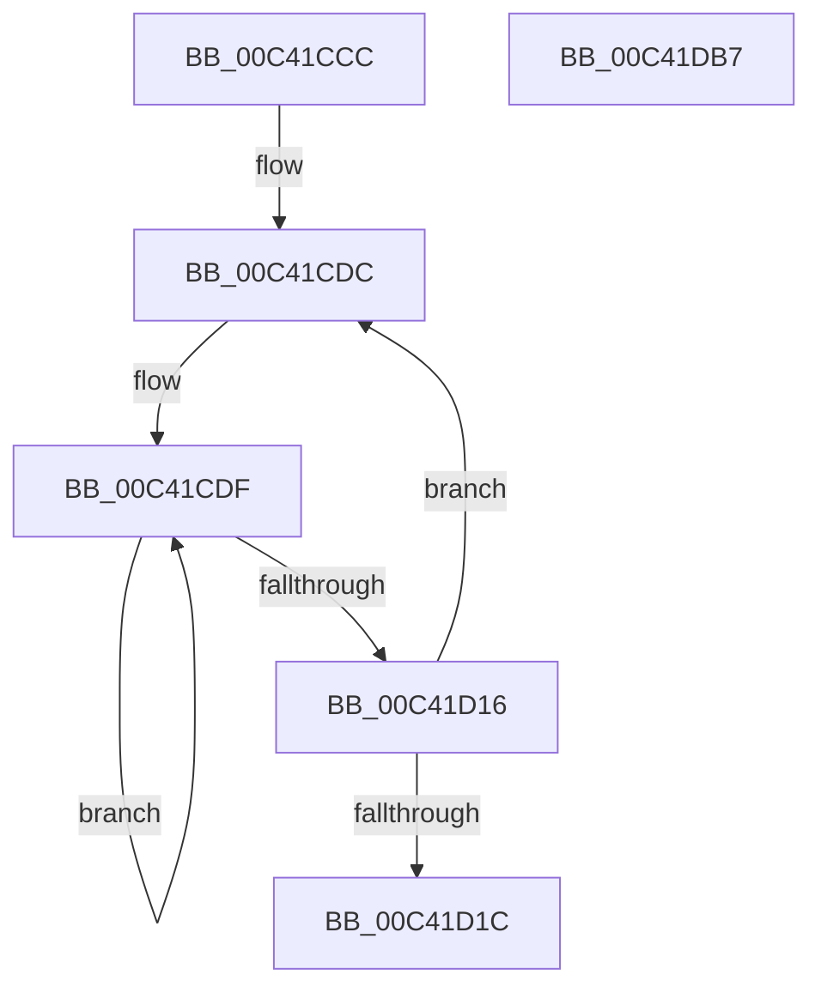

# PpmInitHeteroPolicy

- RVA: `0x00C41CCC`–`0x00C41DB8` (길이 `236` bytes)
- VA: `0x0000000140C41CCC`
- 실행 섹션: `INIT`
- PDB 이름 있음: `예`; PDB Function 태그: `아니요`
- unwind 정보 RVA: `0x000DB714`
- 디코드: `49`개 명령, `236/236` bytes 표시
- 미해석 바이트: `0` (있으면 어셈블리에 `.byte`로 보존)

> 이 문서는 커널 이미지의 기계어와 PDB 기호를 분석해 생성했습니다. 4번과 5번은 함수 원형과 자료형을 바이너리 사용 방식에서 추정한 C 해석이며 원본 소스 복구 결과는 아닙니다.

## 1. Dependencies

- 직접 호출 지점: **0**; 고유 호출 대상: **0**
- 직접 호출자로 확인된 함수: **1**
- RIP 상대 이미지 참조: **21**

### Outgoing calls
- 직접 디코드된 call 명령이 없습니다.

### Direct callers
- [PoInitSystem](../C7/PoInitSystem_function_00C72358.md) at `0x00C729D5`

### Static image references
- `0x00C41CCC` → RVA `0x00F07B03` (`.data`; read)
- `0x00C41D1C` → RVA `0x00F079AE` (`.data`; read/write)
- `0x00C41D29` → RVA `0x00F07B96` (`.data`; read/write)
- `0x00C41D35` → RVA `0x00F079A8` (`.data`; write)
- `0x00C41D3B` → RVA `0x00F07B90` (`.data`; write)
- `0x00C41D41` → RVA `0x00F079A4` (`.data`; write)
- `0x00C41D47` → RVA `0x00F07B8C` (`.data`; write)
- `0x00C41D50` → RVA `0x00F079B4` (`.data`; write)
- `0x00C41D56` → RVA `0x00F07B9C` (`.data`; write)
- `0x00C41D5C` → RVA `0x00F07899` (`.data`; write)
- `0x00C41D62` → RVA `0x00F07A81` (`.data`; write)
- `0x00C41D68` → RVA `0x00F0799B` (`.data`; write)
- `0x00C41D71` → RVA `0x00F07B83` (`.data`; write)
- `0x00C41D7A` → RVA `0x00F079B8` (`.data`; write)
- `0x00C41D80` → RVA `0x00F07BA0` (`.data`; write)
- `0x00C41D86` → RVA `0x00F079BC` (`.data`; write)
- `0x00C41D8D` → RVA `0x00F07BA4` (`.data`; write)
- `0x00C41D94` → RVA `0x00F079C4` (`.data`; write)
- `0x00C41D9B` → RVA `0x00F07BAC` (`.data`; write)
- `0x00C41DA2` → RVA `0x00F079C8` (`.data`; write)
- `0x00C41DAC` → RVA `0x00F07BB0` (`.data`; write)

## 2. Other-region calls and transfers

- 다른 실행 섹션으로 향하는 call: **0**
- 별도 외부 분기/꼬리 이동을 확인하지 못했습니다.

## 3. Assembly (complete function range)

```asm
00C41CCC  48 8D 15 30 5E 2C 00            lea rdx, [rip + 0x2c5e30]
00C41CD3  41 B9 02 00 00 00               mov r9d, 2
00C41CD9  45 33 D2                        xor r10d, r10d
00C41CDC  45 8B C2                        mov r8d, r10d
00C41CDF  41 8B C0                        mov eax, r8d
00C41CE2  F7 D8                           neg eax
00C41CE4  41 8B C0                        mov eax, r8d
00C41CE7  1A C9                           sbb cl, cl
00C41CE9  80 E1 F6                        and cl, 0xf6
00C41CEC  80 C1 5A                        add cl, 0x5a
00C41CEF  88 8A 18 FE FF FF               mov byte ptr [rdx - 0x1e8], cl
00C41CF5  F7 D8                           neg eax
00C41CF7  88 0A                           mov byte ptr [rdx], cl
00C41CF9  1A C9                           sbb cl, cl
00C41CFB  41 FF C0                        inc r8d
00C41CFE  80 E1 14                        and cl, 0x14
00C41D01  80 C1 1E                        add cl, 0x1e
00C41D04  88 8A 98 FD FF FF               mov byte ptr [rdx - 0x268], cl
00C41D0A  88 4A 80                        mov byte ptr [rdx - 0x80], cl
00C41D0D  48 FF C2                        inc rdx
00C41D10  41 83 F8 40                     cmp r8d, 0x40
00C41D14  72 C9                           jb 0x140c41cdf
00C41D16  49 83 E9 01                     sub r9, 1
00C41D1A  75 C0                           jne 0x140c41cdc
00C41D1C  66 81 0D 89 5C 2C 00 FF FF      or word ptr [rip + 0x2c5c89], 0xffff
00C41D25  41 8D 49 03                     lea ecx, [r9 + 3]
00C41D29  66 81 0D 64 5E 2C 00 FF FF      or word ptr [rip + 0x2c5e64], 0xffff
00C41D32  8D 41 02                        lea eax, [rcx + 2]
00C41D35  89 05 6D 5C 2C 00               mov dword ptr [rip + 0x2c5c6d], eax
00C41D3B  89 05 4F 5E 2C 00               mov dword ptr [rip + 0x2c5e4f], eax
00C41D41  89 05 5D 5C 2C 00               mov dword ptr [rip + 0x2c5c5d], eax
00C41D47  89 05 3F 5E 2C 00               mov dword ptr [rip + 0x2c5e3f], eax
00C41D4D  8D 41 01                        lea eax, [rcx + 1]
00C41D50  89 05 5E 5C 2C 00               mov dword ptr [rip + 0x2c5c5e], eax
00C41D56  89 05 40 5E 2C 00               mov dword ptr [rip + 0x2c5e40], eax
00C41D5C  88 0D 37 5B 2C 00               mov byte ptr [rip + 0x2c5b37], cl
00C41D62  88 0D 19 5D 2C 00               mov byte ptr [rip + 0x2c5d19], cl
00C41D68  66 C7 05 2A 5C 2C 00 32 32      mov word ptr [rip + 0x2c5c2a], 0x3232
00C41D71  66 C7 05 09 5E 2C 00 32 32      mov word ptr [rip + 0x2c5e09], 0x3232
00C41D7A  89 0D 38 5C 2C 00               mov dword ptr [rip + 0x2c5c38], ecx
00C41D80  89 0D 1A 5E 2C 00               mov dword ptr [rip + 0x2c5e1a], ecx
00C41D86  48 89 0D 2F 5C 2C 00            mov qword ptr [rip + 0x2c5c2f], rcx
00C41D8D  48 89 0D 10 5E 2C 00            mov qword ptr [rip + 0x2c5e10], rcx
00C41D94  44 89 15 29 5C 2C 00            mov dword ptr [rip + 0x2c5c29], r10d
00C41D9B  44 89 15 0A 5E 2C 00            mov dword ptr [rip + 0x2c5e0a], r10d
00C41DA2  C7 05 1C 5C 2C 00 01 00 00 00   mov dword ptr [rip + 0x2c5c1c], 1
00C41DAC  C7 05 FA 5D 2C 00 01 00 00 00   mov dword ptr [rip + 0x2c5dfa], 1
00C41DB6  C3                              ret
00C41DB7  CC                              int3
```

## 4. C-style interpretation (structured pseudocode)

```c
__int64 __fastcall PpmInitHeteroPolicy(unsigned __int8 a1)
{
    __int64 result;
    __int64 v_r10;

    v_r10 = 0;
loc_00C41CDC:
loc_00C41CDF:
    result = (unsigned int)(-(0));
    a1 = (unsigned __int8)((a1) & (246));
    a1 = (unsigned __int8)((a1) + (90));
    *(unsigned __int8 *)(v_rip + 2907696 - 488) = a1;
    result = (unsigned int)(-(0));
    *(unsigned __int8 *)(v_rip + 2907696) = a1;
    a3 = (unsigned int)((0) + 1);
    a1 = (unsigned __int8)((a1) & (20));
    a1 = (unsigned __int8)((a1) + (30));
    *(unsigned __int8 *)(v_rip + 2907696 - 616) = a1;
    *(unsigned __int8 *)(v_rip + 2907696 - 128) = a1;
    a2 = (v_rip + 2907696) + 1;
    if (((unsigned int)(a3)) < 64) goto loc_00C41CDF;
    a4 = (2) - (1);
    if (condition_is_not_equal) goto loc_00C41CDC;
    *(unsigned int *)(v_rip + 2907245) = (unsigned int)(a4 + 3 + 2);
    *(unsigned int *)(v_rip + 2907727) = (unsigned int)(a4 + 3 + 2);
    *(unsigned int *)(v_rip + 2907229) = (unsigned int)(a4 + 3 + 2);
    *(unsigned int *)(v_rip + 2907711) = (unsigned int)(a4 + 3 + 2);
    *(unsigned int *)(v_rip + 2907230) = (unsigned int)(a4 + 3 + 1);
    *(unsigned int *)(v_rip + 2907712) = (unsigned int)(a4 + 3 + 1);
    *(unsigned __int8 *)(v_rip + 2906935) = (unsigned __int8)(a4 + 3);
    *(unsigned __int8 *)(v_rip + 2907417) = (unsigned __int8)(a4 + 3);
    *(unsigned __int16 *)(v_rip + 2907178) = 0x3232ULL;
    *(unsigned __int16 *)(v_rip + 2907657) = 0x3232ULL;
    *(unsigned int *)(v_rip + 2907192) = (unsigned int)(a4 + 3);
    *(unsigned int *)(v_rip + 2907674) = (unsigned int)(a4 + 3);
    *(unsigned __int64 *)(v_rip + 2907183) = a4 + 3;
    *(unsigned __int64 *)(v_rip + 2907664) = a4 + 3;
    *(unsigned int *)(v_rip + 2907177) = 0;
    *(unsigned int *)(v_rip + 2907658) = 0;
    *(unsigned int *)(v_rip + 2907164) = 1;
    *(unsigned int *)(v_rip + 2907642) = 1;
    return a4 + 3 + 1;
}
```

## 5. (Beta) C Style

```c
int64_t PpmInitHeteroPolicy(uint8_t Arg1)
{
    int64_t result;
    int64_t local_r10;

    local_r10 = 0;
loc_00C41CDC:
loc_00C41CDF:
    result = (uint32_t)(-(0));
    Arg1 = (uint8_t)((Arg1) & (246));
    Arg1 = (uint8_t)((Arg1) + (90));
    *(uint8_t *)(v_rip + 0x2C5E30 - 0x1E8) = Arg1;
    result = (uint32_t)(-(0));
    *(uint8_t *)(v_rip + 0x2C5E30) = Arg1;
    a3 = (uint32_t)((0) + 1);
    Arg1 = (uint8_t)((Arg1) & (20));
    Arg1 = (uint8_t)((Arg1) + (30));
    *(uint8_t *)(v_rip + 0x2C5E30 - 0x268) = Arg1;
    *(uint8_t *)(v_rip + 0x2C5E30 - 0x80) = Arg1;
    a2 = (v_rip + 2907696) + 1;
    if (((uint32_t)(a3)) < 64) goto loc_00C41CDF;
    a4 = (2) - (1);
    if (condition_is_not_equal) goto loc_00C41CDC;
    *(uint32_t *)(v_rip + 0x2C5C6D) = (uint32_t)(a4 + 3 + 2);
    *(uint32_t *)(v_rip + 0x2C5E4F) = (uint32_t)(a4 + 3 + 2);
    *(uint32_t *)(v_rip + 0x2C5C5D) = (uint32_t)(a4 + 3 + 2);
    *(uint32_t *)(v_rip + 0x2C5E3F) = (uint32_t)(a4 + 3 + 2);
    *(uint32_t *)(v_rip + 0x2C5C5E) = (uint32_t)(a4 + 3 + 1);
    *(uint32_t *)(v_rip + 0x2C5E40) = (uint32_t)(a4 + 3 + 1);
    *(uint8_t *)(v_rip + 0x2C5B37) = (uint8_t)(a4 + 3);
    *(uint8_t *)(v_rip + 0x2C5D19) = (uint8_t)(a4 + 3);
    *(uint16_t *)(v_rip + 0x2C5C2A) = 0x3232ULL;
    *(uint16_t *)(v_rip + 0x2C5E09) = 0x3232ULL;
    *(uint32_t *)(v_rip + 0x2C5C38) = (uint32_t)(a4 + 3);
    *(uint32_t *)(v_rip + 0x2C5E1A) = (uint32_t)(a4 + 3);
    *(uint64_t *)(v_rip + 0x2C5C2F) = a4 + 3;
    *(uint64_t *)(v_rip + 0x2C5E10) = a4 + 3;
    *(uint32_t *)(v_rip + 0x2C5C29) = 0;
    *(uint32_t *)(v_rip + 0x2C5E0A) = 0;
    *(uint32_t *)(v_rip + 0x2C5C1C) = 1;
    *(uint32_t *)(v_rip + 0x2C5DFA) = 1;
    return a4 + 3 + 1;
}
```

## 6. Execution-region graph

[열기: 2D/3D 그래프와 함수 탐색 컨트롤 패널](../../../control-panel.html?section=init&rva=0x00C41CCC&view=graph)

- 2D 그래프는 위에서 아래로 흐르고, 3D 그래프는 빈 공간을 드래그해 회전합니다. Shift+드래그는 이동, 휠은 확대·축소, 함수 노드 선택은 대상 보고서 이동입니다.

### Static fallback


