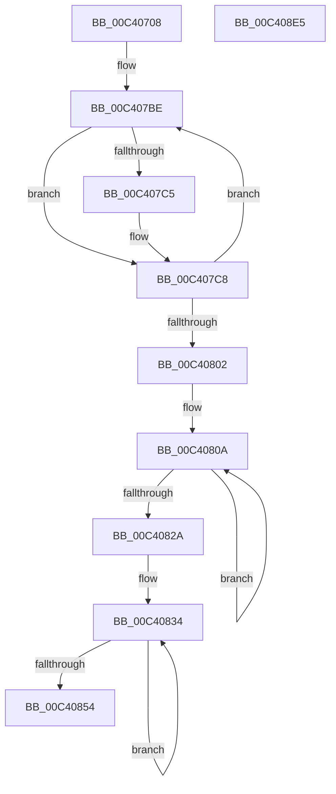

# PpmInitPolicyConfiguration

- RVA: `0x00C40708`–`0x00C408E6` (길이 `478` bytes)
- VA: `0x0000000140C40708`
- 실행 섹션: `INIT`
- PDB 이름 있음: `예`; PDB Function 태그: `아니요`
- unwind 정보 RVA: `0x000CCCD0`
- 디코드: `95`개 명령, `478/478` bytes 표시
- 미해석 바이트: `0` (있으면 어셈블리에 `.byte`로 보존)

> 이 문서는 커널 이미지의 기계어와 PDB 기호를 분석해 생성했습니다. 4번과 5번은 함수 원형과 자료형을 바이너리 사용 방식에서 추정한 C 해석이며 원본 소스 복구 결과는 아닙니다.

## 1. Dependencies

- 직접 호출 지점: **8**; 고유 호출 대상: **7**
- 직접 호출자로 확인된 함수: **1**
- RIP 상대 이미지 참조: **24**

### Outgoing calls
- `0x00C407A5` → [PpmAcquireLock](../../text/2D/PpmAcquireLock_function_002D9AA4.md) (function, `0x002D9AA4`)
- `0x00C4081B` → [PpmPolicySettingsMaskMerge](../../text/4B/PpmPolicySettingsMaskMerge_function_004B2358.md) (function, `0x004B2358`)
- `0x00C40845` → [PpmPolicySettingsMaskMerge](../../text/4B/PpmPolicySettingsMaskMerge_function_004B2358.md) (function, `0x004B2358`)
- `0x00C40886` → [PpmEnableProfile](../../page/77/PpmEnableProfile_function_00770938.md) (function, `0x00770938`)
- `0x00C4089B` → [PpmBeginProfileAccumulation](../../page/70/PpmBeginProfileAccumulation_function_0070552C.md) (function, `0x0070552C`)
- `0x00C408B7` → [qsort](../../text/50/qsort_function_005009F0.md) (function, `0x005009F0`)
- `0x00C408C3` → [PpmReleaseLock](../../text/2D/PpmReleaseLock_function_002DA428.md) (function, `0x002DA428`)
- `0x00C408CF` → [_security_check_cookie](../../text/6A/_security_check_cookie_function_006AC640.md) (function, `0x006AC640`)

### Direct callers
- [PoInitSystem](../C7/PoInitSystem_function_00C72358.md) at `0x00C729C1`

### Static image references
- `0x00C4071A` → RVA `0x00E0A740` (`.data`; read)
- `0x00C40728` → RVA `0x00014528` (`.rdata`; read)
- `0x00C4072F` → RVA `0x0001BE48` (`.rdata`; read)
- `0x00C4073E` → RVA `0x0001BE58` (`.rdata`; read)
- `0x00C40749` → RVA `0x0001BE68` (`.rdata`; read)
- `0x00C40754` → RVA `0x0001BE38` (`.rdata`; read)
- `0x00C4075F` → RVA `0x0001BE18` (`.rdata`; read)
- `0x00C4076A` → RVA `0x0001BE28` (`.rdata`; read)
- `0x00C40775` → RVA `0x0002A0A8` (`.rdata`; read)
- `0x00C40780` → RVA `0x0001BE08` (`.rdata`; read)
- `0x00C4078B` → RVA `0x00014518` (`.rdata`; read)
- `0x00C40796` → RVA `0x00F0CC00` (`.data`; read)
- `0x00C407AA` → RVA `0x00FC5F70` (`ALMOSTRO`; read)
- `0x00C407B7` → RVA `0x00F077C0` (`.data`; read)
- `0x00C4080D` → RVA `0x00F0B200` (`.data`; read)
- `0x00C40837` → RVA `0x00F0B1F0` (`.data`; read)
- `0x00C40854` → RVA `0x000112D0` (`.rdata`; read)
- `0x00C4085B` → RVA `0x00F07BD0` (`.data`; read/write)
- `0x00C40863` → RVA `0x00FC55E0` (`ALMOSTRO`; read)
- `0x00C4086D` → RVA `0x00F077C0` (`.data`; write)
- `0x00C40874` → RVA `0x00F077CC` (`.data`; write)
- `0x00C4087C` → RVA `0x00F077DC` (`.data`; write)
- `0x00C408A5` → RVA `0x00C40640` (`PpmInfoConfigComparer`; read)
- `0x00C408AC` → RVA `0x00FC5F50` (`ALMOSTRO`; read)

## 2. Other-region calls and transfers

- 다른 실행 섹션으로 향하는 call: **8**
  - `0x00C407A5` → [PpmAcquireLock](../../text/2D/PpmAcquireLock_function_002D9AA4.md) (`INIT` → `.text`)
  - `0x00C4081B` → [PpmPolicySettingsMaskMerge](../../text/4B/PpmPolicySettingsMaskMerge_function_004B2358.md) (`INIT` → `.text`)
  - `0x00C40845` → [PpmPolicySettingsMaskMerge](../../text/4B/PpmPolicySettingsMaskMerge_function_004B2358.md) (`INIT` → `.text`)
  - `0x00C40886` → [PpmEnableProfile](../../page/77/PpmEnableProfile_function_00770938.md) (`INIT` → `PAGE`)
  - `0x00C4089B` → [PpmBeginProfileAccumulation](../../page/70/PpmBeginProfileAccumulation_function_0070552C.md) (`INIT` → `PAGE`)
  - `0x00C408B7` → [qsort](../../text/50/qsort_function_005009F0.md) (`INIT` → `.text`)
  - `0x00C408C3` → [PpmReleaseLock](../../text/2D/PpmReleaseLock_function_002DA428.md) (`INIT` → `.text`)
  - `0x00C408CF` → [_security_check_cookie](../../text/6A/_security_check_cookie_function_006AC640.md) (`INIT` → `.text`)
- 별도 외부 분기/꼬리 이동을 확인하지 못했습니다.

## 3. Assembly (complete function range)

```asm
00C40708  48 89 7C 24 08                  mov qword ptr [rsp + 8], rdi
00C4070D  55                              push rbp
00C4070E  48 8D 6C 24 A9                  lea rbp, [rsp - 0x57]
00C40713  48 81 EC 90 00 00 00            sub rsp, 0x90
00C4071A  48 8B 05 1F A0 1C 00            mov rax, qword ptr [rip + 0x1ca01f]
00C40721  48 33 C4                        xor rax, rsp
00C40724  48 89 45 47                     mov qword ptr [rbp + 0x47], rax
00C40728  48 8D 0D F9 3D 3D FF            lea rcx, [rip - 0xc2c207]
00C4072F  48 8D 05 12 B7 3D FF            lea rax, [rip - 0xc248ee]
00C40736  48 89 4D 37                     mov qword ptr [rbp + 0x37], rcx
00C4073A  48 89 45 F7                     mov qword ptr [rbp - 9], rax
00C4073E  48 8D 05 13 B7 3D FF            lea rax, [rip - 0xc248ed]
00C40745  48 89 45 FF                     mov qword ptr [rbp - 1], rax
00C40749  48 8D 05 18 B7 3D FF            lea rax, [rip - 0xc248e8]
00C40750  48 89 45 07                     mov qword ptr [rbp + 7], rax
00C40754  48 8D 05 DD B6 3D FF            lea rax, [rip - 0xc24923]
00C4075B  48 89 45 0F                     mov qword ptr [rbp + 0xf], rax
00C4075F  48 8D 05 B2 B6 3D FF            lea rax, [rip - 0xc2494e]
00C40766  48 89 45 17                     mov qword ptr [rbp + 0x17], rax
00C4076A  48 8D 05 B7 B6 3D FF            lea rax, [rip - 0xc24949]
00C40771  48 89 45 1F                     mov qword ptr [rbp + 0x1f], rax
00C40775  48 8D 05 2C 99 3E FF            lea rax, [rip - 0xc166d4]
00C4077C  48 89 45 27                     mov qword ptr [rbp + 0x27], rax
00C40780  48 8D 05 81 B6 3D FF            lea rax, [rip - 0xc2497f]
00C40787  48 89 45 2F                     mov qword ptr [rbp + 0x2f], rax
00C4078B  48 8D 05 86 3D 3D FF            lea rax, [rip - 0xc2c27a]
00C40792  48 89 4D E7                     mov qword ptr [rbp - 0x19], rcx
00C40796  48 8D 0D 63 C4 2C 00            lea rcx, [rip + 0x2cc463]
00C4079D  48 89 45 3F                     mov qword ptr [rbp + 0x3f], rax
00C407A1  48 89 45 EF                     mov qword ptr [rbp - 0x11], rax
00C407A5  E8 FA 92 69 FF                  call 0x1402d9aa4
00C407AA  4C 8D 05 BF 57 38 00            lea r8, [rip + 0x3857bf]
00C407B1  41 B9 46 00 00 00               mov r9d, 0x46
00C407B7  48 8D 3D 02 70 2C 00            lea rdi, [rip + 0x2c7002]
00C407BE  41 F6 40 05 04                  test byte ptr [r8 + 5], 4
00C407C3  74 03                           je 0x140c407c8
00C407C5  41 D1 28                        shr dword ptr [r8], 1
00C407C8  41 0F B6 50 04                  movzx edx, byte ptr [r8 + 4]
00C407CD  49 83 C0 28                     add r8, 0x28
00C407D1  8B CA                           mov ecx, edx
00C407D3  83 E2 3F                        and edx, 0x3f
00C407D6  48 C1 E9 06                     shr rcx, 6
00C407DA  48 8B 44 CF 28                  mov rax, qword ptr [rdi + rcx*8 + 0x28]
00C407DF  48 0F AB D0                     bts rax, rdx
00C407E3  48 89 44 CF 28                  mov qword ptr [rdi + rcx*8 + 0x28], rax
00C407E8  48 8B 84 CF 10 02 00 00         mov rax, qword ptr [rdi + rcx*8 + 0x210]
00C407F0  48 0F AB D0                     bts rax, rdx
00C407F4  48 89 84 CF 10 02 00 00         mov qword ptr [rdi + rcx*8 + 0x210], rax
00C407FC  49 83 E9 01                     sub r9, 1
00C40800  75 BC                           jne 0x140c407be
00C40802  48 8D 45 F7                     lea rax, [rbp - 9]
00C40806  45 8D 59 0A                     lea r11d, [r9 + 0xa]
00C4080A  4C 8B 00                        mov r8, qword ptr [rax]
00C4080D  48 8D 15 EC A9 2C 00            lea rdx, [rip + 0x2ca9ec]
00C40814  48 8D 0D E5 A9 2C 00            lea rcx, [rip + 0x2ca9e5]
00C4081B  E8 38 1B 87 FF                  call 0x1404b2358
00C40820  48 8D 40 08                     lea rax, [rax + 8]
00C40824  49 83 EB 01                     sub r11, 1
00C40828  75 E0                           jne 0x140c4080a
00C4082A  48 8D 45 E7                     lea rax, [rbp - 0x19]
00C4082E  41 BB 02 00 00 00               mov r11d, 2
00C40834  4C 8B 00                        mov r8, qword ptr [rax]
00C40837  48 8D 15 B2 A9 2C 00            lea rdx, [rip + 0x2ca9b2]
00C4083E  48 8D 0D AB A9 2C 00            lea rcx, [rip + 0x2ca9ab]
00C40845  E8 0E 1B 87 FF                  call 0x1404b2358
00C4084A  48 8D 40 08                     lea rax, [rax + 8]
00C4084E  49 83 EB 01                     sub r11, 1
00C40852  75 E0                           jne 0x140c40834
00C40854  0F 10 05 75 0A 3D FF            movups xmm0, xmmword ptr [rip - 0xc2f58b]
00C4085B  48 83 0D 6D 73 2C 00 FF         or qword ptr [rip + 0x2c736d], 0xffffffffffffffff
00C40863  48 8D 05 76 4D 38 00            lea rax, [rip + 0x384d76]
00C4086A  48 8B CF                        mov rcx, rdi
00C4086D  48 89 05 4C 6F 2C 00            mov qword ptr [rip + 0x2c6f4c], rax
00C40874  F3 0F 7F 05 50 6F 2C 00         movdqu xmmword ptr [rip + 0x2c6f50], xmm0
00C4087C  C7 05 56 6F 2C 00 02 00 00 00   mov dword ptr [rip + 0x2c6f56], 2
00C40886  E8 AD 00 B3 FF                  call 0x140770938
00C4088B  48 BA 08 00 00 00 80 F7 FF FF   movabs rdx, 0xfffff78000000008
00C40895  48 8B CF                        mov rcx, rdi
00C40898  48 8B 12                        mov rdx, qword ptr [rdx]
00C4089B  E8 8C 4C AC FF                  call 0x14070552c
00C408A0  BA 46 00 00 00                  mov edx, 0x46
00C408A5  4C 8D 0D 94 FD FF FF            lea r9, [rip - 0x26c]
00C408AC  48 8D 0D 9D 56 38 00            lea rcx, [rip + 0x38569d]
00C408B3  44 8D 42 E2                     lea r8d, [rdx - 0x1e]
00C408B7  E8 34 01 8C FF                  call 0x1405009f0
00C408BC  48 8D 0D 3D C3 2C 00            lea rcx, [rip + 0x2cc33d]
00C408C3  E8 60 9B 69 FF                  call 0x1402da428
00C408C8  48 8B 4D 47                     mov rcx, qword ptr [rbp + 0x47]
00C408CC  48 33 CC                        xor rcx, rsp
00C408CF  E8 6C BD A6 FF                  call 0x1406ac640
00C408D4  48 8B BC 24 A0 00 00 00         mov rdi, qword ptr [rsp + 0xa0]
00C408DC  48 81 C4 90 00 00 00            add rsp, 0x90
00C408E3  5D                              pop rbp
00C408E4  C3                              ret
00C408E5  CC                              int3
```

## 4. C-style interpretation (structured pseudocode)

```c
__int64 __fastcall PpmInitPolicyConfiguration(void)
{
    __int64 result;
    __int64 v_r11;
    __int64 v_rsp;
    unsigned __int64 v_stack_m18;
    unsigned __int64 v_stack_m20;
    unsigned __int64 v_stack_m28;
    unsigned __int64 v_stack_m30;
    unsigned __int64 v_stack_m38;
    unsigned __int64 v_stack_m40;
    unsigned __int64 v_stack_m48;
    unsigned __int64 v_stack_m50;
    unsigned __int64 v_stack_m58;
    unsigned __int64 v_stack_m5F;
    unsigned __int64 v_stack_m60;
    unsigned __int64 v_stack_m68;
    unsigned __int64 v_stack_m70;
    unsigned __int64 v_stack_m78;
    unsigned __int64 v_stack_p8;

    v_stack_p8 = v_rdi;
    v_rsp = (v_rsp) - (144);
    result = (*(unsigned __int64 *)(v_rip + 1875999)) ^ (v_rsp);
    v_stack_m18 = result;
    v_stack_m28 = v_rip - 12763655;
    v_stack_m68 = v_rip - 12732654;
    v_stack_m60 = v_rip - 12732653;
    v_stack_m58 = v_rip - 12732648;
    v_stack_m50 = v_rip - 12732707;
    v_stack_m48 = v_rip - 12732750;
    v_stack_m40 = v_rip - 12732745;
    v_stack_m38 = v_rip - 12674772;
    v_stack_m30 = v_rip - 12732799;
    v_stack_m78 = v_rip - 12763655;
    v_stack_m20 = v_rip - 12763770;
    v_stack_m70 = v_rip - 12763770;
    result = PpmAcquireLock(v_rip + 2933859, a2, a3, a4);
loc_00C407BE:
    if (((*(unsigned __int8 *)(v_rip + 3692479 + 5)) & (4)) != 0) {
    }
    a3 = (v_rip + 3692479) + (40);
    a2 = (unsigned int)((*(unsigned __int8 *)(v_rip + 3692479 + 4)) & (63));
    a1 = ((unsigned int)((unsigned int)(*(unsigned __int8 *)(v_rip + 3692479 + 4)))) >> (6);
    *(unsigned __int64 *)(v_rip + 2912258 + a1 * 8 + 40) = *(unsigned __int64 *)(v_rip + 2912258 + a1 * 8 + 40);
    *(unsigned __int64 *)(v_rip + 2912258 + a1 * 8 + 528) = *(unsigned __int64 *)(v_rip + 2912258 + a1 * 8 + 528);
    a4 = (70) - (1);
    if (condition_is_not_equal) goto loc_00C407BE;
loc_00C4080A:
    result = PpmPolicySettingsMaskMerge(v_rip + 2927077, v_rip + 2927084, *(unsigned __int64 *)(v_stack_m68), a4);
    v_r11 = (a4 + 10) - (1);
    if (condition_is_not_equal) goto loc_00C4080A;
loc_00C40834:
    result = PpmPolicySettingsMaskMerge(v_rip + 2927019, v_rip + 2927026, *(unsigned __int64 *)(v_stack_m78), a4);
    v_r11 = (2) - (1);
    if (condition_is_not_equal) goto loc_00C40834;
    *(unsigned __int64 *)(v_rip + 2912076) = v_rip + 3689846;
    *(unsigned __int64 *)(v_rip + 2912080) = v_xmm0;
    *(unsigned int *)(v_rip + 2912086) = 2;
    result = PpmEnableProfile(v_rip + 2912258, v_rip + 2927026, *(unsigned __int64 *)(v_stack_m78), a4);
    result = PpmBeginProfileAccumulation(v_rip + 2912258, *(unsigned __int64 *)(v_rip + 2927026), *(unsigned __int64 *)(v_stack_m78), a4);
    result = qsort(v_rip + 3692189, 70, 70 - 30, v_rip - 620);
    result = PpmReleaseLock(v_rip + 2933565, 70, 70 - 30, v_rip - 620);
    a1 = (v_stack_m18) ^ (v_rsp);
    result = _security_check_cookie(a1, 70, 70 - 30, v_rip - 620);
    v_rsp = (v_rsp) + (144);
    return result;
}
```

## 5. (Beta) C Style

```c
void PpmInitPolicyConfiguration(void)
{
    int64_t result;
    int64_t local_r11;
    int64_t local_rsp;
    uint64_t v_stack_m18;
    uint64_t v_stack_m20;
    uint64_t v_stack_m28;
    uint64_t v_stack_m30;
    uint64_t v_stack_m38;
    uint64_t v_stack_m40;
    uint64_t v_stack_m48;
    uint64_t v_stack_m50;
    uint64_t v_stack_m58;
    uint64_t v_stack_m5F;
    uint64_t v_stack_m60;
    uint64_t v_stack_m68;
    uint64_t v_stack_m70;
    uint64_t v_stack_m78;
    uint64_t v_stack_p8;

    v_stack_p8 = local_rdi;
    local_rsp = (local_rsp) - (144);
    result = (*(uint64_t *)(v_rip + 0x1CA01F)) ^ (local_rsp);
    v_stack_m18 = result;
    v_stack_m28 = v_rip - 12763655;
    v_stack_m68 = v_rip - 12732654;
    v_stack_m60 = v_rip - 12732653;
    v_stack_m58 = v_rip - 12732648;
    v_stack_m50 = v_rip - 12732707;
    v_stack_m48 = v_rip - 12732750;
    v_stack_m40 = v_rip - 12732745;
    v_stack_m38 = v_rip - 12674772;
    v_stack_m30 = v_rip - 12732799;
    v_stack_m78 = v_rip - 12763655;
    v_stack_m20 = v_rip - 12763770;
    v_stack_m70 = v_rip - 12763770;
    result = PpmAcquireLock(v_rip + 2933859, a2, a3, a4);
loc_00C407BE:
    if (((*(uint8_t *)(v_rip + 0x3857BF + 0x5)) & (4)) != 0) {
    }
    a3 = (v_rip + 3692479) + (40);
    a2 = (uint32_t)((*(uint8_t *)(v_rip + 0x3857BF + 0x4)) & (63));
    a1 = ((uint32_t)((uint32_t)(*(uint8_t *)(v_rip + 0x3857BF + 0x4)))) >> (6);
    *(uint64_t *)(v_rip + 0x2C7002 + a1 * 8 + 0x28) = *(uint64_t *)(v_rip + 0x2C7002 + a1 * 8 + 0x28);
    *(uint64_t *)(v_rip + 0x2C7002 + a1 * 8 + 0x210) = *(uint64_t *)(v_rip + 0x2C7002 + a1 * 8 + 0x210);
    a4 = (70) - (1);
    if (condition_is_not_equal) goto loc_00C407BE;
loc_00C4080A:
    result = PpmPolicySettingsMaskMerge(v_rip + 2927077, v_rip + 2927084, *(uint64_t *)(v_stack_m68), a4);
    local_r11 = (a4 + 10) - (1);
    if (condition_is_not_equal) goto loc_00C4080A;
loc_00C40834:
    result = PpmPolicySettingsMaskMerge(v_rip + 2927019, v_rip + 2927026, *(uint64_t *)(v_stack_m78), a4);
    local_r11 = (2) - (1);
    if (condition_is_not_equal) goto loc_00C40834;
    *(uint64_t *)(v_rip + 0x2C6F4C) = v_rip + 3689846;
    *(uint64_t *)(v_rip + 0x2C6F50) = v_xmm0;
    *(uint32_t *)(v_rip + 0x2C6F56) = 2;
    result = PpmEnableProfile(v_rip + 2912258, v_rip + 2927026, *(uint64_t *)(v_stack_m78), a4);
    result = PpmBeginProfileAccumulation(v_rip + 2912258, *(uint64_t *)(v_rip + 0x2CA9B2), *(uint64_t *)(v_stack_m78), a4);
    result = qsort(v_rip + 3692189, 70, 70 - 30, v_rip - 620);
    result = PpmReleaseLock(v_rip + 2933565, 70, 70 - 30, v_rip - 620);
    a1 = (v_stack_m18) ^ (local_rsp);
    result = _security_check_cookie(a1, 70, 70 - 30, v_rip - 620);
    local_rsp = (local_rsp) + (144);
    return result;
}
```

## 6. Execution-region graph

[열기: 2D/3D 그래프와 함수 탐색 컨트롤 패널](../../../control-panel.html?section=init&rva=0x00C40708&view=graph)

- 2D 그래프는 위에서 아래로 흐르고, 3D 그래프는 빈 공간을 드래그해 회전합니다. Shift+드래그는 이동, 휠은 확대·축소, 함수 노드 선택은 대상 보고서 이동입니다.

### Static fallback


