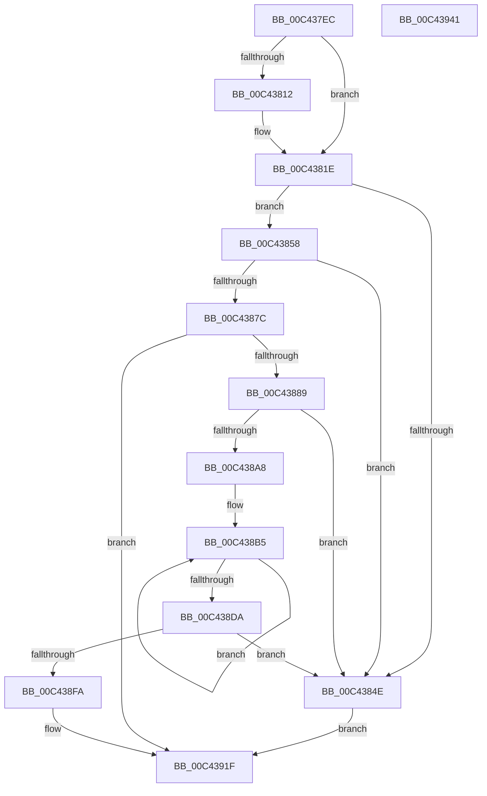

# PpmParkInitialize

- RVA: `0x00C437EC`–`0x00C43942` (길이 `342` bytes)
- VA: `0x0000000140C437EC`
- 실행 섹션: `INIT`
- PDB 이름 있음: `예`; PDB Function 태그: `아니요`
- unwind 정보 RVA: `0x0007F3F8`
- 디코드: `79`개 명령, `342/342` bytes 표시
- 미해석 바이트: `0` (있으면 어셈블리에 `.byte`로 보존)

> 이 문서는 커널 이미지의 기계어와 PDB 기호를 분석해 생성했습니다. 4번과 5번은 함수 원형과 자료형을 바이너리 사용 방식에서 추정한 C 해석이며 원본 소스 복구 결과는 아닙니다.

## 1. Dependencies

- 직접 호출 지점: **7**; 고유 호출 대상: **3**
- 직접 호출자로 확인된 함수: **1**
- RIP 상대 이미지 참조: **10**

### Outgoing calls
- `0x00C4383D` → [ExAllocatePool2](../../poolcode/B8/ExAllocatePool2_function_00B820F0.md) (function, `0x00B820F0`)
- `0x00C4386B` → [ExAllocatePool2](../../poolcode/B8/ExAllocatePool2_function_00B820F0.md) (function, `0x00B820F0`)
- `0x00C4387C` → [Feature_PpmParkEx__private_IsEnabledDeviceUsageNoInline](../../text/4F/Feature_PpmParkEx__private_IsEnabledDeviceUsageNoInline_function_004F135C.md) (function, `0x004F135C`)
- `0x00C43897` → [ExAllocatePool2](../../poolcode/B8/ExAllocatePool2_function_00B820F0.md) (function, `0x00B820F0`)
- `0x00C438C9` → [memset](../../text/6C/memset_function_006C6C40.md) (function, `0x006C6C40`)
- `0x00C438EC` → [ExAllocatePool2](../../poolcode/B8/ExAllocatePool2_function_00B820F0.md) (function, `0x00B820F0`)
- `0x00C4391F` → [Feature_PpmParkEx__private_IsEnabledDeviceUsageNoInline](../../text/4F/Feature_PpmParkEx__private_IsEnabledDeviceUsageNoInline_function_004F135C.md) (function, `0x004F135C`)

### Direct callers
- [PoInitSystem](../C7/PoInitSystem_function_00C72358.md) at `0x00C72E45`

### Static image references
- `0x00C43805` → RVA `0x00FC50F8` (`ALMOSTRO`; read)
- `0x00C43812` → RVA `0x00E0B800` (`.data`; read)
- `0x00C4381E` → RVA `0x00FC6AE8` (`ALMOSTRO`; read)
- `0x00C43837` → RVA `0x00FC6C88` (`ALMOSTRO`; write)
- `0x00C43842` → RVA `0x00F083B8` (`.data`; write)
- `0x00C43870` → RVA `0x00F083C8` (`.data`; write)
- `0x00C4389C` → RVA `0x00E67A80` (`.data`; write)
- `0x00C43904` → RVA `0x00F070A0` (`.data`; write)
- `0x00C43911` → RVA `0x00F070B0` (`.data`; write)
- `0x00C43918` → RVA `0x00F070A8` (`.data`; write)

## 2. Other-region calls and transfers

- 다른 실행 섹션으로 향하는 call: **7**
  - `0x00C4383D` → [ExAllocatePool2](../../poolcode/B8/ExAllocatePool2_function_00B820F0.md) (`INIT` → `POOLCODE`)
  - `0x00C4386B` → [ExAllocatePool2](../../poolcode/B8/ExAllocatePool2_function_00B820F0.md) (`INIT` → `POOLCODE`)
  - `0x00C4387C` → [Feature_PpmParkEx__private_IsEnabledDeviceUsageNoInline](../../text/4F/Feature_PpmParkEx__private_IsEnabledDeviceUsageNoInline_function_004F135C.md) (`INIT` → `.text`)
  - `0x00C43897` → [ExAllocatePool2](../../poolcode/B8/ExAllocatePool2_function_00B820F0.md) (`INIT` → `POOLCODE`)
  - `0x00C438C9` → [memset](../../text/6C/memset_function_006C6C40.md) (`INIT` → `.text`)
  - `0x00C438EC` → [ExAllocatePool2](../../poolcode/B8/ExAllocatePool2_function_00B820F0.md) (`INIT` → `POOLCODE`)
  - `0x00C4391F` → [Feature_PpmParkEx__private_IsEnabledDeviceUsageNoInline](../../text/4F/Feature_PpmParkEx__private_IsEnabledDeviceUsageNoInline_function_004F135C.md) (`INIT` → `.text`)
- 별도 외부 분기/꼬리 이동을 확인하지 못했습니다.

## 3. Assembly (complete function range)

```asm
00C437EC  48 8B C4                        mov rax, rsp
00C437EF  48 89 58 08                     mov qword ptr [rax + 8], rbx
00C437F3  48 89 70 10                     mov qword ptr [rax + 0x10], rsi
00C437F7  48 89 78 18                     mov qword ptr [rax + 0x18], rdi
00C437FB  4C 89 70 20                     mov qword ptr [rax + 0x20], r14
00C437FF  41 57                           push r15
00C43801  48 83 EC 20                     sub rsp, 0x20
00C43805  8B 05 ED 18 38 00               mov eax, dword ptr [rip + 0x3818ed]
00C4380B  33 DB                           xor ebx, ebx
00C4380D  83 F8 FF                        cmp eax, -1
00C43810  75 0C                           jne 0x140c4381e
00C43812  80 3D E7 7F 1C 00 02            cmp byte ptr [rip + 0x1c7fe7], 2
00C43819  8B C3                           mov eax, ebx
00C4381B  0F 97 C0                        seta al
00C4381E  8B 15 C4 32 38 00               mov edx, dword ptr [rip + 0x3832c4]
00C43824  41 BE 40 00 00 00               mov r14d, 0x40
00C4382A  48 C1 E2 02                     shl rdx, 2
00C4382E  41 8B CE                        mov ecx, r14d
00C43831  41 B8 50 50 4D 70               mov r8d, 0x704d5050
00C43837  89 05 4B 34 38 00               mov dword ptr [rip + 0x38344b], eax
00C4383D  E8 AE E8 F3 FF                  call 0x140b820f0
00C43842  48 89 05 6F 4B 2C 00            mov qword ptr [rip + 0x2c4b6f], rax
00C43849  48 85 C0                        test rax, rax
00C4384C  75 0A                           jne 0x140c43858
00C4384E  BB 9A 00 00 C0                  mov ebx, 0xc000009a
00C43853  E9 C7 00 00 00                  jmp 0x140c4391f
00C43858  8B 15 8A 32 38 00               mov edx, dword ptr [rip + 0x38328a]
00C4385E  41 B8 50 50 4D 70               mov r8d, 0x704d5050
00C43864  48 C1 E2 02                     shl rdx, 2
00C43868  49 8B CE                        mov rcx, r14
00C4386B  E8 80 E8 F3 FF                  call 0x140b820f0
00C43870  48 89 05 51 4B 2C 00            mov qword ptr [rip + 0x2c4b51], rax
00C43877  48 85 C0                        test rax, rax
00C4387A  74 D2                           je 0x140c4384e
00C4387C  E8 DB DA 8A FF                  call 0x1404f135c
00C43881  85 C0                           test eax, eax
00C43883  0F 84 96 00 00 00               je 0x140c4391f
00C43889  BA C0 18 00 00                  mov edx, 0x18c0
00C4388E  41 B8 50 50 4D 70               mov r8d, 0x704d5050
00C43894  49 8B CE                        mov rcx, r14
00C43897  E8 54 E8 F3 FF                  call 0x140b820f0
00C4389C  48 89 05 DD 41 22 00            mov qword ptr [rip + 0x2241dd], rax
00C438A3  48 85 C0                        test rax, rax
00C438A6  74 A6                           je 0x140c4384e
00C438A8  BE 18 00 00 00                  mov esi, 0x18
00C438AD  48 8D 78 04                     lea rdi, [rax + 4]
00C438B1  44 8D 7E E9                     lea r15d, [rsi - 0x17]
00C438B5  48 8D 4F 04                     lea rcx, [rdi + 4]
00C438B9  48 C7 47 FC 01 00 20 00         mov qword ptr [rdi - 4], 0x200001
00C438C1  33 D2                           xor edx, edx
00C438C3  41 B8 00 01 00 00               mov r8d, 0x100
00C438C9  E8 72 33 A8 FF                  call 0x1406c6c40
00C438CE  48 8D BF 08 01 00 00            lea rdi, [rdi + 0x108]
00C438D5  49 2B F7                        sub rsi, r15
00C438D8  75 DB                           jne 0x140c438b5
00C438DA  8B 15 08 32 38 00               mov edx, dword ptr [rip + 0x383208]
00C438E0  41 B8 50 50 4D 70               mov r8d, 0x704d5050
00C438E6  C1 E2 04                        shl edx, 4
00C438E9  49 8B CE                        mov rcx, r14
00C438EC  E8 FF E7 F3 FF                  call 0x140b820f0
00C438F1  48 85 C0                        test rax, rax
00C438F4  0F 84 54 FF FF FF               je 0x140c4384e
00C438FA  8B 0D E8 31 38 00               mov ecx, dword ptr [rip + 0x3831e8]
00C43900  48 C1 E1 02                     shl rcx, 2
00C43904  48 89 05 95 37 2C 00            mov qword ptr [rip + 0x2c3795], rax
00C4390B  48 03 C1                        add rax, rcx
00C4390E  48 03 C8                        add rcx, rax
00C43911  48 89 05 98 37 2C 00            mov qword ptr [rip + 0x2c3798], rax
00C43918  48 89 0D 89 37 2C 00            mov qword ptr [rip + 0x2c3789], rcx
00C4391F  E8 38 DA 8A FF                  call 0x1404f135c
00C43924  48 8B 74 24 38                  mov rsi, qword ptr [rsp + 0x38]
00C43929  8B C3                           mov eax, ebx
00C4392B  48 8B 5C 24 30                  mov rbx, qword ptr [rsp + 0x30]
00C43930  48 8B 7C 24 40                  mov rdi, qword ptr [rsp + 0x40]
00C43935  4C 8B 74 24 48                  mov r14, qword ptr [rsp + 0x48]
00C4393A  48 83 C4 20                     add rsp, 0x20
00C4393E  41 5F                           pop r15
00C43940  C3                              ret
00C43941  CC                              int3
```

## 4. C-style interpretation (structured pseudocode)

```c
__int64 __fastcall PpmParkInitialize(void)
{
    __int64 result;
    __int64 v_rbx;
    __int64 v_rsi;
    __int64 v_rsp;
    unsigned __int64 v_stack_p10;
    unsigned __int64 v_stack_p18;
    unsigned __int64 v_stack_p20;
    unsigned __int64 v_stack_p8;

    *(unsigned __int64 *)(v_rsp + 8) = v_rbx;
    *(unsigned __int64 *)(v_rsp + 16) = v_rsi;
    *(unsigned __int64 *)(v_rsp + 24) = v_rdi;
    *(unsigned __int64 *)(v_rsp + 32) = v_r14;
    v_rsp = (v_rsp) - (32);
    v_rbx = 0;
    result = (unsigned int)(*(unsigned int *)(v_rip + 3676397));
    if (((unsigned int)((unsigned int)(*(unsigned int *)(v_rip + 3676397)))) == -1) {
        result = 0;
        result = ((*(unsigned __int8 *)(v_rip + 1867751)) > 2) ? 1 : 0;
    }
    a2 = ((unsigned int)(*(unsigned int *)(v_rip + 3683012))) << (2);
    *(unsigned int *)(v_rip + 3683403) = (unsigned int)(result);
    result = ExAllocatePool2(64, a2, (unsigned int)(0x704D5050ULL), a4);
    *(unsigned __int64 *)(v_rip + 2902895) = result;
    if (result != 0) goto loc_00C43858;
loc_00C4384E:
    goto loc_00C4391F;
loc_00C43858:
    a2 = ((unsigned int)(*(unsigned int *)(v_rip + 3682954))) << (2);
    result = ExAllocatePool2(64, a2, (unsigned int)(0x704D5050ULL), a4);
    *(unsigned __int64 *)(v_rip + 2902865) = result;
    if (result == 0) goto loc_00C4384E;
    result = Feature_PpmParkEx__private_IsEnabledDeviceUsageNoInline(64, a2, (unsigned int)(0x704D5050ULL), a4);
    if ((unsigned int)(result) == 0) goto loc_00C4391F;
    result = ExAllocatePool2(64, (unsigned int)(0x18C0ULL), (unsigned int)(0x704D5050ULL), a4);
    *(unsigned __int64 *)(v_rip + 2245085) = result;
    if (result == 0) goto loc_00C4384E;
loc_00C438B5:
    *(unsigned __int64 *)(result + 4 - 4) = 0x200001ULL;
    a2 = 0;
    result = memset(result + 4 + 4, a2, 256, a4);
    v_rsi = (24) - (24 - 23);
    if (condition_is_not_equal) goto loc_00C438B5;
    a2 = (unsigned int)(((unsigned int)(*(unsigned int *)(v_rip + 3682824))) << (4));
    result = ExAllocatePool2(64, a2, (unsigned int)(0x704D5050ULL), a4);
    if (result == 0) goto loc_00C4384E;
    a1 = ((unsigned int)(*(unsigned int *)(v_rip + 3682792))) << (2);
    *(unsigned __int64 *)(v_rip + 2897813) = result;
    result = (result) + (a1);
    a1 = (a1) + (result);
    *(unsigned __int64 *)(v_rip + 2897816) = result;
    *(unsigned __int64 *)(v_rip + 2897801) = a1;
loc_00C4391F:
    result = Feature_PpmParkEx__private_IsEnabledDeviceUsageNoInline(a1, a2, (unsigned int)(0x704D5050ULL), a4);
    v_rsp = (v_rsp) + (32);
    return (unsigned int)((unsigned int)((unsigned int)(0xC000009AULL)));
}
```

## 5. (Beta) C Style

```c
void PpmParkInitialize(void)
{
    int64_t result;
    int64_t local_rbx;
    int64_t local_rsi;
    int64_t local_rsp;
    uint64_t v_stack_p10;
    uint64_t v_stack_p18;
    uint64_t v_stack_p20;
    uint64_t v_stack_p8;

    *(uint64_t *)(local_rsp + 0x8) = local_rbx;
    *(uint64_t *)(local_rsp + 0x10) = local_rsi;
    *(uint64_t *)(local_rsp + 0x18) = local_rdi;
    *(uint64_t *)(local_rsp + 0x20) = local_r14;
    local_rsp = (local_rsp) - (32);
    local_rbx = 0;
    result = (uint32_t)(*(uint32_t *)(v_rip + 0x3818ED));
    if (((uint32_t)((uint32_t)(*(uint32_t *)(v_rip + 0x3818ED)))) == -1) {
        result = 0;
        result = ((*(uint8_t *)(v_rip + 0x1C7FE7)) > 2) ? 1 : 0;
    }
    a2 = ((uint32_t)(*(uint32_t *)(v_rip + 0x3832C4))) << (2);
    *(uint32_t *)(v_rip + 0x38344B) = (uint32_t)(result);
    result = ExAllocatePool2(64, a2, (uint32_t)(0x704D5050ULL), a4);
    *(uint64_t *)(v_rip + 0x2C4B6F) = result;
    if (result != 0) goto loc_00C43858;
loc_00C4384E:
    goto loc_00C4391F;
loc_00C43858:
    a2 = ((uint32_t)(*(uint32_t *)(v_rip + 0x38328A))) << (2);
    result = ExAllocatePool2(64, a2, (uint32_t)(0x704D5050ULL), a4);
    *(uint64_t *)(v_rip + 0x2C4B51) = result;
    if (result == 0) goto loc_00C4384E;
    result = Feature_PpmParkEx__private_IsEnabledDeviceUsageNoInline(64, a2, (uint32_t)(0x704D5050ULL), a4);
    if ((uint32_t)(result) == 0) goto loc_00C4391F;
    result = ExAllocatePool2(64, (uint32_t)(0x18C0ULL), (uint32_t)(0x704D5050ULL), a4);
    *(uint64_t *)(v_rip + 0x2241DD) = result;
    if (result == 0) goto loc_00C4384E;
loc_00C438B5:
    *(uint64_t *)(result + 0x4 - 0x4) = 0x200001ULL;
    a2 = 0;
    result = memset(result + 4 + 4, a2, 256, a4);
    local_rsi = (24) - (24 - 23);
    if (condition_is_not_equal) goto loc_00C438B5;
    a2 = (uint32_t)(((uint32_t)(*(uint32_t *)(v_rip + 0x383208))) << (4));
    result = ExAllocatePool2(64, a2, (uint32_t)(0x704D5050ULL), a4);
    if (result == 0) goto loc_00C4384E;
    a1 = ((uint32_t)(*(uint32_t *)(v_rip + 0x3831E8))) << (2);
    *(uint64_t *)(v_rip + 0x2C3795) = result;
    result = (result) + (a1);
    a1 = (a1) + (result);
    *(uint64_t *)(v_rip + 0x2C3798) = result;
    *(uint64_t *)(v_rip + 0x2C3789) = a1;
loc_00C4391F:
    result = Feature_PpmParkEx__private_IsEnabledDeviceUsageNoInline(a1, a2, (uint32_t)(0x704D5050ULL), a4);
    local_rsp = (local_rsp) + (32);
    return (uint32_t)((uint32_t)((uint32_t)(0xC000009AULL)));
}
```

## 6. Execution-region graph

[열기: 2D/3D 그래프와 함수 탐색 컨트롤 패널](../../../control-panel.html?section=init&rva=0x00C437EC&view=graph)

- 2D 그래프는 위에서 아래로 흐르고, 3D 그래프는 빈 공간을 드래그해 회전합니다. Shift+드래그는 이동, 휠은 확대·축소, 함수 노드 선택은 대상 보고서 이동입니다.

### Static fallback


