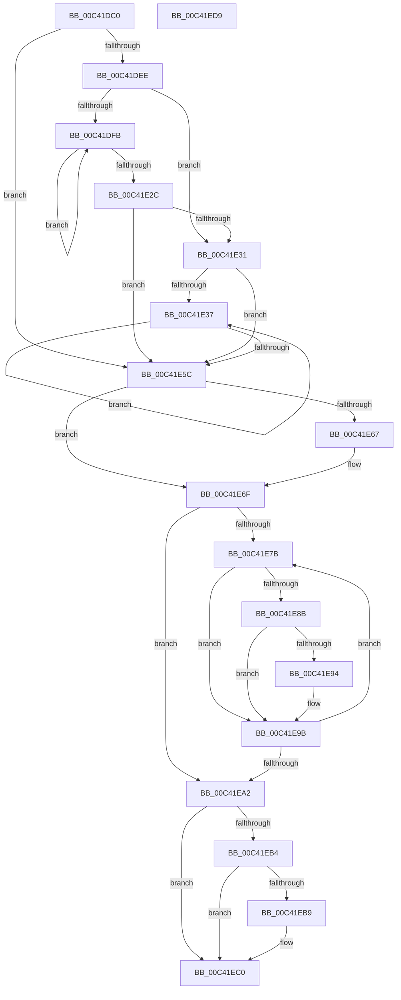

# PpmUpdateArchitecturalEfficiencyClass

- RVA: `0x00C41DC0`–`0x00C41EDA` (길이 `282` bytes)
- VA: `0x0000000140C41DC0`
- 실행 섹션: `INIT`
- PDB 이름 있음: `예`; PDB Function 태그: `아니요`
- unwind 정보 RVA: `0x000A1FF8`
- 디코드: `82`개 명령, `282/282` bytes 표시
- 미해석 바이트: `0` (있으면 어셈블리에 `.byte`로 보존)

> 이 문서는 커널 이미지의 기계어와 PDB 기호를 분석해 생성했습니다. 4번과 5번은 함수 원형과 자료형을 바이너리 사용 방식에서 추정한 C 해석이며 원본 소스 복구 결과는 아닙니다.

## 1. Dependencies

- 직접 호출 지점: **3**; 고유 호출 대상: **1**
- 직접 호출자로 확인된 함수: **1**
- RIP 상대 이미지 참조: **5**

### Outgoing calls
- `0x00C41DFE` → [KeGetPrcb](../../text/2D/KeGetPrcb_function_002D85D0.md) (function, `0x002D85D0`)
- `0x00C41E39` → [KeGetPrcb](../../text/2D/KeGetPrcb_function_002D85D0.md) (function, `0x002D85D0`)
- `0x00C41E7D` → [KeGetPrcb](../../text/2D/KeGetPrcb_function_002D85D0.md) (function, `0x002D85D0`)

### Direct callers
- [PoInitHeteroDetection](../C3/PoInitHeteroDetection_function_00C3D244.md) at `0x00C3D289`

### Static image references
- `0x00C41DD8` → RVA `0x00FC6A80` (`ALMOSTRO`; read)
- `0x00C41E5C` → RVA `0x00FC50B4` (`ALMOSTRO`; read)
- `0x00C41E71` → RVA `0x00FC6C34` (`ALMOSTRO`; write)
- `0x00C41E8B` → RVA `0x00FC6C34` (`ALMOSTRO`; read)
- `0x00C41EA5` → RVA `0x00E0B800` (`.data`; write)

## 2. Other-region calls and transfers

- 다른 실행 섹션으로 향하는 call: **3**
  - `0x00C41DFE` → [KeGetPrcb](../../text/2D/KeGetPrcb_function_002D85D0.md) (`INIT` → `.text`)
  - `0x00C41E39` → [KeGetPrcb](../../text/2D/KeGetPrcb_function_002D85D0.md) (`INIT` → `.text`)
  - `0x00C41E7D` → [KeGetPrcb](../../text/2D/KeGetPrcb_function_002D85D0.md) (`INIT` → `.text`)
- 별도 외부 분기/꼬리 이동을 확인하지 못했습니다.

## 3. Assembly (complete function range)

```asm
00C41DC0  48 89 5C 24 08                  mov qword ptr [rsp + 8], rbx
00C41DC5  48 89 6C 24 10                  mov qword ptr [rsp + 0x10], rbp
00C41DCA  48 89 74 24 18                  mov qword ptr [rsp + 0x18], rsi
00C41DCF  57                              push rdi
00C41DD0  41 54                           push r12
00C41DD2  41 56                           push r14
00C41DD4  48 83 EC 20                     sub rsp, 0x20
00C41DD8  8B 3D A2 4C 38 00               mov edi, dword ptr [rip + 0x384ca2]
00C41DDE  32 DB                           xor bl, bl
00C41DE0  41 BC 01 00 00 00               mov r12d, 1
00C41DE6  81 FF 00 08 00 00               cmp edi, 0x800
00C41DEC  77 6E                           ja 0x140c41e5c
00C41DEE  40 32 ED                        xor bpl, bpl
00C41DF1  45 33 F6                        xor r14d, r14d
00C41DF4  40 B6 FF                        mov sil, 0xff
00C41DF7  85 FF                           test edi, edi
00C41DF9  74 36                           je 0x140c41e31
00C41DFB  41 8B CE                        mov ecx, r14d
00C41DFE  E8 CD 67 69 FF                  call 0x1402d85d0
00C41E03  0F B6 88 4D 8A 00 00            movzx ecx, byte ptr [rax + 0x8a4d]
00C41E0A  40 3A E9                        cmp bpl, cl
00C41E0D  40 0F B6 C5                     movzx eax, bpl
00C41E11  0F 46 C1                        cmovbe eax, ecx
00C41E14  40 3A F1                        cmp sil, cl
00C41E17  40 8A E8                        mov bpl, al
00C41E1A  40 0F B6 C6                     movzx eax, sil
00C41E1E  0F 43 C1                        cmovae eax, ecx
00C41E21  45 03 F4                        add r14d, r12d
00C41E24  40 8A F0                        mov sil, al
00C41E27  44 3B F7                        cmp r14d, edi
00C41E2A  72 CF                           jb 0x140c41dfb
00C41E2C  40 3A E8                        cmp bpl, al
00C41E2F  74 2B                           je 0x140c41e5c
00C41E31  33 ED                           xor ebp, ebp
00C41E33  85 FF                           test edi, edi
00C41E35  74 25                           je 0x140c41e5c
00C41E37  8B CD                           mov ecx, ebp
00C41E39  E8 92 67 69 FF                  call 0x1402d85d0
00C41E3E  0F B6 DB                        movzx ebx, bl
00C41E41  40 38 B0 4D 8A 00 00            cmp byte ptr [rax + 0x8a4d], sil
00C41E48  0F 95 C1                        setne cl
00C41E4B  41 0F 45 DC                     cmovne ebx, r12d
00C41E4F  41 03 EC                        add ebp, r12d
00C41E52  88 88 08 8A 00 00               mov byte ptr [rax + 0x8a08], cl
00C41E58  3B EF                           cmp ebp, edi
00C41E5A  72 DB                           jb 0x140c41e37
00C41E5C  8B 05 52 32 38 00               mov eax, dword ptr [rip + 0x383252]
00C41E62  83 F8 FF                        cmp eax, -1
00C41E65  75 08                           jne 0x140c41e6f
00C41E67  33 C0                           xor eax, eax
00C41E69  80 FB 02                        cmp bl, 2
00C41E6C  0F 93 C0                        setae al
00C41E6F  33 F6                           xor esi, esi
00C41E71  89 05 BD 4D 38 00               mov dword ptr [rip + 0x384dbd], eax
00C41E77  85 FF                           test edi, edi
00C41E79  74 27                           je 0x140c41ea2
00C41E7B  8B CE                           mov ecx, esi
00C41E7D  E8 4E 67 69 FF                  call 0x1402d85d0
00C41E82  80 B8 08 8A 00 00 00            cmp byte ptr [rax + 0x8a08], 0
00C41E89  74 10                           je 0x140c41e9b
00C41E8B  83 3D A2 4D 38 00 00            cmp dword ptr [rip + 0x384da2], 0
00C41E92  75 07                           jne 0x140c41e9b
00C41E94  44 88 A0 08 8A 00 00            mov byte ptr [rax + 0x8a08], r12b
00C41E9B  41 03 F4                        add esi, r12d
00C41E9E  3B F7                           cmp esi, edi
00C41EA0  72 D9                           jb 0x140c41e7b
00C41EA2  41 02 DC                        add bl, r12b
00C41EA5  88 1D 55 99 1C 00               mov byte ptr [rip + 0x1c9955], bl
00C41EAB  83 3D 82 4D 38 00 00            cmp dword ptr [rip + 0x384d82], 0
00C41EB2  75 0C                           jne 0x140c41ec0
00C41EB4  80 FB 02                        cmp bl, 2
00C41EB7  72 07                           jb 0x140c41ec0
00C41EB9  C6 05 40 99 1C 00 02            mov byte ptr [rip + 0x1c9940], 2
00C41EC0  48 8B 5C 24 40                  mov rbx, qword ptr [rsp + 0x40]
00C41EC5  48 8B 6C 24 48                  mov rbp, qword ptr [rsp + 0x48]
00C41ECA  48 8B 74 24 50                  mov rsi, qword ptr [rsp + 0x50]
00C41ECF  48 83 C4 20                     add rsp, 0x20
00C41ED3  41 5E                           pop r14
00C41ED5  41 5C                           pop r12
00C41ED7  5F                              pop rdi
00C41ED8  C3                              ret
00C41ED9  CC                              int3
```

## 4. C-style interpretation (structured pseudocode)

```c
__int64 __fastcall PpmUpdateArchitecturalEfficiencyClass(void)
{
    __int64 result;
    __int64 v_r14;
    __int64 v_rbp;
    __int64 v_rbx;
    __int64 v_rsi;
    __int64 v_rsp;
    unsigned __int64 v_stack_p10;
    unsigned __int64 v_stack_p18;
    unsigned __int64 v_stack_p8;

    v_stack_p8 = v_rbx;
    v_stack_p10 = v_rbp;
    v_stack_p18 = v_rsi;
    v_rsp = (v_rsp) - (32);
    v_rbx = 0;
    if (((unsigned int)((unsigned int)(*(unsigned int *)(v_rip + 3689634)))) > 0x800ULL) goto loc_00C41E5C;
    v_rbp = 0;
    v_r14 = 0;
    if ((unsigned int)((unsigned int)(*(unsigned int *)(v_rip + 3689634))) == 0) goto loc_00C41E31;
loc_00C41DFB:
    result = KeGetPrcb(0, a2, a3, a4);
    result = 0;
    if (0 <= ((unsigned __int8)(*(unsigned __int8 *)(result + 35405)))) { result = (unsigned int)(*(unsigned __int8 *)(result + 35405)); }
    result = 255;
    if (255 >= ((unsigned __int8)(*(unsigned __int8 *)(result + 35405)))) { result = (unsigned int)(*(unsigned __int8 *)(result + 35405)); }
    v_r14 = (unsigned int)((v_r14) + (1));
    if (((unsigned int)(v_r14)) < ((unsigned int)((unsigned int)(*(unsigned int *)(v_rip + 3689634))))) goto loc_00C41DFB;
    if (((unsigned __int8)((unsigned __int8)(result))) == ((unsigned __int8)(result))) goto loc_00C41E5C;
loc_00C41E31:
    v_rbp = 0;
    if ((unsigned int)((unsigned int)(*(unsigned int *)(v_rip + 3689634))) == 0) goto loc_00C41E5C;
loc_00C41E37:
    result = KeGetPrcb(0, a2, a3, a4);
    a1 = ((*(unsigned __int8 *)(result + 35405)) != ((unsigned __int8)((unsigned __int8)(result)))) ? 1 : 0;
    v_rbx = 0;
    if ((*(unsigned __int8 *)(result + 35405)) != ((unsigned __int8)((unsigned __int8)(result)))) { v_rbx = 1; }
    v_rbp = (unsigned int)((v_rbp) + (1));
    *(unsigned __int8 *)(result + 35336) = (unsigned __int8)(a1);
    if (((unsigned int)(v_rbp)) < ((unsigned int)((unsigned int)(*(unsigned int *)(v_rip + 3689634))))) goto loc_00C41E37;
loc_00C41E5C:
    result = (unsigned int)(*(unsigned int *)(v_rip + 3682898));
    if (((unsigned int)((unsigned int)(*(unsigned int *)(v_rip + 3682898)))) == -1) {
        result = 0;
        result = (((unsigned __int8)(v_rbx)) >= 2) ? 1 : 0;
    }
    v_rsi = 0;
    *(unsigned int *)(v_rip + 3689917) = (unsigned int)(result);
    if ((unsigned int)((unsigned int)(*(unsigned int *)(v_rip + 3689634))) == 0) goto loc_00C41EA2;
loc_00C41E7B:
    result = KeGetPrcb(0, a2, a3, a4);
    if ((*(unsigned __int8 *)(result + 35336)) == 0) goto loc_00C41E9B;
    if ((*(unsigned int *)(v_rip + 3689890)) == 0) {
        *(unsigned __int8 *)(result + 35336) = 1;
    }
    v_rsi = (unsigned int)((v_rsi) + (1));
    if (((unsigned int)(v_rsi)) < ((unsigned int)((unsigned int)(*(unsigned int *)(v_rip + 3689634))))) goto loc_00C41E7B;
loc_00C41EA2:
    v_rbx = (unsigned __int8)((v_rbx) + (1));
    *(unsigned __int8 *)(v_rip + 1874261) = (unsigned __int8)(v_rbx);
    if ((*(unsigned int *)(v_rip + 3689858)) != 0) goto loc_00C41EC0;
    if (((unsigned __int8)(v_rbx)) >= 2) {
        *(unsigned __int8 *)(v_rip + 1874240) = 2;
    }
    v_rsp = (v_rsp) + (32);
    return result;
}
```

## 5. (Beta) C Style

```c
void PpmUpdateArchitecturalEfficiencyClass(void)
{
    int64_t result;
    int64_t local_r14;
    int64_t local_rbp;
    int64_t local_rbx;
    int64_t local_rsi;
    int64_t local_rsp;
    uint64_t v_stack_p10;
    uint64_t v_stack_p18;
    uint64_t v_stack_p8;

    v_stack_p8 = local_rbx;
    v_stack_p10 = local_rbp;
    v_stack_p18 = local_rsi;
    local_rsp = (local_rsp) - (32);
    local_rbx = 0;
    if (((uint32_t)((uint32_t)(*(uint32_t *)(v_rip + 0x384CA2)))) > 0x800ULL) goto loc_00C41E5C;
    local_rbp = 0;
    local_r14 = 0;
    if ((uint32_t)((uint32_t)(*(uint32_t *)(v_rip + 0x384CA2))) == 0) goto loc_00C41E31;
loc_00C41DFB:
    result = KeGetPrcb(0, a2, a3, a4);
    result = 0;
    if (0 <= ((uint8_t)(*(uint8_t *)(result + 0x8A4D)))) { result = (uint32_t)(*(uint8_t *)(result + 0x8A4D)); }
    result = 255;
    if (255 >= ((uint8_t)(*(uint8_t *)(result + 0x8A4D)))) { result = (uint32_t)(*(uint8_t *)(result + 0x8A4D)); }
    local_r14 = (uint32_t)((local_r14) + (1));
    if (((uint32_t)(local_r14)) < ((uint32_t)((uint32_t)(*(uint32_t *)(v_rip + 0x384CA2))))) goto loc_00C41DFB;
    if (((uint8_t)((uint8_t)(result))) == ((uint8_t)(result))) goto loc_00C41E5C;
loc_00C41E31:
    local_rbp = 0;
    if ((uint32_t)((uint32_t)(*(uint32_t *)(v_rip + 0x384CA2))) == 0) goto loc_00C41E5C;
loc_00C41E37:
    result = KeGetPrcb(0, a2, a3, a4);
    a1 = ((*(uint8_t *)(result + 0x8A4D)) != ((uint8_t)((uint8_t)(result)))) ? 1 : 0;
    local_rbx = 0;
    if ((*(uint8_t *)(result + 0x8A4D)) != ((uint8_t)((uint8_t)(result)))) { local_rbx = 1; }
    local_rbp = (uint32_t)((local_rbp) + (1));
    *(uint8_t *)(result + 0x8A08) = (uint8_t)(a1);
    if (((uint32_t)(local_rbp)) < ((uint32_t)((uint32_t)(*(uint32_t *)(v_rip + 0x384CA2))))) goto loc_00C41E37;
loc_00C41E5C:
    result = (uint32_t)(*(uint32_t *)(v_rip + 0x383252));
    if (((uint32_t)((uint32_t)(*(uint32_t *)(v_rip + 0x383252)))) == -1) {
        result = 0;
        result = (((uint8_t)(local_rbx)) >= 2) ? 1 : 0;
    }
    local_rsi = 0;
    *(uint32_t *)(v_rip + 0x384DBD) = (uint32_t)(result);
    if ((uint32_t)((uint32_t)(*(uint32_t *)(v_rip + 0x384CA2))) == 0) goto loc_00C41EA2;
loc_00C41E7B:
    result = KeGetPrcb(0, a2, a3, a4);
    if ((*(uint8_t *)(result + 0x8A08)) == 0) goto loc_00C41E9B;
    if ((*(uint32_t *)(v_rip + 0x384DA2)) == 0) {
        *(uint8_t *)(result + 0x8A08) = 1;
    }
    local_rsi = (uint32_t)((local_rsi) + (1));
    if (((uint32_t)(local_rsi)) < ((uint32_t)((uint32_t)(*(uint32_t *)(v_rip + 0x384CA2))))) goto loc_00C41E7B;
loc_00C41EA2:
    local_rbx = (uint8_t)((local_rbx) + (1));
    *(uint8_t *)(v_rip + 0x1C9955) = (uint8_t)(local_rbx);
    if ((*(uint32_t *)(v_rip + 0x384D82)) != 0) goto loc_00C41EC0;
    if (((uint8_t)(local_rbx)) >= 2) {
        *(uint8_t *)(v_rip + 0x1C9940) = 2;
    }
    local_rsp = (local_rsp) + (32);
    return result;
}
```

## 6. Execution-region graph

[열기: 2D/3D 그래프와 함수 탐색 컨트롤 패널](../../../control-panel.html?section=init&rva=0x00C41DC0&view=graph)

- 2D 그래프는 위에서 아래로 흐르고, 3D 그래프는 빈 공간을 드래그해 회전합니다. Shift+드래그는 이동, 휠은 확대·축소, 함수 노드 선택은 대상 보고서 이동입니다.

### Static fallback


