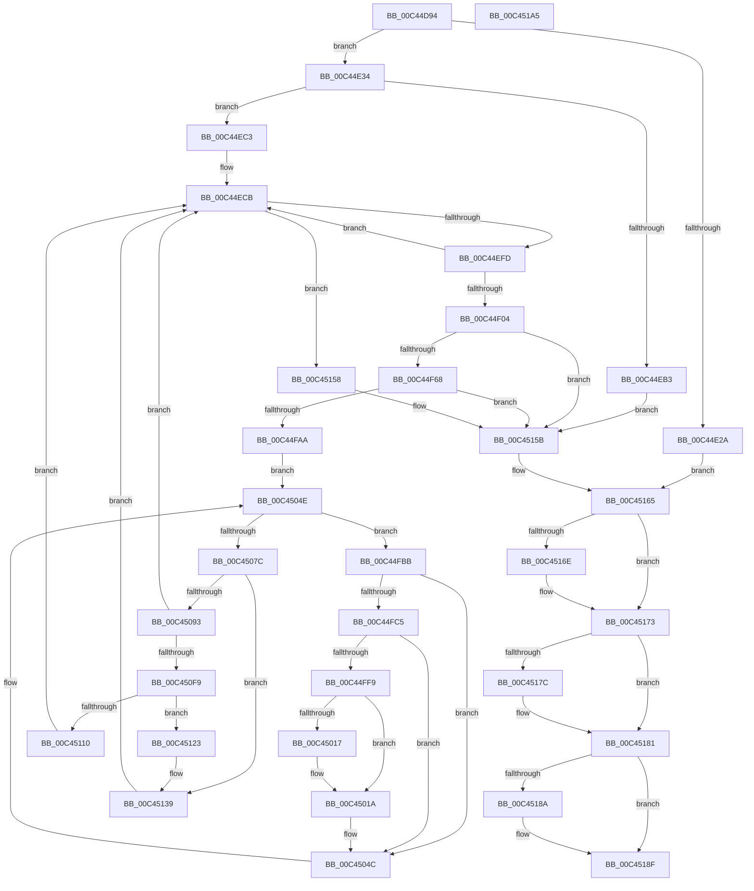

# PsInitializeBootCpuPartitions

- RVA: `0x00C44D94`–`0x00C451A6` (길이 `1,042` bytes)
- VA: `0x0000000140C44D94`
- 실행 섹션: `INIT`
- PDB 이름 있음: `예`; PDB Function 태그: `아니요`
- unwind 정보 RVA: `0x000CE060`
- 디코드: `254`개 명령, `1,042/1,042` bytes 표시
- 미해석 바이트: `0` (있으면 어셈블리에 `.byte`로 보존)

> 이 문서는 커널 이미지의 기계어와 PDB 기호를 분석해 생성했습니다. 4번과 5번은 함수 원형과 자료형을 바이너리 사용 방식에서 추정한 C 해석이며 원본 소스 복구 결과는 아닙니다.

## 1. Dependencies

- 직접 호출 지점: **25**; 고유 호출 대상: **16**
- 직접 호출자로 확인된 함수: **1**
- RIP 상대 이미지 참조: **5**

### Outgoing calls
- `0x00C44E1D` → [ExAllocatePool2](../../poolcode/B8/ExAllocatePool2_function_00B820F0.md) (function, `0x00B820F0`)
- `0x00C44E52` → [memset](../../text/6C/memset_function_006C6C40.md) (function, `0x006C6C40`)
- `0x00C44E6E` → [memset](../../text/6C/memset_function_006C6C40.md) (function, `0x006C6C40`)
- `0x00C44EAA` → [ZwOpenKey](../../text/6A/ZwOpenKey_function_006AD310.md) (function, `0x006AD310`)
- `0x00C44EED` → [ZwEnumerateKey](../../text/6A/ZwEnumerateKey_function_006AD710.md) (function, `0x006AD710`)
- `0x00C44F21` → [RtlInitUnicodeString](../../text/42/RtlInitUnicodeString_function_0042A780.md) (function, `0x0042A780`)
- `0x00C44F59` → [ZwOpenKey](../../text/6A/ZwOpenKey_function_006AD310.md) (function, `0x006AD310`)
- `0x00C44F9B` → [ZwOpenKey](../../text/6A/ZwOpenKey_function_006AD310.md) (function, `0x006AD310`)
- `0x00C44FF0` → [RtlUnicodeStringToInteger](../../page/99/RtlUnicodeStringToInteger_function_00993480.md) (function, `0x00993480`)
- `0x00C45001` → [memset](../../text/6C/memset_function_006C6C40.md) (function, `0x006C6C40`)
- `0x00C45029` → [memcpy](../../text/6C/memcpy_function_006C6840.md) (function, `0x006C6840`)
- `0x00C45039` → [PspCopyNodeRelativeMaskToAffinityEx](PspCopyNodeRelativeMaskToAffinityEx_function_00C451AC.md) (function, `0x00C451AC`)
- `0x00C45047` → [KeOrAffinityEx2](../../text/2C/KeOrAffinityEx2_function_002CF930.md) (function, `0x002CF930`)
- `0x00C4506C` → [ZwEnumerateValueKey](../../text/6A/ZwEnumerateValueKey_function_006AD330.md) (function, `0x006AD330`)
- `0x00C4507F` → [KeIsEmptyAffinityEx](../../text/2D/KeIsEmptyAffinityEx_function_002D1580.md) (function, `0x002D1580`)
- `0x00C450EC` → [PsCreateCpuPartition](../../page/78/PsCreateCpuPartition_function_00783A8C.md) (function, `0x00783A8C`)
- `0x00C45107` → [PsCpuPartitionMoveCpus](../../page/78/PsCpuPartitionMoveCpus_function_00783A6C.md) (function, `0x00783A6C`)
- `0x00C45119` → [ObfDereferenceObjectWithTag](../../text/2F/ObfDereferenceObjectWithTag_function_002F78E0.md) (function, `0x002F78E0`)
- `0x00C45131` → [memset](../../text/6C/memset_function_006C6C40.md) (function, `0x006C6C40`)
- `0x00C4513D` → [ZwClose](../../text/6A/ZwClose_function_006AD2B0.md) (function, `0x006AD2B0`)
- `0x00C4514A` → [ZwClose](../../text/6A/ZwClose_function_006AD2B0.md) (function, `0x006AD2B0`)
- `0x00C45160` → [ExFreePoolWithTag](../../poolcode/B8/ExFreePoolWithTag_function_00B82870.md) (function, `0x00B82870`)
- `0x00C4516E` → [ZwClose](../../text/6A/ZwClose_function_006AD2B0.md) (function, `0x006AD2B0`)
- `0x00C4517C` → [ZwClose](../../text/6A/ZwClose_function_006AD2B0.md) (function, `0x006AD2B0`)
- `0x00C4518A` → [ZwClose](../../text/6A/ZwClose_function_006AD2B0.md) (function, `0x006AD2B0`)

### Direct callers
- [Phase1InitializationDiscard](../C1/Phase1InitializationDiscard_function_00C1C728.md) at `0x00C1D3CD`

### Static image references
- `0x00C44DCD` → RVA `0x00C7C7E0` (` ?? ::PBOPGDP::`string'`; read)
- `0x00C44DE0` → RVA `0x00C7C8A0` (` ?? ::PBOPGDP::`string'`; read)
- `0x00C45093` → RVA `0x00FC72D0` (`ALMOSTRO`; read)
- `0x00C450B5` → RVA `0x00FC7020` (`ALMOSTRO`; read)
- `0x00C450CE` → RVA `0x00FC6D78` (`ALMOSTRO`; read)

## 2. Other-region calls and transfers

- 다른 실행 섹션으로 향하는 call: **24**
  - `0x00C44E1D` → [ExAllocatePool2](../../poolcode/B8/ExAllocatePool2_function_00B820F0.md) (`INIT` → `POOLCODE`)
  - `0x00C44E52` → [memset](../../text/6C/memset_function_006C6C40.md) (`INIT` → `.text`)
  - `0x00C44E6E` → [memset](../../text/6C/memset_function_006C6C40.md) (`INIT` → `.text`)
  - `0x00C44EAA` → [ZwOpenKey](../../text/6A/ZwOpenKey_function_006AD310.md) (`INIT` → `.text`)
  - `0x00C44EED` → [ZwEnumerateKey](../../text/6A/ZwEnumerateKey_function_006AD710.md) (`INIT` → `.text`)
  - `0x00C44F21` → [RtlInitUnicodeString](../../text/42/RtlInitUnicodeString_function_0042A780.md) (`INIT` → `.text`)
  - `0x00C44F59` → [ZwOpenKey](../../text/6A/ZwOpenKey_function_006AD310.md) (`INIT` → `.text`)
  - `0x00C44F9B` → [ZwOpenKey](../../text/6A/ZwOpenKey_function_006AD310.md) (`INIT` → `.text`)
  - `0x00C44FF0` → [RtlUnicodeStringToInteger](../../page/99/RtlUnicodeStringToInteger_function_00993480.md) (`INIT` → `PAGE`)
  - `0x00C45001` → [memset](../../text/6C/memset_function_006C6C40.md) (`INIT` → `.text`)
  - `0x00C45029` → [memcpy](../../text/6C/memcpy_function_006C6840.md) (`INIT` → `.text`)
  - `0x00C45047` → [KeOrAffinityEx2](../../text/2C/KeOrAffinityEx2_function_002CF930.md) (`INIT` → `.text`)
  - `0x00C4506C` → [ZwEnumerateValueKey](../../text/6A/ZwEnumerateValueKey_function_006AD330.md) (`INIT` → `.text`)
  - `0x00C4507F` → [KeIsEmptyAffinityEx](../../text/2D/KeIsEmptyAffinityEx_function_002D1580.md) (`INIT` → `.text`)
  - `0x00C450EC` → [PsCreateCpuPartition](../../page/78/PsCreateCpuPartition_function_00783A8C.md) (`INIT` → `PAGE`)
  - `0x00C45107` → [PsCpuPartitionMoveCpus](../../page/78/PsCpuPartitionMoveCpus_function_00783A6C.md) (`INIT` → `PAGE`)
  - `0x00C45119` → [ObfDereferenceObjectWithTag](../../text/2F/ObfDereferenceObjectWithTag_function_002F78E0.md) (`INIT` → `.text`)
  - `0x00C45131` → [memset](../../text/6C/memset_function_006C6C40.md) (`INIT` → `.text`)
  - `0x00C4513D` → [ZwClose](../../text/6A/ZwClose_function_006AD2B0.md) (`INIT` → `.text`)
  - `0x00C4514A` → [ZwClose](../../text/6A/ZwClose_function_006AD2B0.md) (`INIT` → `.text`)
  - `0x00C45160` → [ExFreePoolWithTag](../../poolcode/B8/ExFreePoolWithTag_function_00B82870.md) (`INIT` → `POOLCODE`)
  - `0x00C4516E` → [ZwClose](../../text/6A/ZwClose_function_006AD2B0.md) (`INIT` → `.text`)
  - `0x00C4517C` → [ZwClose](../../text/6A/ZwClose_function_006AD2B0.md) (`INIT` → `.text`)
  - `0x00C4518A` → [ZwClose](../../text/6A/ZwClose_function_006AD2B0.md) (`INIT` → `.text`)
- 별도 외부 분기/꼬리 이동을 확인하지 못했습니다.

## 3. Assembly (complete function range)

```asm
00C44D94  40 55                           push rbp
00C44D96  53                              push rbx
00C44D97  56                              push rsi
00C44D98  57                              push rdi
00C44D99  41 54                           push r12
00C44D9B  41 55                           push r13
00C44D9D  41 56                           push r14
00C44D9F  41 57                           push r15
00C44DA1  48 8D 6C 24 E1                  lea rbp, [rsp - 0x1f]
00C44DA6  48 81 EC D8 00 00 00            sub rsp, 0xd8
00C44DAD  45 33 FF                        xor r15d, r15d
00C44DB0  48 C7 45 D7 B0 00 B2 00         mov qword ptr [rbp - 0x29], 0xb200b0
00C44DB8  33 C0                           xor eax, eax
00C44DBA  4C 89 7D BF                     mov qword ptr [rbp - 0x41], r15
00C44DBE  0F 57 C0                        xorps xmm0, xmm0
00C44DC1  48 89 45 AF                     mov qword ptr [rbp - 0x51], rax
00C44DC5  89 45 B7                        mov dword ptr [rbp - 0x49], eax
00C44DC8  BA 40 06 00 00                  mov edx, 0x640
00C44DCD  48 8D 05 0C 7A 03 00            lea rax, [rip + 0x37a0c]
00C44DD4  44 89 7D 6F                     mov dword ptr [rbp + 0x6f], r15d
00C44DD8  48 89 45 DF                     mov qword ptr [rbp - 0x21], rax
00C44DDC  41 8D 4F 40                     lea ecx, [r15 + 0x40]
00C44DE0  48 8D 05 B9 7A 03 00            lea rax, [rip + 0x37ab9]
00C44DE7  44 89 7D 67                     mov dword ptr [rbp + 0x67], r15d
00C44DEB  41 B8 50 73 70 50               mov r8d, 0x50707350
00C44DF1  48 89 45 EF                     mov qword ptr [rbp - 0x11], rax
00C44DF5  0F 11 45 C7                     movups xmmword ptr [rbp - 0x39], xmm0
00C44DF9  44 89 7D FB                     mov dword ptr [rbp - 5], r15d
00C44DFD  0F 11 45 8F                     movups xmmword ptr [rbp - 0x71], xmm0
00C44E01  48 C7 45 E7 0A 00 0C 00         mov qword ptr [rbp - 0x19], 0xc000a
00C44E09  0F 11 45 9F                     movups xmmword ptr [rbp - 0x61], xmm0
00C44E0D  4C 89 7D 87                     mov qword ptr [rbp - 0x79], r15
00C44E11  0F 11 45 07                     movups xmmword ptr [rbp + 7], xmm0
00C44E15  4C 89 7D 7F                     mov qword ptr [rbp + 0x7f], r15
00C44E19  4C 89 7D 77                     mov qword ptr [rbp + 0x77], r15
00C44E1D  E8 CE D2 F3 FF                  call 0x140b820f0
00C44E22  48 8B F8                        mov rdi, rax
00C44E25  48 85 C0                        test rax, rax
00C44E28  75 0A                           jne 0x140c44e34
00C44E2A  BB 9A 00 00 C0                  mov ebx, 0xc000009a
00C44E2F  E9 31 03 00 00                  jmp 0x140c45165
00C44E34  4C 8D A8 18 02 00 00            lea r13, [rax + 0x218]
00C44E3B  41 BC 00 01 00 00               mov r12d, 0x100
00C44E41  49 8D 4D 08                     lea rcx, [r13 + 8]
00C44E45  49 C7 45 00 01 00 20 00         mov qword ptr [r13], 0x200001
00C44E4D  45 8B C4                        mov r8d, r12d
00C44E50  33 D2                           xor edx, edx
00C44E52  E8 E9 1D A8 FF                  call 0x1406c6c40
00C44E57  48 8D B7 20 03 00 00            lea rsi, [rdi + 0x320]
00C44E5E  45 8B C4                        mov r8d, r12d
00C44E61  48 8D 4E 08                     lea rcx, [rsi + 8]
00C44E65  48 C7 06 01 00 20 00            mov qword ptr [rsi], 0x200001
00C44E6C  33 D2                           xor edx, edx
00C44E6E  E8 CD 1D A8 FF                  call 0x1406c6c40
00C44E73  48 8D 45 D7                     lea rax, [rbp - 0x29]
00C44E77  44 89 65 F7                     mov dword ptr [rbp - 9], r12d
00C44E7B  0F 57 C0                        xorps xmm0, xmm0
00C44E7E  48 89 45 9F                     mov qword ptr [rbp - 0x61], rax
00C44E82  4C 8D 45 8F                     lea r8, [rbp - 0x71]
00C44E86  48 89 7D FF                     mov qword ptr [rbp - 1], rdi
00C44E8A  BA 08 00 00 00                  mov edx, 8
00C44E8F  C7 45 8F 30 00 00 00            mov dword ptr [rbp - 0x71], 0x30
00C44E96  48 8D 4D 87                     lea rcx, [rbp - 0x79]
00C44E9A  4C 89 7D 97                     mov qword ptr [rbp - 0x69], r15
00C44E9E  F3 0F 7F 45 AF                  movdqu xmmword ptr [rbp - 0x51], xmm0
00C44EA3  C7 45 A7 40 02 00 00            mov dword ptr [rbp - 0x59], 0x240
00C44EAA  E8 61 84 A6 FF                  call 0x1406ad310
00C44EAF  85 C0                           test eax, eax
00C44EB1  79 10                           jns 0x140c44ec3
00C44EB3  3D 34 00 00 C0                  cmp eax, 0xc0000034
00C44EB8  41 8B DF                        mov ebx, r15d
00C44EBB  0F 45 D8                        cmovne ebx, eax
00C44EBE  E9 98 02 00 00                  jmp 0x140c4515b
00C44EC3  45 8B F7                        mov r14d, r15d
00C44EC6  BB 01 00 00 00                  mov ebx, 1
00C44ECB  48 8B 4D 87                     mov rcx, qword ptr [rbp - 0x79]
00C44ECF  48 8D 45 67                     lea rax, [rbp + 0x67]
00C44ED3  48 89 44 24 28                  mov qword ptr [rsp + 0x28], rax
00C44ED8  4C 8D 8F 28 04 00 00            lea r9, [rdi + 0x428]
00C44EDF  45 33 C0                        xor r8d, r8d
00C44EE2  C7 44 24 20 16 02 00 00         mov dword ptr [rsp + 0x20], 0x216
00C44EEA  41 8B D6                        mov edx, r14d
00C44EED  E8 1E 88 A6 FF                  call 0x1406ad710
00C44EF2  3D 1A 00 00 80                  cmp eax, 0x8000001a
00C44EF7  0F 84 5B 02 00 00               je 0x140c45158
00C44EFD  44 03 F3                        add r14d, ebx
00C44F00  85 C0                           test eax, eax
00C44F02  78 C7                           js 0x140c44ecb
00C44F04  8B 87 34 04 00 00               mov eax, dword ptr [rdi + 0x434]
00C44F0A  48 8D 97 38 04 00 00            lea rdx, [rdi + 0x438]
00C44F11  48 D1 E8                        shr rax, 1
00C44F14  48 8D 4D 07                     lea rcx, [rbp + 7]
00C44F18  66 44 89 BC 47 38 04 00 00      mov word ptr [rdi + rax*2 + 0x438], r15w
00C44F21  E8 5A 58 7E FF                  call 0x14042a780
00C44F26  48 8B 45 87                     mov rax, qword ptr [rbp - 0x79]
00C44F2A  4C 8D 45 8F                     lea r8, [rbp - 0x71]
00C44F2E  48 89 45 97                     mov qword ptr [rbp - 0x69], rax
00C44F32  48 8D 4D 7F                     lea rcx, [rbp + 0x7f]
00C44F36  48 8D 45 07                     lea rax, [rbp + 7]
00C44F3A  C7 45 8F 30 00 00 00            mov dword ptr [rbp - 0x71], 0x30
00C44F41  0F 57 C0                        xorps xmm0, xmm0
00C44F44  48 89 45 9F                     mov qword ptr [rbp - 0x61], rax
00C44F48  BA 08 00 00 00                  mov edx, 8
00C44F4D  C7 45 A7 40 02 00 00            mov dword ptr [rbp - 0x59], 0x240
00C44F54  F3 0F 7F 45 AF                  movdqu xmmword ptr [rbp - 0x51], xmm0
00C44F59  E8 B2 83 A6 FF                  call 0x1406ad310
00C44F5E  8B D8                           mov ebx, eax
00C44F60  85 C0                           test eax, eax
00C44F62  0F 88 F3 01 00 00               js 0x140c4515b
00C44F68  48 8B 45 7F                     mov rax, qword ptr [rbp + 0x7f]
00C44F6C  4C 8D 45 8F                     lea r8, [rbp - 0x71]
00C44F70  48 89 45 97                     mov qword ptr [rbp - 0x69], rax
00C44F74  48 8D 4D 77                     lea rcx, [rbp + 0x77]
00C44F78  48 8D 45 E7                     lea rax, [rbp - 0x19]
00C44F7C  C7 45 8F 30 00 00 00            mov dword ptr [rbp - 0x71], 0x30
00C44F83  0F 57 C0                        xorps xmm0, xmm0
00C44F86  48 89 45 9F                     mov qword ptr [rbp - 0x61], rax
00C44F8A  BA 01 00 00 00                  mov edx, 1
00C44F8F  C7 45 A7 40 02 00 00            mov dword ptr [rbp - 0x59], 0x240
00C44F96  F3 0F 7F 45 AF                  movdqu xmmword ptr [rbp - 0x51], xmm0
00C44F9B  E8 70 83 A6 FF                  call 0x1406ad310
00C44FA0  8B D8                           mov ebx, eax
00C44FA2  85 C0                           test eax, eax
00C44FA4  0F 88 B1 01 00 00               js 0x140c4515b
00C44FAA  41 8B DF                        mov ebx, r15d
00C44FAD  33 D2                           xor edx, edx
00C44FAF  4C 8D BF 00 01 00 00            lea r15, [rdi + 0x100]
00C44FB6  E9 93 00 00 00                  jmp 0x140c4504e
00C44FBB  FF C3                           inc ebx
00C44FBD  85 C0                           test eax, eax
00C44FBF  0F 88 87 00 00 00               js 0x140c4504c
00C44FC5  83 65 CB 00                     and dword ptr [rbp - 0x35], 0
00C44FC9  48 8D 87 14 01 00 00            lea rax, [rdi + 0x114]
00C44FD0  48 89 45 CF                     mov qword ptr [rbp - 0x31], rax
00C44FD4  4C 8D 45 6F                     lea r8, [rbp + 0x6f]
00C44FD8  0F B7 87 10 01 00 00            movzx eax, word ptr [rdi + 0x110]
00C44FDF  48 8D 4D C7                     lea rcx, [rbp - 0x39]
00C44FE3  BA 0A 00 00 00                  mov edx, 0xa
00C44FE8  66 89 45 C7                     mov word ptr [rbp - 0x39], ax
00C44FEC  66 89 45 C9                     mov word ptr [rbp - 0x37], ax
00C44FF0  E8 8B E4 D4 FF                  call 0x140993480
00C44FF5  85 C0                           test eax, eax
00C44FF7  78 53                           js 0x140c4504c
00C44FF9  33 D2                           xor edx, edx
00C44FFB  4D 8B C4                        mov r8, r12
00C44FFE  48 8B CF                        mov rcx, rdi
00C45001  E8 3A 1C A8 FF                  call 0x1406c6c40
00C45006  8B 87 0C 01 00 00               mov eax, dword ptr [rdi + 0x10c]
00C4500C  49 8B CC                        mov rcx, r12
00C4500F  4C 8B C1                        mov r8, rcx
00C45012  41 3B C4                        cmp eax, r12d
00C45015  77 03                           ja 0x140c4501a
00C45017  44 8B C0                        mov r8d, eax
00C4501A  8B 97 08 01 00 00               mov edx, dword ptr [rdi + 0x108]
00C45020  48 03 D1                        add rdx, rcx
00C45023  48 8B CF                        mov rcx, rdi
00C45026  48 03 D7                        add rdx, rdi
00C45029  E8 12 18 A8 FF                  call 0x1406c6840
00C4502E  0F B7 4D 6F                     movzx ecx, word ptr [rbp + 0x6f]
00C45032  48 8D 55 F7                     lea rdx, [rbp - 9]
00C45036  4D 8B C5                        mov r8, r13
00C45039  E8 6E 01 00 00                  call 0x140c451ac
00C4503E  4C 8B C6                        mov r8, rsi
00C45041  49 8B D5                        mov rdx, r13
00C45044  48 8B CE                        mov rcx, rsi
00C45047  E8 E4 A8 68 FF                  call 0x1402cf930
00C4504C  8B D3                           mov edx, ebx
00C4504E  48 8B 4D 77                     mov rcx, qword ptr [rbp + 0x77]
00C45052  48 8D 45 67                     lea rax, [rbp + 0x67]
00C45056  48 89 44 24 28                  mov qword ptr [rsp + 0x28], rax
00C4505B  4D 8B CF                        mov r9, r15
00C4505E  41 B8 01 00 00 00               mov r8d, 1
00C45064  C7 44 24 20 18 01 00 00         mov dword ptr [rsp + 0x20], 0x118
00C4506C  E8 BF 82 A6 FF                  call 0x1406ad330
00C45071  3D 1A 00 00 80                  cmp eax, 0x8000001a
00C45076  0F 85 3F FF FF FF               jne 0x140c44fbb
00C4507C  48 8B CE                        mov rcx, rsi
00C4507F  E8 FC C4 68 FF                  call 0x1402d1580
00C45084  45 33 FF                        xor r15d, r15d
00C45087  41 8D 5F 01                     lea ebx, [r15 + 1]
00C4508B  85 C0                           test eax, eax
00C4508D  0F 85 A6 00 00 00               jne 0x140c45139
00C45093  48 8B 05 36 22 38 00            mov rax, qword ptr [rip + 0x382236]
00C4509A  48 8D 4D 8F                     lea rcx, [rbp - 0x71]
00C4509E  48 89 45 97                     mov qword ptr [rbp - 0x69], rax
00C450A2  44 8B CB                        mov r9d, ebx
00C450A5  48 8D 45 07                     lea rax, [rbp + 7]
00C450A9  4C 89 7C 24 30                  mov qword ptr [rsp + 0x30], r15
00C450AE  48 89 45 9F                     mov qword ptr [rbp - 0x61], rax
00C450B2  45 33 C0                        xor r8d, r8d
00C450B5  48 8B 05 64 1F 38 00            mov rax, qword ptr [rip + 0x381f64]
00C450BC  BA 07 00 0E 00                  mov edx, 0xe0007
00C450C1  48 89 45 AF                     mov qword ptr [rbp - 0x51], rax
00C450C5  48 8D 45 BF                     lea rax, [rbp - 0x41]
00C450C9  48 89 44 24 28                  mov qword ptr [rsp + 0x28], rax
00C450CE  48 8B 05 A3 1C 38 00            mov rax, qword ptr [rip + 0x381ca3]
00C450D5  48 89 44 24 20                  mov qword ptr [rsp + 0x20], rax
00C450DA  C7 45 8F 30 00 00 00            mov dword ptr [rbp - 0x71], 0x30
00C450E1  C7 45 A7 50 02 00 00            mov dword ptr [rbp - 0x59], 0x250
00C450E8  4C 89 7D B7                     mov qword ptr [rbp - 0x49], r15
00C450EC  E8 9B E9 B3 FF                  call 0x140783a8c
00C450F1  85 C0                           test eax, eax
00C450F3  0F 88 D2 FD FF FF               js 0x140c44ecb
00C450F9  48 8B 15 78 1C 38 00            mov rdx, qword ptr [rip + 0x381c78]
00C45100  4C 8B C6                        mov r8, rsi
00C45103  48 8B 4D BF                     mov rcx, qword ptr [rbp - 0x41]
00C45107  E8 60 E9 B3 FF                  call 0x140783a6c
00C4510C  85 C0                           test eax, eax
00C4510E  79 13                           jns 0x140c45123
00C45110  48 8B 4D BF                     mov rcx, qword ptr [rbp - 0x41]
00C45114  BA 44 66 6C 74                  mov edx, 0x746c6644
00C45119  E8 C2 27 6B FF                  call 0x1402f78e0
00C4511E  E9 A8 FD FF FF                  jmp 0x140c44ecb
00C45123  44 0F B7 06                     movzx r8d, word ptr [rsi]
00C45127  48 8D 4E 08                     lea rcx, [rsi + 8]
00C4512B  49 C1 E0 03                     shl r8, 3
00C4512F  33 D2                           xor edx, edx
00C45131  E8 0A 1B A8 FF                  call 0x1406c6c40
00C45136  66 89 1E                        mov word ptr [rsi], bx
00C45139  48 8B 4D 7F                     mov rcx, qword ptr [rbp + 0x7f]
00C4513D  E8 6E 81 A6 FF                  call 0x1406ad2b0
00C45142  48 8B 4D 77                     mov rcx, qword ptr [rbp + 0x77]
00C45146  4C 89 7D 7F                     mov qword ptr [rbp + 0x7f], r15
00C4514A  E8 61 81 A6 FF                  call 0x1406ad2b0
00C4514F  4C 89 7D 77                     mov qword ptr [rbp + 0x77], r15
00C45153  E9 73 FD FF FF                  jmp 0x140c44ecb
00C45158  41 8B DF                        mov ebx, r15d
00C4515B  33 D2                           xor edx, edx
00C4515D  48 8B CF                        mov rcx, rdi
00C45160  E8 0B D7 F3 FF                  call 0x140b82870
00C45165  48 8B 4D 77                     mov rcx, qword ptr [rbp + 0x77]
00C45169  48 85 C9                        test rcx, rcx
00C4516C  74 05                           je 0x140c45173
00C4516E  E8 3D 81 A6 FF                  call 0x1406ad2b0
00C45173  48 8B 4D 7F                     mov rcx, qword ptr [rbp + 0x7f]
00C45177  48 85 C9                        test rcx, rcx
00C4517A  74 05                           je 0x140c45181
00C4517C  E8 2F 81 A6 FF                  call 0x1406ad2b0
00C45181  48 8B 4D 87                     mov rcx, qword ptr [rbp - 0x79]
00C45185  48 85 C9                        test rcx, rcx
00C45188  74 05                           je 0x140c4518f
00C4518A  E8 21 81 A6 FF                  call 0x1406ad2b0
00C4518F  8B C3                           mov eax, ebx
00C45191  48 81 C4 D8 00 00 00            add rsp, 0xd8
00C45198  41 5F                           pop r15
00C4519A  41 5E                           pop r14
00C4519C  41 5D                           pop r13
00C4519E  41 5C                           pop r12
00C451A0  5F                              pop rdi
00C451A1  5E                              pop rsi
00C451A2  5B                              pop rbx
00C451A3  5D                              pop rbp
00C451A4  C3                              ret
00C451A5  CC                              int3
```

## 4. C-style interpretation (structured pseudocode)

```c
__int64 __fastcall PsInitializeBootCpuPartitions(void)
{
    __int64 result;
    __int64 v_r14;
    __int64 v_r15;
    __int64 v_rbx;
    __int64 v_rsp;
    unsigned __int64 v_stack_m58;
    unsigned __int64 v_stack_m5F;
    unsigned __int64 v_stack_m60;
    unsigned int v_stack_m64;
    unsigned int v_stack_m68;
    unsigned __int64 v_stack_m70;
    unsigned __int64 v_stack_m78;
    unsigned __int64 v_stack_m80;
    unsigned __int64 v_stack_m88;
    unsigned __int64 v_stack_m90;
    unsigned int v_stack_m94;
    unsigned __int16 v_stack_m96;
    unsigned __int64 v_stack_m98;
    unsigned __int64 v_stack_mA0;
    unsigned int v_stack_mA8;
    unsigned __int64 v_stack_mB0;
    unsigned int v_stack_mB8;
    unsigned __int64 v_stack_mC0;
    unsigned __int64 v_stack_mC8;
    unsigned __int64 v_stack_mD0;
    unsigned __int64 v_stack_mD8;
    unsigned __int64 v_stack_mE8;
    unsigned __int64 v_stack_mF0;
    unsigned int v_stack_mF8;
    unsigned int v_stack_p10;
    unsigned __int64 v_stack_p18;
    unsigned __int64 v_stack_p20;
    unsigned int v_stack_p8;

    v_rsp = (v_rsp) - (216);
    v_r15 = 0;
    v_stack_m88 = 0xB200B0ULL;
    result = 0;
    v_stack_mA0 = 0;
    v_stack_mB0 = 0;
    v_stack_mA8 = 0;
    v_stack_p10 = 0;
    v_stack_m80 = v_rip + 227852;
    v_stack_p8 = 0;
    v_stack_m70 = v_rip + 228025;
    v_stack_m98 = v_xmm0;
    v_stack_m64 = 0;
    v_stack_mD0 = v_xmm0;
    v_stack_m78 = 0xC000AULL;
    v_stack_mC0 = v_xmm0;
    v_stack_mD8 = 0;
    v_stack_m58 = v_xmm0;
    v_stack_p20 = 0;
    v_stack_p18 = 0;
    result = ExAllocatePool2(v_r15 + 64, (unsigned int)(0x640ULL), (unsigned int)(0x50707350ULL), a4);
    if (result != 0) goto loc_00C44E34;
    goto loc_00C45165;
loc_00C44E34:
    *(unsigned __int64 *)(result + 536) = 0x200001ULL;
    a2 = 0;
    result = memset(result + 536 + 8, a2, 256, a4);
    *(unsigned __int64 *)(result + 800) = 0x200001ULL;
    a2 = 0;
    result = memset(result + 800 + 8, a2, 256, a4);
    v_stack_m68 = 256;
    v_stack_mC0 = v_stack_m88;
    v_stack_m60 = result;
    v_stack_mD0 = 48;
    v_stack_mC8 = 0;
    v_stack_mB0 = v_xmm0;
    v_stack_mB8 = 576;
    result = ZwOpenKey(v_stack_mD8, 8, v_stack_mD0, a4);
    if (!sign_flag) goto loc_00C44EC3;
    v_rbx = 0;
    if (((unsigned int)(result)) != 0xC0000034ULL) { v_rbx = (unsigned int)(result); }
    goto loc_00C4515B;
loc_00C44EC3:
loc_00C44ECB:
    v_stack_mF0 = v_stack_p8;
    a3 = 0;
    v_stack_mF8 = 534;
    result = ZwEnumerateKey(v_stack_mD8, 0, a3, result + 1064);
    if (((unsigned int)(result)) == 0x8000001AULL) goto loc_00C45158;
    v_r14 = (unsigned int)((0) + (1));
    if (sign_flag) goto loc_00C44ECB;
    result = ((unsigned int)(*(unsigned int *)(result + 1076))) >> (1);
    *(unsigned __int16 *)(result + result * 2 + 1080) = 0;
    result = RtlInitUnicodeString(v_stack_m58, result + 1080, a3, result + 1064);
    v_stack_mC8 = v_stack_mD8;
    v_stack_mD0 = 48;
    v_stack_mC0 = v_stack_m58;
    v_stack_mB8 = 576;
    v_stack_mB0 = v_xmm0;
    result = ZwOpenKey(v_stack_p20, 8, v_stack_mD0, result + 1064);
    if (sign_flag) goto loc_00C4515B;
    v_stack_mC8 = v_stack_p20;
    v_stack_mD0 = 48;
    v_stack_mC0 = v_stack_m78;
    v_stack_mB8 = 576;
    v_stack_mB0 = v_xmm0;
    result = ZwOpenKey(v_stack_p18, 1, v_stack_mD0, result + 1064);
    if (sign_flag) goto loc_00C4515B;
    a2 = 0;
    goto loc_00C4504E;
loc_00C44FBB:
    v_rbx = (unsigned int)((0) + 1);
    if (sign_flag) goto loc_00C4504C;
    v_stack_m90 = result + 276;
    v_stack_m98 = (unsigned __int16)(*(unsigned __int16 *)(result + 272));
    v_stack_m96 = (unsigned __int16)(*(unsigned __int16 *)(result + 272));
    result = RtlUnicodeStringToInteger(v_stack_m98, 10, v_stack_p10, result + 1064);
    if (sign_flag) goto loc_00C4504C;
    a2 = 0;
    result = memset(result, a2, 256, result + 1064);
    if (((unsigned int)((unsigned int)(*(unsigned int *)(result + 268)))) <= 256) {
        a3 = (unsigned int)((unsigned int)(*(unsigned int *)(result + 268)));
    }
    a2 = ((unsigned int)(*(unsigned int *)(result + 264))) + (256);
    a2 = (a2) + (result);
    result = memcpy(result, a2, a3, result + 1064);
    result = PspCopyNodeRelativeMaskToAffinityEx(v_stack_p10, v_stack_m68, result + 536, result + 1064);
    result = KeOrAffinityEx2(result + 800, result + 536, result + 800, result + 1064);
loc_00C4504C:
loc_00C4504E:
    v_stack_mF0 = v_stack_p8;
    v_stack_mF8 = 280;
    result = ZwEnumerateValueKey(v_stack_p18, (unsigned int)((unsigned int)(v_rbx)), 1, result + 256);
    if (((unsigned int)(result)) != 0x8000001AULL) goto loc_00C44FBB;
    result = KeIsEmptyAffinityEx(result + 800, (unsigned int)((unsigned int)(v_rbx)), 1, result + 256);
    v_r15 = 0;
    if ((unsigned int)(result) != 0) goto loc_00C45139;
    v_stack_mC8 = *(unsigned __int64 *)(v_rip + 3678774);
    v_stack_mE8 = 0;
    v_stack_mC0 = v_stack_m58;
    a3 = 0;
    v_stack_mB0 = *(unsigned __int64 *)(v_rip + 3678052);
    v_stack_mF0 = v_stack_mA0;
    v_stack_mF8 = *(unsigned __int64 *)(v_rip + 3677347);
    v_stack_mD0 = 48;
    v_stack_mB8 = 592;
    v_stack_mA8 = 0;
    result = PsCreateCpuPartition(v_stack_mD0, (unsigned int)(0xE0007ULL), a3, (unsigned int)((unsigned int)(v_r15 + 1)));
    if (sign_flag) goto loc_00C44ECB;
    result = PsCpuPartitionMoveCpus(v_stack_mA0, *(unsigned __int64 *)(v_rip + 3677304), result + 800, (unsigned int)((unsigned int)(v_r15 + 1)));
    if (!sign_flag) goto loc_00C45123;
    result = ObfDereferenceObjectWithTag(v_stack_mA0, (unsigned int)(0x746C6644ULL), result + 800, (unsigned int)((unsigned int)(v_r15 + 1)));
    goto loc_00C44ECB;
loc_00C45123:
    a3 = (*(unsigned __int16 *)(result + 800)) << (3);
    a2 = 0;
    result = memset(result + 800 + 8, a2, a3, (unsigned int)((unsigned int)(v_r15 + 1)));
    *(unsigned __int16 *)(result + 800) = (unsigned __int16)(v_r15 + 1);
loc_00C45139:
    result = ZwClose(v_stack_p20, a2, a3, (unsigned int)((unsigned int)(v_r15 + 1)));
    v_stack_p20 = 0;
    result = ZwClose(v_stack_p18, a2, a3, (unsigned int)((unsigned int)(v_r15 + 1)));
    v_stack_p18 = 0;
    goto loc_00C44ECB;
loc_00C45158:
loc_00C4515B:
    a2 = 0;
    result = ExFreePoolWithTag(result, a2, a3, (unsigned int)((unsigned int)(v_r15 + 1)));
loc_00C45165:
    if (v_stack_p18 != 0) {
        result = ZwClose(v_stack_p18, a2, a3, (unsigned int)((unsigned int)(v_r15 + 1)));
    }
    if (v_stack_p20 != 0) {
        result = ZwClose(v_stack_p20, a2, a3, (unsigned int)((unsigned int)(v_r15 + 1)));
    }
    if (v_stack_mD8 != 0) {
        result = ZwClose(v_stack_mD8, a2, a3, (unsigned int)((unsigned int)(v_r15 + 1)));
    }
    v_rsp = (v_rsp) + (216);
    return 0;
}
```

## 5. (Beta) C Style

```c
void PsInitializeBootCpuPartitions(void)
{
    int64_t result;
    int64_t local_r14;
    int64_t local_r15;
    int64_t local_rbx;
    int64_t local_rsp;
    uint64_t v_stack_m58;
    uint64_t v_stack_m5F;
    uint64_t v_stack_m60;
    uint32_t v_stack_m64;
    uint32_t v_stack_m68;
    uint64_t v_stack_m70;
    uint64_t v_stack_m78;
    uint64_t v_stack_m80;
    uint64_t v_stack_m88;
    uint64_t v_stack_m90;
    uint32_t v_stack_m94;
    uint16_t v_stack_m96;
    uint64_t v_stack_m98;
    uint64_t v_stack_mA0;
    uint32_t v_stack_mA8;
    uint64_t v_stack_mB0;
    uint32_t v_stack_mB8;
    uint64_t v_stack_mC0;
    uint64_t v_stack_mC8;
    uint64_t v_stack_mD0;
    uint64_t v_stack_mD8;
    uint64_t v_stack_mE8;
    uint64_t v_stack_mF0;
    uint32_t v_stack_mF8;
    uint32_t v_stack_p10;
    uint64_t v_stack_p18;
    uint64_t v_stack_p20;
    uint32_t v_stack_p8;

    local_rsp = (local_rsp) - (216);
    local_r15 = 0;
    v_stack_m88 = 0xB200B0ULL;
    result = 0;
    v_stack_mA0 = 0;
    v_stack_mB0 = 0;
    v_stack_mA8 = 0;
    v_stack_p10 = 0;
    v_stack_m80 = v_rip + 227852;
    v_stack_p8 = 0;
    v_stack_m70 = v_rip + 228025;
    v_stack_m98 = v_xmm0;
    v_stack_m64 = 0;
    v_stack_mD0 = v_xmm0;
    v_stack_m78 = 0xC000AULL;
    v_stack_mC0 = v_xmm0;
    v_stack_mD8 = 0;
    v_stack_m58 = v_xmm0;
    v_stack_p20 = 0;
    v_stack_p18 = 0;
    result = ExAllocatePool2(local_r15 + 64, (uint32_t)(0x640ULL), (uint32_t)(0x50707350ULL), a4);
    if (result != 0) goto loc_00C44E34;
    goto loc_00C45165;
loc_00C44E34:
    *(uint64_t *)(result + 0x218) = 0x200001ULL;
    a2 = 0;
    result = memset(result + 536 + 8, a2, 256, a4);
    *(uint64_t *)(result + 0x320) = 0x200001ULL;
    a2 = 0;
    result = memset(result + 800 + 8, a2, 256, a4);
    v_stack_m68 = 256;
    v_stack_mC0 = v_stack_m88;
    v_stack_m60 = result;
    v_stack_mD0 = 48;
    v_stack_mC8 = 0;
    v_stack_mB0 = v_xmm0;
    v_stack_mB8 = 576;
    result = ZwOpenKey(v_stack_mD8, 8, v_stack_mD0, a4);
    if (!sign_flag) goto loc_00C44EC3;
    local_rbx = 0;
    if (((uint32_t)(result)) != 0xC0000034ULL) { local_rbx = (uint32_t)(result); }
    goto loc_00C4515B;
loc_00C44EC3:
loc_00C44ECB:
    v_stack_mF0 = v_stack_p8;
    a3 = 0;
    v_stack_mF8 = 534;
    result = ZwEnumerateKey(v_stack_mD8, 0, a3, result + 1064);
    if (((uint32_t)(result)) == 0x8000001AULL) goto loc_00C45158;
    local_r14 = (uint32_t)((0) + (1));
    if (sign_flag) goto loc_00C44ECB;
    result = ((uint32_t)(*(uint32_t *)(result + 0x434))) >> (1);
    *(uint16_t *)(result + result * 2 + 0x438) = 0;
    result = RtlInitUnicodeString(v_stack_m58, result + 1080, a3, result + 1064);
    v_stack_mC8 = v_stack_mD8;
    v_stack_mD0 = 48;
    v_stack_mC0 = v_stack_m58;
    v_stack_mB8 = 576;
    v_stack_mB0 = v_xmm0;
    result = ZwOpenKey(v_stack_p20, 8, v_stack_mD0, result + 1064);
    if (sign_flag) goto loc_00C4515B;
    v_stack_mC8 = v_stack_p20;
    v_stack_mD0 = 48;
    v_stack_mC0 = v_stack_m78;
    v_stack_mB8 = 576;
    v_stack_mB0 = v_xmm0;
    result = ZwOpenKey(v_stack_p18, 1, v_stack_mD0, result + 1064);
    if (sign_flag) goto loc_00C4515B;
    a2 = 0;
    goto loc_00C4504E;
loc_00C44FBB:
    local_rbx = (uint32_t)((0) + 1);
    if (sign_flag) goto loc_00C4504C;
    v_stack_m90 = result + 276;
    v_stack_m98 = (uint16_t)(*(uint16_t *)(result + 0x110));
    v_stack_m96 = (uint16_t)(*(uint16_t *)(result + 0x110));
    result = RtlUnicodeStringToInteger(v_stack_m98, 10, v_stack_p10, result + 1064);
    if (sign_flag) goto loc_00C4504C;
    a2 = 0;
    result = memset(result, a2, 256, result + 1064);
    if (((uint32_t)((uint32_t)(*(uint32_t *)(result + 0x10C)))) <= 256) {
        a3 = (uint32_t)((uint32_t)(*(uint32_t *)(result + 0x10C)));
    }
    a2 = ((uint32_t)(*(uint32_t *)(result + 0x108))) + (256);
    a2 = (a2) + (result);
    result = memcpy(result, a2, a3, result + 1064);
    result = PspCopyNodeRelativeMaskToAffinityEx(v_stack_p10, v_stack_m68, result + 536, result + 1064);
    result = KeOrAffinityEx2(result + 800, result + 536, result + 800, result + 1064);
loc_00C4504C:
loc_00C4504E:
    v_stack_mF0 = v_stack_p8;
    v_stack_mF8 = 280;
    result = ZwEnumerateValueKey(v_stack_p18, (uint32_t)((uint32_t)(local_rbx)), 1, result + 256);
    if (((uint32_t)(result)) != 0x8000001AULL) goto loc_00C44FBB;
    result = KeIsEmptyAffinityEx(result + 800, (uint32_t)((uint32_t)(local_rbx)), 1, result + 256);
    local_r15 = 0;
    if ((uint32_t)(result) != 0) goto loc_00C45139;
    v_stack_mC8 = *(uint64_t *)(v_rip + 0x382236);
    v_stack_mE8 = 0;
    v_stack_mC0 = v_stack_m58;
    a3 = 0;
    v_stack_mB0 = *(uint64_t *)(v_rip + 0x381F64);
    v_stack_mF0 = v_stack_mA0;
    v_stack_mF8 = *(uint64_t *)(v_rip + 0x381CA3);
    v_stack_mD0 = 48;
    v_stack_mB8 = 592;
    v_stack_mA8 = 0;
    result = PsCreateCpuPartition(v_stack_mD0, (uint32_t)(0xE0007ULL), a3, (uint32_t)((uint32_t)(local_r15 + 1)));
    if (sign_flag) goto loc_00C44ECB;
    result = PsCpuPartitionMoveCpus(v_stack_mA0, *(uint64_t *)(v_rip + 0x381C78), result + 800, (uint32_t)((uint32_t)(local_r15 + 1)));
    if (!sign_flag) goto loc_00C45123;
    result = ObfDereferenceObjectWithTag(v_stack_mA0, (uint32_t)(0x746C6644ULL), result + 800, (uint32_t)((uint32_t)(local_r15 + 1)));
    goto loc_00C44ECB;
loc_00C45123:
    a3 = (*(uint16_t *)(result + 0x320)) << (3);
    a2 = 0;
    result = memset(result + 800 + 8, a2, a3, (uint32_t)((uint32_t)(local_r15 + 1)));
    *(uint16_t *)(result + 0x320) = (uint16_t)(local_r15 + 1);
loc_00C45139:
    result = ZwClose(v_stack_p20, a2, a3, (uint32_t)((uint32_t)(local_r15 + 1)));
    v_stack_p20 = 0;
    result = ZwClose(v_stack_p18, a2, a3, (uint32_t)((uint32_t)(local_r15 + 1)));
    v_stack_p18 = 0;
    goto loc_00C44ECB;
loc_00C45158:
loc_00C4515B:
    a2 = 0;
    result = ExFreePoolWithTag(result, a2, a3, (uint32_t)((uint32_t)(local_r15 + 1)));
loc_00C45165:
    if (v_stack_p18 != 0) {
        result = ZwClose(v_stack_p18, a2, a3, (uint32_t)((uint32_t)(local_r15 + 1)));
    }
    if (v_stack_p20 != 0) {
        result = ZwClose(v_stack_p20, a2, a3, (uint32_t)((uint32_t)(local_r15 + 1)));
    }
    if (v_stack_mD8 != 0) {
        result = ZwClose(v_stack_mD8, a2, a3, (uint32_t)((uint32_t)(local_r15 + 1)));
    }
    local_rsp = (local_rsp) + (216);
    return 0;
}
```

## 6. Execution-region graph

[열기: 2D/3D 그래프와 함수 탐색 컨트롤 패널](../../../control-panel.html?section=init&rva=0x00C44D94&view=graph)

- 2D 그래프는 위에서 아래로 흐르고, 3D 그래프는 빈 공간을 드래그해 회전합니다. Shift+드래그는 이동, 휠은 확대·축소, 함수 노드 선택은 대상 보고서 이동입니다.

### Static fallback


