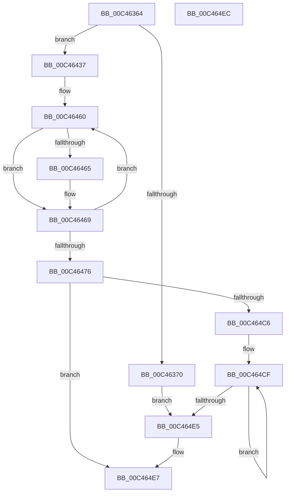

# PsInitializeQuotaSystem

- RVA: `0x00C46364`–`0x00C464ED` (길이 `393` bytes)
- VA: `0x0000000140C46364`
- 실행 섹션: `INIT`
- PDB 이름 있음: `예`; PDB Function 태그: `아니요`
- unwind 정보 RVA: `0x0005C788`
- 디코드: `73`개 명령, `393/393` bytes 표시
- 미해석 바이트: `0` (있으면 어셈블리에 `.byte`로 보존)

> 이 문서는 커널 이미지의 기계어와 PDB 기호를 분석해 생성했습니다. 4번과 5번은 함수 원형과 자료형을 바이너리 사용 방식에서 추정한 C 해석이며 원본 소스 복구 결과는 아닙니다.

## 1. Dependencies

- 직접 호출 지점: **6**; 고유 호출 대상: **3**
- 직접 호출자로 확인된 함수: **2**
- RIP 상대 이미지 참조: **26**

### Outgoing calls
- `0x00C4637A` → [PspRegisterResource](../../text/5E/PspRegisterResource_function_005E2C40.md) (function, `0x005E2C40`)
- `0x00C46384` → [PspRegisterResource](../../text/5E/PspRegisterResource_function_005E2C40.md) (function, `0x005E2C40`)
- `0x00C46394` → [PspRegisterResource](../../text/5E/PspRegisterResource_function_005E2C40.md) (function, `0x005E2C40`)
- `0x00C463A2` → [PspRegisterResource](../../text/5E/PspRegisterResource_function_005E2C40.md) (function, `0x005E2C40`)
- `0x00C464A0` → [PspSanitizeResourceLimits](../../page/78/PspSanitizeResourceLimits_function_0078108C.md) (function, `0x0078108C`)
- `0x00C464B5` → [ExAllocatePool2](../../poolcode/B8/ExAllocatePool2_function_00B820F0.md) (function, `0x00B820F0`)

### Direct callers
- [InitBootProcessor](../C1/InitBootProcessor_function_00C1B1C8.md) at `0x00C1B480`
- [MiInitSystem](../C5/MiInitSystem_function_00C5E6C0.md) at `0x00C5E7AF`

### Static image references
- `0x00C463A7` → RVA `0x00F06650` (`.data`; read/write)
- `0x00C463AF` → RVA `0x00F06668` (`.data`; read)
- `0x00C463B6` → RVA `0x00F06678` (`.data`; read/write)
- `0x00C463BD` → RVA `0x003907F0` (`MmRaisePoolQuota`; read)
- `0x00C463C4` → RVA `0x00F06688` (`.data`; read/write)
- `0x00C463CC` → RVA `0x00390EE0` (`MmReturnPoolQuota`; read)
- `0x00C463D3` → RVA `0x00F06670` (`.data`; write)
- `0x00C463DA` → RVA `0x00F06668` (`.data`; write)
- `0x00C463E1` → RVA `0x00F066A0` (`.data`; read)
- `0x00C463E8` → RVA `0x00F066A8` (`.data`; write)
- `0x00C463EF` → RVA `0x00F066A0` (`.data`; write)
- `0x00C463F6` → RVA `0x00F06648` (`.data`; write)
- `0x00C46401` → RVA `0x00F06658` (`.data`; write)
- `0x00C46408` → RVA `0x00F06660` (`.data`; write)
- `0x00C4640F` → RVA `0x00F06640` (`.data`; write)
- `0x00C46419` → RVA `0x00F06680` (`.data`; write)
- `0x00C46424` → RVA `0x00F06690` (`.data`; write)
- `0x00C4642B` → RVA `0x00F06698` (`.data`; write)
- `0x00C46437` → RVA `0x00E28180` (`.data`; write)
- `0x00C46441` → RVA `0x00E27FC0` (`.data`; read)
- `0x00C46448` → RVA `0x00E28184` (`.data`; write)
- `0x00C46452` → RVA `0x00FC7350` (`ALMOSTRO`; read)
- `0x00C46459` → RVA `0x00FC7370` (`ALMOSTRO`; read)
- `0x00C4648B` → RVA `0x00E27F80` (`.data`; read)
- `0x00C46499` → RVA `0x00FD9DF8` (`PAGEDATA`; read)
- `0x00C464BA` → RVA `0x00FD9C48` (`PAGEDATA`; write)

## 2. Other-region calls and transfers

- 다른 실행 섹션으로 향하는 call: **6**
  - `0x00C4637A` → [PspRegisterResource](../../text/5E/PspRegisterResource_function_005E2C40.md) (`INIT` → `.text`)
  - `0x00C46384` → [PspRegisterResource](../../text/5E/PspRegisterResource_function_005E2C40.md) (`INIT` → `.text`)
  - `0x00C46394` → [PspRegisterResource](../../text/5E/PspRegisterResource_function_005E2C40.md) (`INIT` → `.text`)
  - `0x00C463A2` → [PspRegisterResource](../../text/5E/PspRegisterResource_function_005E2C40.md) (`INIT` → `.text`)
  - `0x00C464A0` → [PspSanitizeResourceLimits](../../page/78/PspSanitizeResourceLimits_function_0078108C.md) (`INIT` → `PAGE`)
  - `0x00C464B5` → [ExAllocatePool2](../../poolcode/B8/ExAllocatePool2_function_00B820F0.md) (`INIT` → `POOLCODE`)
- 별도 외부 분기/꼬리 이동을 확인하지 못했습니다.

## 3. Assembly (complete function range)

```asm
00C46364  48 83 EC 28                     sub rsp, 0x28
00C46368  85 C9                           test ecx, ecx
00C4636A  0F 84 C7 00 00 00               je 0x140c46437
00C46370  41 B8 44 00 00 C0               mov r8d, 0xc0000044
00C46376  B2 05                           mov dl, 5
00C46378  33 C9                           xor ecx, ecx
00C4637A  E8 C1 C8 99 FF                  call 0x1405e2c40
00C4637F  B9 01 00 00 00                  mov ecx, 1
00C46384  E8 B7 C8 99 FF                  call 0x1405e2c40
00C46389  33 D2                           xor edx, edx
00C4638B  41 B8 2C 01 00 C0               mov r8d, 0xc000012c
00C46391  8D 4A 02                        lea ecx, [rdx + 2]
00C46394  E8 A7 C8 99 FF                  call 0x1405e2c40
00C46399  8D 4A 03                        lea ecx, [rdx + 3]
00C4639C  41 B8 A1 00 00 C0               mov r8d, 0xc00000a1
00C463A2  E8 99 C8 99 FF                  call 0x1405e2c40
00C463A7  48 83 25 A1 02 2C 00 00         and qword ptr [rip + 0x2c02a1], 0
00C463AF  48 8D 05 B2 02 2C 00            lea rax, [rip + 0x2c02b2]
00C463B6  83 25 BB 02 2C 00 00            and dword ptr [rip + 0x2c02bb], 0
00C463BD  48 8D 15 2C A4 74 FF            lea rdx, [rip - 0x8b5bd4]
00C463C4  48 83 25 BC 02 2C 00 00         and qword ptr [rip + 0x2c02bc], 0
00C463CC  48 8D 0D 0D AB 74 FF            lea rcx, [rip - 0x8b54f3]
00C463D3  48 89 05 96 02 2C 00            mov qword ptr [rip + 0x2c0296], rax
00C463DA  48 89 05 87 02 2C 00            mov qword ptr [rip + 0x2c0287], rax
00C463E1  48 8D 05 B8 02 2C 00            lea rax, [rip + 0x2c02b8]
00C463E8  48 89 05 B9 02 2C 00            mov qword ptr [rip + 0x2c02b9], rax
00C463EF  48 89 05 AA 02 2C 00            mov qword ptr [rip + 0x2c02aa], rax
00C463F6  48 C7 05 47 02 2C 00 00 00 01 00  mov qword ptr [rip + 0x2c0247], 0x10000
00C46401  48 89 15 50 02 2C 00            mov qword ptr [rip + 0x2c0250], rdx
00C46408  48 89 0D 51 02 2C 00            mov qword ptr [rip + 0x2c0251], rcx
00C4640F  C7 05 27 02 2C 00 01 00 00 00   mov dword ptr [rip + 0x2c0227], 1
00C46419  48 C7 05 5C 02 2C 00 00 00 08 00  mov qword ptr [rip + 0x2c025c], 0x80000
00C46424  48 89 15 65 02 2C 00            mov qword ptr [rip + 0x2c0265], rdx
00C4642B  48 89 0D 66 02 2C 00            mov qword ptr [rip + 0x2c0266], rcx
00C46432  E9 AE 00 00 00                  jmp 0x140c464e5
00C46437  C7 05 3F 1D 1E 00 01 00 00 00   mov dword ptr [rip + 0x1e1d3f], 1
00C46441  48 8D 15 78 1B 1E 00            lea rdx, [rip + 0x1e1b78]
00C46448  C7 05 32 1D 1E 00 01 00 00 00   mov dword ptr [rip + 0x1e1d32], 1
00C46452  48 8D 0D F7 0E 38 00            lea rcx, [rip + 0x380ef7]
00C46459  4C 8D 05 10 0F 38 00            lea r8, [rip + 0x380f10]
00C46460  F6 01 02                        test byte ptr [rcx], 2
00C46463  75 04                           jne 0x140c46469
00C46465  48 83 0A FF                     or qword ptr [rdx], 0xffffffffffffffff
00C46469  48 83 C1 08                     add rcx, 8
00C4646D  48 83 EA 80                     sub rdx, -0x80
00C46471  49 3B C8                        cmp rcx, r8
00C46474  7C EA                           jl 0x140c46460
00C46476  65 48 8B 04 25 88 01 00 00      mov rax, qword ptr gs:[0x188]
00C4647F  BA 01 00 00 00                  mov edx, 1
00C46484  48 8B 88 B8 00 00 00            mov rcx, qword ptr [rax + 0xb8]
00C4648B  48 8D 05 EE 1A 1E 00            lea rax, [rip + 0x1e1aee]
00C46492  48 89 81 F8 02 00 00            mov qword ptr [rcx + 0x2f8], rax
00C46499  48 8D 0D 58 39 39 00            lea rcx, [rip + 0x393958]
00C464A0  E8 E7 AB B3 FF                  call 0x14078108c
00C464A5  BA 00 03 00 00                  mov edx, 0x300
00C464AA  41 B8 50 73 51 74               mov r8d, 0x74517350
00C464B0  B9 00 01 00 00                  mov ecx, 0x100
00C464B5  E8 36 BC F3 FF                  call 0x140b820f0
00C464BA  48 89 05 87 37 39 00            mov qword ptr [rip + 0x393787], rax
00C464C1  48 85 C0                        test rax, rax
00C464C4  74 21                           je 0x140c464e7
00C464C6  48 83 C0 08                     add rax, 8
00C464CA  B9 20 00 00 00                  mov ecx, 0x20
00C464CF  48 89 40 08                     mov qword ptr [rax + 8], rax
00C464D3  48 89 00                        mov qword ptr [rax], rax
00C464D6  48 83 60 F8 00                  and qword ptr [rax - 8], 0
00C464DB  48 83 C0 18                     add rax, 0x18
00C464DF  48 83 E9 01                     sub rcx, 1
00C464E3  75 EA                           jne 0x140c464cf
00C464E5  B0 01                           mov al, 1
00C464E7  48 83 C4 28                     add rsp, 0x28
00C464EB  C3                              ret
00C464EC  CC                              int3
```

## 4. C-style interpretation (structured pseudocode)

```c
__int64 __fastcall PsInitializeQuotaSystem(int a1)
{
    __int64 result;
    __int64 v_rsp;

    v_rsp = (v_rsp) - (40);
    if (a1 == 0) goto loc_00C46437;
    a1 = 0;
    result = PspRegisterResource(a1, 5, (unsigned int)(0xC0000044ULL), a4);
    result = PspRegisterResource(1, 5, (unsigned int)(0xC0000044ULL), a4);
    a2 = 0;
    result = PspRegisterResource(a2 + 2, a2, (unsigned int)(0xC000012CULL), a4);
    result = PspRegisterResource(a2 + 3, a2, (unsigned int)(0xC00000A1ULL), a4);
    *(unsigned __int64 *)(v_rip + 2884246) = v_rip + 2884274;
    *(unsigned __int64 *)(v_rip + 2884231) = v_rip + 2884274;
    *(unsigned __int64 *)(v_rip + 2884281) = v_rip + 2884280;
    *(unsigned __int64 *)(v_rip + 2884266) = v_rip + 2884280;
    *(unsigned __int64 *)(v_rip + 2884167) = 0x10000ULL;
    *(unsigned __int64 *)(v_rip + 2884176) = v_rip - 9133012;
    *(unsigned __int64 *)(v_rip + 2884177) = v_rip - 9131251;
    *(unsigned int *)(v_rip + 2884135) = 1;
    *(unsigned __int64 *)(v_rip + 2884188) = 0x80000ULL;
    *(unsigned __int64 *)(v_rip + 2884197) = v_rip - 9133012;
    *(unsigned __int64 *)(v_rip + 2884198) = v_rip - 9131251;
    goto loc_00C464E5;
loc_00C46437:
    *(unsigned int *)(v_rip + 1973567) = 1;
    *(unsigned int *)(v_rip + 1973554) = 1;
loc_00C46460:
    if (((*(unsigned __int8 *)(v_rip + 3673847)) & (2)) == 0) {
    }
    a1 = (v_rip + 3673847) + (8);
    a2 = (v_rip + 1973112) - (-128);
    if (a1 < (v_rip + 3673872)) goto loc_00C46460;
    *(unsigned __int64 *)(*(unsigned __int64 *)(*(unsigned __int64 *)(gs_base + (0 + 392)) + 184) + 760) = v_rip + 1972974;
    result = PspSanitizeResourceLimits(v_rip + 3750232, 1, v_rip + 3673872, a4);
    result = ExAllocatePool2(256, 768, (unsigned int)(0x74517350ULL), a4);
    *(unsigned __int64 *)(v_rip + 3749767) = result;
    if (result == 0) goto loc_00C464E7;
    result = (result) + (8);
loc_00C464CF:
    *(unsigned __int64 *)(result + 8) = result;
    *(unsigned __int64 *)(result) = result;
    result = (result) + (24);
    a1 = (32) - (1);
    if (condition_is_not_equal) goto loc_00C464CF;
loc_00C464E5:
loc_00C464E7:
    v_rsp = (v_rsp) + (40);
    return 1;
}
```

## 5. (Beta) C Style

```c
int64_t PsInitializeQuotaSystem(int32_t Arg1)
{
    int64_t result;
    int64_t local_rsp;

    local_rsp = (local_rsp) - (40);
    if (Arg1 == 0) goto loc_00C46437;
    Arg1 = 0;
    result = PspRegisterResource(Arg1, 5, (uint32_t)(0xC0000044ULL), a4);
    result = PspRegisterResource(1, 5, (uint32_t)(0xC0000044ULL), a4);
    a2 = 0;
    result = PspRegisterResource(a2 + 2, a2, (uint32_t)(0xC000012CULL), a4);
    result = PspRegisterResource(a2 + 3, a2, (uint32_t)(0xC00000A1ULL), a4);
    *(uint64_t *)(v_rip + 0x2C0296) = v_rip + 2884274;
    *(uint64_t *)(v_rip + 0x2C0287) = v_rip + 2884274;
    *(uint64_t *)(v_rip + 0x2C02B9) = v_rip + 2884280;
    *(uint64_t *)(v_rip + 0x2C02AA) = v_rip + 2884280;
    *(uint64_t *)(v_rip + 0x2C0247) = 0x10000ULL;
    *(uint64_t *)(v_rip + 0x2C0250) = v_rip - 9133012;
    *(uint64_t *)(v_rip + 0x2C0251) = v_rip - 9131251;
    *(uint32_t *)(v_rip + 0x2C0227) = 1;
    *(uint64_t *)(v_rip + 0x2C025C) = 0x80000ULL;
    *(uint64_t *)(v_rip + 0x2C0265) = v_rip - 9133012;
    *(uint64_t *)(v_rip + 0x2C0266) = v_rip - 9131251;
    goto loc_00C464E5;
loc_00C46437:
    *(uint32_t *)(v_rip + 0x1E1D3F) = 1;
    *(uint32_t *)(v_rip + 0x1E1D32) = 1;
loc_00C46460:
    if (((*(uint8_t *)(v_rip + 0x380EF7)) & (2)) == 0) {
    }
    Arg1 = (v_rip + 3673847) + (8);
    a2 = (v_rip + 1973112) - (-128);
    if (Arg1 < (v_rip + 3673872)) goto loc_00C46460;
    *(uint64_t *)(*(uint64_t *)(*(uint64_t *)(gs_base + (0 + 0x188)) + 0xB8) + 0x2F8) = v_rip + 1972974;
    result = PspSanitizeResourceLimits(v_rip + 3750232, 1, v_rip + 3673872, a4);
    result = ExAllocatePool2(256, 768, (uint32_t)(0x74517350ULL), a4);
    *(uint64_t *)(v_rip + 0x393787) = result;
    if (result == 0) goto loc_00C464E7;
    result = (result) + (8);
loc_00C464CF:
    *(uint64_t *)(result + 0x8) = result;
    *(uint64_t *)(result) = result;
    result = (result) + (24);
    Arg1 = (32) - (1);
    if (condition_is_not_equal) goto loc_00C464CF;
loc_00C464E5:
loc_00C464E7:
    local_rsp = (local_rsp) + (40);
    return 1;
}
```

## 6. Execution-region graph

[열기: 2D/3D 그래프와 함수 탐색 컨트롤 패널](../../../control-panel.html?section=init&rva=0x00C46364&view=graph)

- 2D 그래프는 위에서 아래로 흐르고, 3D 그래프는 빈 공간을 드래그해 회전합니다. Shift+드래그는 이동, 휠은 확대·축소, 함수 노드 선택은 대상 보고서 이동입니다.

### Static fallback


