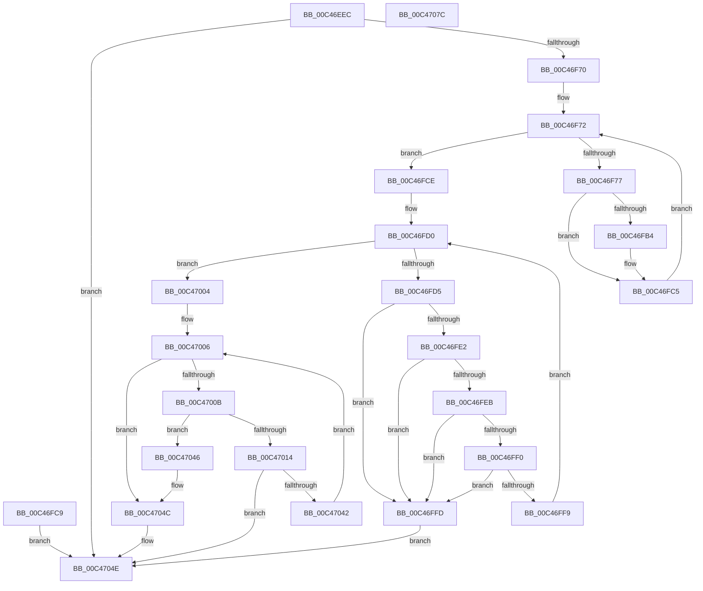

# PsInitializeScpCfgPages

- RVA: `0x00C46EEC`–`0x00C4707D` (길이 `401` bytes)
- VA: `0x0000000140C46EEC`
- 실행 섹션: `INIT`
- PDB 이름 있음: `예`; PDB Function 태그: `아니요`
- unwind 정보 RVA: `0x000CF678`
- 디코드: `105`개 명령, `401/401` bytes 표시
- 미해석 바이트: `0` (있으면 어셈블리에 `.byte`로 보존)

> 이 문서는 커널 이미지의 기계어와 PDB 기호를 분석해 생성했습니다. 4번과 5번은 함수 원형과 자료형을 바이너리 사용 방식에서 추정한 C 해석이며 원본 소스 복구 결과는 아닙니다.

## 1. Dependencies

- 직접 호출 지점: **8**; 고유 호출 대상: **6**
- 직접 호출자로 확인된 함수: **1**
- RIP 상대 이미지 참조: **1**

### Outgoing calls
- `0x00C46F35` → [memset](../../text/6C/memset_function_006C6C40.md) (function, `0x006C6C40`)
- `0x00C46F45` → [memset](../../text/6C/memset_function_006C6C40.md) (function, `0x006C6C40`)
- `0x00C46F63` → [PspLocateNtdllAddressesForScpCfg](PspLocateNtdllAddressesForScpCfg_function_00C46CB0.md) (function, `0x00C46CB0`)
- `0x00C46FA3` → [memcpy](../../text/6C/memcpy_function_006C6840.md) (function, `0x006C6840`)
- `0x00C46FC0` → [memset](../../text/6C/memset_function_006C6C40.md) (function, `0x006C6C40`)
- `0x00C47039` → [PspFinalizeScpCfgPage](PspFinalizeScpCfgPage_function_00C46A8C.md) (function, `0x00C46A8C`)
- `0x00C47046` → [gsl::details::terminate](../../text/4F/gsl_details_terminate_function_004F9AA0.md) (function, `0x004F9AA0`)
- `0x00C47059` → [_security_check_cookie](../../text/6A/_security_check_cookie_function_006AC640.md) (function, `0x006AC640`)

### Direct callers
- [MmInitializeImageViewExtensionCfg](../C6/MmInitializeImageViewExtensionCfg_function_00C64FC4.md) at `0x00C6524C`

### Static image references
- `0x00C46F08` → RVA `0x00E0A740` (`.data`; read)

## 2. Other-region calls and transfers

- 다른 실행 섹션으로 향하는 call: **6**
  - `0x00C46F35` → [memset](../../text/6C/memset_function_006C6C40.md) (`INIT` → `.text`)
  - `0x00C46F45` → [memset](../../text/6C/memset_function_006C6C40.md) (`INIT` → `.text`)
  - `0x00C46FA3` → [memcpy](../../text/6C/memcpy_function_006C6840.md) (`INIT` → `.text`)
  - `0x00C46FC0` → [memset](../../text/6C/memset_function_006C6C40.md) (`INIT` → `.text`)
  - `0x00C47046` → [gsl::details::terminate](../../text/4F/gsl_details_terminate_function_004F9AA0.md) (`INIT` → `.text`)
  - `0x00C47059` → [_security_check_cookie](../../text/6A/_security_check_cookie_function_006AC640.md) (`INIT` → `.text`)
- 별도 외부 분기/꼬리 이동을 확인하지 못했습니다.

## 3. Assembly (complete function range)

```asm
00C46EEC  4C 8B DC                        mov r11, rsp
00C46EEF  49 89 5B 10                     mov qword ptr [r11 + 0x10], rbx
00C46EF3  49 89 73 18                     mov qword ptr [r11 + 0x18], rsi
00C46EF7  49 89 7B 20                     mov qword ptr [r11 + 0x20], rdi
00C46EFB  41 54                           push r12
00C46EFD  41 56                           push r14
00C46EFF  41 57                           push r15
00C46F01  48 81 EC 10 01 00 00            sub rsp, 0x110
00C46F08  48 8B 05 31 38 1C 00            mov rax, qword ptr [rip + 0x1c3831]
00C46F0F  48 33 C4                        xor rax, rsp
00C46F12  48 89 84 24 00 01 00 00         mov qword ptr [rsp + 0x100], rax
00C46F1A  4D 8B E1                        mov r12, r9
00C46F1D  48 8B F1                        mov rsi, rcx
00C46F20  49 83 A3 68 FF FF FF 00         and qword ptr [r11 - 0x98], 0
00C46F28  33 D2                           xor edx, edx
00C46F2A  44 8D 42 60                     lea r8d, [rdx + 0x60]
00C46F2E  49 8D 8B 70 FF FF FF            lea rcx, [r11 - 0x90]
00C46F35  E8 06 FD A7 FF                  call 0x1406c6c40
00C46F3A  33 D2                           xor edx, edx
00C46F3C  44 8D 42 40                     lea r8d, [rdx + 0x40]
00C46F40  48 8D 4C 24 50                  lea rcx, [rsp + 0x50]
00C46F45  E8 F6 FC A7 FF                  call 0x1406c6c40
00C46F4A  48 8D 44 24 50                  lea rax, [rsp + 0x50]
00C46F4F  48 89 44 24 20                  mov qword ptr [rsp + 0x20], rax
00C46F54  4C 8D 8C 24 90 00 00 00         lea r9, [rsp + 0x90]
00C46F5C  8A 94 24 58 01 00 00            mov dl, byte ptr [rsp + 0x158]
00C46F63  E8 48 FD FF FF                  call 0x140c46cb0
00C46F68  85 C0                           test eax, eax
00C46F6A  0F 88 DE 00 00 00               js 0x140c4704e
00C46F70  33 DB                           xor ebx, ebx
00C46F72  83 FB 04                        cmp ebx, 4
00C46F75  73 57                           jae 0x140c46fce
00C46F77  8B C3                           mov eax, ebx
00C46F79  48 03 C0                        add rax, rax
00C46F7C  0F 10 8C C4 90 00 00 00         movups xmm1, xmmword ptr [rsp + rax*8 + 0x90]
00C46F84  66 0F 6F C1                     movdqa xmm0, xmm1
00C46F88  66 0F 73 D8 08                  psrldq xmm0, 8
00C46F8D  66 48 0F 7E C7                  movq rdi, xmm0
00C46F92  66 48 0F 7E CA                  movq rdx, xmm1
00C46F97  2B FA                           sub edi, edx
00C46F99  44 8B FF                        mov r15d, edi
00C46F9C  44 8B C7                        mov r8d, edi
00C46F9F  48 8B 0C DE                     mov rcx, qword ptr [rsi + rbx*8]
00C46FA3  E8 98 F8 A7 FF                  call 0x1406c6840
00C46FA8  90                              nop
00C46FA9  41 B8 00 10 00 00               mov r8d, 0x1000
00C46FAF  44 2B C7                        sub r8d, edi
00C46FB2  74 11                           je 0x140c46fc5
00C46FB4  48 8B 0C DE                     mov rcx, qword ptr [rsi + rbx*8]
00C46FB8  49 03 CF                        add rcx, r15
00C46FBB  BA CC 00 00 00                  mov edx, 0xcc
00C46FC0  E8 7B FC A7 FF                  call 0x1406c6c40
00C46FC5  FF C3                           inc ebx
00C46FC7  EB A9                           jmp 0x140c46f72
00C46FC9  E9 80 00 00 00                  jmp 0x140c4704e
00C46FCE  33 C9                           xor ecx, ecx
00C46FD0  83 F9 04                        cmp ecx, 4
00C46FD3  73 2F                           jae 0x140c47004
00C46FD5  48 8B 14 CE                     mov rdx, qword ptr [rsi + rcx*8]
00C46FD9  81 7A 08 40 01 00 00            cmp dword ptr [rdx + 8], 0x140
00C46FE0  75 1B                           jne 0x140c46ffd
00C46FE2  81 7A 0C C0 01 00 00            cmp dword ptr [rdx + 0xc], 0x1c0
00C46FE9  75 12                           jne 0x140c46ffd
00C46FEB  83 3A 40                        cmp dword ptr [rdx], 0x40
00C46FEE  75 0D                           jne 0x140c46ffd
00C46FF0  81 7A 04 C0 00 00 00            cmp dword ptr [rdx + 4], 0xc0
00C46FF7  75 04                           jne 0x140c46ffd
00C46FF9  FF C1                           inc ecx
00C46FFB  EB D3                           jmp 0x140c46fd0
00C46FFD  B8 0D 00 00 C0                  mov eax, 0xc000000d
00C47002  EB 4A                           jmp 0x140c4704e
00C47004  33 DB                           xor ebx, ebx
00C47006  83 FB 04                        cmp ebx, 4
00C47009  73 41                           jae 0x140c4704c
00C4700B  48 8B 0C DE                     mov rcx, qword ptr [rsi + rbx*8]
00C4700F  48 85 C9                        test rcx, rcx
00C47012  74 32                           je 0x140c47046
00C47014  48 C7 44 24 40 00 10 00 00      mov qword ptr [rsp + 0x40], 0x1000
00C4701D  48 89 4C 24 48                  mov qword ptr [rsp + 0x48], rcx
00C47022  48 8D 84 24 90 00 00 00         lea rax, [rsp + 0x90]
00C4702A  48 89 44 24 20                  mov qword ptr [rsp + 0x20], rax
00C4702F  4D 8B C4                        mov r8, r12
00C47032  8B D3                           mov edx, ebx
00C47034  48 8D 4C 24 40                  lea rcx, [rsp + 0x40]
00C47039  E8 4E FA FF FF                  call 0x140c46a8c
00C4703E  85 C0                           test eax, eax
00C47040  78 0C                           js 0x140c4704e
00C47042  FF C3                           inc ebx
00C47044  EB C0                           jmp 0x140c47006
00C47046  E8 55 2A 8B FF                  call 0x1404f9aa0
00C4704B  CC                              int3
00C4704C  33 C0                           xor eax, eax
00C4704E  48 8B 8C 24 00 01 00 00         mov rcx, qword ptr [rsp + 0x100]
00C47056  48 33 CC                        xor rcx, rsp
00C47059  E8 E2 55 A6 FF                  call 0x1406ac640
00C4705E  4C 8D 9C 24 10 01 00 00         lea r11, [rsp + 0x110]
00C47066  49 8B 5B 28                     mov rbx, qword ptr [r11 + 0x28]
00C4706A  49 8B 73 30                     mov rsi, qword ptr [r11 + 0x30]
00C4706E  49 8B 7B 38                     mov rdi, qword ptr [r11 + 0x38]
00C47072  49 8B E3                        mov rsp, r11
00C47075  41 5F                           pop r15
00C47077  41 5E                           pop r14
00C47079  41 5C                           pop r12
00C4707B  C3                              ret
00C4707C  CC                              int3
```

## 4. C-style interpretation (structured pseudocode)

```c
__int64 __fastcall PsInitializeScpCfgPages(__int64 a1, int a2, __int64 a3, __int64 a4, __int64 a5, unsigned __int8 a6)
{
    __int64 result;
    __int64 v_rbx;
    __int64 v_rdi;
    __int64 v_rsp;
    unsigned __int64 v_stack_m108;
    unsigned __int64 v_stack_m18;
    unsigned __int64 v_stack_m28;
    unsigned __int64 v_stack_m98;
    unsigned __int64 v_stack_mD8;
    unsigned __int64 v_stack_mE0;
    unsigned __int64 v_stack_mE8;

    *(unsigned __int64 *)(v_rsp + 16) = v_rbx;
    *(unsigned __int64 *)(v_rsp + 24) = v_rsi;
    *(unsigned __int64 *)(v_rsp + 32) = v_rdi;
    v_rsp = (v_rsp) - (272);
    result = (*(unsigned __int64 *)(v_rip + 1849393)) ^ (v_rsp);
    v_stack_m28 = result;
    a2 = 0;
    result = memset(v_rsp - 144, a2, a2 + 96, a4);
    a2 = 0;
    result = memset(v_stack_mD8, a2, a2 + 64, a4);
    v_stack_m108 = v_stack_mD8;
    result = PspLocateNtdllAddressesForScpCfg(v_stack_mD8, a6, a2 + 64, v_stack_m98);
    if (sign_flag) goto loc_00C4704E;
    v_rbx = 0;
loc_00C46F72:
    if (0 >= 4) goto loc_00C46FCE;
    result = (0) + (0);
    v_rdi = (unsigned int)((v_rdi) - (a6));
    result = memcpy(*(unsigned __int64 *)(a1 + v_rbx * 8), a6, (unsigned int)((unsigned int)(v_rdi)), v_stack_m98);
    a3 = (unsigned int)(((unsigned int)(0x1000ULL)) - ((unsigned int)(v_rdi)));
    if (!(condition_is_equal)) {
        a1 = *(unsigned __int64 *)(a1 + v_rbx * 8);
        a1 = (a1) + ((unsigned int)((unsigned int)(v_rdi)));
        a2 = 204;
        result = memset(a1, a2, a3, v_stack_m98);
    }
    v_rbx = (unsigned int)((v_rbx) + 1);
    goto loc_00C46F72;
loc_00C46FCE:
    a1 = 0;
loc_00C46FD0:
    if (0 >= 4) goto loc_00C47004;
    if ((*(unsigned int *)(*(unsigned __int64 *)(a1 + a1 * 8) + 8)) != 320) goto loc_00C46FFD;
    if ((*(unsigned int *)(*(unsigned __int64 *)(a1 + a1 * 8) + 12)) != 448) goto loc_00C46FFD;
    if ((*(unsigned int *)(*(unsigned __int64 *)(a1 + a1 * 8))) != 64) goto loc_00C46FFD;
    if ((*(unsigned int *)(*(unsigned __int64 *)(a1 + a1 * 8) + 4)) != 192) goto loc_00C46FFD;
    a1 = (unsigned int)((a1) + 1);
    goto loc_00C46FD0;
loc_00C46FFD:
    goto loc_00C4704E;
loc_00C47004:
    v_rbx = 0;
loc_00C47006:
    if (0 >= 4) goto loc_00C4704C;
    if (*(unsigned __int64 *)(a1 + v_rbx * 8) == 0) goto loc_00C47046;
    v_stack_mE8 = 0x1000ULL;
    v_stack_mE0 = *(unsigned __int64 *)(a1 + v_rbx * 8);
    v_stack_m108 = v_stack_m98;
    result = PspFinalizeScpCfgPage(v_stack_mE8, 0, a4, v_stack_m98);
    if (sign_flag) goto loc_00C4704E;
    v_rbx = (unsigned int)((v_rbx) + 1);
    goto loc_00C47006;
loc_00C47046:
    result = gsl__details__terminate(v_stack_mE8, 0, a4, v_stack_m98);
loc_00C4704C:
    result = 0;
loc_00C4704E:
    a1 = (v_stack_m28) ^ (v_rsp);
    result = _security_check_cookie(a1, 0, a4, v_stack_m98);
    return result;
}
```

## 5. (Beta) C Style

```c
int64_t PsInitializeScpCfgPages(void *Arg1, int32_t Arg2, int64_t Arg3, int64_t Arg4, uint64_t Arg5, uint8_t Arg6)
{
    uint8_t *arg1 = (uint8_t *)Arg1;

    int64_t result;
    int64_t local_rbx;
    int64_t local_rdi;
    int64_t local_rsp;
    uint64_t v_stack_m108;
    uint64_t v_stack_m18;
    uint64_t v_stack_m28;
    uint64_t v_stack_m98;
    uint64_t v_stack_mD8;
    uint64_t v_stack_mE0;
    uint64_t v_stack_mE8;

    *(uint64_t *)(local_rsp + 0x10) = local_rbx;
    *(uint64_t *)(local_rsp + 0x18) = local_rsi;
    *(uint64_t *)(local_rsp + 0x20) = local_rdi;
    local_rsp = (local_rsp) - (272);
    result = (*(uint64_t *)(v_rip + 0x1C3831)) ^ (local_rsp);
    v_stack_m28 = result;
    Arg2 = 0;
    result = memset(local_rsp - 144, Arg2, Arg2 + 96, Arg4);
    Arg2 = 0;
    result = memset(v_stack_mD8, Arg2, Arg2 + 64, Arg4);
    v_stack_m108 = v_stack_mD8;
    result = PspLocateNtdllAddressesForScpCfg(v_stack_mD8, Arg6, Arg2 + 64, v_stack_m98);
    if (sign_flag) goto loc_00C4704E;
    local_rbx = 0;
loc_00C46F72:
    if (0 >= 4) goto loc_00C46FCE;
    result = (0) + (0);
    local_rdi = (uint32_t)((local_rdi) - (Arg6));
    result = memcpy(*(uint64_t *)(arg1 + local_rbx * 8), Arg6, (uint32_t)((uint32_t)(local_rdi)), v_stack_m98);
    Arg3 = (uint32_t)(((uint32_t)(0x1000ULL)) - ((uint32_t)(local_rdi)));
    if (!(condition_is_equal)) {
        Arg1 = *(uint64_t *)(arg1 + local_rbx * 8);
        Arg1 = (Arg1) + ((uint32_t)((uint32_t)(local_rdi)));
        Arg2 = 204;
        result = memset(Arg1, Arg2, Arg3, v_stack_m98);
    }
    local_rbx = (uint32_t)((local_rbx) + 1);
    goto loc_00C46F72;
loc_00C46FCE:
    Arg1 = 0;
loc_00C46FD0:
    if (0 >= 4) goto loc_00C47004;
    if ((*(uint32_t *)(*(uint64_t *)(arg1 + arg1 * 8) + 0x8)) != 320) goto loc_00C46FFD;
    if ((*(uint32_t *)(*(uint64_t *)(arg1 + arg1 * 8) + 0xC)) != 448) goto loc_00C46FFD;
    if ((*(uint32_t *)(*(uint64_t *)(arg1 + arg1 * 8))) != 64) goto loc_00C46FFD;
    if ((*(uint32_t *)(*(uint64_t *)(arg1 + arg1 * 8) + 0x4)) != 192) goto loc_00C46FFD;
    Arg1 = (uint32_t)((Arg1) + 1);
    goto loc_00C46FD0;
loc_00C46FFD:
    goto loc_00C4704E;
loc_00C47004:
    local_rbx = 0;
loc_00C47006:
    if (0 >= 4) goto loc_00C4704C;
    if (*(uint64_t *)(arg1 + local_rbx * 8) == 0) goto loc_00C47046;
    v_stack_mE8 = 0x1000ULL;
    v_stack_mE0 = *(uint64_t *)(arg1 + local_rbx * 8);
    v_stack_m108 = v_stack_m98;
    result = PspFinalizeScpCfgPage(v_stack_mE8, 0, Arg4, v_stack_m98);
    if (sign_flag) goto loc_00C4704E;
    local_rbx = (uint32_t)((local_rbx) + 1);
    goto loc_00C47006;
loc_00C47046:
    result = gsl__details__terminate(v_stack_mE8, 0, Arg4, v_stack_m98);
loc_00C4704C:
    result = 0;
loc_00C4704E:
    Arg1 = (v_stack_m28) ^ (local_rsp);
    result = _security_check_cookie(Arg1, 0, Arg4, v_stack_m98);
    return result;
}
```

### 관측된 메모리 오프셋

구조체 형식이 확인되지 않은 접근은 인자 기준의 오프셋으로만 기록했습니다.

| 기준 인자 | 오프셋 표현 | 폭 (bit) | 접근 |
|---|---:|---:|---|
| `Arg1` | `+ 0x0 + rbx*8` | `64` | `R` |
| `Arg1` | `+ 0x0 + rcx*8` | `64` | `R` |

## 6. Execution-region graph

[열기: 2D/3D 그래프와 함수 탐색 컨트롤 패널](../../../control-panel.html?section=init&rva=0x00C46EEC&view=graph)

- 2D 그래프는 위에서 아래로 흐르고, 3D 그래프는 빈 공간을 드래그해 회전합니다. Shift+드래그는 이동, 휠은 확대·축소, 함수 노드 선택은 대상 보고서 이동입니다.

### Static fallback


