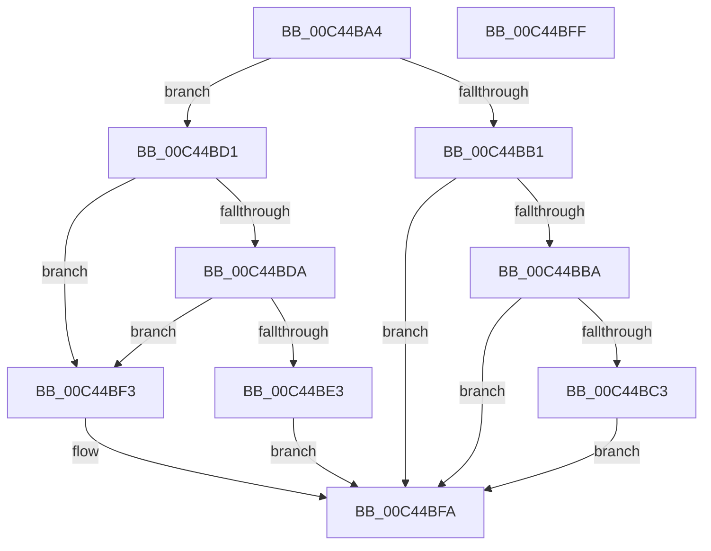

# PsInitializeSyscallProviders

- RVA: `0x00C44BA4`–`0x00C44C00` (길이 `92` bytes)
- VA: `0x0000000140C44BA4`
- 실행 섹션: `INIT`
- PDB 이름 있음: `예`; PDB Function 태그: `아니요`
- unwind 정보 RVA: `0x0005C788`
- 디코드: `25`개 명령, `92/92` bytes 표시
- 미해석 바이트: `0` (있으면 어셈블리에 `.byte`로 보존)

> 이 문서는 커널 이미지의 기계어와 PDB 기호를 분석해 생성했습니다. 4번과 5번은 함수 원형과 자료형을 바이너리 사용 방식에서 추정한 C 해석이며 원본 소스 복구 결과는 아닙니다.

## 1. Dependencies

- 직접 호출 지점: **5**; 고유 호출 대상: **4**
- 직접 호출자로 확인된 함수: **1**
- RIP 상대 이미지 참조: **2**

### Outgoing calls
- `0x00C44BA8` → [Feature_Servicing_SyscallProviderWin32kMetadata__private_IsEnabledDeviceUsageNoInline](../../text/5B/Feature_Servicing_SyscallProviderWin32kMetadata__private_IsEnabledDeviceUsageNoInline_function_005B1458.md) (function, `0x005B1458`)
- `0x00C44BBA` → [VslInitializeSyscallProviders](../C2/VslInitializeSyscallProviders_function_00C29CF4.md) (function, `0x00C29CF4`)
- `0x00C44BC3` → [PspRegisterSyscallProviderServiceTableMetadata](PspRegisterSyscallProviderServiceTableMetadata_function_00C44D18.md) (function, `0x00C44D18`)
- `0x00C44BDA` → [VslInitializeSyscallProviders](../C2/VslInitializeSyscallProviders_function_00C29CF4.md) (function, `0x00C29CF4`)
- `0x00C44BEC` → [PsRegisterSyscallProviderServiceTableMetadata](../../page/AD/PsRegisterSyscallProviderServiceTableMetadata_function_00ADB224.md) (function, `0x00ADB224`)

### Direct callers
- [IoInitSystemPreDrivers](../C2/IoInitSystemPreDrivers_function_00C2AC3C.md) at `0x00C2B935`

### Static image references
- `0x00C44BB1` → RVA `0x00FC6A84` (`ALMOSTRO`; read)
- `0x00C44BC8` → RVA `0x00FD9A64` (`PAGEDATA`; write)

## 2. Other-region calls and transfers

- 다른 실행 섹션으로 향하는 call: **2**
  - `0x00C44BA8` → [Feature_Servicing_SyscallProviderWin32kMetadata__private_IsEnabledDeviceUsageNoInline](../../text/5B/Feature_Servicing_SyscallProviderWin32kMetadata__private_IsEnabledDeviceUsageNoInline_function_005B1458.md) (`INIT` → `.text`)
  - `0x00C44BEC` → [PsRegisterSyscallProviderServiceTableMetadata](../../page/AD/PsRegisterSyscallProviderServiceTableMetadata_function_00ADB224.md) (`INIT` → `PAGE`)
- 별도 외부 분기/꼬리 이동을 확인하지 못했습니다.

## 3. Assembly (complete function range)

```asm
00C44BA4  48 83 EC 28                     sub rsp, 0x28
00C44BA8  E8 AB C8 96 FF                  call 0x1405b1458
00C44BAD  85 C0                           test eax, eax
00C44BAF  74 20                           je 0x140c44bd1
00C44BB1  80 3D CC 1E 38 00 00            cmp byte ptr [rip + 0x381ecc], 0
00C44BB8  74 40                           je 0x140c44bfa
00C44BBA  E8 35 51 FE FF                  call 0x140c29cf4
00C44BBF  85 C0                           test eax, eax
00C44BC1  78 37                           js 0x140c44bfa
00C44BC3  E8 50 01 00 00                  call 0x140c44d18
00C44BC8  C6 05 95 4E 39 00 01            mov byte ptr [rip + 0x394e95], 1
00C44BCF  EB 29                           jmp 0x140c44bfa
00C44BD1  80 3D AC 1E 38 00 00            cmp byte ptr [rip + 0x381eac], 0
00C44BD8  74 19                           je 0x140c44bf3
00C44BDA  E8 15 51 FE FF                  call 0x140c29cf4
00C44BDF  85 C0                           test eax, eax
00C44BE1  78 10                           js 0x140c44bf3
00C44BE3  33 C9                           xor ecx, ecx
00C44BE5  C6 05 78 4E 39 00 01            mov byte ptr [rip + 0x394e78], 1
00C44BEC  E8 33 66 E9 FF                  call 0x140adb224
00C44BF1  EB 07                           jmp 0x140c44bfa
00C44BF3  C6 05 6A 4E 39 00 00            mov byte ptr [rip + 0x394e6a], 0
00C44BFA  48 83 C4 28                     add rsp, 0x28
00C44BFE  C3                              ret
00C44BFF  CC                              int3
```

## 4. C-style interpretation (structured pseudocode)

```c
__int64 __fastcall PsInitializeSyscallProviders(int a1)
{
    __int64 result;
    __int64 v_rsp;

    v_rsp = (v_rsp) - (40);
    result = Feature_Servicing_SyscallProviderWin32kMetadata__private_IsEnabledDeviceUsageNoInline(a1, a2, a3, a4);
    if ((unsigned int)(result) == 0) goto loc_00C44BD1;
    if ((*(unsigned __int8 *)(v_rip + 3677900)) == 0) goto loc_00C44BFA;
    result = VslInitializeSyscallProviders(a1, a2, a3, a4);
    if (sign_flag) goto loc_00C44BFA;
    result = PspRegisterSyscallProviderServiceTableMetadata(a1, a2, a3, a4);
    *(unsigned __int8 *)(v_rip + 3755669) = 1;
    goto loc_00C44BFA;
loc_00C44BD1:
    if ((*(unsigned __int8 *)(v_rip + 3677868)) == 0) goto loc_00C44BF3;
    result = VslInitializeSyscallProviders(a1, a2, a3, a4);
    if (sign_flag) goto loc_00C44BF3;
    a1 = 0;
    *(unsigned __int8 *)(v_rip + 3755640) = 1;
    result = PsRegisterSyscallProviderServiceTableMetadata(a1, a2, a3, a4);
    goto loc_00C44BFA;
loc_00C44BF3:
    *(unsigned __int8 *)(v_rip + 3755626) = 0;
loc_00C44BFA:
    v_rsp = (v_rsp) + (40);
    return result;
}
```

## 5. (Beta) C Style

```c
int64_t PsInitializeSyscallProviders(int32_t Arg1)
{
    int64_t result;
    int64_t local_rsp;

    local_rsp = (local_rsp) - (40);
    result = Feature_Servicing_SyscallProviderWin32kMetadata__private_IsEnabledDeviceUsageNoInline(Arg1, a2, a3, a4);
    if ((uint32_t)(result) == 0) goto loc_00C44BD1;
    if ((*(uint8_t *)(v_rip + 0x381ECC)) == 0) goto loc_00C44BFA;
    result = VslInitializeSyscallProviders(Arg1, a2, a3, a4);
    if (sign_flag) goto loc_00C44BFA;
    result = PspRegisterSyscallProviderServiceTableMetadata(Arg1, a2, a3, a4);
    *(uint8_t *)(v_rip + 0x394E95) = 1;
    goto loc_00C44BFA;
loc_00C44BD1:
    if ((*(uint8_t *)(v_rip + 0x381EAC)) == 0) goto loc_00C44BF3;
    result = VslInitializeSyscallProviders(Arg1, a2, a3, a4);
    if (sign_flag) goto loc_00C44BF3;
    Arg1 = 0;
    *(uint8_t *)(v_rip + 0x394E78) = 1;
    result = PsRegisterSyscallProviderServiceTableMetadata(Arg1, a2, a3, a4);
    goto loc_00C44BFA;
loc_00C44BF3:
    *(uint8_t *)(v_rip + 0x394E6A) = 0;
loc_00C44BFA:
    local_rsp = (local_rsp) + (40);
    return result;
}
```

## 6. Execution-region graph

[열기: 2D/3D 그래프와 함수 탐색 컨트롤 패널](../../../control-panel.html?section=init&rva=0x00C44BA4&view=graph)

- 2D 그래프는 위에서 아래로 흐르고, 3D 그래프는 빈 공간을 드래그해 회전합니다. Shift+드래그는 이동, 휠은 확대·축소, 함수 노드 선택은 대상 보고서 이동입니다.

### Static fallback


