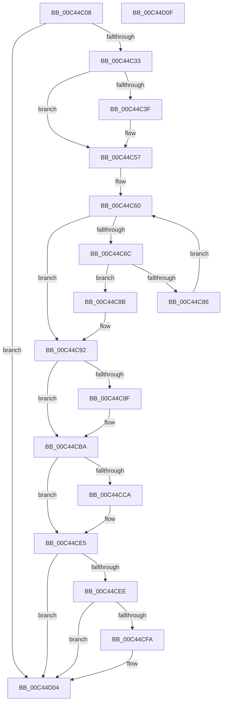

# PsInitializeWin32kServiceTable

- RVA: `0x00C44C08`–`0x00C44D10` (길이 `264` bytes)
- VA: `0x0000000140C44C08`
- 실행 섹션: `INIT`
- PDB 이름 있음: `예`; PDB Function 태그: `아니요`
- unwind 정보 RVA: `0x0008A658`
- 디코드: `68`개 명령, `264/264` bytes 표시
- 미해석 바이트: `0` (있으면 어셈블리에 `.byte`로 보존)

> 이 문서는 커널 이미지의 기계어와 PDB 기호를 분석해 생성했습니다. 4번과 5번은 함수 원형과 자료형을 바이너리 사용 방식에서 추정한 C 해석이며 원본 소스 복구 결과는 아닙니다.

## 1. Dependencies

- 직접 호출 지점: **8**; 고유 호출 대상: **6**
- 직접 호출자로 확인된 함수: **1**
- RIP 상대 이미지 참조: **8**

### Outgoing calls
- `0x00C44C1C` → `ext-ms-win-ntos-win32k-l1-1-0.dll!Win32kGetSupportedExportsVersion` (import, 간접 대상; import `ext-ms-win-ntos-win32k-l1-1-0.dll!Win32kGetSupportedExportsVersion`)
- `0x00C44C51` → [KeBugCheckEx](../../text/4F/KeBugCheckEx_function_004FD660.md) (function, `0x004FD660`)
- `0x00C44C7D` → [RtlCompareUnicodeString](../../page/93/RtlCompareUnicodeString_function_00937F90.md) (function, `0x00937F90`)
- `0x00C44C96` → [MmCompactServiceTable](../../page/80/MmCompactServiceTable_function_0080C7E8.md) (function, `0x0080C7E8`)
- `0x00C44CB4` → [KeBugCheckEx](../../text/4F/KeBugCheckEx_function_004FD660.md) (function, `0x004FD660`)
- `0x00C44CBA` → `ext-ms-win-ntos-win32k-l1-1-0.dll!Win32kSystemTableAdd` (import, 간접 대상; import `ext-ms-win-ntos-win32k-l1-1-0.dll!Win32kSystemTableAdd`)
- `0x00C44CDF` → [KeBugCheckEx](../../text/4F/KeBugCheckEx_function_004FD660.md) (function, `0x004FD660`)
- `0x00C44CFF` → [MmProtectDriverSection](../../text/67/MmProtectDriverSection_function_00670A80.md) (function, `0x00670A80`)

### Direct callers
- [InitBootProcessor](../C1/InitBootProcessor_function_00C1B1C8.md) at `0x00C1B9A2`

### Static image references
- `0x00C44C1C` → RVA `0x00151660` (`ext-ms-win-ntos-win32k-l1-1-0.dll!Win32kGetSupportedExportsVersion (IAT)`; read)
- `0x00C44C33` → RVA `0x00F067D0` (`.data`; read)
- `0x00C44C57` → RVA `0x00EF54C0` (`.data`; read)
- `0x00C44C73` → RVA `0x0000B590` (`.rdata`; read)
- `0x00C44C8B` → RVA `0x00F067D0` (`.data`; write)
- `0x00C44CBA` → RVA `0x00151668` (`ext-ms-win-ntos-win32k-l1-1-0.dll!Win32kSystemTableAdd (IAT)`; read)
- `0x00C44CE5` → RVA `0x00FC6A84` (`ALMOSTRO`; read)
- `0x00C44CEE` → RVA `0x00FC72A0` (`ALMOSTRO`; read)

## 2. Other-region calls and transfers

- 다른 실행 섹션으로 향하는 call: **6**
  - `0x00C44C51` → [KeBugCheckEx](../../text/4F/KeBugCheckEx_function_004FD660.md) (`INIT` → `.text`)
  - `0x00C44C7D` → [RtlCompareUnicodeString](../../page/93/RtlCompareUnicodeString_function_00937F90.md) (`INIT` → `PAGE`)
  - `0x00C44C96` → [MmCompactServiceTable](../../page/80/MmCompactServiceTable_function_0080C7E8.md) (`INIT` → `PAGE`)
  - `0x00C44CB4` → [KeBugCheckEx](../../text/4F/KeBugCheckEx_function_004FD660.md) (`INIT` → `.text`)
  - `0x00C44CDF` → [KeBugCheckEx](../../text/4F/KeBugCheckEx_function_004FD660.md) (`INIT` → `.text`)
  - `0x00C44CFF` → [MmProtectDriverSection](../../text/67/MmProtectDriverSection_function_00670A80.md) (`INIT` → `.text`)
- 별도 외부 분기/꼬리 이동을 확인하지 못했습니다.

## 3. Assembly (complete function range)

```asm
00C44C08  48 89 5C 24 10                  mov qword ptr [rsp + 0x10], rbx
00C44C0D  57                              push rdi
00C44C0E  48 83 EC 30                     sub rsp, 0x30
00C44C12  83 64 24 40 00                  and dword ptr [rsp + 0x40], 0
00C44C17  48 8D 4C 24 40                  lea rcx, [rsp + 0x40]
00C44C1C  48 FF 15 3D CA 50 FF            call qword ptr [rip - 0xaf35c3]
00C44C23  0F 1F 44 00 00                  nop dword ptr [rax + rax]
00C44C28  3D BB 00 00 C0                  cmp eax, 0xc00000bb
00C44C2D  0F 84 D1 00 00 00               je 0x140c44d04
00C44C33  4C 8B 05 96 1B 2C 00            mov r8, qword ptr [rip + 0x2c1b96]
00C44C3A  4D 85 C0                        test r8, r8
00C44C3D  74 18                           je 0x140c44c57
00C44C3F  48 83 64 24 20 00               and qword ptr [rsp + 0x20], 0
00C44C45  45 33 C9                        xor r9d, r9d
00C44C48  B9 64 01 00 00                  mov ecx, 0x164
00C44C4D  41 8D 51 45                     lea edx, [r9 + 0x45]
00C44C51  E8 0A 8A 8B FF                  call 0x1404fd660
00C44C56  CC                              int3
00C44C57  48 8B 1D 62 08 2B 00            mov rbx, qword ptr [rip + 0x2b0862]
00C44C5E  33 FF                           xor edi, edi
00C44C60  48 8D 05 59 08 2B 00            lea rax, [rip + 0x2b0859]
00C44C67  48 3B D8                        cmp rbx, rax
00C44C6A  74 26                           je 0x140c44c92
00C44C6C  48 8D 4B 58                     lea rcx, [rbx + 0x58]
00C44C70  41 B0 01                        mov r8b, 1
00C44C73  48 8D 15 16 69 3C FF            lea rdx, [rip - 0xc396ea]
00C44C7A  48 8B FB                        mov rdi, rbx
00C44C7D  E8 0E 33 CF FF                  call 0x140937f90
00C44C82  85 C0                           test eax, eax
00C44C84  74 05                           je 0x140c44c8b
00C44C86  48 8B 1B                        mov rbx, qword ptr [rbx]
00C44C89  EB D5                           jmp 0x140c44c60
00C44C8B  48 89 1D 3E 1B 2C 00            mov qword ptr [rip + 0x2c1b3e], rbx
00C44C92  48 8B 4F 30                     mov rcx, qword ptr [rdi + 0x30]
00C44C96  E8 4D 7B BC FF                  call 0x14080c7e8
00C44C9B  85 C0                           test eax, eax
00C44C9D  79 1B                           jns 0x140c44cba
00C44C9F  48 83 64 24 20 00               and qword ptr [rsp + 0x20], 0
00C44CA5  45 33 C9                        xor r9d, r9d
00C44CA8  4C 63 C0                        movsxd r8, eax
00C44CAB  B9 64 01 00 00                  mov ecx, 0x164
00C44CB0  41 8D 51 46                     lea edx, [r9 + 0x46]
00C44CB4  E8 A7 89 8B FF                  call 0x1404fd660
00C44CB9  CC                              int3
00C44CBA  48 FF 15 A7 C9 50 FF            call qword ptr [rip - 0xaf3659]
00C44CC1  0F 1F 44 00 00                  nop dword ptr [rax + rax]
00C44CC6  85 C0                           test eax, eax
00C44CC8  79 1B                           jns 0x140c44ce5
00C44CCA  48 83 64 24 20 00               and qword ptr [rsp + 0x20], 0
00C44CD0  45 33 C9                        xor r9d, r9d
00C44CD3  4C 63 C0                        movsxd r8, eax
00C44CD6  B9 64 01 00 00                  mov ecx, 0x164
00C44CDB  41 8D 51 47                     lea edx, [r9 + 0x47]
00C44CDF  E8 7C 89 8B FF                  call 0x1404fd660
00C44CE4  CC                              int3
00C44CE5  80 3D 98 1D 38 00 00            cmp byte ptr [rip + 0x381d98], 0
00C44CEC  74 16                           je 0x140c44d04
00C44CEE  48 8B 0D AB 25 38 00            mov rcx, qword ptr [rip + 0x3825ab]
00C44CF5  48 85 C9                        test rcx, rcx
00C44CF8  74 0A                           je 0x140c44d04
00C44CFA  45 33 C0                        xor r8d, r8d
00C44CFD  33 D2                           xor edx, edx
00C44CFF  E8 7C BD A2 FF                  call 0x140670a80
00C44D04  48 8B 5C 24 48                  mov rbx, qword ptr [rsp + 0x48]
00C44D09  48 83 C4 30                     add rsp, 0x30
00C44D0D  5F                              pop rdi
00C44D0E  C3                              ret
00C44D0F  CC                              int3
```

## 4. C-style interpretation (structured pseudocode)

```c
__int64 __fastcall PsInitializeWin32kServiceTable(__int64 a1, __int64 a2, __int64 a3, int a4)
{
    __int64 result;
    __int64 v_rdi;
    __int64 v_rsp;
    unsigned __int64 v_stack_m18;
    unsigned __int64 v_stack_p10;
    unsigned int v_stack_p8;

    v_stack_p10 = v_rbx;
    v_rsp = (v_rsp) - (48);
    result = ext_ms_win_ntos_win32k_l1_1_0_dll_Win32kGetSupportedExportsVersion(v_stack_p8, a2, a3, a4);
    if (((unsigned int)(result)) == 0xC00000BBULL) goto loc_00C44D04;
    if (*(unsigned __int64 *)(v_rip + 2890646) != 0) {
        a4 = 0;
        a1 = 356;
        a2 = a4 + 69;
        result = KeBugCheckEx(a1, a2, *(unsigned __int64 *)(v_rip + 2890646), a4);
    }
    v_rdi = 0;
loc_00C44C60:
    if ((*(unsigned __int64 *)(v_rip + 2820194)) == (v_rip + 2820185)) goto loc_00C44C92;
    result = RtlCompareUnicodeString(*(unsigned __int64 *)(v_rip + 2820194) + 88, v_rip - 12818154, 1, a4);
    if ((unsigned int)(result) == 0) goto loc_00C44C8B;
    goto loc_00C44C60;
loc_00C44C8B:
    *(unsigned __int64 *)(v_rip + 2890558) = *(unsigned __int64 *)(*(unsigned __int64 *)(v_rip + 2820194));
loc_00C44C92:
    result = MmCompactServiceTable(*(unsigned __int64 *)(*(unsigned __int64 *)(v_rip + 2820194) + 48), v_rip - 12818154, 1, a4);
    if (sign_flag) {
        a4 = 0;
        a3 = (int)((unsigned int)(result));
        a1 = 356;
        a2 = a4 + 70;
        result = KeBugCheckEx(a1, a2, a3, a4);
    }
    result = ext_ms_win_ntos_win32k_l1_1_0_dll_Win32kSystemTableAdd(a1, a2, a3, a4);
    if (sign_flag) {
        a4 = 0;
        a3 = (int)((unsigned int)(result));
        a1 = 356;
        a2 = a4 + 71;
        result = KeBugCheckEx(a1, a2, a3, a4);
    }
    if ((*(unsigned __int8 *)(v_rip + 3677592)) == 0) goto loc_00C44D04;
    if (*(unsigned __int64 *)(v_rip + 3679659) != 0) {
        a3 = 0;
        a2 = 0;
        result = MmProtectDriverSection(*(unsigned __int64 *)(v_rip + 3679659), a2, a3, a4);
    }
    v_rsp = (v_rsp) + (48);
    return result;
}
```

## 5. (Beta) C Style

```c
int64_t PsInitializeWin32kServiceTable(int64_t Arg1, int64_t Arg2, int64_t Arg3, int32_t Arg4)
{
    int64_t result;
    int64_t local_rdi;
    int64_t local_rsp;
    uint64_t v_stack_m18;
    uint64_t v_stack_p10;
    uint32_t v_stack_p8;

    v_stack_p10 = local_rbx;
    local_rsp = (local_rsp) - (48);
    result = kernel_indirect_call(v_stack_p8, Arg2, Arg3, Arg4);
    if (((uint32_t)(result)) == 0xC00000BBULL) goto loc_00C44D04;
    if (*(uint64_t *)(v_rip + 0x2C1B96) != 0) {
        Arg4 = 0;
        Arg1 = 356;
        Arg2 = Arg4 + 69;
        result = KeBugCheckEx(Arg1, Arg2, *(uint64_t *)(v_rip + 0x2C1B96), Arg4);
    }
    local_rdi = 0;
loc_00C44C60:
    if ((*(uint64_t *)(v_rip + 0x2B0862)) == (v_rip + 2820185)) goto loc_00C44C92;
    result = RtlCompareUnicodeString(*(uint64_t *)(v_rip + 0x2B0862) + 88, v_rip - 12818154, 1, Arg4);
    if ((uint32_t)(result) == 0) goto loc_00C44C8B;
    goto loc_00C44C60;
loc_00C44C8B:
    *(uint64_t *)(v_rip + 0x2C1B3E) = *(uint64_t *)(*(uint64_t *)(v_rip + 0x2B0862));
loc_00C44C92:
    result = MmCompactServiceTable(*(uint64_t *)(*(uint64_t *)(v_rip + 0x2B0862) + 0x30), v_rip - 12818154, 1, Arg4);
    if (sign_flag) {
        Arg4 = 0;
        Arg3 = (int32_t)((uint32_t)(result));
        Arg1 = 356;
        Arg2 = Arg4 + 70;
        result = KeBugCheckEx(Arg1, Arg2, Arg3, Arg4);
    }
    result = kernel_indirect_call(Arg1, Arg2, Arg3, Arg4);
    if (sign_flag) {
        Arg4 = 0;
        Arg3 = (int32_t)((uint32_t)(result));
        Arg1 = 356;
        Arg2 = Arg4 + 71;
        result = KeBugCheckEx(Arg1, Arg2, Arg3, Arg4);
    }
    if ((*(uint8_t *)(v_rip + 0x381D98)) == 0) goto loc_00C44D04;
    if (*(uint64_t *)(v_rip + 0x3825AB) != 0) {
        Arg3 = 0;
        Arg2 = 0;
        result = MmProtectDriverSection(*(uint64_t *)(v_rip + 0x3825AB), Arg2, Arg3, Arg4);
    }
    local_rsp = (local_rsp) + (48);
    return result;
}
```

## 6. Execution-region graph

[열기: 2D/3D 그래프와 함수 탐색 컨트롤 패널](../../../control-panel.html?section=init&rva=0x00C44C08&view=graph)

- 2D 그래프는 위에서 아래로 흐르고, 3D 그래프는 빈 공간을 드래그해 회전합니다. Shift+드래그는 이동, 휠은 확대·축소, 함수 노드 선택은 대상 보고서 이동입니다.

### Static fallback


