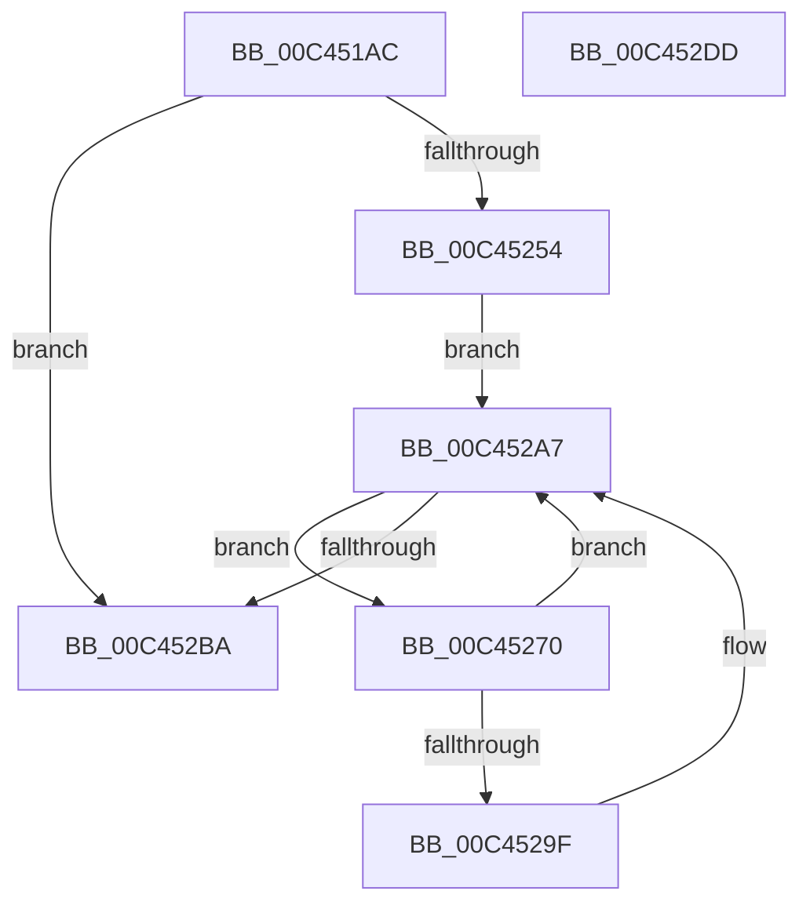

# PspCopyNodeRelativeMaskToAffinityEx

- RVA: `0x00C451AC`–`0x00C452DE` (길이 `306` bytes)
- VA: `0x0000000140C451AC`
- 실행 섹션: `INIT`
- PDB 이름 있음: `예`; PDB Function 태그: `아니요`
- unwind 정보 RVA: `0x000CDF68`
- 디코드: `79`개 명령, `306/306` bytes 표시
- 미해석 바이트: `0` (있으면 어셈블리에 `.byte`로 보존)

> 이 문서는 커널 이미지의 기계어와 PDB 기호를 분석해 생성했습니다. 4번과 5번은 함수 원형과 자료형을 바이너리 사용 방식에서 추정한 C 해석이며 원본 소스 복구 결과는 아닙니다.

## 1. Dependencies

- 직접 호출 지점: **8**; 고유 호출 대상: **6**
- 직접 호출자로 확인된 함수: **1**
- RIP 상대 이미지 참조: **2**

### Outgoing calls
- `0x00C451F6` → [memset](../../text/6C/memset_function_006C6C40.md) (function, `0x006C6C40`)
- `0x00C4520E` → [memset](../../text/6C/memset_function_006C6C40.md) (function, `0x006C6C40`)
- `0x00C45231` → [memset](../../text/6C/memset_function_006C6C40.md) (function, `0x006C6C40`)
- `0x00C45241` → [KeQueryNodeActiveAffinityEx](../../text/25/KeQueryNodeActiveAffinityEx_function_00256740.md) (function, `0x00256740`)
- `0x00C4524B` → [KeIsEmptyAffinityEx](../../text/2D/KeIsEmptyAffinityEx_function_002D1580.md) (function, `0x002D1580`)
- `0x00C452A2` → [KeAddProcessorAffinityEx](../../text/25/KeAddProcessorAffinityEx_function_0025B6F0.md) (function, `0x0025B6F0`)
- `0x00C452B1` → [KeEnumerateNextProcessor](../../text/41/KeEnumerateNextProcessor_function_00415480.md) (function, `0x00415480`)
- `0x00C452C1` → [_security_check_cookie](../../text/6A/_security_check_cookie_function_006AC640.md) (function, `0x006AC640`)

### Direct callers
- [PsInitializeBootCpuPartitions](PsInitializeBootCpuPartitions_function_00C44D94.md) at `0x00C45039`

### Static image references
- `0x00C451C4` → RVA `0x00E0A740` (`.data`; read)
- `0x00C45274` → RVA `0x00FC8C40` (`ALMOSTRO`; read)

## 2. Other-region calls and transfers

- 다른 실행 섹션으로 향하는 call: **8**
  - `0x00C451F6` → [memset](../../text/6C/memset_function_006C6C40.md) (`INIT` → `.text`)
  - `0x00C4520E` → [memset](../../text/6C/memset_function_006C6C40.md) (`INIT` → `.text`)
  - `0x00C45231` → [memset](../../text/6C/memset_function_006C6C40.md) (`INIT` → `.text`)
  - `0x00C45241` → [KeQueryNodeActiveAffinityEx](../../text/25/KeQueryNodeActiveAffinityEx_function_00256740.md) (`INIT` → `.text`)
  - `0x00C4524B` → [KeIsEmptyAffinityEx](../../text/2D/KeIsEmptyAffinityEx_function_002D1580.md) (`INIT` → `.text`)
  - `0x00C452A2` → [KeAddProcessorAffinityEx](../../text/25/KeAddProcessorAffinityEx_function_0025B6F0.md) (`INIT` → `.text`)
  - `0x00C452B1` → [KeEnumerateNextProcessor](../../text/41/KeEnumerateNextProcessor_function_00415480.md) (`INIT` → `.text`)
  - `0x00C452C1` → [_security_check_cookie](../../text/6A/_security_check_cookie_function_006AC640.md) (`INIT` → `.text`)
- 별도 외부 분기/꼬리 이동을 확인하지 못했습니다.

## 3. Assembly (complete function range)

```asm
00C451AC  48 89 5C 24 10                  mov qword ptr [rsp + 0x10], rbx
00C451B1  55                              push rbp
00C451B2  56                              push rsi
00C451B3  57                              push rdi
00C451B4  41 54                           push r12
00C451B6  41 57                           push r15
00C451B8  48 8D 6C 24 A0                  lea rbp, [rsp - 0x60]
00C451BD  48 81 EC 60 01 00 00            sub rsp, 0x160
00C451C4  48 8B 05 75 55 1C 00            mov rax, qword ptr [rip + 0x1c5575]
00C451CB  48 33 C4                        xor rax, rsp
00C451CE  48 89 45 50                     mov qword ptr [rbp + 0x50], rax
00C451D2  49 8B F8                        mov rdi, r8
00C451D5  48 8B F2                        mov rsi, rdx
00C451D8  0F B7 D9                        movzx ebx, cx
00C451DB  45 33 FF                        xor r15d, r15d
00C451DE  33 D2                           xor edx, edx
00C451E0  44 89 7C 24 3A                  mov dword ptr [rsp + 0x3a], r15d
00C451E5  41 B8 00 01 00 00               mov r8d, 0x100
00C451EB  66 44 89 7C 24 3E               mov word ptr [rsp + 0x3e], r15w
00C451F1  48 8D 4C 24 48                  lea rcx, [rsp + 0x48]
00C451F6  E8 45 1A A8 FF                  call 0x1406c6c40
00C451FB  44 0F B7 07                     movzx r8d, word ptr [rdi]
00C451FF  48 8D 4F 08                     lea rcx, [rdi + 8]
00C45203  49 C1 E0 03                     shl r8, 3
00C45207  33 D2                           xor edx, edx
00C45209  44 89 7C 24 20                  mov dword ptr [rsp + 0x20], r15d
00C4520E  E8 2D 1A A8 FF                  call 0x1406c6c40
00C45213  45 8D 67 01                     lea r12d, [r15 + 1]
00C45217  48 C7 44 24 40 01 00 20 00      mov qword ptr [rsp + 0x40], 0x200001
00C45220  33 D2                           xor edx, edx
00C45222  66 44 89 27                     mov word ptr [rdi], r12w
00C45226  41 B8 00 01 00 00               mov r8d, 0x100
00C4522C  48 8D 4C 24 48                  lea rcx, [rsp + 0x48]
00C45231  E8 0A 1A A8 FF                  call 0x1406c6c40
00C45236  45 33 C0                        xor r8d, r8d
00C45239  48 8D 54 24 40                  lea rdx, [rsp + 0x40]
00C4523E  0F B7 CB                        movzx ecx, bx
00C45241  E8 FA 14 61 FF                  call 0x140256740
00C45246  48 8D 4C 24 40                  lea rcx, [rsp + 0x40]
00C4524B  E8 30 C3 68 FF                  call 0x1402d1580
00C45250  85 C0                           test eax, eax
00C45252  75 66                           jne 0x140c452ba
00C45254  48 8B 44 24 48                  mov rax, qword ptr [rsp + 0x48]
00C45259  48 89 44 24 30                  mov qword ptr [rsp + 0x30], rax
00C4525E  48 8D 44 24 40                  lea rax, [rsp + 0x40]
00C45263  48 89 44 24 28                  mov qword ptr [rsp + 0x28], rax
00C45268  66 44 89 7C 24 38               mov word ptr [rsp + 0x38], r15w
00C4526E  EB 37                           jmp 0x140c452a7
00C45270  8B 54 24 20                     mov edx, dword ptr [rsp + 0x20]
00C45274  48 8D 0D C5 39 38 00            lea rcx, [rip + 0x3839c5]
00C4527B  48 8B 04 D1                     mov rax, qword ptr [rcx + rdx*8]
00C4527F  8B 88 28 B9 00 00               mov ecx, dword ptr [rax + 0xb928]
00C45285  48 8B 46 08                     mov rax, qword ptr [rsi + 8]
00C45289  44 8B C1                        mov r8d, ecx
00C4528C  49 C1 E8 03                     shr r8, 3
00C45290  80 E1 07                        and cl, 7
00C45293  45 8A 04 00                     mov r8b, byte ptr [r8 + rax]
00C45297  41 D2 F8                        sar r8b, cl
00C4529A  45 84 C4                        test r12b, r8b
00C4529D  74 08                           je 0x140c452a7
00C4529F  48 8B CF                        mov rcx, rdi
00C452A2  E8 49 64 61 FF                  call 0x14025b6f0
00C452A7  48 8D 54 24 28                  lea rdx, [rsp + 0x28]
00C452AC  48 8D 4C 24 20                  lea rcx, [rsp + 0x20]
00C452B1  E8 CA 01 7D FF                  call 0x140415480
00C452B6  85 C0                           test eax, eax
00C452B8  74 B6                           je 0x140c45270
00C452BA  48 8B 4D 50                     mov rcx, qword ptr [rbp + 0x50]
00C452BE  48 33 CC                        xor rcx, rsp
00C452C1  E8 7A 73 A6 FF                  call 0x1406ac640
00C452C6  48 8B 9C 24 98 01 00 00         mov rbx, qword ptr [rsp + 0x198]
00C452CE  48 81 C4 60 01 00 00            add rsp, 0x160
00C452D5  41 5F                           pop r15
00C452D7  41 5C                           pop r12
00C452D9  5F                              pop rdi
00C452DA  5E                              pop rsi
00C452DB  5D                              pop rbp
00C452DC  C3                              ret
00C452DD  CC                              int3
```

## 4. C-style interpretation (structured pseudocode)

```c
__int64 __fastcall PspCopyNodeRelativeMaskToAffinityEx(unsigned __int16 a1, __int64 a2, __int64 a3)
{
    __int64 result;
    __int64 v_r15;
    __int64 v_rsp;
    unsigned __int64 v_stack_m140;
    unsigned __int64 v_stack_m148;
    unsigned __int16 v_stack_m14A;
    unsigned int v_stack_m14E;
    unsigned __int16 v_stack_m150;
    unsigned __int64 v_stack_m158;
    unsigned __int64 v_stack_m160;
    unsigned int v_stack_m168;
    unsigned __int64 v_stack_m38;
    unsigned __int64 v_stack_m88;
    unsigned __int64 v_stack_p10;

    v_stack_p10 = v_rbx;
    v_rsp = (v_rsp) - (352);
    result = (*(unsigned __int64 *)(v_rip + 1856885)) ^ (v_rsp);
    v_stack_m38 = result;
    v_r15 = 0;
    a2 = 0;
    v_stack_m14E = 0;
    v_stack_m14A = 0;
    result = memset(v_stack_m140, a2, 256, a4);
    a3 = (*(unsigned __int16 *)(a3)) << (3);
    a2 = 0;
    v_stack_m168 = 0;
    result = memset(a3 + 8, a2, a3, a4);
    v_stack_m148 = 0x200001ULL;
    a2 = 0;
    *(unsigned __int16 *)(a3) = (unsigned __int16)(v_r15 + 1);
    result = memset(v_stack_m140, a2, 256, a4);
    a3 = 0;
    result = KeQueryNodeActiveAffinityEx(a1, v_stack_m148, a3, a4);
    result = KeIsEmptyAffinityEx(v_stack_m148, v_stack_m148, a3, a4);
    if ((unsigned int)(result) != 0) goto loc_00C452BA;
    v_stack_m158 = v_stack_m140;
    v_stack_m160 = v_stack_m148;
    v_stack_m150 = 0;
    goto loc_00C452A7;
loc_00C45270:
    a3 = ((unsigned int)((unsigned int)((unsigned int)(*(unsigned int *)(*(unsigned __int64 *)(v_rip + 3684805 + (unsigned int)(v_stack_m168) * 8) + 47400))))) >> (3);
    a1 = (unsigned __int8)(((unsigned int)(*(unsigned int *)(*(unsigned __int64 *)(v_rip + 3684805 + (unsigned int)(v_stack_m168) * 8) + 47400))) & (7));
    a3 = (unsigned __int8)((*(unsigned __int8 *)(a3 + *(unsigned __int64 *)(a2 + 8) * 1)) >> ((unsigned __int8)(a1)));
    result = *(unsigned __int64 *)(a2 + 8);
    if ((((unsigned __int8)(v_r15 + 1)) & ((unsigned __int8)(a3))) != 0) {
        a1 = a3;
        result = KeAddProcessorAffinityEx(a1, (unsigned int)(v_stack_m168), a3, a4);
    }
    result = KeEnumerateNextProcessor(v_stack_m168, v_stack_m160, a3, a4);
    if ((unsigned int)(result) == 0) goto loc_00C45270;
loc_00C452BA:
    a1 = (v_stack_m38) ^ (v_rsp);
    result = _security_check_cookie(a1, v_stack_m160, a3, a4);
    v_rsp = (v_rsp) + (352);
    return result;
}
```

## 5. (Beta) C Style

```c
int64_t PspCopyNodeRelativeMaskToAffinityEx(uint16_t Arg1, void *Arg2, void *Arg3)
{
    uint8_t *arg2 = (uint8_t *)Arg2;
    uint8_t *arg3 = (uint8_t *)Arg3;

    int64_t result;
    int64_t local_r15;
    int64_t local_rsp;
    uint64_t v_stack_m140;
    uint64_t v_stack_m148;
    uint16_t v_stack_m14A;
    uint32_t v_stack_m14E;
    uint16_t v_stack_m150;
    uint64_t v_stack_m158;
    uint64_t v_stack_m160;
    uint32_t v_stack_m168;
    uint64_t v_stack_m38;
    uint64_t v_stack_m88;
    uint64_t v_stack_p10;

    v_stack_p10 = local_rbx;
    local_rsp = (local_rsp) - (352);
    result = (*(uint64_t *)(v_rip + 0x1C5575)) ^ (local_rsp);
    v_stack_m38 = result;
    local_r15 = 0;
    Arg2 = 0;
    v_stack_m14E = 0;
    v_stack_m14A = 0;
    result = memset(v_stack_m140, Arg2, 256, a4);
    Arg3 = (*(uint16_t *)(arg3)) << (3);
    Arg2 = 0;
    v_stack_m168 = 0;
    result = memset(Arg3 + 8, Arg2, Arg3, a4);
    v_stack_m148 = 0x200001ULL;
    Arg2 = 0;
    *(uint16_t *)(arg3) = (uint16_t)(local_r15 + 1);
    result = memset(v_stack_m140, Arg2, 256, a4);
    Arg3 = 0;
    result = KeQueryNodeActiveAffinityEx(Arg1, v_stack_m148, Arg3, a4);
    result = KeIsEmptyAffinityEx(v_stack_m148, v_stack_m148, Arg3, a4);
    if ((uint32_t)(result) != 0) goto loc_00C452BA;
    v_stack_m158 = v_stack_m140;
    v_stack_m160 = v_stack_m148;
    v_stack_m150 = 0;
    goto loc_00C452A7;
loc_00C45270:
    Arg3 = ((uint32_t)((uint32_t)((uint32_t)(*(uint32_t *)(*(uint64_t *)(v_rip + 0x3839C5 + (uint32_t)(v_stack_m168) * 8) + 0xB928))))) >> (3);
    Arg1 = (uint8_t)(((uint32_t)(*(uint32_t *)(*(uint64_t *)(v_rip + 0x3839C5 + (uint32_t)(v_stack_m168) * 8) + 0xB928))) & (7));
    Arg3 = (uint8_t)((*(uint8_t *)(arg3 + *(uint64_t *)(arg2 + 0x8) * 1)) >> ((uint8_t)(Arg1)));
    result = *(uint64_t *)(arg2 + 0x8);
    if ((((uint8_t)(local_r15 + 1)) & ((uint8_t)(Arg3))) != 0) {
        Arg1 = Arg3;
        result = KeAddProcessorAffinityEx(Arg1, (uint32_t)(v_stack_m168), Arg3, a4);
    }
    result = KeEnumerateNextProcessor(v_stack_m168, v_stack_m160, Arg3, a4);
    if ((uint32_t)(result) == 0) goto loc_00C45270;
loc_00C452BA:
    Arg1 = (v_stack_m38) ^ (local_rsp);
    result = _security_check_cookie(Arg1, v_stack_m160, Arg3, a4);
    local_rsp = (local_rsp) + (352);
    return result;
}
```

### 관측된 메모리 오프셋

구조체 형식이 확인되지 않은 접근은 인자 기준의 오프셋으로만 기록했습니다.

| 기준 인자 | 오프셋 표현 | 폭 (bit) | 접근 |
|---|---:|---:|---|
| `Arg2` | `+ 0x8` | `64` | `R` |
| `Arg3` | `+ 0x0` | `16` | `R` |
| `Arg3` | `+ 0x0` | `16` | `W` |
| `Arg3` | `+ 0x8` | `64` | `R` |

## 6. Execution-region graph

[열기: 2D/3D 그래프와 함수 탐색 컨트롤 패널](../../../control-panel.html?section=init&rva=0x00C451AC&view=graph)

- 2D 그래프는 위에서 아래로 흐르고, 3D 그래프는 빈 공간을 드래그해 회전합니다. Shift+드래그는 이동, 휠은 확대·축소, 함수 노드 선택은 대상 보고서 이동입니다.

### Static fallback


