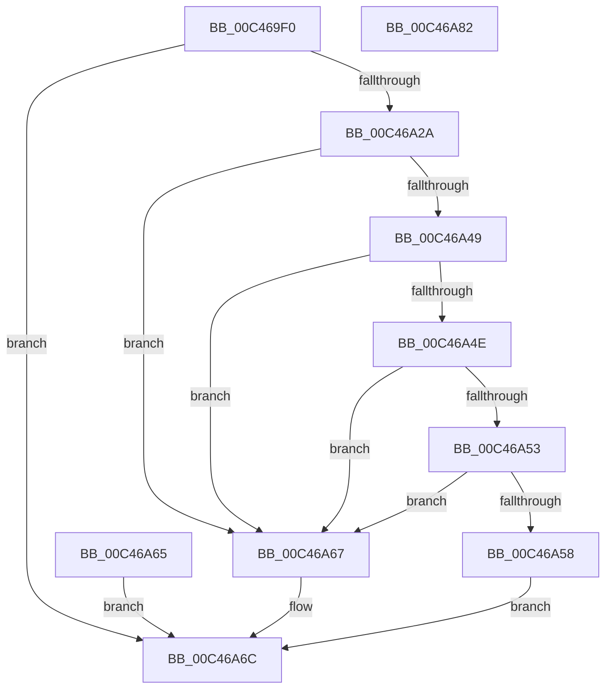

# PspCopyNtdllExport

- RVA: `0x00C469F0`–`0x00C46A83` (길이 `147` bytes)
- VA: `0x0000000140C469F0`
- 실행 섹션: `INIT`
- PDB 이름 있음: `예`; PDB Function 태그: `아니요`
- unwind 정보 RVA: `0x000CF6D8`
- 디코드: `45`개 명령, `147/147` bytes 표시
- 미해석 바이트: `0` (있으면 어셈블리에 `.byte`로 보존)

> 이 문서는 커널 이미지의 기계어와 PDB 기호를 분석해 생성했습니다. 4번과 5번은 함수 원형과 자료형을 바이너리 사용 방식에서 추정한 C 해석이며 원본 소스 복구 결과는 아닙니다.

## 1. Dependencies

- 직접 호출 지점: **2**; 고유 호출 대상: **2**
- 직접 호출자로 확인된 함수: **1**
- RIP 상대 이미지 참조: **0**

### Outgoing calls
- `0x00C46A21` → [PspLookupEntryPoint](PspLookupEntryPoint_function_00C45E8C.md) (function, `0x00C45E8C`)
- `0x00C46A5B` → [memcpy](../../text/6C/memcpy_function_006C6840.md) (function, `0x006C6840`)

### Direct callers
- [PspLocateNtdllAddressesForScpCfg](PspLocateNtdllAddressesForScpCfg_function_00C46CB0.md) at `0x00C46D3D`

### Static image references
- 디코드된 RIP-relative 메모리 참조가 없습니다.

## 2. Other-region calls and transfers

- 다른 실행 섹션으로 향하는 call: **1**
  - `0x00C46A5B` → [memcpy](../../text/6C/memcpy_function_006C6840.md) (`INIT` → `.text`)
- 별도 외부 분기/꼬리 이동을 확인하지 못했습니다.

## 3. Assembly (complete function range)

```asm
00C469F0  4C 8B DC                        mov r11, rsp
00C469F3  49 89 5B 10                     mov qword ptr [r11 + 0x10], rbx
00C469F7  49 89 73 18                     mov qword ptr [r11 + 0x18], rsi
00C469FB  49 89 7B 20                     mov qword ptr [r11 + 0x20], rdi
00C469FF  41 56                           push r14
00C46A01  48 83 EC 20                     sub rsp, 0x20
00C46A05  49 8B F1                        mov rsi, r9
00C46A08  49 8B C0                        mov rax, r8
00C46A0B  44 8B F2                        mov r14d, edx
00C46A0E  48 8B F9                        mov rdi, rcx
00C46A11  49 83 63 08 00                  and qword ptr [r11 + 8], 0
00C46A16  48 8B 59 20                     mov rbx, qword ptr [rcx + 0x20]
00C46A1A  4D 8D 43 08                     lea r8, [r11 + 8]
00C46A1E  48 8B D0                        mov rdx, rax
00C46A21  E8 66 F4 FF FF                  call 0x140c45e8c
00C46A26  85 C0                           test eax, eax
00C46A28  78 42                           js 0x140c46a6c
00C46A2A  48 8B 57 20                     mov rdx, qword ptr [rdi + 0x20]
00C46A2E  48 2B 57 18                     sub rdx, qword ptr [rdi + 0x18]
00C46A32  48 03 54 24 30                  add rdx, qword ptr [rsp + 0x30]
00C46A37  4A 8D 04 33                     lea rax, [rbx + r14]
00C46A3B  4C 8B 44 24 50                  mov r8, qword ptr [rsp + 0x50]
00C46A40  4A 8D 0C 02                     lea rcx, [rdx + r8]
00C46A44  48 3B C3                        cmp rax, rbx
00C46A47  76 1E                           jbe 0x140c46a67
00C46A49  48 3B CA                        cmp rcx, rdx
00C46A4C  76 19                           jbe 0x140c46a67
00C46A4E  48 3B D3                        cmp rdx, rbx
00C46A51  72 14                           jb 0x140c46a67
00C46A53  48 3B C8                        cmp rcx, rax
00C46A56  77 0F                           ja 0x140c46a67
00C46A58  48 8B CE                        mov rcx, rsi
00C46A5B  E8 E0 FD A7 FF                  call 0x1406c6840
00C46A60  90                              nop
00C46A61  33 C0                           xor eax, eax
00C46A63  EB 07                           jmp 0x140c46a6c
00C46A65  EB 05                           jmp 0x140c46a6c
00C46A67  B8 0D 00 00 C0                  mov eax, 0xc000000d
00C46A6C  48 8B 5C 24 38                  mov rbx, qword ptr [rsp + 0x38]
00C46A71  48 8B 74 24 40                  mov rsi, qword ptr [rsp + 0x40]
00C46A76  48 8B 7C 24 48                  mov rdi, qword ptr [rsp + 0x48]
00C46A7B  48 83 C4 20                     add rsp, 0x20
00C46A7F  41 5E                           pop r14
00C46A81  C3                              ret
00C46A82  CC                              int3
```

## 4. C-style interpretation (structured pseudocode)

```c
__int64 __fastcall PspCopyNtdllExport(__int64 a1, int a2, __int64 a3, __int64 a4, __int64 a5)
{
    __int64 result;
    __int64 v_rsp;
    unsigned __int64 v_stack_p10;
    unsigned __int64 v_stack_p18;
    unsigned __int64 v_stack_p20;
    unsigned __int64 v_stack_p8;

    *(unsigned __int64 *)(v_rsp + 16) = v_rbx;
    *(unsigned __int64 *)(v_rsp + 24) = v_rsi;
    *(unsigned __int64 *)(v_rsp + 32) = v_rdi;
    v_rsp = (v_rsp) - (32);
    result = PspLookupEntryPoint(a1, a3, v_rsp + 8, a4);
    if (sign_flag) goto loc_00C46A6C;
    a2 = (*(unsigned __int64 *)(a1 + 32)) - (*(unsigned __int64 *)(a1 + 24));
    a2 = (a2) + (v_stack_p8);
    if ((*(unsigned __int64 *)(a1 + 32) + (unsigned int)(a2) * 1) <= (*(unsigned __int64 *)(a1 + 32))) goto loc_00C46A67;
    if ((a2 + a5 * 1) <= a2) goto loc_00C46A67;
    if (a2 < (*(unsigned __int64 *)(a1 + 32))) goto loc_00C46A67;
    if ((a2 + a5 * 1) > (*(unsigned __int64 *)(a1 + 32) + (unsigned int)(a2) * 1)) goto loc_00C46A67;
    result = memcpy(a4, a2, a5, a4);
    result = 0;
    goto loc_00C46A6C;
loc_00C46A67:
loc_00C46A6C:
    v_rsp = (v_rsp) + (32);
    return (unsigned int)(0xC000000DULL);
}
```

## 5. (Beta) C Style

```c
int64_t PspCopyNtdllExport(void *Arg1, int32_t Arg2, int64_t Arg3, int64_t Arg4, int64_t Arg5)
{
    uint8_t *arg1 = (uint8_t *)Arg1;

    int64_t result;
    int64_t local_rsp;
    uint64_t v_stack_p10;
    uint64_t v_stack_p18;
    uint64_t v_stack_p20;
    uint64_t v_stack_p8;

    *(uint64_t *)(local_rsp + 0x10) = local_rbx;
    *(uint64_t *)(local_rsp + 0x18) = local_rsi;
    *(uint64_t *)(local_rsp + 0x20) = local_rdi;
    local_rsp = (local_rsp) - (32);
    result = PspLookupEntryPoint(Arg1, Arg3, local_rsp + 8, Arg4);
    if (sign_flag) goto loc_00C46A6C;
    Arg2 = (*(uint64_t *)(arg1 + 0x20)) - (*(uint64_t *)(arg1 + 0x18));
    Arg2 = (Arg2) + (v_stack_p8);
    if ((*(uint64_t *)(arg1 + 0x20) + (uint32_t)(Arg2) * 1) <= (*(uint64_t *)(arg1 + 0x20))) goto loc_00C46A67;
    if ((Arg2 + Arg5 * 1) <= Arg2) goto loc_00C46A67;
    if (Arg2 < (*(uint64_t *)(arg1 + 0x20))) goto loc_00C46A67;
    if ((Arg2 + Arg5 * 1) > (*(uint64_t *)(arg1 + 0x20) + (uint32_t)(Arg2) * 1)) goto loc_00C46A67;
    result = memcpy(Arg4, Arg2, Arg5, Arg4);
    result = 0;
    goto loc_00C46A6C;
loc_00C46A67:
loc_00C46A6C:
    local_rsp = (local_rsp) + (32);
    return (uint32_t)(0xC000000DULL);
}
```

### 관측된 메모리 오프셋

구조체 형식이 확인되지 않은 접근은 인자 기준의 오프셋으로만 기록했습니다.

| 기준 인자 | 오프셋 표현 | 폭 (bit) | 접근 |
|---|---:|---:|---|
| `Arg1` | `+ 0x18` | `64` | `R` |
| `Arg1` | `+ 0x20` | `64` | `R` |

## 6. Execution-region graph

[열기: 2D/3D 그래프와 함수 탐색 컨트롤 패널](../../../control-panel.html?section=init&rva=0x00C469F0&view=graph)

- 2D 그래프는 위에서 아래로 흐르고, 3D 그래프는 빈 공간을 드래그해 회전합니다. Shift+드래그는 이동, 휠은 확대·축소, 함수 노드 선택은 대상 보고서 이동입니다.

### Static fallback


