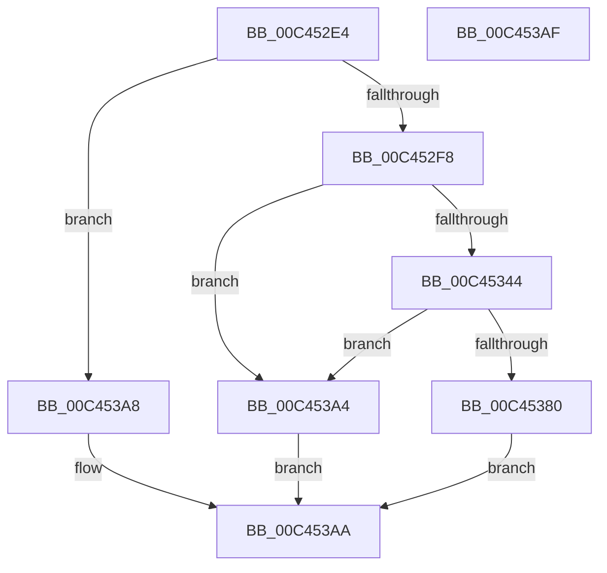

# PspCreateSecureSystemProcess

- RVA: `0x00C452E4`–`0x00C453B0` (길이 `204` bytes)
- VA: `0x0000000140C452E4`
- 실행 섹션: `INIT`
- PDB 이름 있음: `예`; PDB Function 태그: `아니요`
- unwind 정보 RVA: `0x0007A034`
- 디코드: `48`개 명령, `204/204` bytes 표시
- 미해석 바이트: `0` (있으면 어셈블리에 `.byte`로 보존)

> 이 문서는 커널 이미지의 기계어와 PDB 기호를 분석해 생성했습니다. 4번과 5번은 함수 원형과 자료형을 바이너리 사용 방식에서 추정한 C 해석이며 원본 소스 복구 결과는 아닙니다.

## 1. Dependencies

- 직접 호출 지점: **4**; 고유 호출 대상: **4**
- 직접 호출자로 확인된 함수: **1**
- RIP 상대 이미지 참조: **5**

### Outgoing calls
- `0x00C4533B` → [PsCreateMinimalProcess](../../page/78/PsCreateMinimalProcess_function_00786D14.md) (function, `0x00786D14`)
- `0x00C4536B` → [ObReferenceObjectByHandle](../../page/86/ObReferenceObjectByHandle_function_00868DB0.md) (function, `0x00868DB0`)
- `0x00C45393` → [strcpy_s](../../text/50/strcpy_s_function_00505FB0.md) (function, `0x00505FB0`)
- `0x00C45398` → [VslRegisterSecureSystemProcess](../../text/58/VslRegisterSecureSystemProcess_function_0058F190.md) (function, `0x0058F190`)

### Direct callers
- [PspInitPhase1](PspInitPhase1_function_00C453B8.md) at `0x00C4543A`

### Static image references
- `0x00C452EB` → RVA `0x00FC6A84` (`ALMOSTRO`; read)
- `0x00C452F8` → RVA `0x00FC6AB0` (`ALMOSTRO`; read)
- `0x00C45344` → RVA `0x00FC6A98` (`ALMOSTRO`; read)
- `0x00C45375` → RVA `0x00FC6CB8` (`ALMOSTRO`; write)
- `0x00C45387` → RVA `0x00C7C790` (` ?? ::PBOPGDP::`string'`; read)

## 2. Other-region calls and transfers

- 다른 실행 섹션으로 향하는 call: **4**
  - `0x00C4533B` → [PsCreateMinimalProcess](../../page/78/PsCreateMinimalProcess_function_00786D14.md) (`INIT` → `PAGE`)
  - `0x00C4536B` → [ObReferenceObjectByHandle](../../page/86/ObReferenceObjectByHandle_function_00868DB0.md) (`INIT` → `PAGE`)
  - `0x00C45393` → [strcpy_s](../../text/50/strcpy_s_function_00505FB0.md) (`INIT` → `.text`)
  - `0x00C45398` → [VslRegisterSecureSystemProcess](../../text/58/VslRegisterSecureSystemProcess_function_0058F190.md) (`INIT` → `.text`)
- 별도 외부 분기/꼬리 이동을 확인하지 못했습니다.

## 3. Assembly (complete function range)

```asm
00C452E4  4C 8B DC                        mov r11, rsp
00C452E7  48 83 EC 68                     sub rsp, 0x68
00C452EB  80 3D 92 17 38 00 00            cmp byte ptr [rip + 0x381792], 0
00C452F2  0F 84 B0 00 00 00               je 0x140c453a8
00C452F8  48 8B 0D B1 17 38 00            mov rcx, qword ptr [rip + 0x3817b1]
00C452FF  49 8D 43 08                     lea rax, [r11 + 8]
00C45303  49 83 63 08 00                  and qword ptr [r11 + 8], 0
00C45308  45 33 C0                        xor r8d, r8d
00C4530B  49 89 43 F0                     mov qword ptr [r11 - 0x10], rax
00C4530F  33 D2                           xor edx, edx
00C45311  49 83 63 E8 00                  and qword ptr [r11 - 0x18], 0
00C45316  49 83 63 E0 00                  and qword ptr [r11 - 0x20], 0
00C4531B  49 83 63 D8 00                  and qword ptr [r11 - 0x28], 0
00C45320  49 83 63 D0 00                  and qword ptr [r11 - 0x30], 0
00C45325  83 64 24 30 00                  and dword ptr [rsp + 0x30], 0
00C4532A  83 64 24 28 00                  and dword ptr [rsp + 0x28], 0
00C4532F  44 8A 89 FA 05 00 00            mov r9b, byte ptr [rcx + 0x5fa]
00C45336  49 83 63 B8 00                  and qword ptr [r11 - 0x48], 0
00C4533B  E8 D4 19 B4 FF                  call 0x140786d14
00C45340  85 C0                           test eax, eax
00C45342  78 60                           js 0x140c453a4
00C45344  4C 8B 05 4D 17 38 00            mov r8, qword ptr [rip + 0x38174d]
00C4534B  48 8D 44 24 78                  lea rax, [rsp + 0x78]
00C45350  48 83 64 24 28 00               and qword ptr [rsp + 0x28], 0
00C45356  45 33 C9                        xor r9d, r9d
00C45359  48 8B 4C 24 70                  mov rcx, qword ptr [rsp + 0x70]
00C4535E  33 D2                           xor edx, edx
00C45360  48 83 64 24 78 00               and qword ptr [rsp + 0x78], 0
00C45366  48 89 44 24 20                  mov qword ptr [rsp + 0x20], rax
00C4536B  E8 40 3A C2 FF                  call 0x140868db0
00C45370  48 8B 4C 24 78                  mov rcx, qword ptr [rsp + 0x78]
00C45375  48 89 0D 3C 19 38 00            mov qword ptr [rip + 0x38193c], rcx
00C4537C  85 C0                           test eax, eax
00C4537E  78 24                           js 0x140c453a4
00C45380  48 81 C1 38 03 00 00            add rcx, 0x338
00C45387  4C 8D 05 02 74 03 00            lea r8, [rip + 0x37402]
00C4538E  BA 0F 00 00 00                  mov edx, 0xf
00C45393  E8 18 0C 8C FF                  call 0x140505fb0
00C45398  E8 F3 9D 94 FF                  call 0x14058f190
00C4539D  85 C0                           test eax, eax
00C4539F  0F 99 C0                        setns al
00C453A2  EB 06                           jmp 0x140c453aa
00C453A4  32 C0                           xor al, al
00C453A6  EB 02                           jmp 0x140c453aa
00C453A8  B0 01                           mov al, 1
00C453AA  48 83 C4 68                     add rsp, 0x68
00C453AE  C3                              ret
00C453AF  CC                              int3
```

## 4. C-style interpretation (structured pseudocode)

```c
__int64 __fastcall PspCreateSecureSystemProcess(__int64 a1, int a2, int a3)
{
    __int64 result;
    __int64 v_rsp;
    unsigned int v_stack_m38;
    unsigned int v_stack_m40;
    unsigned __int64 v_stack_m48;
    unsigned __int64 v_stack_p10;
    unsigned __int64 v_stack_p8;

    v_rsp = (v_rsp) - (104);
    if ((*(unsigned __int8 *)(v_rip + 3676050)) == 0) goto loc_00C453A8;
    a3 = 0;
    *(unsigned __int64 *)(v_rsp - 16) = v_rsp + 8;
    a2 = 0;
    result = PsCreateMinimalProcess(*(unsigned __int64 *)(v_rip + 3676081), a2, a3, *(unsigned __int8 *)(*(unsigned __int64 *)(v_rip + 3676081) + 1530));
    if (sign_flag) goto loc_00C453A4;
    a4 = 0;
    a2 = 0;
    v_stack_m48 = v_stack_p10;
    result = ObReferenceObjectByHandle(v_stack_p8, a2, *(unsigned __int64 *)(v_rip + 3675981), a4);
    *(unsigned __int64 *)(v_rip + 3676476) = v_stack_p10;
    if (sign_flag) goto loc_00C453A4;
    a1 = (v_stack_p10) + (824);
    result = strcpy_s(a1, 15, v_rip + 226306, a4);
    result = VslRegisterSecureSystemProcess(a1, 15, v_rip + 226306, a4);
    result = (!sign_flag) ? 1 : 0;
    goto loc_00C453AA;
loc_00C453A4:
    result = 0;
    goto loc_00C453AA;
loc_00C453A8:
loc_00C453AA:
    v_rsp = (v_rsp) + (104);
    return 1;
}
```

## 5. (Beta) C Style

```c
int64_t PspCreateSecureSystemProcess(int64_t Arg1, int32_t Arg2, int32_t Arg3)
{
    int64_t result;
    int64_t local_rsp;
    uint32_t v_stack_m38;
    uint32_t v_stack_m40;
    uint64_t v_stack_m48;
    uint64_t v_stack_p10;
    uint64_t v_stack_p8;

    local_rsp = (local_rsp) - (104);
    if ((*(uint8_t *)(v_rip + 0x381792)) == 0) goto loc_00C453A8;
    Arg3 = 0;
    *(uint64_t *)(local_rsp - 0x10) = local_rsp + 8;
    Arg2 = 0;
    result = PsCreateMinimalProcess(*(uint64_t *)(v_rip + 0x3817B1), Arg2, Arg3, *(uint8_t *)(*(uint64_t *)(v_rip + 0x3817B1) + 0x5FA));
    if (sign_flag) goto loc_00C453A4;
    a4 = 0;
    Arg2 = 0;
    v_stack_m48 = v_stack_p10;
    result = ObReferenceObjectByHandle(v_stack_p8, Arg2, *(uint64_t *)(v_rip + 0x38174D), a4);
    *(uint64_t *)(v_rip + 0x38193C) = v_stack_p10;
    if (sign_flag) goto loc_00C453A4;
    Arg1 = (v_stack_p10) + (824);
    result = strcpy_s(Arg1, 15, v_rip + 226306, a4);
    result = VslRegisterSecureSystemProcess(Arg1, 15, v_rip + 226306, a4);
    result = (!sign_flag) ? 1 : 0;
    goto loc_00C453AA;
loc_00C453A4:
    result = 0;
    goto loc_00C453AA;
loc_00C453A8:
loc_00C453AA:
    local_rsp = (local_rsp) + (104);
    return 1;
}
```

## 6. Execution-region graph

[열기: 2D/3D 그래프와 함수 탐색 컨트롤 패널](../../../control-panel.html?section=init&rva=0x00C452E4&view=graph)

- 2D 그래프는 위에서 아래로 흐르고, 3D 그래프는 빈 공간을 드래그해 회전합니다. Shift+드래그는 이동, 휠은 확대·축소, 함수 노드 선택은 대상 보고서 이동입니다.

### Static fallback


