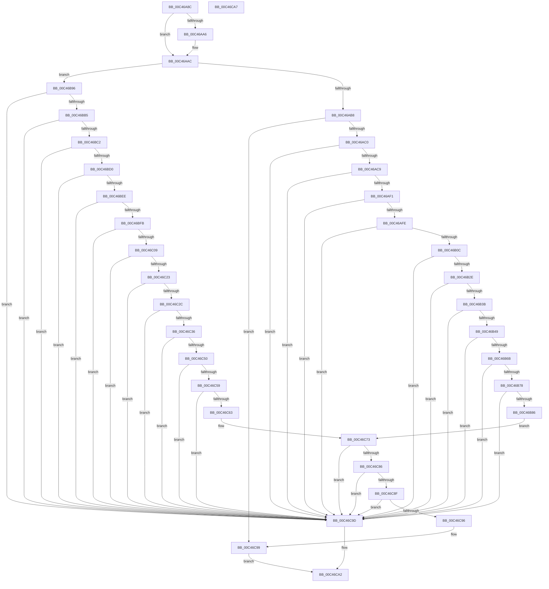

# PspFinalizeScpCfgPage

- RVA: `0x00C46A8C`–`0x00C46CA8` (길이 `540` bytes)
- VA: `0x0000000140C46A8C`
- 실행 섹션: `INIT`
- PDB 이름 있음: `예`; PDB Function 태그: `아니요`
- unwind 정보 RVA: `0x00063458`
- 디코드: `136`개 명령, `540/540` bytes 표시
- 미해석 바이트: `0` (있으면 어셈블리에 `.byte`로 보존)

> 이 문서는 커널 이미지의 기계어와 PDB 기호를 분석해 생성했습니다. 4번과 5번은 함수 원형과 자료형을 바이너리 사용 방식에서 추정한 C 해석이며 원본 소스 복구 결과는 아닙니다.

## 1. Dependencies

- 직접 호출 지점: **1**; 고유 호출 대상: **1**
- 직접 호출자로 확인된 함수: **1**
- RIP 상대 이미지 참조: **0**

### Outgoing calls
- `0x00C46AA6` → [gsl::details::terminate](../../text/4F/gsl_details_terminate_function_004F9AA0.md) (function, `0x004F9AA0`)

### Direct callers
- [PsInitializeScpCfgPages](PsInitializeScpCfgPages_function_00C46EEC.md) at `0x00C47039`

### Static image references
- 디코드된 RIP-relative 메모리 참조가 없습니다.

## 2. Other-region calls and transfers

- 다른 실행 섹션으로 향하는 call: **1**
  - `0x00C46AA6` → [gsl::details::terminate](../../text/4F/gsl_details_terminate_function_004F9AA0.md) (`INIT` → `.text`)
- 별도 외부 분기/꼬리 이동을 확인하지 못했습니다.

## 3. Assembly (complete function range)

```asm
00C46A8C  48 83 EC 48                     sub rsp, 0x48
00C46A90  0F 28 01                        movaps xmm0, xmmword ptr [rcx]
00C46A93  4D 8B D0                        mov r10, r8
00C46A96  66 48 0F 7E C0                  movq rax, xmm0
00C46A9B  0F 29 44 24 20                  movaps xmmword ptr [rsp + 0x20], xmm0
00C46AA0  48 83 F8 18                     cmp rax, 0x18
00C46AA4  73 06                           jae 0x140c46aac
00C46AA6  E8 F5 2F 8B FF                  call 0x1404f9aa0
00C46AAB  CC                              int3
00C46AAC  8D 42 FF                        lea eax, [rdx - 1]
00C46AAF  83 F8 01                        cmp eax, 1
00C46AB2  0F 86 DE 00 00 00               jbe 0x140c46b96
00C46AB8  85 D2                           test edx, edx
00C46ABA  0F 84 D9 01 00 00               je 0x140c46c99
00C46AC0  83 FA 03                        cmp edx, 3
00C46AC3  0F 85 D4 01 00 00               jne 0x140c46c9d
00C46AC9  4C 8B 54 24 28                  mov r10, qword ptr [rsp + 0x28]
00C46ACE  66 48 0F 7E C0                  movq rax, xmm0
00C46AD3  4C 8B 4C 24 70                  mov r9, qword ptr [rsp + 0x70]
00C46AD8  0F 29 44 24 30                  movaps xmmword ptr [rsp + 0x30], xmm0
00C46ADD  41 8B 12                        mov edx, dword ptr [r10]
00C46AE0  4D 8B 59 40                     mov r11, qword ptr [r9 + 0x40]
00C46AE4  83 C2 02                        add edx, 2
00C46AE7  48 83 F8 08                     cmp rax, 8
00C46AEB  0F 82 AC 01 00 00               jb 0x140c46c9d
00C46AF1  48 83 C0 F8                     add rax, -8
00C46AF5  48 3B C2                        cmp rax, rdx
00C46AF8  0F 82 9F 01 00 00               jb 0x140c46c9d
00C46AFE  4C 8B 44 24 38                  mov r8, qword ptr [rsp + 0x38]
00C46B03  4C 03 C2                        add r8, rdx
00C46B06  0F 84 91 01 00 00               je 0x140c46c9d
00C46B0C  4D 89 18                        mov qword ptr [r8], r11
00C46B0F  66 48 0F 7E C0                  movq rax, xmm0
00C46B14  41 8B 52 04                     mov edx, dword ptr [r10 + 4]
00C46B18  4D 8B 59 48                     mov r11, qword ptr [r9 + 0x48]
00C46B1C  83 C2 02                        add edx, 2
00C46B1F  0F 29 44 24 30                  movaps xmmword ptr [rsp + 0x30], xmm0
00C46B24  48 83 F8 08                     cmp rax, 8
00C46B28  0F 82 6F 01 00 00               jb 0x140c46c9d
00C46B2E  48 83 C0 F8                     add rax, -8
00C46B32  48 3B C2                        cmp rax, rdx
00C46B35  0F 82 62 01 00 00               jb 0x140c46c9d
00C46B3B  4C 8B 44 24 38                  mov r8, qword ptr [rsp + 0x38]
00C46B40  4C 03 C2                        add r8, rdx
00C46B43  0F 84 54 01 00 00               je 0x140c46c9d
00C46B49  4D 89 18                        mov qword ptr [r8], r11
00C46B4C  66 48 0F 7E C0                  movq rax, xmm0
00C46B51  41 8B 52 08                     mov edx, dword ptr [r10 + 8]
00C46B55  4D 8B 59 50                     mov r11, qword ptr [r9 + 0x50]
00C46B59  83 C2 02                        add edx, 2
00C46B5C  0F 29 44 24 30                  movaps xmmword ptr [rsp + 0x30], xmm0
00C46B61  48 83 F8 08                     cmp rax, 8
00C46B65  0F 82 32 01 00 00               jb 0x140c46c9d
00C46B6B  48 83 C0 F8                     add rax, -8
00C46B6F  48 3B C2                        cmp rax, rdx
00C46B72  0F 82 25 01 00 00               jb 0x140c46c9d
00C46B78  4C 8B 44 24 38                  mov r8, qword ptr [rsp + 0x38]
00C46B7D  4C 03 C2                        add r8, rdx
00C46B80  0F 84 17 01 00 00               je 0x140c46c9d
00C46B86  4D 89 18                        mov qword ptr [r8], r11
00C46B89  49 8B 51 58                     mov rdx, qword ptr [r9 + 0x58]
00C46B8D  41 8B 4A 0C                     mov ecx, dword ptr [r10 + 0xc]
00C46B91  E9 DD 00 00 00                  jmp 0x140c46c73
00C46B96  4C 8B 44 24 28                  mov r8, qword ptr [rsp + 0x28]
00C46B9B  66 48 0F 7E C0                  movq rax, xmm0
00C46BA0  0F 29 44 24 30                  movaps xmmword ptr [rsp + 0x30], xmm0
00C46BA5  41 8B 10                        mov edx, dword ptr [r8]
00C46BA8  83 C2 02                        add edx, 2
00C46BAB  48 83 F8 08                     cmp rax, 8
00C46BAF  0F 82 E8 00 00 00               jb 0x140c46c9d
00C46BB5  48 83 C0 F8                     add rax, -8
00C46BB9  48 3B C2                        cmp rax, rdx
00C46BBC  0F 82 DB 00 00 00               jb 0x140c46c9d
00C46BC2  4C 8B 4C 24 38                  mov r9, qword ptr [rsp + 0x38]
00C46BC7  4C 03 CA                        add r9, rdx
00C46BCA  0F 84 CD 00 00 00               je 0x140c46c9d
00C46BD0  4D 89 11                        mov qword ptr [r9], r10
00C46BD3  66 48 0F 7E C0                  movq rax, xmm0
00C46BD8  41 8B 50 04                     mov edx, dword ptr [r8 + 4]
00C46BDC  83 C2 02                        add edx, 2
00C46BDF  0F 29 44 24 30                  movaps xmmword ptr [rsp + 0x30], xmm0
00C46BE4  48 83 F8 08                     cmp rax, 8
00C46BE8  0F 82 AF 00 00 00               jb 0x140c46c9d
00C46BEE  48 83 C0 F8                     add rax, -8
00C46BF2  48 3B C2                        cmp rax, rdx
00C46BF5  0F 82 A2 00 00 00               jb 0x140c46c9d
00C46BFB  4C 8B 4C 24 38                  mov r9, qword ptr [rsp + 0x38]
00C46C00  4C 03 CA                        add r9, rdx
00C46C03  0F 84 94 00 00 00               je 0x140c46c9d
00C46C09  4D 89 11                        mov qword ptr [r9], r10
00C46C0C  66 48 0F 7E C0                  movq rax, xmm0
00C46C11  41 8B 50 08                     mov edx, dword ptr [r8 + 8]
00C46C15  83 C2 02                        add edx, 2
00C46C18  0F 29 44 24 30                  movaps xmmword ptr [rsp + 0x30], xmm0
00C46C1D  48 83 F8 08                     cmp rax, 8
00C46C21  72 7A                           jb 0x140c46c9d
00C46C23  48 83 C0 F8                     add rax, -8
00C46C27  48 3B C2                        cmp rax, rdx
00C46C2A  72 71                           jb 0x140c46c9d
00C46C2C  4C 8B 4C 24 38                  mov r9, qword ptr [rsp + 0x38]
00C46C31  4C 03 CA                        add r9, rdx
00C46C34  74 67                           je 0x140c46c9d
00C46C36  4D 89 11                        mov qword ptr [r9], r10
00C46C39  66 48 0F 7E C0                  movq rax, xmm0
00C46C3E  41 8B 50 0C                     mov edx, dword ptr [r8 + 0xc]
00C46C42  83 C2 02                        add edx, 2
00C46C45  0F 29 44 24 30                  movaps xmmword ptr [rsp + 0x30], xmm0
00C46C4A  48 83 F8 08                     cmp rax, 8
00C46C4E  72 4D                           jb 0x140c46c9d
00C46C50  48 83 C0 F8                     add rax, -8
00C46C54  48 3B C2                        cmp rax, rdx
00C46C57  72 44                           jb 0x140c46c9d
00C46C59  4C 8B 4C 24 38                  mov r9, qword ptr [rsp + 0x38]
00C46C5E  4C 03 CA                        add r9, rdx
00C46C61  74 3A                           je 0x140c46c9d
00C46C63  48 8B 44 24 70                  mov rax, qword ptr [rsp + 0x70]
00C46C68  4D 89 11                        mov qword ptr [r9], r10
00C46C6B  41 8B 48 10                     mov ecx, dword ptr [r8 + 0x10]
00C46C6F  48 8B 50 60                     mov rdx, qword ptr [rax + 0x60]
00C46C73  83 C1 02                        add ecx, 2
00C46C76  0F 29 44 24 30                  movaps xmmword ptr [rsp + 0x30], xmm0
00C46C7B  66 48 0F 7E C0                  movq rax, xmm0
00C46C80  48 83 F8 08                     cmp rax, 8
00C46C84  72 17                           jb 0x140c46c9d
00C46C86  48 83 C0 F8                     add rax, -8
00C46C8A  48 3B C1                        cmp rax, rcx
00C46C8D  72 0E                           jb 0x140c46c9d
00C46C8F  48 03 4C 24 38                  add rcx, qword ptr [rsp + 0x38]
00C46C94  74 07                           je 0x140c46c9d
00C46C96  48 89 11                        mov qword ptr [rcx], rdx
00C46C99  33 C0                           xor eax, eax
00C46C9B  EB 05                           jmp 0x140c46ca2
00C46C9D  B8 0D 00 00 C0                  mov eax, 0xc000000d
00C46CA2  48 83 C4 48                     add rsp, 0x48
00C46CA6  C3                              ret
00C46CA7  CC                              int3
```

## 4. C-style interpretation (structured pseudocode)

```c
__int64 __fastcall PspFinalizeScpCfgPage(__int64 a1, __int64 a2, __int64 a3, __int64 a4, __int64 a5)
{
    __int64 result;
    __int64 v_rsp;
    unsigned __int64 v_stack_m10;
    unsigned __int64 v_stack_m18;
    unsigned __int64 v_stack_m20;
    unsigned __int64 v_stack_m28;

    v_rsp = (v_rsp) - (72);
    v_stack_m28 = v_xmm0;
    if (result < 24) {
        result = gsl__details__terminate(a1, a2, a3, a4);
    }
    if (((unsigned int)(a2 - 1)) <= 1) goto loc_00C46B96;
    if ((unsigned int)(a2) == 0) goto loc_00C46C99;
    if (((unsigned int)(a2)) != 3) goto loc_00C46C9D;
    v_stack_m18 = v_xmm0;
    a2 = (unsigned int)(((unsigned int)(*(unsigned int *)(v_stack_m20))) + (2));
    if ((a2 - 1) < 8) goto loc_00C46C9D;
    result = (a2 - 1) + (-8);
    if (result < a2) goto loc_00C46C9D;
    a3 = (v_stack_m10) + (a2);
    if (condition_is_equal) goto loc_00C46C9D;
    *(unsigned __int64 *)(a3) = *(unsigned __int64 *)(a5 + 64);
    a2 = (unsigned int)(((unsigned int)(*(unsigned int *)(v_stack_m20 + 4))) + (2));
    v_stack_m18 = v_xmm0;
    if (result < 8) goto loc_00C46C9D;
    result = (result) + (-8);
    if (result < a2) goto loc_00C46C9D;
    a3 = (v_stack_m10) + (a2);
    if (condition_is_equal) goto loc_00C46C9D;
    *(unsigned __int64 *)(a3) = *(unsigned __int64 *)(a5 + 72);
    a2 = (unsigned int)(((unsigned int)(*(unsigned int *)(v_stack_m20 + 8))) + (2));
    v_stack_m18 = v_xmm0;
    if (result < 8) goto loc_00C46C9D;
    result = (result) + (-8);
    if (result < a2) goto loc_00C46C9D;
    a3 = (v_stack_m10) + (a2);
    if (condition_is_equal) goto loc_00C46C9D;
    *(unsigned __int64 *)(a3) = *(unsigned __int64 *)(a5 + 80);
    goto loc_00C46C73;
loc_00C46B96:
    v_stack_m18 = v_xmm0;
    a2 = (unsigned int)(((unsigned int)(*(unsigned int *)(v_stack_m20))) + (2));
    if (result < 8) goto loc_00C46C9D;
    result = (result) + (-8);
    if (result < a2) goto loc_00C46C9D;
    a4 = (v_stack_m10) + (a2);
    if (condition_is_equal) goto loc_00C46C9D;
    *(unsigned __int64 *)(a4) = v_stack_m20;
    a2 = (unsigned int)(((unsigned int)(*(unsigned int *)(v_stack_m20 + 4))) + (2));
    v_stack_m18 = v_xmm0;
    if (result < 8) goto loc_00C46C9D;
    result = (result) + (-8);
    if (result < a2) goto loc_00C46C9D;
    a4 = (v_stack_m10) + (a2);
    if (condition_is_equal) goto loc_00C46C9D;
    *(unsigned __int64 *)(a4) = v_stack_m20;
    a2 = (unsigned int)(((unsigned int)(*(unsigned int *)(v_stack_m20 + 8))) + (2));
    v_stack_m18 = v_xmm0;
    if (result < 8) goto loc_00C46C9D;
    result = (result) + (-8);
    if (result < a2) goto loc_00C46C9D;
    a4 = (v_stack_m10) + (a2);
    if (condition_is_equal) goto loc_00C46C9D;
    *(unsigned __int64 *)(a4) = v_stack_m20;
    a2 = (unsigned int)(((unsigned int)(*(unsigned int *)(v_stack_m20 + 12))) + (2));
    v_stack_m18 = v_xmm0;
    if (result < 8) goto loc_00C46C9D;
    result = (result) + (-8);
    if (result < a2) goto loc_00C46C9D;
    a4 = (v_stack_m10) + (a2);
    if (condition_is_equal) goto loc_00C46C9D;
    *(unsigned __int64 *)(a4) = v_stack_m20;
loc_00C46C73:
    a1 = (unsigned int)(((unsigned int)(*(unsigned int *)(v_stack_m20 + 16))) + (2));
    v_stack_m18 = v_xmm0;
    if (a5 < 8) goto loc_00C46C9D;
    result = (a5) + (-8);
    if (result < a1) goto loc_00C46C9D;
    a1 = (a1) + (v_stack_m10);
    if (condition_is_equal) goto loc_00C46C9D;
    *(unsigned __int64 *)(a1) = *(unsigned __int64 *)(a5 + 96);
loc_00C46C99:
    result = 0;
    goto loc_00C46CA2;
loc_00C46C9D:
loc_00C46CA2:
    v_rsp = (v_rsp) + (72);
    return (unsigned int)(0xC000000DULL);
}
```

## 5. (Beta) C Style

```c
int64_t PspFinalizeScpCfgPage(void *Arg1, int64_t Arg2, int64_t Arg3, int64_t Arg4, void *Arg5)
{
    uint8_t *arg1 = (uint8_t *)Arg1;
    uint8_t *arg5 = (uint8_t *)Arg5;

    int64_t result;
    int64_t local_rsp;
    uint64_t v_stack_m10;
    uint64_t v_stack_m18;
    uint64_t v_stack_m20;
    uint64_t v_stack_m28;

    local_rsp = (local_rsp) - (72);
    v_stack_m28 = v_xmm0;
    if (result < 24) {
        result = gsl__details__terminate(Arg1, Arg2, Arg3, Arg4);
    }
    if (((uint32_t)(Arg2 - 1)) <= 1) goto loc_00C46B96;
    if ((uint32_t)(Arg2) == 0) goto loc_00C46C99;
    if (((uint32_t)(Arg2)) != 3) goto loc_00C46C9D;
    v_stack_m18 = v_xmm0;
    Arg2 = (uint32_t)(((uint32_t)(*(uint32_t *)(v_stack_m20))) + (2));
    if ((Arg2 - 1) < 8) goto loc_00C46C9D;
    result = (Arg2 - 1) + (-8);
    if (result < Arg2) goto loc_00C46C9D;
    Arg3 = (v_stack_m10) + (Arg2);
    if (condition_is_equal) goto loc_00C46C9D;
    *(uint64_t *)(Arg3) = *(uint64_t *)(arg5 + 0x40);
    Arg2 = (uint32_t)(((uint32_t)(*(uint32_t *)(v_stack_m20 + 0x4))) + (2));
    v_stack_m18 = v_xmm0;
    if (result < 8) goto loc_00C46C9D;
    result = (result) + (-8);
    if (result < Arg2) goto loc_00C46C9D;
    Arg3 = (v_stack_m10) + (Arg2);
    if (condition_is_equal) goto loc_00C46C9D;
    *(uint64_t *)(Arg3) = *(uint64_t *)(arg5 + 0x48);
    Arg2 = (uint32_t)(((uint32_t)(*(uint32_t *)(v_stack_m20 + 0x8))) + (2));
    v_stack_m18 = v_xmm0;
    if (result < 8) goto loc_00C46C9D;
    result = (result) + (-8);
    if (result < Arg2) goto loc_00C46C9D;
    Arg3 = (v_stack_m10) + (Arg2);
    if (condition_is_equal) goto loc_00C46C9D;
    *(uint64_t *)(Arg3) = *(uint64_t *)(arg5 + 0x50);
    goto loc_00C46C73;
loc_00C46B96:
    v_stack_m18 = v_xmm0;
    Arg2 = (uint32_t)(((uint32_t)(*(uint32_t *)(v_stack_m20))) + (2));
    if (result < 8) goto loc_00C46C9D;
    result = (result) + (-8);
    if (result < Arg2) goto loc_00C46C9D;
    Arg4 = (v_stack_m10) + (Arg2);
    if (condition_is_equal) goto loc_00C46C9D;
    *(uint64_t *)(Arg4) = v_stack_m20;
    Arg2 = (uint32_t)(((uint32_t)(*(uint32_t *)(v_stack_m20 + 0x4))) + (2));
    v_stack_m18 = v_xmm0;
    if (result < 8) goto loc_00C46C9D;
    result = (result) + (-8);
    if (result < Arg2) goto loc_00C46C9D;
    Arg4 = (v_stack_m10) + (Arg2);
    if (condition_is_equal) goto loc_00C46C9D;
    *(uint64_t *)(Arg4) = v_stack_m20;
    Arg2 = (uint32_t)(((uint32_t)(*(uint32_t *)(v_stack_m20 + 0x8))) + (2));
    v_stack_m18 = v_xmm0;
    if (result < 8) goto loc_00C46C9D;
    result = (result) + (-8);
    if (result < Arg2) goto loc_00C46C9D;
    Arg4 = (v_stack_m10) + (Arg2);
    if (condition_is_equal) goto loc_00C46C9D;
    *(uint64_t *)(Arg4) = v_stack_m20;
    Arg2 = (uint32_t)(((uint32_t)(*(uint32_t *)(v_stack_m20 + 0xC))) + (2));
    v_stack_m18 = v_xmm0;
    if (result < 8) goto loc_00C46C9D;
    result = (result) + (-8);
    if (result < Arg2) goto loc_00C46C9D;
    Arg4 = (v_stack_m10) + (Arg2);
    if (condition_is_equal) goto loc_00C46C9D;
    *(uint64_t *)(Arg4) = v_stack_m20;
loc_00C46C73:
    Arg1 = (uint32_t)(((uint32_t)(*(uint32_t *)(v_stack_m20 + 0x10))) + (2));
    v_stack_m18 = v_xmm0;
    if (Arg5 < 8) goto loc_00C46C9D;
    result = (Arg5) + (-8);
    if (result < Arg1) goto loc_00C46C9D;
    Arg1 = (Arg1) + (v_stack_m10);
    if (condition_is_equal) goto loc_00C46C9D;
    *(uint64_t *)(arg1) = *(uint64_t *)(arg5 + 0x60);
loc_00C46C99:
    result = 0;
    goto loc_00C46CA2;
loc_00C46C9D:
loc_00C46CA2:
    local_rsp = (local_rsp) + (72);
    return (uint32_t)(0xC000000DULL);
}
```

### 관측된 메모리 오프셋

구조체 형식이 확인되지 않은 접근은 인자 기준의 오프셋으로만 기록했습니다.

| 기준 인자 | 오프셋 표현 | 폭 (bit) | 접근 |
|---|---:|---:|---|
| `Arg1` | `+ 0x0` | `128` | `R` |
| `Arg5` | `+ 0x40` | `64` | `R` |
| `Arg5` | `+ 0x48` | `64` | `R` |
| `Arg5` | `+ 0x50` | `64` | `R` |
| `Arg5` | `+ 0x58` | `64` | `R` |
| `Arg5` | `+ 0x60` | `64` | `R` |

## 6. Execution-region graph

[열기: 2D/3D 그래프와 함수 탐색 컨트롤 패널](../../../control-panel.html?section=init&rva=0x00C46A8C&view=graph)

- 2D 그래프는 위에서 아래로 흐르고, 3D 그래프는 빈 공간을 드래그해 회전합니다. Shift+드래그는 이동, 휠은 확대·축소, 함수 노드 선택은 대상 보고서 이동입니다.

### Static fallback


