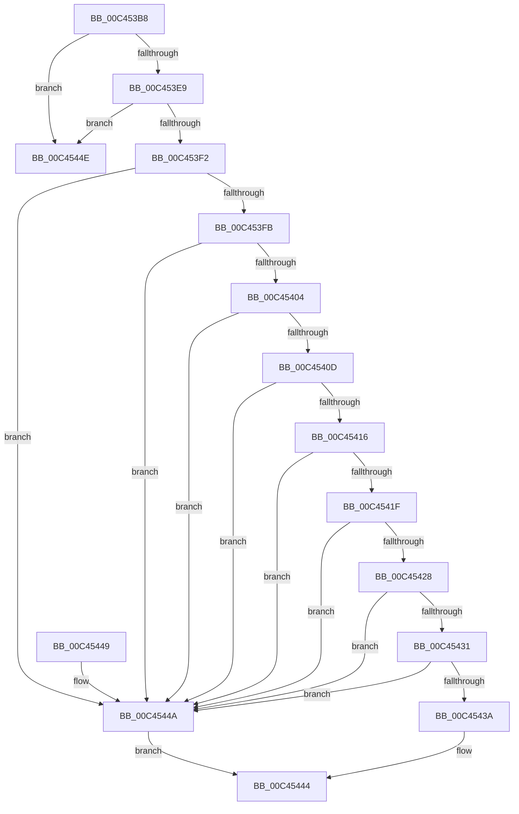

# PspInitPhase1

- RVA: `0x00C453B8`–`0x00C45459` (길이 `161` bytes)
- VA: `0x0000000140C453B8`
- 실행 섹션: `INIT`
- PDB 이름 있음: `예`; PDB Function 태그: `아니요`
- unwind 정보 RVA: `0x0006D234`
- 디코드: `49`개 명령, `161/161` bytes 표시
- 미해석 바이트: `0` (있으면 어셈블리에 `.byte`로 보존)

> 이 문서는 커널 이미지의 기계어와 PDB 기호를 분석해 생성했습니다. 4번과 5번은 함수 원형과 자료형을 바이너리 사용 방식에서 추정한 C 해석이며 원본 소스 복구 결과는 아닙니다.

## 1. Dependencies

- 직접 호출 지점: **12**; 고유 호출 대상: **12**
- 직접 호출자로 확인된 함수: **1**
- RIP 상대 이미지 참조: **2**

### Outgoing calls
- `0x00C453E0` → [ObInsertObject](../../page/8B/ObInsertObject_function_008B9100.md) (function, `0x008B9100`)
- `0x00C453E9` → [PspInitializeCpuPartitionsPhase1](PspInitializeCpuPartitionsPhase1_function_00C45AF4.md) (function, `0x00C45AF4`)
- `0x00C453F2` → [PspInitializeNetRateControl](PspInitializeNetRateControl_function_00C466DC.md) (function, `0x00C466DC`)
- `0x00C453FB` → [PspInitializeBackgroundActivityModeratorCallouts](PspInitializeBackgroundActivityModeratorCallouts_function_00C45764.md) (function, `0x00C45764`)
- `0x00C45404` → [PspInitializeDesktopActivityModeratorCallouts](PspInitializeDesktopActivityModeratorCallouts_function_00C45BF8.md) (function, `0x00C45BF8`)
- `0x00C4540D` → [PspInitializeMMCSSCallouts](PspInitializeMMCSSCallouts_function_00C45D54.md) (function, `0x00C45D54`)
- `0x00C45416` → [PspInitializeHwTraceCallouts](PspInitializeHwTraceCallouts_function_00C45CE4.md) (function, `0x00C45CE4`)
- `0x00C4541F` → [PspInitializeOctagonExtensionHost](PspInitializeOctagonExtensionHost_function_00C464F4.md) (function, `0x00C464F4`)
- `0x00C45428` → [PspInitializeSecExtensionHost](PspInitializeSecExtensionHost_function_00C46564.md) (function, `0x00C46564`)
- `0x00C45431` → [PspInitializeDxgExtensionHost](PspInitializeDxgExtensionHost_function_00C45C60.md) (function, `0x00C45C60`)
- `0x00C4543A` → [PspCreateSecureSystemProcess](PspCreateSecureSystemProcess_function_00C452E4.md) (function, `0x00C452E4`)
- `0x00C45453` → [KeBugCheck](../../text/4F/KeBugCheck_function_004FD640.md) (function, `0x004FD640`)

### Direct callers
- [PsInitSystem](../BE/PsInitSystem_function_00BEED58.md) at `0x00BEED9A`

### Static image references
- `0x00C453BC` → RVA `0x00FC6EA0` (`ALMOSTRO`; read)
- `0x00C453C3` → RVA `0x00FC7388` (`ALMOSTRO`; read)

## 2. Other-region calls and transfers

- 다른 실행 섹션으로 향하는 call: **2**
  - `0x00C453E0` → [ObInsertObject](../../page/8B/ObInsertObject_function_008B9100.md) (`INIT` → `PAGE`)
  - `0x00C45453` → [KeBugCheck](../../text/4F/KeBugCheck_function_004FD640.md) (`INIT` → `.text`)
- 별도 외부 분기/꼬리 이동을 확인하지 못했습니다.

## 3. Assembly (complete function range)

```asm
00C453B8  48 83 EC 38                     sub rsp, 0x38
00C453BC  48 8B 0D DD 1A 38 00            mov rcx, qword ptr [rip + 0x381add]
00C453C3  48 8D 05 BE 1F 38 00            lea rax, [rip + 0x381fbe]
00C453CA  48 89 44 24 28                  mov qword ptr [rsp + 0x28], rax
00C453CF  45 33 C9                        xor r9d, r9d
00C453D2  48 83 64 24 20 00               and qword ptr [rsp + 0x20], 0
00C453D8  33 D2                           xor edx, edx
00C453DA  41 B8 03 00 1F 00               mov r8d, 0x1f0003
00C453E0  E8 1B 3D C7 FF                  call 0x1408b9100
00C453E5  85 C0                           test eax, eax
00C453E7  78 65                           js 0x140c4544e
00C453E9  E8 06 07 00 00                  call 0x140c45af4
00C453EE  85 C0                           test eax, eax
00C453F0  78 5C                           js 0x140c4544e
00C453F2  E8 E5 12 00 00                  call 0x140c466dc
00C453F7  84 C0                           test al, al
00C453F9  74 4F                           je 0x140c4544a
00C453FB  E8 64 03 00 00                  call 0x140c45764
00C45400  85 C0                           test eax, eax
00C45402  78 46                           js 0x140c4544a
00C45404  E8 EF 07 00 00                  call 0x140c45bf8
00C45409  85 C0                           test eax, eax
00C4540B  78 3D                           js 0x140c4544a
00C4540D  E8 42 09 00 00                  call 0x140c45d54
00C45412  85 C0                           test eax, eax
00C45414  78 34                           js 0x140c4544a
00C45416  E8 C9 08 00 00                  call 0x140c45ce4
00C4541B  85 C0                           test eax, eax
00C4541D  78 2B                           js 0x140c4544a
00C4541F  E8 D0 10 00 00                  call 0x140c464f4
00C45424  85 C0                           test eax, eax
00C45426  78 22                           js 0x140c4544a
00C45428  E8 37 11 00 00                  call 0x140c46564
00C4542D  85 C0                           test eax, eax
00C4542F  78 19                           js 0x140c4544a
00C45431  E8 2A 08 00 00                  call 0x140c45c60
00C45436  85 C0                           test eax, eax
00C45438  78 10                           js 0x140c4544a
00C4543A  E8 A5 FE FF FF                  call 0x140c452e4
00C4543F  84 C0                           test al, al
00C45441  0F 95 C0                        setne al
00C45444  48 83 C4 38                     add rsp, 0x38
00C45448  C3                              ret
00C45449  CC                              int3
00C4544A  32 C0                           xor al, al
00C4544C  EB F6                           jmp 0x140c45444
00C4544E  B9 60 00 00 00                  mov ecx, 0x60
00C45453  E8 E8 81 8B FF                  call 0x1404fd640
00C45458  CC                              int3
```

## 4. C-style interpretation (structured pseudocode)

```c
__int64 __fastcall PspInitPhase1(__int64 a1, int a2, __int64 a3, int a4)
{
    __int64 result;
    __int64 v_rsp;
    unsigned __int64 v_stack_m10;
    unsigned __int64 v_stack_m18;

    v_rsp = (v_rsp) - (56);
    v_stack_m10 = v_rip + 3678142;
    a4 = 0;
    a2 = 0;
    result = ObInsertObject(*(unsigned __int64 *)(v_rip + 3676893), a2, (unsigned int)(0x1F0003ULL), a4);
    if (sign_flag) goto loc_00C4544E;
    result = PspInitializeCpuPartitionsPhase1(*(unsigned __int64 *)(v_rip + 3676893), a2, (unsigned int)(0x1F0003ULL), a4);
    if (sign_flag) goto loc_00C4544E;
    result = PspInitializeNetRateControl(*(unsigned __int64 *)(v_rip + 3676893), a2, (unsigned int)(0x1F0003ULL), a4);
    if ((unsigned __int8)(result) == 0) goto loc_00C4544A;
    result = PspInitializeBackgroundActivityModeratorCallouts(*(unsigned __int64 *)(v_rip + 3676893), a2, (unsigned int)(0x1F0003ULL), a4);
    if (sign_flag) goto loc_00C4544A;
    result = PspInitializeDesktopActivityModeratorCallouts(*(unsigned __int64 *)(v_rip + 3676893), a2, (unsigned int)(0x1F0003ULL), a4);
    if (sign_flag) goto loc_00C4544A;
    result = PspInitializeMMCSSCallouts(*(unsigned __int64 *)(v_rip + 3676893), a2, (unsigned int)(0x1F0003ULL), a4);
    if (sign_flag) goto loc_00C4544A;
    result = PspInitializeHwTraceCallouts(*(unsigned __int64 *)(v_rip + 3676893), a2, (unsigned int)(0x1F0003ULL), a4);
    if (sign_flag) goto loc_00C4544A;
    result = PspInitializeOctagonExtensionHost(*(unsigned __int64 *)(v_rip + 3676893), a2, (unsigned int)(0x1F0003ULL), a4);
    if (sign_flag) goto loc_00C4544A;
    result = PspInitializeSecExtensionHost(*(unsigned __int64 *)(v_rip + 3676893), a2, (unsigned int)(0x1F0003ULL), a4);
    if (sign_flag) goto loc_00C4544A;
    result = PspInitializeDxgExtensionHost(*(unsigned __int64 *)(v_rip + 3676893), a2, (unsigned int)(0x1F0003ULL), a4);
    if (sign_flag) goto loc_00C4544A;
    result = PspCreateSecureSystemProcess(*(unsigned __int64 *)(v_rip + 3676893), a2, (unsigned int)(0x1F0003ULL), a4);
    result = ((unsigned __int8)(result) != 0) ? 1 : 0;
loc_00C45444:
    v_rsp = (v_rsp) + (56);
    return result;
loc_00C4544A:
    result = 0;
    goto loc_00C45444;
loc_00C4544E:
    result = KeBugCheck(96, a2, (unsigned int)(0x1F0003ULL), a4);
    return result;
}
```

## 5. (Beta) C Style

```c
int64_t PspInitPhase1(int64_t Arg1, int32_t Arg2, int64_t Arg3, int32_t Arg4)
{
    int64_t result;
    int64_t local_rsp;
    uint64_t v_stack_m10;
    uint64_t v_stack_m18;

    local_rsp = (local_rsp) - (56);
    v_stack_m10 = v_rip + 3678142;
    Arg4 = 0;
    Arg2 = 0;
    result = ObInsertObject(*(uint64_t *)(v_rip + 0x381ADD), Arg2, (uint32_t)(0x1F0003ULL), Arg4);
    if (sign_flag) goto loc_00C4544E;
    result = PspInitializeCpuPartitionsPhase1(*(uint64_t *)(v_rip + 0x381ADD), Arg2, (uint32_t)(0x1F0003ULL), Arg4);
    if (sign_flag) goto loc_00C4544E;
    result = PspInitializeNetRateControl(*(uint64_t *)(v_rip + 0x381ADD), Arg2, (uint32_t)(0x1F0003ULL), Arg4);
    if ((uint8_t)(result) == 0) goto loc_00C4544A;
    result = PspInitializeBackgroundActivityModeratorCallouts(*(uint64_t *)(v_rip + 0x381ADD), Arg2, (uint32_t)(0x1F0003ULL), Arg4);
    if (sign_flag) goto loc_00C4544A;
    result = PspInitializeDesktopActivityModeratorCallouts(*(uint64_t *)(v_rip + 0x381ADD), Arg2, (uint32_t)(0x1F0003ULL), Arg4);
    if (sign_flag) goto loc_00C4544A;
    result = PspInitializeMMCSSCallouts(*(uint64_t *)(v_rip + 0x381ADD), Arg2, (uint32_t)(0x1F0003ULL), Arg4);
    if (sign_flag) goto loc_00C4544A;
    result = PspInitializeHwTraceCallouts(*(uint64_t *)(v_rip + 0x381ADD), Arg2, (uint32_t)(0x1F0003ULL), Arg4);
    if (sign_flag) goto loc_00C4544A;
    result = PspInitializeOctagonExtensionHost(*(uint64_t *)(v_rip + 0x381ADD), Arg2, (uint32_t)(0x1F0003ULL), Arg4);
    if (sign_flag) goto loc_00C4544A;
    result = PspInitializeSecExtensionHost(*(uint64_t *)(v_rip + 0x381ADD), Arg2, (uint32_t)(0x1F0003ULL), Arg4);
    if (sign_flag) goto loc_00C4544A;
    result = PspInitializeDxgExtensionHost(*(uint64_t *)(v_rip + 0x381ADD), Arg2, (uint32_t)(0x1F0003ULL), Arg4);
    if (sign_flag) goto loc_00C4544A;
    result = PspCreateSecureSystemProcess(*(uint64_t *)(v_rip + 0x381ADD), Arg2, (uint32_t)(0x1F0003ULL), Arg4);
    result = ((uint8_t)(result) != 0) ? 1 : 0;
loc_00C45444:
    local_rsp = (local_rsp) + (56);
    return result;
loc_00C4544A:
    result = 0;
    goto loc_00C45444;
loc_00C4544E:
    result = KeBugCheck(96, Arg2, (uint32_t)(0x1F0003ULL), Arg4);
    return result;
}
```

## 6. Execution-region graph

[열기: 2D/3D 그래프와 함수 탐색 컨트롤 패널](../../../control-panel.html?section=init&rva=0x00C453B8&view=graph)

- 2D 그래프는 위에서 아래로 흐르고, 3D 그래프는 빈 공간을 드래그해 회전합니다. Shift+드래그는 이동, 휠은 확대·축소, 함수 노드 선택은 대상 보고서 이동입니다.

### Static fallback


