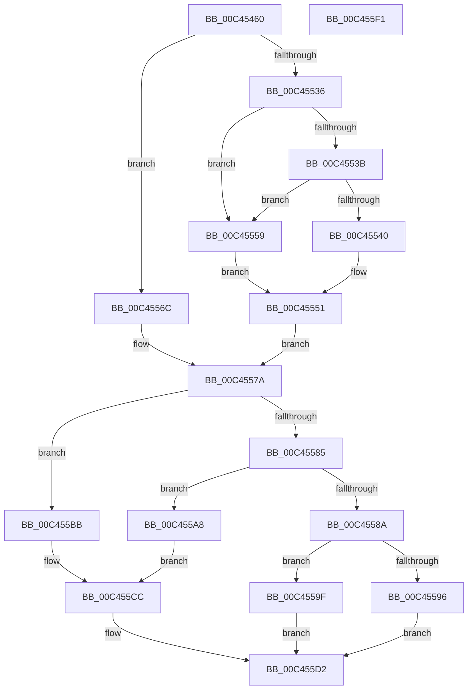

# PspInitPhase2

- RVA: `0x00C45460`–`0x00C455F2` (길이 `402` bytes)
- VA: `0x0000000140C45460`
- 실행 섹션: `INIT`
- PDB 이름 있음: `예`; PDB Function 태그: `아니요`
- unwind 정보 RVA: `0x0005CF00`
- 디코드: `89`개 명령, `402/402` bytes 표시
- 미해석 바이트: `0` (있으면 어셈블리에 `.byte`로 보존)

> 이 문서는 커널 이미지의 기계어와 PDB 기호를 분석해 생성했습니다. 4번과 5번은 함수 원형과 자료형을 바이너리 사용 방식에서 추정한 C 해석이며 원본 소스 복구 결과는 아닙니다.

## 1. Dependencies

- 직접 호출 지점: **9**; 고유 호출 대상: **7**
- 직접 호출자로 확인된 함수: **1**
- RIP 상대 이미지 참조: **8**

### Outgoing calls
- `0x00C45472` → [TraceLoggingRegisterEx_EtwRegister_EtwSetInformation](../../page/92/TraceLoggingRegisterEx_EtwRegister_EtwSetInformation_function_009208A0.md) (function, `0x009208A0`)
- `0x00C4547E` → [RtlGetSystemTimePrecise](../../text/37/RtlGetSystemTimePrecise_function_0037EDD0.md) (function, `0x0037EDD0`)
- `0x00C454A4` → [KiQueryUnbiasedInterruptTime](../../text/42/KiQueryUnbiasedInterruptTime_function_0042D180.md) (function, `0x0042D180`)
- `0x00C454FD` → [RtlGetSystemTimePrecise](../../text/37/RtlGetSystemTimePrecise_function_0037EDD0.md) (function, `0x0037EDD0`)
- `0x00C45507` → [RtlRandom](../../page/A6/RtlRandom_function_00A65C60.md) (function, `0x00A65C60`)
- `0x00C4551E` → [RtlRandom](../../page/A6/RtlRandom_function_00A65C60.md) (function, `0x00A65C60`)
- `0x00C455D2` → [PspInitializeSystemDlls](PspInitializeSystemDlls_function_00C45DC4.md) (function, `0x00C45DC4`)
- `0x00C455D9` → [PsGetServerSiloGlobals](../../text/22/PsGetServerSiloGlobals_function_002250A0.md) (function, `0x002250A0`)
- `0x00C455E1` → [PspInitializeProtectedProcessParameters](../../page/77/PspInitializeProtectedProcessParameters_function_0077EE98.md) (function, `0x0077EE98`)

### Direct callers
- [PsInitSystem](../BE/PsInitSystem_function_00BEED58.md) at `0x00BEED93`

### Static image references
- `0x00C45469` → RVA `0x00E08640` (`.data`; read)
- `0x00C45477` → RVA `0x00FC6AB0` (`ALMOSTRO`; read)
- `0x00C454B0` → RVA `0x00FC6B70` (`ALMOSTRO`; read)
- `0x00C45517` → RVA `0x00FD9DD0` (`PAGEDATA`; write)
- `0x00C45525` → RVA `0x00FD9DD0` (`PAGEDATA`; read/write)
- `0x00C4552C` → RVA `0x00FC5304` (`ALMOSTRO`; read)
- `0x00C45540` → RVA `0x00FC5008` (`ALMOSTRO`; read)
- `0x00C4557A` → RVA `0x00FC5300` (`ALMOSTRO`; read)

## 2. Other-region calls and transfers

- 다른 실행 섹션으로 향하는 call: **8**
  - `0x00C45472` → [TraceLoggingRegisterEx_EtwRegister_EtwSetInformation](../../page/92/TraceLoggingRegisterEx_EtwRegister_EtwSetInformation_function_009208A0.md) (`INIT` → `PAGE`)
  - `0x00C4547E` → [RtlGetSystemTimePrecise](../../text/37/RtlGetSystemTimePrecise_function_0037EDD0.md) (`INIT` → `.text`)
  - `0x00C454A4` → [KiQueryUnbiasedInterruptTime](../../text/42/KiQueryUnbiasedInterruptTime_function_0042D180.md) (`INIT` → `.text`)
  - `0x00C454FD` → [RtlGetSystemTimePrecise](../../text/37/RtlGetSystemTimePrecise_function_0037EDD0.md) (`INIT` → `.text`)
  - `0x00C45507` → [RtlRandom](../../page/A6/RtlRandom_function_00A65C60.md) (`INIT` → `PAGE`)
  - `0x00C4551E` → [RtlRandom](../../page/A6/RtlRandom_function_00A65C60.md) (`INIT` → `PAGE`)
  - `0x00C455D9` → [PsGetServerSiloGlobals](../../text/22/PsGetServerSiloGlobals_function_002250A0.md) (`INIT` → `.text`)
  - `0x00C455E1` → [PspInitializeProtectedProcessParameters](../../page/77/PspInitializeProtectedProcessParameters_function_0077EE98.md) (`INIT` → `PAGE`)
- 별도 외부 분기/꼬리 이동을 확인하지 못했습니다.

## 3. Assembly (complete function range)

```asm
00C45460  40 53                           push rbx
00C45462  48 83 EC 20                     sub rsp, 0x20
00C45466  45 33 C0                        xor r8d, r8d
00C45469  48 8D 0D D0 31 1C 00            lea rcx, [rip + 0x1c31d0]
00C45470  33 D2                           xor edx, edx
00C45472  E8 29 B4 CD FF                  call 0x1409208a0
00C45477  48 8B 1D 32 16 38 00            mov rbx, qword ptr [rip + 0x381632]
00C4547E  E8 4D 99 73 FF                  call 0x14037edd0
00C45483  48 89 83 F8 01 00 00            mov qword ptr [rbx + 0x1f8], rax
00C4548A  48 A1 08 00 00 00 80 F7 FF FF   movabs rax, qword ptr [0xfffff78000000008]
00C45494  48 8B 0D 15 16 38 00            mov rcx, qword ptr [rip + 0x381615]
00C4549B  48 89 81 80 06 00 00            mov qword ptr [rcx + 0x680], rax
00C454A2  B1 01                           mov cl, 1
00C454A4  E8 D7 7C 7E FF                  call 0x14042d180
00C454A9  48 8B 0D 00 16 38 00            mov rcx, qword ptr [rip + 0x381600]
00C454B0  48 8B 15 B9 16 38 00            mov rdx, qword ptr [rip + 0x3816b9]
00C454B7  48 89 81 88 06 00 00            mov qword ptr [rcx + 0x688], rax
00C454BE  48 8B 05 EB 15 38 00            mov rax, qword ptr [rip + 0x3815eb]
00C454C5  48 8B 88 F8 01 00 00            mov rcx, qword ptr [rax + 0x1f8]
00C454CC  48 89 8A F8 01 00 00            mov qword ptr [rdx + 0x1f8], rcx
00C454D3  48 8B 05 D6 15 38 00            mov rax, qword ptr [rip + 0x3815d6]
00C454DA  48 8B 88 80 06 00 00            mov rcx, qword ptr [rax + 0x680]
00C454E1  48 89 8A 80 06 00 00            mov qword ptr [rdx + 0x680], rcx
00C454E8  48 8B 05 C1 15 38 00            mov rax, qword ptr [rip + 0x3815c1]
00C454EF  48 8B 88 88 06 00 00            mov rcx, qword ptr [rax + 0x688]
00C454F6  48 89 8A 88 06 00 00            mov qword ptr [rdx + 0x688], rcx
00C454FD  E8 CE 98 73 FF                  call 0x14037edd0
00C45502  48 8D 4C 24 38                  lea rcx, [rsp + 0x38]
00C45507  E8 54 07 E2 FF                  call 0x140a65c60
00C4550C  8B C0                           mov eax, eax
00C4550E  48 8D 4C 24 38                  lea rcx, [rsp + 0x38]
00C45513  48 C1 E0 20                     shl rax, 0x20
00C45517  48 89 05 B2 48 39 00            mov qword ptr [rip + 0x3948b2], rax
00C4551E  E8 3D 07 E2 FF                  call 0x140a65c60
00C45523  8B C0                           mov eax, eax
00C45525  48 09 05 A4 48 39 00            or qword ptr [rip + 0x3948a4], rax
00C4552C  8B 05 D2 FD 37 00               mov eax, dword ptr [rip + 0x37fdd2]
00C45532  85 C0                           test eax, eax
00C45534  74 36                           je 0x140c4556c
00C45536  83 E8 01                        sub eax, 1
00C45539  74 1E                           je 0x140c45559
00C4553B  83 F8 01                        cmp eax, 1
00C4553E  75 19                           jne 0x140c45559
00C45540  48 8B 0D C1 FA 37 00            mov rcx, qword ptr [rip + 0x37fac1]
00C45547  8A 81 D5 02 00 00               mov al, byte ptr [rcx + 0x2d5]
00C4554D  24 FB                           and al, 0xfb
00C4554F  0C 08                           or al, 8
00C45551  88 81 D5 02 00 00               mov byte ptr [rcx + 0x2d5], al
00C45557  EB 21                           jmp 0x140c4557a
00C45559  48 8B 0D A8 FA 37 00            mov rcx, qword ptr [rip + 0x37faa8]
00C45560  8A 81 D5 02 00 00               mov al, byte ptr [rcx + 0x2d5]
00C45566  24 F7                           and al, 0xf7
00C45568  0C 04                           or al, 4
00C4556A  EB E5                           jmp 0x140c45551
00C4556C  48 8B 05 95 FA 37 00            mov rax, qword ptr [rip + 0x37fa95]
00C45573  80 A0 D5 02 00 00 F3            and byte ptr [rax + 0x2d5], 0xf3
00C4557A  8B 05 80 FD 37 00               mov eax, dword ptr [rip + 0x37fd80]
00C45580  83 F8 01                        cmp eax, 1
00C45583  74 36                           je 0x140c455bb
00C45585  83 F8 02                        cmp eax, 2
00C45588  74 1E                           je 0x140c455a8
00C4558A  83 F8 FF                        cmp eax, -1
00C4558D  48 8B 05 74 FA 37 00            mov rax, qword ptr [rip + 0x37fa74]
00C45594  74 09                           je 0x140c4559f
00C45596  80 A0 D5 02 00 00 CF            and byte ptr [rax + 0x2d5], 0xcf
00C4559D  EB 33                           jmp 0x140c455d2
00C4559F  80 88 D5 02 00 00 30            or byte ptr [rax + 0x2d5], 0x30
00C455A6  EB 2A                           jmp 0x140c455d2
00C455A8  48 8B 0D 59 FA 37 00            mov rcx, qword ptr [rip + 0x37fa59]
00C455AF  8A 81 D5 02 00 00               mov al, byte ptr [rcx + 0x2d5]
00C455B5  24 EF                           and al, 0xef
00C455B7  0C 20                           or al, 0x20
00C455B9  EB 11                           jmp 0x140c455cc
00C455BB  48 8B 0D 46 FA 37 00            mov rcx, qword ptr [rip + 0x37fa46]
00C455C2  8A 81 D5 02 00 00               mov al, byte ptr [rcx + 0x2d5]
00C455C8  24 DF                           and al, 0xdf
00C455CA  0C 10                           or al, 0x10
00C455CC  88 81 D5 02 00 00               mov byte ptr [rcx + 0x2d5], al
00C455D2  E8 ED 07 00 00                  call 0x140c45dc4
00C455D7  33 C9                           xor ecx, ecx
00C455D9  E8 C2 FA 5D FF                  call 0x1402250a0
00C455DE  48 8B C8                        mov rcx, rax
00C455E1  E8 B2 98 B3 FF                  call 0x14077ee98
00C455E6  85 C0                           test eax, eax
00C455E8  0F 99 C0                        setns al
00C455EB  48 83 C4 20                     add rsp, 0x20
00C455EF  5B                              pop rbx
00C455F0  C3                              ret
00C455F1  CC                              int3
```

## 4. C-style interpretation (structured pseudocode)

```c
__int64 __fastcall PspInitPhase2(__int64 a1, int a2, int a3)
{
    __int64 result;
    __int64 v_rsp;
    unsigned __int64 v_stack_p10;

    v_rsp = (v_rsp) - (32);
    a3 = 0;
    a2 = 0;
    result = TraceLoggingRegisterEx_EtwRegister_EtwSetInformation(v_rip + 1847760, a2, a3, a4);
    result = RtlGetSystemTimePrecise(v_rip + 1847760, a2, a3, a4);
    *(unsigned __int64 *)(*(unsigned __int64 *)(v_rip + 3675698) + 504) = result;
    *(unsigned __int64 *)(*(unsigned __int64 *)(v_rip + 3675669) + 1664) = result;
    result = KiQueryUnbiasedInterruptTime(1, a2, a3, a4);
    *(unsigned __int64 *)(*(unsigned __int64 *)(v_rip + 3675648) + 1672) = result;
    *(unsigned __int64 *)(*(unsigned __int64 *)(v_rip + 3675833) + 504) = *(unsigned __int64 *)(*(unsigned __int64 *)(v_rip + 3675627) + 504);
    *(unsigned __int64 *)(*(unsigned __int64 *)(v_rip + 3675833) + 1664) = *(unsigned __int64 *)(*(unsigned __int64 *)(v_rip + 3675606) + 1664);
    *(unsigned __int64 *)(*(unsigned __int64 *)(v_rip + 3675833) + 1672) = *(unsigned __int64 *)(*(unsigned __int64 *)(v_rip + 3675585) + 1672);
    result = RtlGetSystemTimePrecise(*(unsigned __int64 *)(*(unsigned __int64 *)(v_rip + 3675585) + 1672), *(unsigned __int64 *)(v_rip + 3675833), a3, a4);
    result = RtlRandom(v_stack_p10, *(unsigned __int64 *)(v_rip + 3675833), a3, a4);
    result = ((unsigned int)((unsigned int)(result))) << (32);
    *(unsigned __int64 *)(v_rip + 3754162) = result;
    result = RtlRandom(v_stack_p10, *(unsigned __int64 *)(v_rip + 3675833), a3, a4);
    if ((unsigned int)((unsigned int)(*(unsigned int *)(v_rip + 3669458))) == 0) goto loc_00C4556C;
    result = (unsigned int)(((unsigned int)(*(unsigned int *)(v_rip + 3669458))) - (1));
    if (condition_is_equal) goto loc_00C45559;
    if (((unsigned int)(result)) != 1) goto loc_00C45559;
    result = (unsigned __int8)((*(unsigned __int8 *)(*(unsigned __int64 *)(v_rip + 3668673) + 725)) & (251));
    result = (unsigned __int8)((result) | (8));
loc_00C45551:
    *(unsigned __int8 *)(*(unsigned __int64 *)(v_rip + 3668673) + 725) = (unsigned __int8)(result);
    goto loc_00C4557A;
loc_00C45559:
    result = (unsigned __int8)((*(unsigned __int8 *)(*(unsigned __int64 *)(v_rip + 3668648) + 725)) & (247));
    result = (unsigned __int8)((result) | (4));
    goto loc_00C45551;
loc_00C4556C:
loc_00C4557A:
    if (((unsigned int)((unsigned int)(*(unsigned int *)(v_rip + 3669376)))) == 1) goto loc_00C455BB;
    if (((unsigned int)((unsigned int)(*(unsigned int *)(v_rip + 3669376)))) == 2) goto loc_00C455A8;
    if (((unsigned int)((unsigned int)(*(unsigned int *)(v_rip + 3669376)))) == -1) goto loc_00C4559F;
    goto loc_00C455D2;
loc_00C4559F:
    goto loc_00C455D2;
loc_00C455A8:
    result = (unsigned __int8)((*(unsigned __int8 *)(*(unsigned __int64 *)(v_rip + 3668569) + 725)) & (239));
    result = (unsigned __int8)((result) | (32));
    goto loc_00C455CC;
loc_00C455BB:
    result = (unsigned __int8)((*(unsigned __int8 *)(*(unsigned __int64 *)(v_rip + 3668550) + 725)) & (223));
    result = (unsigned __int8)((result) | (16));
loc_00C455CC:
    *(unsigned __int8 *)(*(unsigned __int64 *)(v_rip + 3668550) + 725) = (unsigned __int8)(result);
loc_00C455D2:
    result = PspInitializeSystemDlls(*(unsigned __int64 *)(v_rip + 3668550), *(unsigned __int64 *)(v_rip + 3675833), a3, a4);
    a1 = 0;
    result = PsGetServerSiloGlobals(a1, *(unsigned __int64 *)(v_rip + 3675833), a3, a4);
    result = PspInitializeProtectedProcessParameters(result, *(unsigned __int64 *)(v_rip + 3675833), a3, a4);
    result = (!sign_flag) ? 1 : 0;
    v_rsp = (v_rsp) + (32);
    return result;
}
```

## 5. (Beta) C Style

```c
int64_t PspInitPhase2(int64_t Arg1, int32_t Arg2, int32_t Arg3)
{
    int64_t result;
    int64_t local_rsp;
    uint64_t v_stack_p10;

    local_rsp = (local_rsp) - (32);
    Arg3 = 0;
    Arg2 = 0;
    result = TraceLoggingRegisterEx_EtwRegister_EtwSetInformation(v_rip + 1847760, Arg2, Arg3, a4);
    result = RtlGetSystemTimePrecise(v_rip + 1847760, Arg2, Arg3, a4);
    *(uint64_t *)(*(uint64_t *)(v_rip + 0x381632) + 0x1F8) = result;
    *(uint64_t *)(*(uint64_t *)(v_rip + 0x381615) + 0x680) = result;
    result = KiQueryUnbiasedInterruptTime(1, Arg2, Arg3, a4);
    *(uint64_t *)(*(uint64_t *)(v_rip + 0x381600) + 0x688) = result;
    *(uint64_t *)(*(uint64_t *)(v_rip + 0x3816B9) + 0x1F8) = *(uint64_t *)(*(uint64_t *)(v_rip + 0x3815EB) + 0x1F8);
    *(uint64_t *)(*(uint64_t *)(v_rip + 0x3816B9) + 0x680) = *(uint64_t *)(*(uint64_t *)(v_rip + 0x3815D6) + 0x680);
    *(uint64_t *)(*(uint64_t *)(v_rip + 0x3816B9) + 0x688) = *(uint64_t *)(*(uint64_t *)(v_rip + 0x3815C1) + 0x688);
    result = RtlGetSystemTimePrecise(*(uint64_t *)(*(uint64_t *)(v_rip + 0x3815C1) + 0x688), *(uint64_t *)(v_rip + 0x3816B9), Arg3, a4);
    result = RtlRandom(v_stack_p10, *(uint64_t *)(v_rip + 0x3816B9), Arg3, a4);
    result = ((uint32_t)((uint32_t)(result))) << (32);
    *(uint64_t *)(v_rip + 0x3948B2) = result;
    result = RtlRandom(v_stack_p10, *(uint64_t *)(v_rip + 0x3816B9), Arg3, a4);
    if ((uint32_t)((uint32_t)(*(uint32_t *)(v_rip + 0x37FDD2))) == 0) goto loc_00C4556C;
    result = (uint32_t)(((uint32_t)(*(uint32_t *)(v_rip + 0x37FDD2))) - (1));
    if (condition_is_equal) goto loc_00C45559;
    if (((uint32_t)(result)) != 1) goto loc_00C45559;
    result = (uint8_t)((*(uint8_t *)(*(uint64_t *)(v_rip + 0x37FAC1) + 0x2D5)) & (251));
    result = (uint8_t)((result) | (8));
loc_00C45551:
    *(uint8_t *)(*(uint64_t *)(v_rip + 0x37FAC1) + 0x2D5) = (uint8_t)(result);
    goto loc_00C4557A;
loc_00C45559:
    result = (uint8_t)((*(uint8_t *)(*(uint64_t *)(v_rip + 0x37FAA8) + 0x2D5)) & (247));
    result = (uint8_t)((result) | (4));
    goto loc_00C45551;
loc_00C4556C:
loc_00C4557A:
    if (((uint32_t)((uint32_t)(*(uint32_t *)(v_rip + 0x37FD80)))) == 1) goto loc_00C455BB;
    if (((uint32_t)((uint32_t)(*(uint32_t *)(v_rip + 0x37FD80)))) == 2) goto loc_00C455A8;
    if (((uint32_t)((uint32_t)(*(uint32_t *)(v_rip + 0x37FD80)))) == -1) goto loc_00C4559F;
    goto loc_00C455D2;
loc_00C4559F:
    goto loc_00C455D2;
loc_00C455A8:
    result = (uint8_t)((*(uint8_t *)(*(uint64_t *)(v_rip + 0x37FA59) + 0x2D5)) & (239));
    result = (uint8_t)((result) | (32));
    goto loc_00C455CC;
loc_00C455BB:
    result = (uint8_t)((*(uint8_t *)(*(uint64_t *)(v_rip + 0x37FA46) + 0x2D5)) & (223));
    result = (uint8_t)((result) | (16));
loc_00C455CC:
    *(uint8_t *)(*(uint64_t *)(v_rip + 0x37FA46) + 0x2D5) = (uint8_t)(result);
loc_00C455D2:
    result = PspInitializeSystemDlls(*(uint64_t *)(v_rip + 0x37FA46), *(uint64_t *)(v_rip + 0x3816B9), Arg3, a4);
    Arg1 = 0;
    result = PsGetServerSiloGlobals(Arg1, *(uint64_t *)(v_rip + 0x3816B9), Arg3, a4);
    result = PspInitializeProtectedProcessParameters(result, *(uint64_t *)(v_rip + 0x3816B9), Arg3, a4);
    result = (!sign_flag) ? 1 : 0;
    local_rsp = (local_rsp) + (32);
    return result;
}
```

## 6. Execution-region graph

[열기: 2D/3D 그래프와 함수 탐색 컨트롤 패널](../../../control-panel.html?section=init&rva=0x00C45460&view=graph)

- 2D 그래프는 위에서 아래로 흐르고, 3D 그래프는 빈 공간을 드래그해 회전합니다. Shift+드래그는 이동, 휠은 확대·축소, 함수 노드 선택은 대상 보고서 이동입니다.

### Static fallback


