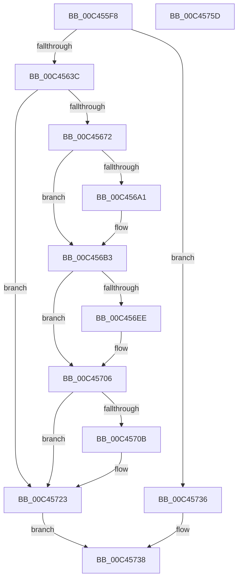

# PspInitPhase3

- RVA: `0x00C455F8`–`0x00C4575E` (길이 `358` bytes)
- VA: `0x0000000140C455F8`
- 실행 섹션: `INIT`
- PDB 이름 있음: `예`; PDB Function 태그: `아니요`
- unwind 정보 RVA: `0x000CDFF8`
- 디코드: `85`개 명령, `358/358` bytes 표시
- 미해석 바이트: `0` (있으면 어셈블리에 `.byte`로 보존)

> 이 문서는 커널 이미지의 기계어와 PDB 기호를 분석해 생성했습니다. 4번과 5번은 함수 원형과 자료형을 바이너리 사용 방식에서 추정한 C 해석이며 원본 소스 복구 결과는 아닙니다.

## 1. Dependencies

- 직접 호출 지점: **11**; 고유 호출 대상: **8**
- 직접 호출자로 확인된 함수: **1**
- RIP 상대 이미지 참조: **5**

### Outgoing calls
- `0x00C4564A` → [KiStackAttachProcess](../../text/21/KiStackAttachProcess_function_00216820.md) (function, `0x00216820`)
- `0x00C45663` → [PspMapSystemDll](../../page/8D/PspMapSystemDll_function_008D6908.md) (function, `0x008D6908`)
- `0x00C4567C` → [PspReferenceSystemDll](../../page/8D/PspReferenceSystemDll_function_008D6AD8.md) (function, `0x008D6AD8`)
- `0x00C45698` → [PspMapSystemDll](../../page/8D/PspMapSystemDll_function_008D6908.md) (function, `0x008D6908`)
- `0x00C456AB` → [PspReferenceSystemDll](../../page/8D/PspReferenceSystemDll_function_008D6AD8.md) (function, `0x008D6AD8`)
- `0x00C456BE` → [memset](../../text/6C/memset_function_006C6C40.md) (function, `0x006C6C40`)
- `0x00C456E2` → [VslpEnterIumSecureMode](../../text/23/VslpEnterIumSecureMode_function_00235E50.md) (function, `0x00235E50`)
- `0x00C45701` → [ObFastDereferenceObject](../../text/3E/ObFastDereferenceObject_function_003ED5F0.md) (function, `0x003ED5F0`)
- `0x00C4571E` → [ObFastDereferenceObject](../../text/3E/ObFastDereferenceObject_function_003ED5F0.md) (function, `0x003ED5F0`)
- `0x00C4572A` → [KiUnstackDetachProcess](../../text/21/KiUnstackDetachProcess_function_00217D30.md) (function, `0x00217D30`)
- `0x00C45743` → [_security_check_cookie](../../text/6A/_security_check_cookie_function_006AC640.md) (function, `0x006AC640`)

### Direct callers
- [PsInitSystem](../BE/PsInitSystem_function_00BEED58.md) at `0x00BEED8C`

### Static image references
- `0x00C4560A` → RVA `0x00E0A740` (`.data`; read)
- `0x00C45621` → RVA `0x00FC6A84` (`ALMOSTRO`; read)
- `0x00C4563C` → RVA `0x00FC6CB8` (`ALMOSTRO`; read)
- `0x00C4564F` → RVA `0x00FD8130` (`PAGEDATA`; read)
- `0x00C45681` → RVA `0x00FD8150` (`PAGEDATA`; read)

## 2. Other-region calls and transfers

- 다른 실행 섹션으로 향하는 call: **11**
  - `0x00C4564A` → [KiStackAttachProcess](../../text/21/KiStackAttachProcess_function_00216820.md) (`INIT` → `.text`)
  - `0x00C45663` → [PspMapSystemDll](../../page/8D/PspMapSystemDll_function_008D6908.md) (`INIT` → `PAGE`)
  - `0x00C4567C` → [PspReferenceSystemDll](../../page/8D/PspReferenceSystemDll_function_008D6AD8.md) (`INIT` → `PAGE`)
  - `0x00C45698` → [PspMapSystemDll](../../page/8D/PspMapSystemDll_function_008D6908.md) (`INIT` → `PAGE`)
  - `0x00C456AB` → [PspReferenceSystemDll](../../page/8D/PspReferenceSystemDll_function_008D6AD8.md) (`INIT` → `PAGE`)
  - `0x00C456BE` → [memset](../../text/6C/memset_function_006C6C40.md) (`INIT` → `.text`)
  - `0x00C456E2` → [VslpEnterIumSecureMode](../../text/23/VslpEnterIumSecureMode_function_00235E50.md) (`INIT` → `.text`)
  - `0x00C45701` → [ObFastDereferenceObject](../../text/3E/ObFastDereferenceObject_function_003ED5F0.md) (`INIT` → `.text`)
  - `0x00C4571E` → [ObFastDereferenceObject](../../text/3E/ObFastDereferenceObject_function_003ED5F0.md) (`INIT` → `.text`)
  - `0x00C4572A` → [KiUnstackDetachProcess](../../text/21/KiUnstackDetachProcess_function_00217D30.md) (`INIT` → `.text`)
  - `0x00C45743` → [_security_check_cookie](../../text/6A/_security_check_cookie_function_006AC640.md) (`INIT` → `.text`)
- 별도 외부 분기/꼬리 이동을 확인하지 못했습니다.

## 3. Assembly (complete function range)

```asm
00C455F8  48 89 5C 24 08                  mov qword ptr [rsp + 8], rbx
00C455FD  48 89 74 24 10                  mov qword ptr [rsp + 0x10], rsi
00C45602  57                              push rdi
00C45603  48 81 EC D0 00 00 00            sub rsp, 0xd0
00C4560A  48 8B 05 2F 51 1C 00            mov rax, qword ptr [rip + 0x1c512f]
00C45611  48 33 C4                        xor rax, rsp
00C45614  48 89 84 24 C0 00 00 00         mov qword ptr [rsp + 0xc0], rax
00C4561C  0F 57 C0                        xorps xmm0, xmm0
00C4561F  33 DB                           xor ebx, ebx
00C45621  38 1D 5D 14 38 00               cmp byte ptr [rip + 0x38145d], bl
00C45627  0F 11 44 24 20                  movups xmmword ptr [rsp + 0x20], xmm0
00C4562C  0F 11 44 24 30                  movups xmmword ptr [rsp + 0x30], xmm0
00C45631  0F 11 44 24 40                  movups xmmword ptr [rsp + 0x40], xmm0
00C45636  0F 84 FA 00 00 00               je 0x140c45736
00C4563C  48 8B 0D 75 16 38 00            mov rcx, qword ptr [rip + 0x381675]
00C45643  4C 8D 44 24 20                  lea r8, [rsp + 0x20]
00C45648  33 D2                           xor edx, edx
00C4564A  E8 D1 11 5D FF                  call 0x140216820
00C4564F  48 8B 15 DA 2A 39 00            mov rdx, qword ptr [rip + 0x392ada]
00C45656  45 33 C9                        xor r9d, r9d
00C45659  48 8B 0D 58 16 38 00            mov rcx, qword ptr [rip + 0x381658]
00C45660  45 33 C0                        xor r8d, r8d
00C45663  E8 A0 12 C9 FF                  call 0x1408d6908
00C45668  8B F0                           mov esi, eax
00C4566A  85 C0                           test eax, eax
00C4566C  0F 88 B1 00 00 00               js 0x140c45723
00C45672  48 8B 0D B7 2A 39 00            mov rcx, qword ptr [rip + 0x392ab7]
00C45679  48 8B 09                        mov rcx, qword ptr [rcx]
00C4567C  E8 57 14 C9 FF                  call 0x1408d6ad8
00C45681  48 8B 15 C8 2A 39 00            mov rdx, qword ptr [rip + 0x392ac8]
00C45688  45 33 C9                        xor r9d, r9d
00C4568B  48 8B 0D 26 16 38 00            mov rcx, qword ptr [rip + 0x381626]
00C45692  45 33 C0                        xor r8d, r8d
00C45695  48 8B F8                        mov rdi, rax
00C45698  E8 6B 12 C9 FF                  call 0x1408d6908
00C4569D  85 C0                           test eax, eax
00C4569F  78 12                           js 0x140c456b3
00C456A1  48 8B 0D A8 2A 39 00            mov rcx, qword ptr [rip + 0x392aa8]
00C456A8  48 8B 09                        mov rcx, qword ptr [rcx]
00C456AB  E8 28 14 C9 FF                  call 0x1408d6ad8
00C456B0  48 8B D8                        mov rbx, rax
00C456B3  33 D2                           xor edx, edx
00C456B5  48 8D 4C 24 50                  lea rcx, [rsp + 0x50]
00C456BA  44 8D 42 68                     lea r8d, [rdx + 0x68]
00C456BE  E8 7D 15 A8 FF                  call 0x1406c6c40
00C456C3  48 83 64 24 68 00               and qword ptr [rsp + 0x68], 0
00C456C9  4C 8D 4C 24 50                  lea r9, [rsp + 0x50]
00C456CE  BA 04 00 00 00                  mov edx, 4
00C456D3  48 89 7C 24 58                  mov qword ptr [rsp + 0x58], rdi
00C456D8  45 33 C0                        xor r8d, r8d
00C456DB  48 89 5C 24 60                  mov qword ptr [rsp + 0x60], rbx
00C456E0  B1 02                           mov cl, 2
00C456E2  E8 69 07 5F FF                  call 0x140235e50
00C456E7  8B F0                           mov esi, eax
00C456E9  48 85 DB                        test rbx, rbx
00C456EC  74 18                           je 0x140c45706
00C456EE  48 8B 0D 5B 2A 39 00            mov rcx, qword ptr [rip + 0x392a5b]
00C456F5  41 B8 50 73 53 64               mov r8d, 0x64537350
00C456FB  48 8B D3                        mov rdx, rbx
00C456FE  48 8B 09                        mov rcx, qword ptr [rcx]
00C45701  E8 EA 7E 7A FF                  call 0x1403ed5f0
00C45706  48 85 FF                        test rdi, rdi
00C45709  74 18                           je 0x140c45723
00C4570B  48 8B 0D 1E 2A 39 00            mov rcx, qword ptr [rip + 0x392a1e]
00C45712  41 B8 50 73 53 64               mov r8d, 0x64537350
00C45718  48 8B D7                        mov rdx, rdi
00C4571B  48 8B 09                        mov rcx, qword ptr [rcx]
00C4571E  E8 CD 7E 7A FF                  call 0x1403ed5f0
00C45723  33 D2                           xor edx, edx
00C45725  48 8D 4C 24 20                  lea rcx, [rsp + 0x20]
00C4572A  E8 01 26 5D FF                  call 0x140217d30
00C4572F  85 F6                           test esi, esi
00C45731  0F 99 C0                        setns al
00C45734  EB 02                           jmp 0x140c45738
00C45736  B0 01                           mov al, 1
00C45738  48 8B 8C 24 C0 00 00 00         mov rcx, qword ptr [rsp + 0xc0]
00C45740  48 33 CC                        xor rcx, rsp
00C45743  E8 F8 6E A6 FF                  call 0x1406ac640
00C45748  4C 8D 9C 24 D0 00 00 00         lea r11, [rsp + 0xd0]
00C45750  49 8B 5B 10                     mov rbx, qword ptr [r11 + 0x10]
00C45754  49 8B 73 18                     mov rsi, qword ptr [r11 + 0x18]
00C45758  49 8B E3                        mov rsp, r11
00C4575B  5F                              pop rdi
00C4575C  C3                              ret
00C4575D  CC                              int3
```

## 4. C-style interpretation (structured pseudocode)

```c
__int64 __fastcall PspInitPhase3(__int64 a1, int a2, __int64 a3, int a4)
{
    __int64 result;
    __int64 v_rbx;
    __int64 v_rsp;
    unsigned __int64 v_stack_m18;
    unsigned __int64 v_stack_m70;
    unsigned __int64 v_stack_m78;
    unsigned __int64 v_stack_m8;
    unsigned __int64 v_stack_m80;
    unsigned __int64 v_stack_m88;
    unsigned __int64 v_stack_m98;
    unsigned __int64 v_stack_mA8;
    unsigned __int64 v_stack_mB8;
    unsigned __int64 v_stack_p10;
    unsigned __int64 v_stack_p8;

    v_stack_p8 = v_rbx;
    v_stack_p10 = v_rsi;
    v_rsp = (v_rsp) - (208);
    result = (*(unsigned __int64 *)(v_rip + 1855791)) ^ (v_rsp);
    v_stack_m18 = result;
    v_rbx = 0;
    v_stack_mB8 = v_xmm0;
    v_stack_mA8 = v_xmm0;
    v_stack_m98 = v_xmm0;
    if ((*(unsigned __int8 *)(v_rip + 3675229)) == 0) goto loc_00C45736;
    a2 = 0;
    result = KiStackAttachProcess(*(unsigned __int64 *)(v_rip + 3675765), a2, v_stack_mB8, a4);
    a4 = 0;
    a3 = 0;
    result = PspMapSystemDll(*(unsigned __int64 *)(v_rip + 3675736), *(unsigned __int64 *)(v_rip + 3746522), a3, a4);
    if (sign_flag) goto loc_00C45723;
    result = PspReferenceSystemDll(*(unsigned __int64 *)(*(unsigned __int64 *)(v_rip + 3746487)), *(unsigned __int64 *)(v_rip + 3746522), a3, a4);
    a4 = 0;
    a3 = 0;
    result = PspMapSystemDll(*(unsigned __int64 *)(v_rip + 3675686), *(unsigned __int64 *)(v_rip + 3746504), a3, a4);
    if (!(sign_flag)) {
        a1 = *(unsigned __int64 *)(v_rip + 3746472);
        a1 = *(unsigned __int64 *)(a1);
        result = PspReferenceSystemDll(a1, *(unsigned __int64 *)(v_rip + 3746504), a3, a4);
        v_rbx = result;
    }
    a2 = 0;
    result = memset(v_stack_m88, a2, a2 + 104, a4);
    v_stack_m80 = result;
    a3 = 0;
    v_stack_m78 = v_rbx;
    result = VslpEnterIumSecureMode(2, 4, a3, v_stack_m88);
    if (v_rbx != 0) {
        a1 = *(unsigned __int64 *)(v_rip + 3746395);
        a3 = 0x64537350ULL;
        a2 = v_rbx;
        a1 = *(unsigned __int64 *)(a1);
        result = ObFastDereferenceObject(a1, a2, a3, v_stack_m88);
    }
    if (result != 0) {
        a1 = *(unsigned __int64 *)(v_rip + 3746334);
        a3 = 0x64537350ULL;
        a2 = result;
        a1 = *(unsigned __int64 *)(a1);
        result = ObFastDereferenceObject(a1, a2, a3, v_stack_m88);
    }
    a2 = 0;
    result = KiUnstackDetachProcess(v_stack_mB8, a2, a3, v_stack_m88);
    result = (!sign_flag) ? 1 : 0;
    goto loc_00C45738;
loc_00C45736:
loc_00C45738:
    a1 = (v_stack_m18) ^ (v_rsp);
    result = _security_check_cookie(a1, a2, a3, v_stack_m88);
    return result;
}
```

## 5. (Beta) C Style

```c
int64_t PspInitPhase3(int64_t Arg1, int32_t Arg2, int64_t Arg3, int32_t Arg4)
{
    int64_t result;
    int64_t local_rbx;
    int64_t local_rsp;
    uint64_t v_stack_m18;
    uint64_t v_stack_m70;
    uint64_t v_stack_m78;
    uint64_t v_stack_m8;
    uint64_t v_stack_m80;
    uint64_t v_stack_m88;
    uint64_t v_stack_m98;
    uint64_t v_stack_mA8;
    uint64_t v_stack_mB8;
    uint64_t v_stack_p10;
    uint64_t v_stack_p8;

    v_stack_p8 = local_rbx;
    v_stack_p10 = local_rsi;
    local_rsp = (local_rsp) - (208);
    result = (*(uint64_t *)(v_rip + 0x1C512F)) ^ (local_rsp);
    v_stack_m18 = result;
    local_rbx = 0;
    v_stack_mB8 = v_xmm0;
    v_stack_mA8 = v_xmm0;
    v_stack_m98 = v_xmm0;
    if ((*(uint8_t *)(v_rip + 0x38145D)) == 0) goto loc_00C45736;
    Arg2 = 0;
    result = KiStackAttachProcess(*(uint64_t *)(v_rip + 0x381675), Arg2, v_stack_mB8, Arg4);
    Arg4 = 0;
    Arg3 = 0;
    result = PspMapSystemDll(*(uint64_t *)(v_rip + 0x381658), *(uint64_t *)(v_rip + 0x392ADA), Arg3, Arg4);
    if (sign_flag) goto loc_00C45723;
    result = PspReferenceSystemDll(*(uint64_t *)(*(uint64_t *)(v_rip + 0x392AB7)), *(uint64_t *)(v_rip + 0x392ADA), Arg3, Arg4);
    Arg4 = 0;
    Arg3 = 0;
    result = PspMapSystemDll(*(uint64_t *)(v_rip + 0x381626), *(uint64_t *)(v_rip + 0x392AC8), Arg3, Arg4);
    if (!(sign_flag)) {
        Arg1 = *(uint64_t *)(v_rip + 0x392AA8);
        Arg1 = *(uint64_t *)(Arg1);
        result = PspReferenceSystemDll(Arg1, *(uint64_t *)(v_rip + 0x392AC8), Arg3, Arg4);
        local_rbx = result;
    }
    Arg2 = 0;
    result = memset(v_stack_m88, Arg2, Arg2 + 104, Arg4);
    v_stack_m80 = result;
    Arg3 = 0;
    v_stack_m78 = local_rbx;
    result = VslpEnterIumSecureMode(2, 4, Arg3, v_stack_m88);
    if (local_rbx != 0) {
        Arg1 = *(uint64_t *)(v_rip + 0x392A5B);
        Arg3 = 0x64537350ULL;
        Arg2 = local_rbx;
        Arg1 = *(uint64_t *)(Arg1);
        result = ObFastDereferenceObject(Arg1, Arg2, Arg3, v_stack_m88);
    }
    if (result != 0) {
        Arg1 = *(uint64_t *)(v_rip + 0x392A1E);
        Arg3 = 0x64537350ULL;
        Arg2 = result;
        Arg1 = *(uint64_t *)(Arg1);
        result = ObFastDereferenceObject(Arg1, Arg2, Arg3, v_stack_m88);
    }
    Arg2 = 0;
    result = KiUnstackDetachProcess(v_stack_mB8, Arg2, Arg3, v_stack_m88);
    result = (!sign_flag) ? 1 : 0;
    goto loc_00C45738;
loc_00C45736:
loc_00C45738:
    Arg1 = (v_stack_m18) ^ (local_rsp);
    result = _security_check_cookie(Arg1, Arg2, Arg3, v_stack_m88);
    return result;
}
```

## 6. Execution-region graph

[열기: 2D/3D 그래프와 함수 탐색 컨트롤 패널](../../../control-panel.html?section=init&rva=0x00C455F8&view=graph)

- 2D 그래프는 위에서 아래로 흐르고, 3D 그래프는 빈 공간을 드래그해 회전합니다. Shift+드래그는 이동, 휠은 확대·축소, 함수 노드 선택은 대상 보고서 이동입니다.

### Static fallback


