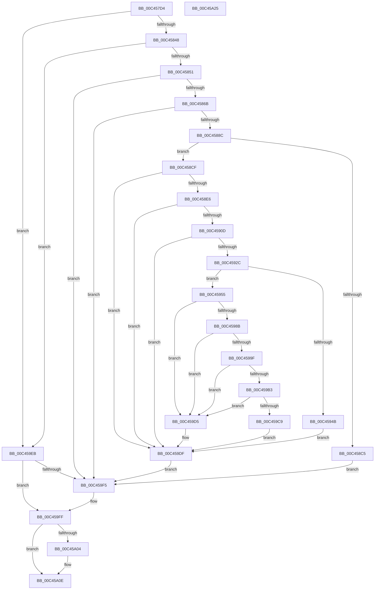

# PspInitializeCpuPartitionsDefaultSd

- RVA: `0x00C457D4`–`0x00C45A26` (길이 `594` bytes)
- VA: `0x0000000140C457D4`
- 실행 섹션: `INIT`
- PDB 이름 있음: `예`; PDB Function 태그: `아니요`
- unwind 정보 RVA: `0x000CDF9C`
- 디코드: `175`개 명령, `594/594` bytes 표시
- 미해석 바이트: `0` (있으면 어셈블리에 `.byte`로 보존)

> 이 문서는 커널 이미지의 기계어와 PDB 기호를 분석해 생성했습니다. 4번과 5번은 함수 원형과 자료형을 바이너리 사용 방식에서 추정한 C 해석이며 원본 소스 복구 결과는 아닙니다.

## 1. Dependencies

- 직접 호출 지점: **21**; 고유 호출 대상: **11**
- 직접 호출자로 확인된 함수: **2**
- RIP 상대 이미지 참조: **0**

### Outgoing calls
- `0x00C45800` → [RtlLengthRequiredSid](../../page/9C/RtlLengthRequiredSid_function_009CA4D0.md) (function, `0x009CA4D0`)
- `0x00C4581A` → [ExAllocatePool2](../../poolcode/B8/ExAllocatePool2_function_00B820F0.md) (function, `0x00B820F0`)
- `0x00C4582B` → [RtlLengthRequiredSid](../../page/9C/RtlLengthRequiredSid_function_009CA4D0.md) (function, `0x009CA4D0`)
- `0x00C45837` → [ExAllocatePool2](../../poolcode/B8/ExAllocatePool2_function_00B820F0.md) (function, `0x00B820F0`)
- `0x00C4585C` → [RtlInitializeSid](../../page/9E/RtlInitializeSid_function_009EB720.md) (function, `0x009EB720`)
- `0x00C4587D` → [RtlInitializeSid](../../page/9E/RtlInitializeSid_function_009EB720.md) (function, `0x009EB720`)
- `0x00C458B8` → [ExAllocatePool2](../../poolcode/B8/ExAllocatePool2_function_00B820F0.md) (function, `0x00B820F0`)
- `0x00C458D7` → [RtlCreateAcl](../../page/91/RtlCreateAcl_function_00916F00.md) (function, `0x00916F00`)
- `0x00C458FE` → [RtlAddAccessAllowedAce](../../page/92/RtlAddAccessAllowedAce_function_009298C0.md) (function, `0x009298C0`)
- `0x00C4591D` → [RtlAddAccessAllowedAce](../../page/92/RtlAddAccessAllowedAce_function_009298C0.md) (function, `0x009298C0`)
- `0x00C4593E` → [ExAllocatePool2](../../poolcode/B8/ExAllocatePool2_function_00B820F0.md) (function, `0x00B820F0`)
- `0x00C45962` → [memcpy](../../text/6C/memcpy_function_006C6840.md) (function, `0x006C6840`)
- `0x00C45973` → [memcpy](../../text/6C/memcpy_function_006C6840.md) (function, `0x006C6840`)
- `0x00C45980` → [RtlCreateSecurityDescriptor](../../page/9F/RtlCreateSecurityDescriptor_function_009F1DF0.md) (function, `0x009F1DF0`)
- `0x00C45994` → [RtlSetOwnerSecurityDescriptor](../../page/91/RtlSetOwnerSecurityDescriptor_function_00916F90.md) (function, `0x00916F90`)
- `0x00C459A8` → [RtlSetGroupSecurityDescriptor](../../page/A2/RtlSetGroupSecurityDescriptor_function_00A2EB10.md) (function, `0x00A2EB10`)
- `0x00C459BE` → [RtlSetDaclSecurityDescriptor](../../page/9E/RtlSetDaclSecurityDescriptor_function_009EC210.md) (function, `0x009EC210`)
- `0x00C459DA` → [ExFreePoolWithTag](../../poolcode/B8/ExFreePoolWithTag_function_00B82870.md) (function, `0x00B82870`)
- `0x00C459E4` → [ExFreePoolWithTag](../../poolcode/B8/ExFreePoolWithTag_function_00B82870.md) (function, `0x00B82870`)
- `0x00C459FA` → [ExFreePoolWithTag](../../poolcode/B8/ExFreePoolWithTag_function_00B82870.md) (function, `0x00B82870`)
- `0x00C45A09` → [ExFreePoolWithTag](../../poolcode/B8/ExFreePoolWithTag_function_00B82870.md) (function, `0x00B82870`)

### Direct callers
- [PspInitializeCpuPartitionsPhase0](PspInitializeCpuPartitionsPhase0_function_00C45A2C.md) at `0x00C45A64`
- [PspInitializeCpuPartitionsPhase1](PspInitializeCpuPartitionsPhase1_function_00C45AF4.md) at `0x00C45B25`

### Static image references
- 디코드된 RIP-relative 메모리 참조가 없습니다.

## 2. Other-region calls and transfers

- 다른 실행 섹션으로 향하는 call: **21**
  - `0x00C45800` → [RtlLengthRequiredSid](../../page/9C/RtlLengthRequiredSid_function_009CA4D0.md) (`INIT` → `PAGE`)
  - `0x00C4581A` → [ExAllocatePool2](../../poolcode/B8/ExAllocatePool2_function_00B820F0.md) (`INIT` → `POOLCODE`)
  - `0x00C4582B` → [RtlLengthRequiredSid](../../page/9C/RtlLengthRequiredSid_function_009CA4D0.md) (`INIT` → `PAGE`)
  - `0x00C45837` → [ExAllocatePool2](../../poolcode/B8/ExAllocatePool2_function_00B820F0.md) (`INIT` → `POOLCODE`)
  - `0x00C4585C` → [RtlInitializeSid](../../page/9E/RtlInitializeSid_function_009EB720.md) (`INIT` → `PAGE`)
  - `0x00C4587D` → [RtlInitializeSid](../../page/9E/RtlInitializeSid_function_009EB720.md) (`INIT` → `PAGE`)
  - `0x00C458B8` → [ExAllocatePool2](../../poolcode/B8/ExAllocatePool2_function_00B820F0.md) (`INIT` → `POOLCODE`)
  - `0x00C458D7` → [RtlCreateAcl](../../page/91/RtlCreateAcl_function_00916F00.md) (`INIT` → `PAGE`)
  - `0x00C458FE` → [RtlAddAccessAllowedAce](../../page/92/RtlAddAccessAllowedAce_function_009298C0.md) (`INIT` → `PAGE`)
  - `0x00C4591D` → [RtlAddAccessAllowedAce](../../page/92/RtlAddAccessAllowedAce_function_009298C0.md) (`INIT` → `PAGE`)
  - `0x00C4593E` → [ExAllocatePool2](../../poolcode/B8/ExAllocatePool2_function_00B820F0.md) (`INIT` → `POOLCODE`)
  - `0x00C45962` → [memcpy](../../text/6C/memcpy_function_006C6840.md) (`INIT` → `.text`)
  - `0x00C45973` → [memcpy](../../text/6C/memcpy_function_006C6840.md) (`INIT` → `.text`)
  - `0x00C45980` → [RtlCreateSecurityDescriptor](../../page/9F/RtlCreateSecurityDescriptor_function_009F1DF0.md) (`INIT` → `PAGE`)
  - `0x00C45994` → [RtlSetOwnerSecurityDescriptor](../../page/91/RtlSetOwnerSecurityDescriptor_function_00916F90.md) (`INIT` → `PAGE`)
  - `0x00C459A8` → [RtlSetGroupSecurityDescriptor](../../page/A2/RtlSetGroupSecurityDescriptor_function_00A2EB10.md) (`INIT` → `PAGE`)
  - `0x00C459BE` → [RtlSetDaclSecurityDescriptor](../../page/9E/RtlSetDaclSecurityDescriptor_function_009EC210.md) (`INIT` → `PAGE`)
  - `0x00C459DA` → [ExFreePoolWithTag](../../poolcode/B8/ExFreePoolWithTag_function_00B82870.md) (`INIT` → `POOLCODE`)
  - `0x00C459E4` → [ExFreePoolWithTag](../../poolcode/B8/ExFreePoolWithTag_function_00B82870.md) (`INIT` → `POOLCODE`)
  - `0x00C459FA` → [ExFreePoolWithTag](../../poolcode/B8/ExFreePoolWithTag_function_00B82870.md) (`INIT` → `POOLCODE`)
  - `0x00C45A09` → [ExFreePoolWithTag](../../poolcode/B8/ExFreePoolWithTag_function_00B82870.md) (`INIT` → `POOLCODE`)
- 별도 외부 분기/꼬리 이동을 확인하지 못했습니다.

## 3. Assembly (complete function range)

```asm
00C457D4  48 8B C4                        mov rax, rsp
00C457D7  48 89 58 10                     mov qword ptr [rax + 0x10], rbx
00C457DB  48 89 48 08                     mov qword ptr [rax + 8], rcx
00C457DF  55                              push rbp
00C457E0  56                              push rsi
00C457E1  57                              push rdi
00C457E2  41 54                           push r12
00C457E4  41 55                           push r13
00C457E6  41 56                           push r14
00C457E8  41 57                           push r15
00C457EA  48 83 EC 20                     sub rsp, 0x20
00C457EE  83 60 18 00                     and dword ptr [rax + 0x18], 0
00C457F2  B9 01 00 00 00                  mov ecx, 1
00C457F7  40 8A FA                        mov dil, dl
00C457FA  66 C7 40 1C 00 05               mov word ptr [rax + 0x1c], 0x500
00C45800  E8 CB 4C D8 FF                  call 0x1409ca4d0
00C45805  41 BE 50 73 70 50               mov r14d, 0x50707350
00C4580B  8B D0                           mov edx, eax
00C4580D  BB 00 01 00 00                  mov ebx, 0x100
00C45812  44 8B E8                        mov r13d, eax
00C45815  45 8B C6                        mov r8d, r14d
00C45818  8B CB                           mov ecx, ebx
00C4581A  E8 D1 C8 F3 FF                  call 0x140b820f0
00C4581F  41 BF 02 00 00 00               mov r15d, 2
00C45825  48 8B F0                        mov rsi, rax
00C45828  41 8B CF                        mov ecx, r15d
00C4582B  E8 A0 4C D8 FF                  call 0x1409ca4d0
00C45830  8B D0                           mov edx, eax
00C45832  45 8B C6                        mov r8d, r14d
00C45835  8B CB                           mov ecx, ebx
00C45837  E8 B4 C8 F3 FF                  call 0x140b820f0
00C4583C  48 8B E8                        mov rbp, rax
00C4583F  48 85 C0                        test rax, rax
00C45842  0F 84 A3 01 00 00               je 0x140c459eb
00C45848  48 85 F6                        test rsi, rsi
00C4584B  0F 84 9A 01 00 00               je 0x140c459eb
00C45851  41 B0 01                        mov r8b, 1
00C45854  48 8D 54 24 70                  lea rdx, [rsp + 0x70]
00C45859  48 8B CE                        mov rcx, rsi
00C4585C  E8 BF 5E DA FF                  call 0x1409eb720
00C45861  8B D8                           mov ebx, eax
00C45863  85 C0                           test eax, eax
00C45865  0F 88 8A 01 00 00               js 0x140c459f5
00C4586B  45 8A C7                        mov r8b, r15b
00C4586E  C7 46 08 12 00 00 00            mov dword ptr [rsi + 8], 0x12
00C45875  48 8D 54 24 70                  lea rdx, [rsp + 0x70]
00C4587A  48 8B CD                        mov rcx, rbp
00C4587D  E8 9E 5E DA FF                  call 0x1409eb720
00C45882  8B D8                           mov ebx, eax
00C45884  85 C0                           test eax, eax
00C45886  0F 88 69 01 00 00               js 0x140c459f5
00C4588C  C7 45 08 20 00 00 00            mov dword ptr [rbp + 8], 0x20
00C45893  45 8B C6                        mov r8d, r14d
00C45896  C7 45 0C 20 02 00 00            mov dword ptr [rbp + 0xc], 0x220
00C4589D  0F B6 4D 01                     movzx ecx, byte ptr [rbp + 1]
00C458A1  0F B6 46 01                     movzx eax, byte ptr [rsi + 1]
00C458A5  03 C8                           add ecx, eax
00C458A7  8D 1C 8D 28 00 00 00            lea ebx, [rcx*4 + 0x28]
00C458AE  B9 00 01 00 00                  mov ecx, 0x100
00C458B3  8B D3                           mov edx, ebx
00C458B5  44 8B E3                        mov r12d, ebx
00C458B8  E8 33 C8 F3 FF                  call 0x140b820f0
00C458BD  4C 8B F0                        mov r14, rax
00C458C0  48 85 C0                        test rax, rax
00C458C3  75 0A                           jne 0x140c458cf
00C458C5  BB 9A 00 00 C0                  mov ebx, 0xc000009a
00C458CA  E9 26 01 00 00                  jmp 0x140c459f5
00C458CF  45 8B C7                        mov r8d, r15d
00C458D2  8B D3                           mov edx, ebx
00C458D4  49 8B CE                        mov rcx, r14
00C458D7  E8 24 16 CD FF                  call 0x140916f00
00C458DC  8B D8                           mov ebx, eax
00C458DE  85 C0                           test eax, eax
00C458E0  0F 88 F9 00 00 00               js 0x140c459df
00C458E6  40 F6 DF                        neg dil
00C458E9  4C 8B CE                        mov r9, rsi
00C458EC  41 8B D7                        mov edx, r15d
00C458EF  49 8B CE                        mov rcx, r14
00C458F2  1B FF                           sbb edi, edi
00C458F4  83 E7 08                        and edi, 8
00C458F7  44 8D 87 07 00 0E 00            lea r8d, [rdi + 0xe0007]
00C458FE  E8 BD 3F CE FF                  call 0x1409298c0
00C45903  8B D8                           mov ebx, eax
00C45905  85 C0                           test eax, eax
00C45907  0F 88 D2 00 00 00               js 0x140c459df
00C4590D  4C 8B CD                        mov r9, rbp
00C45910  44 8D 87 07 00 0E 00            lea r8d, [rdi + 0xe0007]
00C45917  41 8B D7                        mov edx, r15d
00C4591A  49 8B CE                        mov rcx, r14
00C4591D  E8 9E 3F CE FF                  call 0x1409298c0
00C45922  8B D8                           mov ebx, eax
00C45924  85 C0                           test eax, eax
00C45926  0F 88 B3 00 00 00               js 0x140c459df
00C4592C  49 8D 55 28                     lea rdx, [r13 + 0x28]
00C45930  B9 00 01 00 00                  mov ecx, 0x100
00C45935  49 03 D4                        add rdx, r12
00C45938  41 B8 50 73 70 50               mov r8d, 0x50707350
00C4593E  E8 AD C7 F3 FF                  call 0x140b820f0
00C45943  48 8B F8                        mov rdi, rax
00C45946  48 85 C0                        test rax, rax
00C45949  75 0A                           jne 0x140c45955
00C4594B  BB 9A 00 00 C0                  mov ebx, 0xc000009a
00C45950  E9 8A 00 00 00                  jmp 0x140c459df
00C45955  4C 8D 78 28                     lea r15, [rax + 0x28]
00C45959  4D 8B C5                        mov r8, r13
00C4595C  49 8B CF                        mov rcx, r15
00C4595F  48 8B D6                        mov rdx, rsi
00C45962  E8 D9 0E A8 FF                  call 0x1406c6840
00C45967  4D 03 EF                        add r13, r15
00C4596A  4D 8B C4                        mov r8, r12
00C4596D  49 8B CD                        mov rcx, r13
00C45970  49 8B D6                        mov rdx, r14
00C45973  E8 C8 0E A8 FF                  call 0x1406c6840
00C45978  BA 01 00 00 00                  mov edx, 1
00C4597D  48 8B CF                        mov rcx, rdi
00C45980  E8 6B C4 DA FF                  call 0x1409f1df0
00C45985  8B D8                           mov ebx, eax
00C45987  85 C0                           test eax, eax
00C45989  78 4A                           js 0x140c459d5
00C4598B  45 33 C0                        xor r8d, r8d
00C4598E  49 8B D7                        mov rdx, r15
00C45991  48 8B CF                        mov rcx, rdi
00C45994  E8 F7 15 CD FF                  call 0x140916f90
00C45999  8B D8                           mov ebx, eax
00C4599B  85 C0                           test eax, eax
00C4599D  78 36                           js 0x140c459d5
00C4599F  45 33 C0                        xor r8d, r8d
00C459A2  49 8B D7                        mov rdx, r15
00C459A5  48 8B CF                        mov rcx, rdi
00C459A8  E8 63 91 DE FF                  call 0x140a2eb10
00C459AD  8B D8                           mov ebx, eax
00C459AF  85 C0                           test eax, eax
00C459B1  78 22                           js 0x140c459d5
00C459B3  45 33 C9                        xor r9d, r9d
00C459B6  4D 8B C5                        mov r8, r13
00C459B9  B2 01                           mov dl, 1
00C459BB  48 8B CF                        mov rcx, rdi
00C459BE  E8 4D 68 DA FF                  call 0x1409ec210
00C459C3  8B D8                           mov ebx, eax
00C459C5  85 C0                           test eax, eax
00C459C7  78 0C                           js 0x140c459d5
00C459C9  48 8B 44 24 60                  mov rax, qword ptr [rsp + 0x60]
00C459CE  33 DB                           xor ebx, ebx
00C459D0  48 89 38                        mov qword ptr [rax], rdi
00C459D3  EB 0A                           jmp 0x140c459df
00C459D5  33 D2                           xor edx, edx
00C459D7  48 8B CF                        mov rcx, rdi
00C459DA  E8 91 CE F3 FF                  call 0x140b82870
00C459DF  33 D2                           xor edx, edx
00C459E1  49 8B CE                        mov rcx, r14
00C459E4  E8 87 CE F3 FF                  call 0x140b82870
00C459E9  EB 0A                           jmp 0x140c459f5
00C459EB  BB 9A 00 00 C0                  mov ebx, 0xc000009a
00C459F0  48 85 ED                        test rbp, rbp
00C459F3  74 0A                           je 0x140c459ff
00C459F5  33 D2                           xor edx, edx
00C459F7  48 8B CD                        mov rcx, rbp
00C459FA  E8 71 CE F3 FF                  call 0x140b82870
00C459FF  48 85 F6                        test rsi, rsi
00C45A02  74 0A                           je 0x140c45a0e
00C45A04  33 D2                           xor edx, edx
00C45A06  48 8B CE                        mov rcx, rsi
00C45A09  E8 62 CE F3 FF                  call 0x140b82870
00C45A0E  8B C3                           mov eax, ebx
00C45A10  48 8B 5C 24 68                  mov rbx, qword ptr [rsp + 0x68]
00C45A15  48 83 C4 20                     add rsp, 0x20
00C45A19  41 5F                           pop r15
00C45A1B  41 5E                           pop r14
00C45A1D  41 5D                           pop r13
00C45A1F  41 5C                           pop r12
00C45A21  5F                              pop rdi
00C45A22  5E                              pop rsi
00C45A23  5D                              pop rbp
00C45A24  C3                              ret
00C45A25  CC                              int3
```

## 4. C-style interpretation (structured pseudocode)

```c
__int64 __fastcall PspInitializeCpuPartitionsDefaultSd(__int64 a1, unsigned __int8 a2)
{
    __int64 result;
    __int64 v_r13;
    __int64 v_rbx;
    __int64 v_rdi;
    __int64 v_rsp;
    unsigned __int64 v_stack_p10;
    unsigned __int64 v_stack_p18;
    unsigned __int64 v_stack_p8;

    *(unsigned __int64 *)(v_rsp + 16) = v_rbx;
    *(unsigned __int64 *)(v_rsp + 8) = a1;
    v_rsp = (v_rsp) - (32);
    *(unsigned __int16 *)(v_rsp + 28) = 0x500ULL;
    result = RtlLengthRequiredSid(1, a2, a3, a4);
    result = ExAllocatePool2(256, (unsigned int)((unsigned int)(result)), (unsigned int)((unsigned int)((unsigned int)(0x50707350ULL))), a4);
    result = RtlLengthRequiredSid(2, (unsigned int)((unsigned int)(result)), (unsigned int)((unsigned int)((unsigned int)(0x50707350ULL))), a4);
    result = ExAllocatePool2(256, (unsigned int)((unsigned int)(result)), (unsigned int)((unsigned int)((unsigned int)(0x50707350ULL))), a4);
    if (result == 0) goto loc_00C459EB;
    if (result == 0) goto loc_00C459EB;
    result = RtlInitializeSid(result, v_stack_p18, 1, a4);
    if (sign_flag) goto loc_00C459F5;
    *(unsigned int *)(result + 8) = 18;
    result = RtlInitializeSid(result, v_stack_p18, 2, a4);
    if (sign_flag) goto loc_00C459F5;
    *(unsigned int *)(result + 8) = 32;
    *(unsigned int *)(result + 12) = 544;
    a1 = (unsigned int)((*(unsigned __int8 *)(result + 1)) + ((unsigned int)(*(unsigned __int8 *)(result + 1))));
    result = ExAllocatePool2(256, (unsigned int)((unsigned int)(a1 * 4 + 40)), (unsigned int)((unsigned int)((unsigned int)(0x50707350ULL))), a4);
    if (result != 0) goto loc_00C458CF;
    goto loc_00C459F5;
loc_00C458CF:
    result = RtlCreateAcl(result, (unsigned int)((unsigned int)((unsigned int)(0xC000009AULL))), 2, a4);
    if (sign_flag) goto loc_00C459DF;
    v_rdi = (unsigned __int8)(-(a2));
    v_rdi = (unsigned int)((v_rdi) & (8));
    result = RtlAddAccessAllowedAce(result, 2, v_rdi + 917511, result);
    if (sign_flag) goto loc_00C459DF;
    result = RtlAddAccessAllowedAce(result, 2, v_rdi + 917511, result);
    if (sign_flag) goto loc_00C459DF;
    a2 = ((unsigned int)((unsigned int)(result)) + 40) + ((unsigned int)((unsigned int)(a1 * 4 + 40)));
    result = ExAllocatePool2(256, a2, (unsigned int)(0x50707350ULL), result);
    if (result != 0) goto loc_00C45955;
    goto loc_00C459DF;
loc_00C45955:
    result = memcpy(result + 40, result, (unsigned int)((unsigned int)(result)), result);
    v_r13 = ((unsigned int)((unsigned int)(result))) + (result + 40);
    result = memcpy(v_r13, result, (unsigned int)((unsigned int)(a1 * 4 + 40)), result);
    result = RtlCreateSecurityDescriptor(result, 1, (unsigned int)((unsigned int)(a1 * 4 + 40)), result);
    if (sign_flag) goto loc_00C459D5;
    a3 = 0;
    result = RtlSetOwnerSecurityDescriptor(result, result + 40, a3, result);
    if (sign_flag) goto loc_00C459D5;
    a3 = 0;
    result = RtlSetGroupSecurityDescriptor(result, result + 40, a3, result);
    if (sign_flag) goto loc_00C459D5;
    a4 = 0;
    result = RtlSetDaclSecurityDescriptor(result, 1, v_r13, a4);
    if (sign_flag) goto loc_00C459D5;
    v_rbx = 0;
    *(unsigned __int64 *)(v_stack_p8) = result;
    goto loc_00C459DF;
loc_00C459D5:
    a2 = 0;
    result = ExFreePoolWithTag(result, a2, v_r13, a4);
loc_00C459DF:
    a2 = 0;
    result = ExFreePoolWithTag(result, a2, v_r13, a4);
    goto loc_00C459F5;
loc_00C459EB:
    if (result != 0) {
        a2 = 0;
        a1 = result;
        result = ExFreePoolWithTag(a1, a2, v_r13, a4);
    }
    if (result != 0) {
        a2 = 0;
        a1 = result;
        result = ExFreePoolWithTag(a1, a2, v_r13, a4);
    }
    v_rsp = (v_rsp) + (32);
    return (unsigned int)((unsigned int)((unsigned int)(0xC000009AULL)));
}
```

## 5. (Beta) C Style

```c
int64_t PspInitializeCpuPartitionsDefaultSd(int64_t Arg1, uint8_t Arg2)
{
    int64_t result;
    int64_t local_r13;
    int64_t local_rbx;
    int64_t local_rdi;
    int64_t local_rsp;
    uint64_t v_stack_p10;
    uint64_t v_stack_p18;
    uint64_t v_stack_p8;

    *(uint64_t *)(local_rsp + 0x10) = local_rbx;
    *(uint64_t *)(local_rsp + 0x8) = Arg1;
    local_rsp = (local_rsp) - (32);
    *(uint16_t *)(local_rsp + 0x1C) = 0x500ULL;
    result = RtlLengthRequiredSid(1, Arg2, a3, a4);
    result = ExAllocatePool2(256, (uint32_t)((uint32_t)(result)), (uint32_t)((uint32_t)((uint32_t)(0x50707350ULL))), a4);
    result = RtlLengthRequiredSid(2, (uint32_t)((uint32_t)(result)), (uint32_t)((uint32_t)((uint32_t)(0x50707350ULL))), a4);
    result = ExAllocatePool2(256, (uint32_t)((uint32_t)(result)), (uint32_t)((uint32_t)((uint32_t)(0x50707350ULL))), a4);
    if (result == 0) goto loc_00C459EB;
    if (result == 0) goto loc_00C459EB;
    result = RtlInitializeSid(result, v_stack_p18, 1, a4);
    if (sign_flag) goto loc_00C459F5;
    *(uint32_t *)(result + 0x8) = 18;
    result = RtlInitializeSid(result, v_stack_p18, 2, a4);
    if (sign_flag) goto loc_00C459F5;
    *(uint32_t *)(result + 0x8) = 32;
    *(uint32_t *)(result + 0xC) = 544;
    Arg1 = (uint32_t)((*(uint8_t *)(result + 0x1)) + ((uint32_t)(*(uint8_t *)(result + 0x1))));
    result = ExAllocatePool2(256, (uint32_t)((uint32_t)(Arg1 * 4 + 40)), (uint32_t)((uint32_t)((uint32_t)(0x50707350ULL))), a4);
    if (result != 0) goto loc_00C458CF;
    goto loc_00C459F5;
loc_00C458CF:
    result = RtlCreateAcl(result, (uint32_t)((uint32_t)((uint32_t)(0xC000009AULL))), 2, a4);
    if (sign_flag) goto loc_00C459DF;
    local_rdi = (uint8_t)(-(Arg2));
    local_rdi = (uint32_t)((local_rdi) & (8));
    result = RtlAddAccessAllowedAce(result, 2, local_rdi + 917511, result);
    if (sign_flag) goto loc_00C459DF;
    result = RtlAddAccessAllowedAce(result, 2, local_rdi + 917511, result);
    if (sign_flag) goto loc_00C459DF;
    Arg2 = ((uint32_t)((uint32_t)(result)) + 40) + ((uint32_t)((uint32_t)(Arg1 * 4 + 40)));
    result = ExAllocatePool2(256, Arg2, (uint32_t)(0x50707350ULL), result);
    if (result != 0) goto loc_00C45955;
    goto loc_00C459DF;
loc_00C45955:
    result = memcpy(result + 40, result, (uint32_t)((uint32_t)(result)), result);
    local_r13 = ((uint32_t)((uint32_t)(result))) + (result + 40);
    result = memcpy(local_r13, result, (uint32_t)((uint32_t)(Arg1 * 4 + 40)), result);
    result = RtlCreateSecurityDescriptor(result, 1, (uint32_t)((uint32_t)(Arg1 * 4 + 40)), result);
    if (sign_flag) goto loc_00C459D5;
    a3 = 0;
    result = RtlSetOwnerSecurityDescriptor(result, result + 40, a3, result);
    if (sign_flag) goto loc_00C459D5;
    a3 = 0;
    result = RtlSetGroupSecurityDescriptor(result, result + 40, a3, result);
    if (sign_flag) goto loc_00C459D5;
    a4 = 0;
    result = RtlSetDaclSecurityDescriptor(result, 1, local_r13, a4);
    if (sign_flag) goto loc_00C459D5;
    local_rbx = 0;
    *(uint64_t *)(v_stack_p8) = result;
    goto loc_00C459DF;
loc_00C459D5:
    Arg2 = 0;
    result = ExFreePoolWithTag(result, Arg2, local_r13, a4);
loc_00C459DF:
    Arg2 = 0;
    result = ExFreePoolWithTag(result, Arg2, local_r13, a4);
    goto loc_00C459F5;
loc_00C459EB:
    if (result != 0) {
        Arg2 = 0;
        Arg1 = result;
        result = ExFreePoolWithTag(Arg1, Arg2, local_r13, a4);
    }
    if (result != 0) {
        Arg2 = 0;
        Arg1 = result;
        result = ExFreePoolWithTag(Arg1, Arg2, local_r13, a4);
    }
    local_rsp = (local_rsp) + (32);
    return (uint32_t)((uint32_t)((uint32_t)(0xC000009AULL)));
}
```

## 6. Execution-region graph

[열기: 2D/3D 그래프와 함수 탐색 컨트롤 패널](../../../control-panel.html?section=init&rva=0x00C457D4&view=graph)

- 2D 그래프는 위에서 아래로 흐르고, 3D 그래프는 빈 공간을 드래그해 회전합니다. Shift+드래그는 이동, 휠은 확대·축소, 함수 노드 선택은 대상 보고서 이동입니다.

### Static fallback


