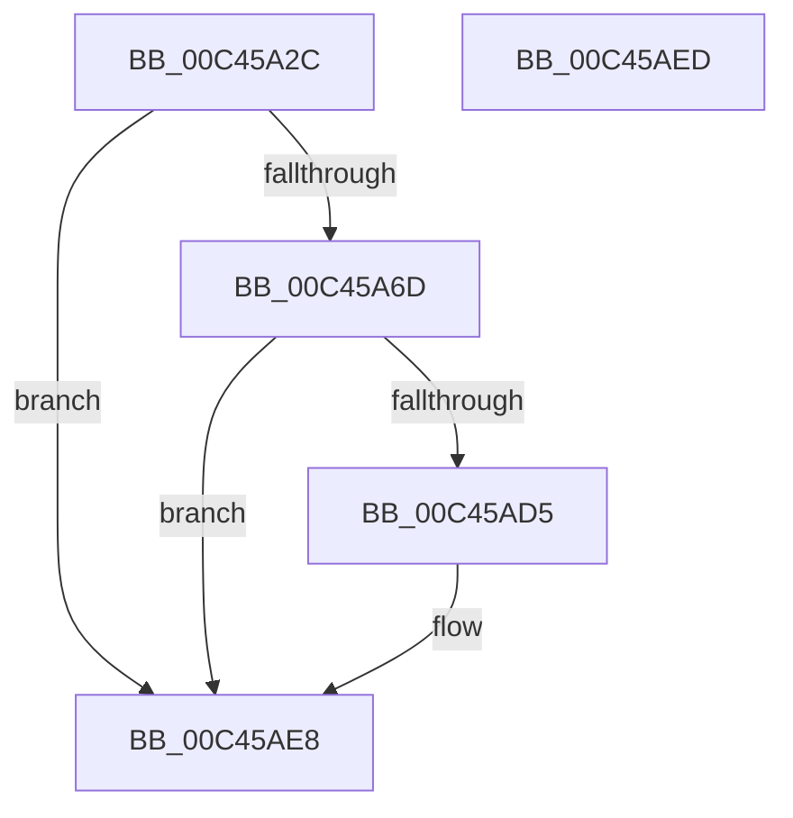

# PspInitializeCpuPartitionsPhase0

- RVA: `0x00C45A2C`–`0x00C45AEE` (길이 `194` bytes)
- VA: `0x0000000140C45A2C`
- 실행 섹션: `INIT`
- PDB 이름 있음: `예`; PDB Function 태그: `아니요`
- unwind 정보 RVA: `0x000BCD28`
- 디코드: `40`개 명령, `194/194` bytes 표시
- 미해석 바이트: `0` (있으면 어셈블리에 `.byte`로 보존)

> 이 문서는 커널 이미지의 기계어와 PDB 기호를 분석해 생성했습니다. 4번과 5번은 함수 원형과 자료형을 바이너리 사용 방식에서 추정한 C 해석이며 원본 소스 복구 결과는 아닙니다.

## 1. Dependencies

- 직접 호출 지점: **2**; 고유 호출 대상: **2**
- 직접 호출자로 확인된 함수: **1**
- RIP 상대 이미지 참조: **8**

### Outgoing calls
- `0x00C45A64` → [PspInitializeCpuPartitionsDefaultSd](PspInitializeCpuPartitionsDefaultSd_function_00C457D4.md) (function, `0x00C457D4`)
- `0x00C45ACC` → [PsCreateCpuPartition](../../page/78/PsCreateCpuPartition_function_00783A8C.md) (function, `0x00783A8C`)

### Direct callers
- [PspInitPhase0](../C7/PspInitPhase0_function_00C77E2C.md) at `0x00C788A2`

### Static image references
- `0x00C45A30` → RVA `0x00FD9DC8` (`PAGEDATA`; read/write)
- `0x00C45A38` → RVA `0x00FC7020` (`ALMOSTRO`; read)
- `0x00C45A4F` → RVA `0x00FDA3F8` (`PAGEDATA`; read)
- `0x00C45A56` → RVA `0x00FDA400` (`PAGEDATA`; write)
- `0x00C45A5D` → RVA `0x00FDA3F8` (`PAGEDATA`; write)
- `0x00C45A73` → RVA `0x00B4BED8` (`PspSystemCpuPartitionName`; read)
- `0x00C45AAA` → RVA `0x00FC6D78` (`ALMOSTRO`; read)
- `0x00C45AE1` → RVA `0x00FC6C20` (`ALMOSTRO`; write)

## 2. Other-region calls and transfers

- 다른 실행 섹션으로 향하는 call: **1**
  - `0x00C45ACC` → [PsCreateCpuPartition](../../page/78/PsCreateCpuPartition_function_00783A8C.md) (`INIT` → `PAGE`)
- 별도 외부 분기/꼬리 이동을 확인하지 못했습니다.

## 3. Assembly (complete function range)

```asm
00C45A2C  48 83 EC 78                     sub rsp, 0x78
00C45A30  48 83 25 90 43 39 00 00         and qword ptr [rip + 0x394390], 0
00C45A38  48 8D 0D E1 15 38 00            lea rcx, [rip + 0x3815e1]
00C45A3F  33 C0                           xor eax, eax
00C45A41  33 D2                           xor edx, edx
00C45A43  21 44 24 5C                     and dword ptr [rsp + 0x5c], eax
00C45A47  89 44 24 44                     mov dword ptr [rsp + 0x44], eax
00C45A4B  21 44 24 44                     and dword ptr [rsp + 0x44], eax
00C45A4F  48 8D 05 A2 49 39 00            lea rax, [rip + 0x3949a2]
00C45A56  48 89 05 A3 49 39 00            mov qword ptr [rip + 0x3949a3], rax
00C45A5D  48 89 05 94 49 39 00            mov qword ptr [rip + 0x394994], rax
00C45A64  E8 6B FD FF FF                  call 0x140c457d4
00C45A69  85 C0                           test eax, eax
00C45A6B  78 7B                           js 0x140c45ae8
00C45A6D  48 83 64 24 30 00               and qword ptr [rsp + 0x30], 0
00C45A73  48 8D 05 5E 64 F0 FF            lea rax, [rip - 0xf9ba2]
00C45A7A  48 83 64 24 48 00               and qword ptr [rsp + 0x48], 0
00C45A80  48 8D 4C 24 40                  lea rcx, [rsp + 0x40]
00C45A85  48 83 64 24 68 00               and qword ptr [rsp + 0x68], 0
00C45A8B  41 B9 01 00 00 00               mov r9d, 1
00C45A91  48 89 44 24 50                  mov qword ptr [rsp + 0x50], rax
00C45A96  45 33 C0                        xor r8d, r8d
00C45A99  48 8B 05 80 15 38 00            mov rax, qword ptr [rip + 0x381580]
00C45AA0  BA 07 00 0E 00                  mov edx, 0xe0007
00C45AA5  48 89 44 24 60                  mov qword ptr [rsp + 0x60], rax
00C45AAA  48 8D 05 C7 12 38 00            lea rax, [rip + 0x3812c7]
00C45AB1  48 89 44 24 28                  mov qword ptr [rsp + 0x28], rax
00C45AB6  48 83 64 24 20 00               and qword ptr [rsp + 0x20], 0
00C45ABC  C7 44 24 40 30 00 00 00         mov dword ptr [rsp + 0x40], 0x30
00C45AC4  C7 44 24 58 50 02 00 00         mov dword ptr [rsp + 0x58], 0x250
00C45ACC  E8 BB DF B3 FF                  call 0x140783a8c
00C45AD1  85 C0                           test eax, eax
00C45AD3  78 13                           js 0x140c45ae8
00C45AD5  48 8B 05 9C 12 38 00            mov rax, qword ptr [rip + 0x38129c]
00C45ADC  48 8B 08                        mov rcx, qword ptr [rax]
00C45ADF  33 C0                           xor eax, eax
00C45AE1  48 89 0D 38 11 38 00            mov qword ptr [rip + 0x381138], rcx
00C45AE8  48 83 C4 78                     add rsp, 0x78
00C45AEC  C3                              ret
00C45AED  CC                              int3
```

## 4. C-style interpretation (structured pseudocode)

```c
__int64 __fastcall PspInitializeCpuPartitionsPhase0(__int64 a1, int a2, int a3)
{
    __int64 result;
    __int64 v_rsp;
    unsigned __int64 v_stack_m10;
    unsigned __int64 v_stack_m18;
    unsigned int v_stack_m1C;
    unsigned int v_stack_m20;
    unsigned __int64 v_stack_m28;
    unsigned __int64 v_stack_m30;
    unsigned int v_stack_m34;
    unsigned __int64 v_stack_m38;
    unsigned __int64 v_stack_m48;
    unsigned __int64 v_stack_m50;
    unsigned __int64 v_stack_m58;

    v_rsp = (v_rsp) - (120);
    result = 0;
    a2 = 0;
    v_stack_m34 = 0;
    *(unsigned __int64 *)(v_rip + 3754403) = v_rip + 3754402;
    *(unsigned __int64 *)(v_rip + 3754388) = v_rip + 3754402;
    result = PspInitializeCpuPartitionsDefaultSd(v_rip + 3675617, a2, a3, a4);
    if (sign_flag) goto loc_00C45AE8;
    v_stack_m28 = v_rip - 1022882;
    a3 = 0;
    v_stack_m18 = *(unsigned __int64 *)(v_rip + 3675520);
    v_stack_m50 = v_rip + 3674823;
    v_stack_m38 = 48;
    v_stack_m20 = 592;
    result = PsCreateCpuPartition(v_stack_m38, (unsigned int)(0xE0007ULL), a3, 1);
    if (!(sign_flag)) {
        result = *(unsigned __int64 *)(v_rip + 3674780);
        a1 = *(unsigned __int64 *)(result);
        result = 0;
        *(unsigned __int64 *)(v_rip + 3674424) = a1;
    }
    v_rsp = (v_rsp) + (120);
    return result;
}
```

## 5. (Beta) C Style

```c
int64_t PspInitializeCpuPartitionsPhase0(int64_t Arg1, int32_t Arg2, int32_t Arg3)
{
    int64_t result;
    int64_t local_rsp;
    uint64_t v_stack_m10;
    uint64_t v_stack_m18;
    uint32_t v_stack_m1C;
    uint32_t v_stack_m20;
    uint64_t v_stack_m28;
    uint64_t v_stack_m30;
    uint32_t v_stack_m34;
    uint64_t v_stack_m38;
    uint64_t v_stack_m48;
    uint64_t v_stack_m50;
    uint64_t v_stack_m58;

    local_rsp = (local_rsp) - (120);
    result = 0;
    Arg2 = 0;
    v_stack_m34 = 0;
    *(uint64_t *)(v_rip + 0x3949A3) = v_rip + 3754402;
    *(uint64_t *)(v_rip + 0x394994) = v_rip + 3754402;
    result = PspInitializeCpuPartitionsDefaultSd(v_rip + 3675617, Arg2, Arg3, a4);
    if (sign_flag) goto loc_00C45AE8;
    v_stack_m28 = v_rip - 1022882;
    Arg3 = 0;
    v_stack_m18 = *(uint64_t *)(v_rip + 0x381580);
    v_stack_m50 = v_rip + 3674823;
    v_stack_m38 = 48;
    v_stack_m20 = 592;
    result = PsCreateCpuPartition(v_stack_m38, (uint32_t)(0xE0007ULL), Arg3, 1);
    if (!(sign_flag)) {
        result = *(uint64_t *)(v_rip + 0x38129C);
        Arg1 = *(uint64_t *)(result);
        result = 0;
        *(uint64_t *)(v_rip + 0x381138) = Arg1;
    }
    local_rsp = (local_rsp) + (120);
    return result;
}
```

## 6. Execution-region graph

[열기: 2D/3D 그래프와 함수 탐색 컨트롤 패널](../../../control-panel.html?section=init&rva=0x00C45A2C&view=graph)

- 2D 그래프는 위에서 아래로 흐르고, 3D 그래프는 빈 공간을 드래그해 회전합니다. Shift+드래그는 이동, 휠은 확대·축소, 함수 노드 선택은 대상 보고서 이동입니다.

### Static fallback


