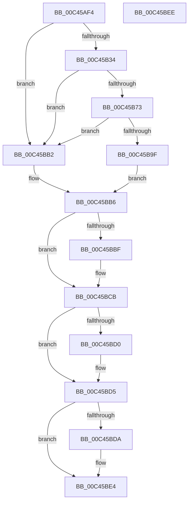

# PspInitializeCpuPartitionsPhase1

- RVA: `0x00C45AF4`–`0x00C45BEF` (길이 `251` bytes)
- VA: `0x0000000140C45AF4`
- 실행 섹션: `INIT`
- PDB 이름 있음: `예`; PDB Function 태그: `아니요`
- unwind 정보 RVA: `0x000CDF8C`
- 디코드: `73`개 명령, `251/251` bytes 표시
- 미해석 바이트: `0` (있으면 어셈블리에 `.byte`로 보존)

> 이 문서는 커널 이미지의 기계어와 PDB 기호를 분석해 생성했습니다. 4번과 5번은 함수 원형과 자료형을 바이너리 사용 방식에서 추정한 C 해석이며 원본 소스 복구 결과는 아닙니다.

## 1. Dependencies

- 직접 호출 지점: **6**; 고유 호출 대상: **5**
- 직접 호출자로 확인된 함수: **1**
- RIP 상대 이미지 참조: **3**

### Outgoing calls
- `0x00C45B25` → [PspInitializeCpuPartitionsDefaultSd](PspInitializeCpuPartitionsDefaultSd_function_00C457D4.md) (function, `0x00C457D4`)
- `0x00C45B68` → [ZwCreateDirectoryObject](../../text/6A/ZwCreateDirectoryObject_function_006AE650.md) (function, `0x006AE650`)
- `0x00C45B94` → [ObInsertObject](../../page/8B/ObInsertObject_function_008B9100.md) (function, `0x008B9100`)
- `0x00C45BC2` → [ZwClose](../../text/6A/ZwClose_function_006AD2B0.md) (function, `0x006AD2B0`)
- `0x00C45BD0` → [ZwClose](../../text/6A/ZwClose_function_006AD2B0.md) (function, `0x006AD2B0`)
- `0x00C45BDF` → [ExFreePoolWithTag](../../poolcode/B8/ExFreePoolWithTag_function_00B82870.md) (function, `0x00B82870`)

### Direct callers
- [PspInitPhase1](PspInitPhase1_function_00C453B8.md) at `0x00C453E9`

### Static image references
- `0x00C45B39` → RVA `0x00B4B0E0` (`PspCpuPartitionDirectoryPathString`; read)
- `0x00C45B73` → RVA `0x00FC6D78` (`ALMOSTRO`; read)
- `0x00C45BA5` → RVA `0x00FC72D0` (`ALMOSTRO`; write)

## 2. Other-region calls and transfers

- 다른 실행 섹션으로 향하는 call: **5**
  - `0x00C45B68` → [ZwCreateDirectoryObject](../../text/6A/ZwCreateDirectoryObject_function_006AE650.md) (`INIT` → `.text`)
  - `0x00C45B94` → [ObInsertObject](../../page/8B/ObInsertObject_function_008B9100.md) (`INIT` → `PAGE`)
  - `0x00C45BC2` → [ZwClose](../../text/6A/ZwClose_function_006AD2B0.md) (`INIT` → `.text`)
  - `0x00C45BD0` → [ZwClose](../../text/6A/ZwClose_function_006AD2B0.md) (`INIT` → `.text`)
  - `0x00C45BDF` → [ExFreePoolWithTag](../../poolcode/B8/ExFreePoolWithTag_function_00B82870.md) (`INIT` → `POOLCODE`)
- 별도 외부 분기/꼬리 이동을 확인하지 못했습니다.

## 3. Assembly (complete function range)

```asm
00C45AF4  40 55                           push rbp
00C45AF6  53                              push rbx
00C45AF7  57                              push rdi
00C45AF8  48 8B EC                        mov rbp, rsp
00C45AFB  48 83 EC 60                     sub rsp, 0x60
00C45AFF  33 C0                           xor eax, eax
00C45B01  48 8D 4D 28                     lea rcx, [rbp + 0x28]
00C45B05  48 21 45 20                     and qword ptr [rbp + 0x20], rax
00C45B09  0F 57 C0                        xorps xmm0, xmm0
00C45B0C  48 21 45 30                     and qword ptr [rbp + 0x30], rax
00C45B10  B2 01                           mov dl, 1
00C45B12  48 21 45 28                     and qword ptr [rbp + 0x28], rax
00C45B16  0F 11 45 D0                     movups xmmword ptr [rbp - 0x30], xmm0
00C45B1A  48 89 45 F0                     mov qword ptr [rbp - 0x10], rax
00C45B1E  0F 11 45 E0                     movups xmmword ptr [rbp - 0x20], xmm0
00C45B22  89 45 F8                        mov dword ptr [rbp - 8], eax
00C45B25  E8 AA FC FF FF                  call 0x140c457d4
00C45B2A  48 8B 7D 28                     mov rdi, qword ptr [rbp + 0x28]
00C45B2E  8B D8                           mov ebx, eax
00C45B30  85 C0                           test eax, eax
00C45B32  78 7E                           js 0x140c45bb2
00C45B34  48 83 65 D8 00                  and qword ptr [rbp - 0x28], 0
00C45B39  48 8D 05 A0 55 F0 FF            lea rax, [rip - 0xfaa60]
00C45B40  48 83 65 F8 00                  and qword ptr [rbp - 8], 0
00C45B45  4C 8D 45 D0                     lea r8, [rbp - 0x30]
00C45B49  BA 04 00 00 00                  mov edx, 4
00C45B4E  48 89 45 E0                     mov qword ptr [rbp - 0x20], rax
00C45B52  48 8D 4D 20                     lea rcx, [rbp + 0x20]
00C45B56  C7 45 D0 30 00 00 00            mov dword ptr [rbp - 0x30], 0x30
00C45B5D  C7 45 E8 50 02 00 00            mov dword ptr [rbp - 0x18], 0x250
00C45B64  48 89 7D F0                     mov qword ptr [rbp - 0x10], rdi
00C45B68  E8 E3 8A A6 FF                  call 0x1406ae650
00C45B6D  8B D8                           mov ebx, eax
00C45B6F  85 C0                           test eax, eax
00C45B71  78 3F                           js 0x140c45bb2
00C45B73  48 8B 0D FE 11 38 00            mov rcx, qword ptr [rip + 0x3811fe]
00C45B7A  48 8D 45 30                     lea rax, [rbp + 0x30]
00C45B7E  48 89 44 24 28                  mov qword ptr [rsp + 0x28], rax
00C45B83  45 33 C9                        xor r9d, r9d
00C45B86  48 83 64 24 20 00               and qword ptr [rsp + 0x20], 0
00C45B8C  33 D2                           xor edx, edx
00C45B8E  41 B8 07 00 0E 00               mov r8d, 0xe0007
00C45B94  E8 67 35 C7 FF                  call 0x1408b9100
00C45B99  8B D8                           mov ebx, eax
00C45B9B  85 C0                           test eax, eax
00C45B9D  78 13                           js 0x140c45bb2
00C45B9F  48 8B 45 20                     mov rax, qword ptr [rbp + 0x20]
00C45BA3  33 C9                           xor ecx, ecx
00C45BA5  48 89 05 24 17 38 00            mov qword ptr [rip + 0x381724], rax
00C45BAC  48 89 4D 20                     mov qword ptr [rbp + 0x20], rcx
00C45BB0  EB 04                           jmp 0x140c45bb6
00C45BB2  48 8B 4D 20                     mov rcx, qword ptr [rbp + 0x20]
00C45BB6  48 8B 45 30                     mov rax, qword ptr [rbp + 0x30]
00C45BBA  48 85 C0                        test rax, rax
00C45BBD  74 0C                           je 0x140c45bcb
00C45BBF  48 8B C8                        mov rcx, rax
00C45BC2  E8 E9 76 A6 FF                  call 0x1406ad2b0
00C45BC7  48 8B 4D 20                     mov rcx, qword ptr [rbp + 0x20]
00C45BCB  48 85 C9                        test rcx, rcx
00C45BCE  74 05                           je 0x140c45bd5
00C45BD0  E8 DB 76 A6 FF                  call 0x1406ad2b0
00C45BD5  48 85 FF                        test rdi, rdi
00C45BD8  74 0A                           je 0x140c45be4
00C45BDA  33 D2                           xor edx, edx
00C45BDC  48 8B CF                        mov rcx, rdi
00C45BDF  E8 8C CC F3 FF                  call 0x140b82870
00C45BE4  8B C3                           mov eax, ebx
00C45BE6  48 83 C4 60                     add rsp, 0x60
00C45BEA  5F                              pop rdi
00C45BEB  5B                              pop rbx
00C45BEC  5D                              pop rbp
00C45BED  C3                              ret
00C45BEE  CC                              int3
```

## 4. C-style interpretation (structured pseudocode)

```c
__int64 __fastcall PspInitializeCpuPartitionsPhase1(__int64 a1, __int64 a2, __int64 a3, int a4)
{
    __int64 result;
    __int64 v_rsp;
    unsigned int v_stack_m20;
    unsigned __int64 v_stack_m28;
    unsigned int v_stack_m30;
    unsigned __int64 v_stack_m38;
    unsigned __int64 v_stack_m40;
    unsigned __int64 v_stack_m48;
    unsigned __int64 v_stack_m50;
    unsigned __int64 v_stack_m58;
    unsigned __int64 v_stack_p10;
    unsigned __int64 v_stack_p18;
    unsigned __int64 v_stack_p8;

    v_rsp = (v_rsp) - (96);
    result = 0;
    v_stack_m48 = v_xmm0;
    v_stack_m28 = 0;
    v_stack_m38 = v_xmm0;
    v_stack_m20 = 0;
    result = PspInitializeCpuPartitionsDefaultSd(v_stack_p10, 1, a3, a4);
    if (sign_flag) goto loc_00C45BB2;
    v_stack_m38 = v_rip - 1026656;
    v_stack_m48 = 48;
    v_stack_m30 = 592;
    v_stack_m28 = v_stack_p10;
    result = ZwCreateDirectoryObject(v_stack_p8, 4, v_stack_m48, a4);
    if (sign_flag) goto loc_00C45BB2;
    v_stack_m50 = v_stack_p18;
    a4 = 0;
    a2 = 0;
    result = ObInsertObject(*(unsigned __int64 *)(v_rip + 3674622), a2, (unsigned int)(0xE0007ULL), a4);
    if (sign_flag) goto loc_00C45BB2;
    a1 = 0;
    *(unsigned __int64 *)(v_rip + 3675940) = v_stack_p8;
    v_stack_p8 = 0;
    goto loc_00C45BB6;
loc_00C45BB2:
loc_00C45BB6:
    result = v_stack_p18;
    if (v_stack_p18 != 0) {
        a1 = v_stack_p18;
        result = ZwClose(a1, a2, (unsigned int)(0xE0007ULL), a4);
        a1 = v_stack_p8;
    }
    if (a1 != 0) {
        result = ZwClose(a1, a2, (unsigned int)(0xE0007ULL), a4);
    }
    if (v_stack_p10 != 0) {
        a2 = 0;
        a1 = v_stack_p10;
        result = ExFreePoolWithTag(a1, a2, (unsigned int)(0xE0007ULL), a4);
    }
    v_rsp = (v_rsp) + (96);
    return (unsigned int)((unsigned int)((unsigned int)((unsigned int)(result))));
}
```

## 5. (Beta) C Style

```c
int64_t PspInitializeCpuPartitionsPhase1(int64_t Arg1, int64_t Arg2, int64_t Arg3, int32_t Arg4)
{
    int64_t result;
    int64_t local_rsp;
    uint32_t v_stack_m20;
    uint64_t v_stack_m28;
    uint32_t v_stack_m30;
    uint64_t v_stack_m38;
    uint64_t v_stack_m40;
    uint64_t v_stack_m48;
    uint64_t v_stack_m50;
    uint64_t v_stack_m58;
    uint64_t v_stack_p10;
    uint64_t v_stack_p18;
    uint64_t v_stack_p8;

    local_rsp = (local_rsp) - (96);
    result = 0;
    v_stack_m48 = v_xmm0;
    v_stack_m28 = 0;
    v_stack_m38 = v_xmm0;
    v_stack_m20 = 0;
    result = PspInitializeCpuPartitionsDefaultSd(v_stack_p10, 1, Arg3, Arg4);
    if (sign_flag) goto loc_00C45BB2;
    v_stack_m38 = v_rip - 1026656;
    v_stack_m48 = 48;
    v_stack_m30 = 592;
    v_stack_m28 = v_stack_p10;
    result = ZwCreateDirectoryObject(v_stack_p8, 4, v_stack_m48, Arg4);
    if (sign_flag) goto loc_00C45BB2;
    v_stack_m50 = v_stack_p18;
    Arg4 = 0;
    Arg2 = 0;
    result = ObInsertObject(*(uint64_t *)(v_rip + 0x3811FE), Arg2, (uint32_t)(0xE0007ULL), Arg4);
    if (sign_flag) goto loc_00C45BB2;
    Arg1 = 0;
    *(uint64_t *)(v_rip + 0x381724) = v_stack_p8;
    v_stack_p8 = 0;
    goto loc_00C45BB6;
loc_00C45BB2:
loc_00C45BB6:
    result = v_stack_p18;
    if (v_stack_p18 != 0) {
        Arg1 = v_stack_p18;
        result = ZwClose(Arg1, Arg2, (uint32_t)(0xE0007ULL), Arg4);
        Arg1 = v_stack_p8;
    }
    if (Arg1 != 0) {
        result = ZwClose(Arg1, Arg2, (uint32_t)(0xE0007ULL), Arg4);
    }
    if (v_stack_p10 != 0) {
        Arg2 = 0;
        Arg1 = v_stack_p10;
        result = ExFreePoolWithTag(Arg1, Arg2, (uint32_t)(0xE0007ULL), Arg4);
    }
    local_rsp = (local_rsp) + (96);
    return (uint32_t)((uint32_t)((uint32_t)((uint32_t)(result))));
}
```

## 6. Execution-region graph

[열기: 2D/3D 그래프와 함수 탐색 컨트롤 패널](../../../control-panel.html?section=init&rva=0x00C45AF4&view=graph)

- 2D 그래프는 위에서 아래로 흐르고, 3D 그래프는 빈 공간을 드래그해 회전합니다. Shift+드래그는 이동, 휠은 확대·축소, 함수 노드 선택은 대상 보고서 이동입니다.

### Static fallback


