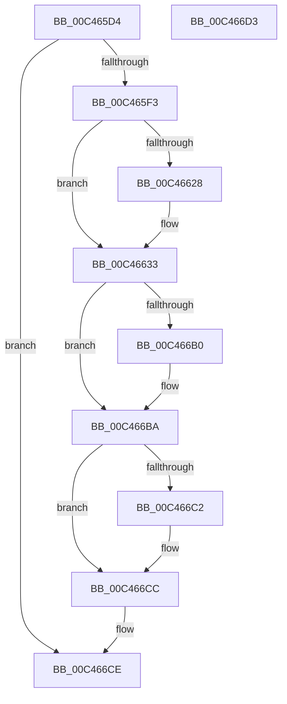

# PspInitializeJobStructures

- RVA: `0x00C465D4`–`0x00C466D4` (길이 `256` bytes)
- VA: `0x0000000140C465D4`
- 실행 섹션: `INIT`
- PDB 이름 있음: `예`; PDB Function 태그: `아니요`
- unwind 정보 RVA: `0x0005C788`
- 디코드: `46`개 명령, `256/256` bytes 표시
- 미해석 바이트: `0` (있으면 어셈블리에 `.byte`로 보존)

> 이 문서는 커널 이미지의 기계어와 PDB 기호를 분석해 생성했습니다. 4번과 5번은 함수 원형과 자료형을 바이너리 사용 방식에서 추정한 C 해석이며 원본 소스 복구 결과는 아닙니다.

## 1. Dependencies

- 직접 호출 지점: **1**; 고유 호출 대상: **1**
- 직접 호출자로 확인된 함수: **1**
- RIP 상대 이미지 참조: **28**

### Outgoing calls
- `0x00C465DC` → [ExCreateHandleTable](../../page/94/ExCreateHandleTable_function_0094C7E8.md) (function, `0x0094C7E8`)

### Direct callers
- [PspInitPhase0](../C7/PspInitPhase0_function_00C77E2C.md) at `0x00C78794`

### Static image references
- `0x00C465E3` → RVA `0x00FD9D00` (`PAGEDATA`; write)
- `0x00C465F7` → RVA `0x00FDA078` (`PAGEDATA`; read)
- `0x00C465FE` → RVA `0x00E0C598` (`.data`; read)
- `0x00C46604` → RVA `0x00FDA080` (`PAGEDATA`; write)
- `0x00C4660B` → RVA `0x00FDA078` (`PAGEDATA`; write)
- `0x00C46612` → RVA `0x00FD9DA8` (`PAGEDATA`; write)
- `0x00C4661C` → RVA `0x00FD9E88` (`PAGEDATA`; write)
- `0x00C4662D` → RVA `0x00E0C598` (`.data`; write)
- `0x00C46633` → RVA `0x00FC515C` (`ALMOSTRO`; read)
- `0x00C46639` → RVA `0x00A55CB0` (`PspJobNotificationWorker`; read)
- `0x00C46640` → RVA `0x00F065D0` (`.data`; write)
- `0x00C46647` → RVA `0x009183E0` (`PspJobTimeLimitsWork`; read)
- `0x00C4664E` → RVA `0x00F06610` (`.data`; write)
- `0x00C46655` → RVA `0x00FD9ECC` (`PAGEDATA`; read)
- `0x00C4665C` → RVA `0x00E0C59C` (`.data`; write)
- `0x00C46662` → RVA `0x00FDA5E0` (`PAGEDATA`; read)
- `0x00C46669` → RVA `0x00FDA050` (`PAGEDATA`; write)
- `0x00C46670` → RVA `0x00F065D8` (`.data`; write)
- `0x00C46677` → RVA `0x00F065C0` (`.data`; write)
- `0x00C4667E` → RVA `0x00F06618` (`.data`; write)
- `0x00C46685` → RVA `0x00F06600` (`.data`; write)
- `0x00C4668C` → RVA `0x00FD9D90` (`PAGEDATA`; write)
- `0x00C46693` → RVA `0x00FDA048` (`PAGEDATA`; write)
- `0x00C4669D` → RVA `0x00FDA058` (`PAGEDATA`; write)
- `0x00C466A7` → RVA `0x00FDA060` (`PAGEDATA`; write)
- `0x00C466B0` → RVA `0x00FC515C` (`ALMOSTRO`; write)
- `0x00C466BA` → RVA `0x00FC5160` (`ALMOSTRO`; read)
- `0x00C466C2` → RVA `0x00FC5160` (`ALMOSTRO`; write)

## 2. Other-region calls and transfers

- 다른 실행 섹션으로 향하는 call: **1**
  - `0x00C465DC` → [ExCreateHandleTable](../../page/94/ExCreateHandleTable_function_0094C7E8.md) (`INIT` → `PAGE`)
- 별도 외부 분기/꼬리 이동을 확인하지 못했습니다.

## 3. Assembly (complete function range)

```asm
00C465D4  48 83 EC 28                     sub rsp, 0x28
00C465D8  33 D2                           xor edx, edx
00C465DA  33 C9                           xor ecx, ecx
00C465DC  E8 07 62 D0 FF                  call 0x14094c7e8
00C465E1  33 D2                           xor edx, edx
00C465E3  48 89 05 16 37 39 00            mov qword ptr [rip + 0x393716], rax
00C465EA  48 85 C0                        test rax, rax
00C465ED  0F 84 DB 00 00 00               je 0x140c466ce
00C465F3  80 48 2C 01                     or byte ptr [rax + 0x2c], 1
00C465F7  48 8D 05 7A 3A 39 00            lea rax, [rip + 0x393a7a]
00C465FE  8B 0D 94 5F 1C 00               mov ecx, dword ptr [rip + 0x1c5f94]
00C46604  48 89 05 75 3A 39 00            mov qword ptr [rip + 0x393a75], rax
00C4660B  48 89 05 66 3A 39 00            mov qword ptr [rip + 0x393a66], rax
00C46612  48 89 15 8F 37 39 00            mov qword ptr [rip + 0x39378f], rdx
00C46619  8D 41 FF                        lea eax, [rcx - 1]
00C4661C  48 89 15 65 38 39 00            mov qword ptr [rip + 0x393865], rdx
00C46623  83 F8 09                        cmp eax, 9
00C46626  76 0B                           jbe 0x140c46633
00C46628  B9 07 00 00 00                  mov ecx, 7
00C4662D  89 0D 65 5F 1C 00               mov dword ptr [rip + 0x1c5f65], ecx
00C46633  39 15 23 EB 37 00               cmp dword ptr [rip + 0x37eb23], edx
00C46639  48 8D 05 70 F6 E0 FF            lea rax, [rip - 0x1f0990]
00C46640  48 89 05 89 FF 2B 00            mov qword ptr [rip + 0x2bff89], rax
00C46647  48 8D 05 92 1D CD FF            lea rax, [rip - 0x32e26e]
00C4664E  48 89 05 BB FF 2B 00            mov qword ptr [rip + 0x2bffbb], rax
00C46655  48 8D 05 70 38 39 00            lea rax, [rip + 0x393870]
00C4665C  89 0D 3A 5F 1C 00               mov dword ptr [rip + 0x1c5f3a], ecx
00C46662  48 8D 0D 77 3F 39 00            lea rcx, [rip + 0x393f77]
00C46669  48 89 05 E0 39 39 00            mov qword ptr [rip + 0x3939e0], rax
00C46670  48 89 15 61 FF 2B 00            mov qword ptr [rip + 0x2bff61], rdx
00C46677  48 89 15 42 FF 2B 00            mov qword ptr [rip + 0x2bff42], rdx
00C4667E  48 89 15 93 FF 2B 00            mov qword ptr [rip + 0x2bff93], rdx
00C46685  48 89 15 74 FF 2B 00            mov qword ptr [rip + 0x2bff74], rdx
00C4668C  48 89 15 FD 36 39 00            mov qword ptr [rip + 0x3936fd], rdx
00C46693  C7 05 AB 39 39 00 20 00 00 00   mov dword ptr [rip + 0x3939ab], 0x20
00C4669D  C7 05 B1 39 39 00 00 01 00 00   mov dword ptr [rip + 0x3939b1], 0x100
00C466A7  48 89 0D B2 39 39 00            mov qword ptr [rip + 0x3939b2], rcx
00C466AE  75 0A                           jne 0x140c466ba
00C466B0  C7 05 A2 EA 37 00 32 00 00 00   mov dword ptr [rip + 0x37eaa2], 0x32
00C466BA  39 15 A0 EA 37 00               cmp dword ptr [rip + 0x37eaa0], edx
00C466C0  75 0A                           jne 0x140c466cc
00C466C2  C7 05 94 EA 37 00 C8 00 00 00   mov dword ptr [rip + 0x37ea94], 0xc8
00C466CC  B0 01                           mov al, 1
00C466CE  48 83 C4 28                     add rsp, 0x28
00C466D2  C3                              ret
00C466D3  CC                              int3
```

## 4. C-style interpretation (structured pseudocode)

```c
__int64 __fastcall PspInitializeJobStructures(int a1, int a2)
{
    __int64 result;
    __int64 v_rsp;

    v_rsp = (v_rsp) - (40);
    a2 = 0;
    a1 = 0;
    result = ExCreateHandleTable(a1, a2, a3, a4);
    a2 = 0;
    *(unsigned __int64 *)(v_rip + 3749654) = result;
    if (result == 0) goto loc_00C466CE;
    *(unsigned __int64 *)(v_rip + 3750517) = v_rip + 3750522;
    *(unsigned __int64 *)(v_rip + 3750502) = v_rip + 3750522;
    *(unsigned __int64 *)(v_rip + 3749775) = 0;
    *(unsigned __int64 *)(v_rip + 3749989) = 0;
    if (((unsigned int)((unsigned int)(*(unsigned int *)(v_rip + 1859476)) - 1)) >= = 9) {
        a1 = 7;
        *(unsigned int *)(v_rip + 1859429) = a1;
    }
    *(unsigned __int64 *)(v_rip + 2883465) = v_rip - 2034064;
    *(unsigned __int64 *)(v_rip + 2883515) = v_rip - 3334766;
    *(unsigned int *)(v_rip + 1859386) = a1;
    *(unsigned __int64 *)(v_rip + 3750368) = v_rip + 3750000;
    *(unsigned __int64 *)(v_rip + 2883425) = 0;
    *(unsigned __int64 *)(v_rip + 2883394) = 0;
    *(unsigned __int64 *)(v_rip + 2883475) = 0;
    *(unsigned __int64 *)(v_rip + 2883444) = 0;
    *(unsigned __int64 *)(v_rip + 3749629) = 0;
    *(unsigned int *)(v_rip + 3750315) = 32;
    *(unsigned int *)(v_rip + 3750321) = 256;
    *(unsigned __int64 *)(v_rip + 3750322) = v_rip + 3751799;
    if ((*(unsigned int *)(v_rip + 3664675)) == 0) {
        *(unsigned int *)(v_rip + 3664546) = 50;
    }
    if ((*(unsigned int *)(v_rip + 3664544)) == 0) {
        *(unsigned int *)(v_rip + 3664532) = 200;
    }
loc_00C466CE:
    v_rsp = (v_rsp) + (40);
    return 1;
}
```

## 5. (Beta) C Style

```c
int64_t PspInitializeJobStructures(int32_t Arg1, int32_t Arg2)
{
    int64_t result;
    int64_t local_rsp;

    local_rsp = (local_rsp) - (40);
    Arg2 = 0;
    Arg1 = 0;
    result = ExCreateHandleTable(Arg1, Arg2, a3, a4);
    Arg2 = 0;
    *(uint64_t *)(v_rip + 0x393716) = result;
    if (result == 0) goto loc_00C466CE;
    *(uint64_t *)(v_rip + 0x393A75) = v_rip + 3750522;
    *(uint64_t *)(v_rip + 0x393A66) = v_rip + 3750522;
    *(uint64_t *)(v_rip + 0x39378F) = 0;
    *(uint64_t *)(v_rip + 0x393865) = 0;
    if (((uint32_t)((uint32_t)(*(uint32_t *)(v_rip + 0x1C5F94)) - 1)) >= = 9) {
        Arg1 = 7;
        *(uint32_t *)(v_rip + 0x1C5F65) = Arg1;
    }
    *(uint64_t *)(v_rip + 0x2BFF89) = v_rip - 2034064;
    *(uint64_t *)(v_rip + 0x2BFFBB) = v_rip - 3334766;
    *(uint32_t *)(v_rip + 0x1C5F3A) = Arg1;
    *(uint64_t *)(v_rip + 0x3939E0) = v_rip + 3750000;
    *(uint64_t *)(v_rip + 0x2BFF61) = 0;
    *(uint64_t *)(v_rip + 0x2BFF42) = 0;
    *(uint64_t *)(v_rip + 0x2BFF93) = 0;
    *(uint64_t *)(v_rip + 0x2BFF74) = 0;
    *(uint64_t *)(v_rip + 0x3936FD) = 0;
    *(uint32_t *)(v_rip + 0x3939AB) = 32;
    *(uint32_t *)(v_rip + 0x3939B1) = 256;
    *(uint64_t *)(v_rip + 0x3939B2) = v_rip + 3751799;
    if ((*(uint32_t *)(v_rip + 0x37EB23)) == 0) {
        *(uint32_t *)(v_rip + 0x37EAA2) = 50;
    }
    if ((*(uint32_t *)(v_rip + 0x37EAA0)) == 0) {
        *(uint32_t *)(v_rip + 0x37EA94) = 200;
    }
loc_00C466CE:
    local_rsp = (local_rsp) + (40);
    return 1;
}
```

## 6. Execution-region graph

[열기: 2D/3D 그래프와 함수 탐색 컨트롤 패널](../../../control-panel.html?section=init&rva=0x00C465D4&view=graph)

- 2D 그래프는 위에서 아래로 흐르고, 3D 그래프는 빈 공간을 드래그해 회전합니다. Shift+드래그는 이동, 휠은 확대·축소, 함수 노드 선택은 대상 보고서 이동입니다.

### Static fallback


