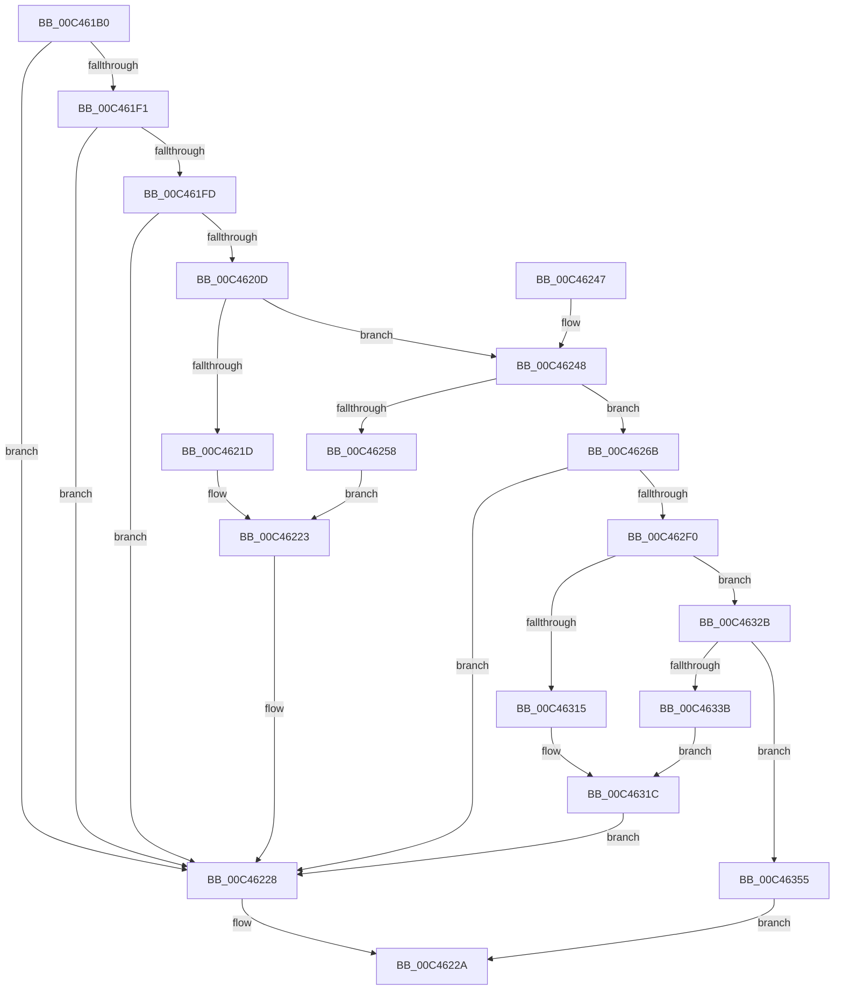

# PspInitializeSiloStructures

- RVA: `0x00C461B0`–`0x00C4635C` (길이 `428` bytes)
- VA: `0x0000000140C461B0`
- 실행 섹션: `INIT`
- PDB 이름 있음: `예`; PDB Function 태그: `아니요`
- unwind 정보 RVA: `0x000CE174`
- 디코드: `96`개 명령, `428/428` bytes 표시
- 미해석 바이트: `0` (있으면 어셈블리에 `.byte`로 보존)

> 이 문서는 커널 이미지의 기계어와 PDB 기호를 분석해 생성했습니다. 4번과 5번은 함수 원형과 자료형을 바이너리 사용 방식에서 추정한 C 해석이며 원본 소스 복구 결과는 아닙니다.

## 1. Dependencies

- 직접 호출 지점: **14**; 고유 호출 대상: **9**
- 직접 호출자로 확인된 함수: **1**
- RIP 상대 이미지 참조: **15**

### Outgoing calls
- `0x00C461E0` → [ExAllocatePool2](../../poolcode/B8/ExAllocatePool2_function_00B820F0.md) (function, `0x00B820F0`)
- `0x00C461F4` → [PspSiloInitializeSharedUserSessionId](../../page/78/PspSiloInitializeSharedUserSessionId_function_00780548.md) (function, `0x00780548`)
- `0x00C46204` → [PspStorageAllocSlot](../../page/78/PspStorageAllocSlot_function_00789B68.md) (function, `0x00789B68`)
- `0x00C46214` → [PspStorageAllocSlot](../../page/78/PspStorageAllocSlot_function_00789B68.md) (function, `0x00789B68`)
- `0x00C46223` → [PspStorageFreeSlot](../../page/78/PspStorageFreeSlot_function_00789C64.md) (function, `0x00789C64`)
- `0x00C46231` → [_security_check_cookie](../../text/6A/_security_check_cookie_function_006AC640.md) (function, `0x006AC640`)
- `0x00C4624F` → [PspStorageAllocSlot](../../page/78/PspStorageAllocSlot_function_00789B68.md) (function, `0x00789B68`)
- `0x00C4625E` → [PspStorageFreeSlot](../../page/78/PspStorageFreeSlot_function_00789C64.md) (function, `0x00789C64`)
- `0x00C46296` → [memset](../../text/6C/memset_function_006C6C40.md) (function, `0x006C6C40`)
- `0x00C462E3` → [ObCreateObjectType](../../page/70/ObCreateObjectType_function_00705230.md) (function, `0x00705230`)
- `0x00C4630C` → [ObCreateObjectType](../../page/70/ObCreateObjectType_function_00705230.md) (function, `0x00705230`)
- `0x00C46321` → [ObfDereferenceObjectWithTag](../../text/2F/ObfDereferenceObjectWithTag_function_002F78E0.md) (function, `0x002F78E0`)
- `0x00C46332` → [PspAllocStorage](../../page/A8/PspAllocStorage_function_00A89DF0.md) (function, `0x00A89DF0`)
- `0x00C46347` → [ObfDereferenceObjectWithTag](../../text/2F/ObfDereferenceObjectWithTag_function_002F78E0.md) (function, `0x002F78E0`)

### Direct callers
- [PspInitPhase0](../C7/PspInitPhase0_function_00C77E2C.md) at `0x00C787A1`

### Static image references
- `0x00C461C2` → RVA `0x00E0A740` (`.data`; read)
- `0x00C461E5` → RVA `0x00FCFE48` (`CACHEALI`; write)
- `0x00C461FD` → RVA `0x00FC5068` (`ALMOSTRO`; read)
- `0x00C4620D` → RVA `0x00FC5164` (`ALMOSTRO`; read)
- `0x00C46248` → RVA `0x00FC5168` (`ALMOSTRO`; read)
- `0x00C4626B` → RVA `0x00FD9B60` (`PAGEDATA`; read/write)
- `0x00C46273` → RVA `0x00FDA068` (`PAGEDATA`; read)
- `0x00C4627F` → RVA `0x00FDA070` (`PAGEDATA`; write)
- `0x00C46289` → RVA `0x00FDA068` (`PAGEDATA`; write)
- `0x00C4629F` → RVA `0x00FD9DC0` (`PAGEDATA`; read)
- `0x00C462B9` → RVA `0x00C825E0` (`PspSiloStoragePagedTypeName`; read)
- `0x00C462D8` → RVA `0x00AAE7F0` (`PspDeleteSiloContext`; read)
- `0x00C462F0` → RVA `0x00FD9E90` (`PAGEDATA`; read)
- `0x00C46305` → RVA `0x00C825D0` (`PspSiloStorageNonPagedTypeName`; read)
- `0x00C4632B` → RVA `0x00FCFE30` (`CACHEALI`; read)

## 2. Other-region calls and transfers

- 다른 실행 섹션으로 향하는 call: **14**
  - `0x00C461E0` → [ExAllocatePool2](../../poolcode/B8/ExAllocatePool2_function_00B820F0.md) (`INIT` → `POOLCODE`)
  - `0x00C461F4` → [PspSiloInitializeSharedUserSessionId](../../page/78/PspSiloInitializeSharedUserSessionId_function_00780548.md) (`INIT` → `PAGE`)
  - `0x00C46204` → [PspStorageAllocSlot](../../page/78/PspStorageAllocSlot_function_00789B68.md) (`INIT` → `PAGE`)
  - `0x00C46214` → [PspStorageAllocSlot](../../page/78/PspStorageAllocSlot_function_00789B68.md) (`INIT` → `PAGE`)
  - `0x00C46223` → [PspStorageFreeSlot](../../page/78/PspStorageFreeSlot_function_00789C64.md) (`INIT` → `PAGE`)
  - `0x00C46231` → [_security_check_cookie](../../text/6A/_security_check_cookie_function_006AC640.md) (`INIT` → `.text`)
  - `0x00C4624F` → [PspStorageAllocSlot](../../page/78/PspStorageAllocSlot_function_00789B68.md) (`INIT` → `PAGE`)
  - `0x00C4625E` → [PspStorageFreeSlot](../../page/78/PspStorageFreeSlot_function_00789C64.md) (`INIT` → `PAGE`)
  - `0x00C46296` → [memset](../../text/6C/memset_function_006C6C40.md) (`INIT` → `.text`)
  - `0x00C462E3` → [ObCreateObjectType](../../page/70/ObCreateObjectType_function_00705230.md) (`INIT` → `PAGE`)
  - `0x00C4630C` → [ObCreateObjectType](../../page/70/ObCreateObjectType_function_00705230.md) (`INIT` → `PAGE`)
  - `0x00C46321` → [ObfDereferenceObjectWithTag](../../text/2F/ObfDereferenceObjectWithTag_function_002F78E0.md) (`INIT` → `.text`)
  - `0x00C46332` → [PspAllocStorage](../../page/A8/PspAllocStorage_function_00A89DF0.md) (`INIT` → `PAGE`)
  - `0x00C46347` → [ObfDereferenceObjectWithTag](../../text/2F/ObfDereferenceObjectWithTag_function_002F78E0.md) (`INIT` → `.text`)
- 별도 외부 분기/꼬리 이동을 확인하지 못했습니다.

## 3. Assembly (complete function range)

```asm
00C461B0  48 89 5C 24 08                  mov qword ptr [rsp + 8], rbx
00C461B5  55                              push rbp
00C461B6  48 8D 6C 24 A9                  lea rbp, [rsp - 0x57]
00C461BB  48 81 EC B0 00 00 00            sub rsp, 0xb0
00C461C2  48 8B 05 77 45 1C 00            mov rax, qword ptr [rip + 0x1c4577]
00C461C9  48 33 C4                        xor rax, rsp
00C461CC  48 89 45 47                     mov qword ptr [rbp + 0x47], rax
00C461D0  BA 70 02 00 00                  mov edx, 0x270
00C461D5  B9 40 00 00 00                  mov ecx, 0x40
00C461DA  41 B8 53 69 6C 47               mov r8d, 0x476c6953
00C461E0  E8 0B BF F3 FF                  call 0x140b820f0
00C461E5  48 89 05 5C 9C 38 00            mov qword ptr [rip + 0x389c5c], rax
00C461EC  48 85 C0                        test rax, rax
00C461EF  74 37                           je 0x140c46228
00C461F1  48 8B C8                        mov rcx, rax
00C461F4  E8 4F A3 B3 FF                  call 0x140780548
00C461F9  85 C0                           test eax, eax
00C461FB  78 2B                           js 0x140c46228
00C461FD  48 8D 0D 64 EE 37 00            lea rcx, [rip + 0x37ee64]
00C46204  E8 5F 39 B4 FF                  call 0x140789b68
00C46209  85 C0                           test eax, eax
00C4620B  78 1B                           js 0x140c46228
00C4620D  48 8D 0D 50 EF 37 00            lea rcx, [rip + 0x37ef50]
00C46214  E8 4F 39 B4 FF                  call 0x140789b68
00C46219  85 C0                           test eax, eax
00C4621B  79 2B                           jns 0x140c46248
00C4621D  8B 0D 45 EE 37 00               mov ecx, dword ptr [rip + 0x37ee45]
00C46223  E8 3C 3A B4 FF                  call 0x140789c64
00C46228  32 C0                           xor al, al
00C4622A  48 8B 4D 47                     mov rcx, qword ptr [rbp + 0x47]
00C4622E  48 33 CC                        xor rcx, rsp
00C46231  E8 0A 64 A6 FF                  call 0x1406ac640
00C46236  48 8B 9C 24 C0 00 00 00         mov rbx, qword ptr [rsp + 0xc0]
00C4623E  48 81 C4 B0 00 00 00            add rsp, 0xb0
00C46245  5D                              pop rbp
00C46246  C3                              ret
00C46247  CC                              int3
00C46248  48 8D 0D 19 EF 37 00            lea rcx, [rip + 0x37ef19]
00C4624F  E8 14 39 B4 FF                  call 0x140789b68
00C46254  85 C0                           test eax, eax
00C46256  79 13                           jns 0x140c4626b
00C46258  8B 0D 0A EE 37 00               mov ecx, dword ptr [rip + 0x37ee0a]
00C4625E  E8 01 3A B4 FF                  call 0x140789c64
00C46263  8B 0D FB EE 37 00               mov ecx, dword ptr [rip + 0x37eefb]
00C46269  EB B8                           jmp 0x140c46223
00C4626B  48 83 25 ED 38 39 00 00         and qword ptr [rip + 0x3938ed], 0
00C46273  48 8D 05 EE 3D 39 00            lea rax, [rip + 0x393dee]
00C4627A  BB 78 00 00 00                  mov ebx, 0x78
00C4627F  48 89 05 EA 3D 39 00            mov qword ptr [rip + 0x393dea], rax
00C46286  44 8B C3                        mov r8d, ebx
00C46289  48 89 05 D8 3D 39 00            mov qword ptr [rip + 0x393dd8], rax
00C46290  33 D2                           xor edx, edx
00C46292  48 8D 4D C7                     lea rcx, [rbp - 0x39]
00C46296  E8 A5 09 A8 FF                  call 0x1406c6c40
00C4629B  80 4D C9 84                     or byte ptr [rbp - 0x37], 0x84
00C4629F  4C 8D 0D 1A 3B 39 00            lea r9, [rip + 0x393b1a]
00C462A6  B8 00 00 02 00                  mov eax, 0x20000
00C462AB  66 89 5D C7                     mov word ptr [rbp - 0x39], bx
00C462AF  89 45 D3                        mov dword ptr [rbp - 0x2d], eax
00C462B2  48 8D 55 C7                     lea rdx, [rbp - 0x39]
00C462B6  89 45 D7                        mov dword ptr [rbp - 0x29], eax
00C462B9  48 8D 0D 20 C3 03 00            lea rcx, [rip + 0x3c320]
00C462C0  89 45 DB                        mov dword ptr [rbp - 0x25], eax
00C462C3  45 33 C0                        xor r8d, r8d
00C462C6  B8 00 00 0F 00                  mov eax, 0xf0000
00C462CB  C7 45 EB 01 00 00 00            mov dword ptr [rbp - 0x15], 1
00C462D2  89 45 DF                        mov dword ptr [rbp - 0x21], eax
00C462D5  89 45 E3                        mov dword ptr [rbp - 0x1d], eax
00C462D8  48 8D 05 11 85 E6 FF            lea rax, [rip - 0x197aef]
00C462DF  48 89 45 0F                     mov qword ptr [rbp + 0xf], rax
00C462E3  E8 48 EF AB FF                  call 0x140705230
00C462E8  85 C0                           test eax, eax
00C462EA  0F 88 38 FF FF FF               js 0x140c46228
00C462F0  4C 8D 0D 99 3B 39 00            lea r9, [rip + 0x393b99]
00C462F7  C7 45 EB 00 02 00 00            mov dword ptr [rbp - 0x15], 0x200
00C462FE  45 33 C0                        xor r8d, r8d
00C46301  48 8D 55 C7                     lea rdx, [rbp - 0x39]
00C46305  48 8D 0D C4 C2 03 00            lea rcx, [rip + 0x3c2c4]
00C4630C  E8 1F EF AB FF                  call 0x140705230
00C46311  85 C0                           test eax, eax
00C46313  79 16                           jns 0x140c4632b
00C46315  48 8B 0D A4 3A 39 00            mov rcx, qword ptr [rip + 0x393aa4]
00C4631C  BA 44 66 6C 74                  mov edx, 0x746c6644
00C46321  E8 BA 15 6B FF                  call 0x1402f78e0
00C46326  E9 FD FE FF FF                  jmp 0x140c46228
00C4632B  48 8D 0D FE 9A 38 00            lea rcx, [rip + 0x389afe]
00C46332  E8 B9 3A E4 FF                  call 0x140a89df0
00C46337  85 C0                           test eax, eax
00C46339  79 1A                           jns 0x140c46355
00C4633B  48 8B 0D 7E 3A 39 00            mov rcx, qword ptr [rip + 0x393a7e]
00C46342  BA 44 66 6C 74                  mov edx, 0x746c6644
00C46347  E8 94 15 6B FF                  call 0x1402f78e0
00C4634C  48 8B 0D 3D 3B 39 00            mov rcx, qword ptr [rip + 0x393b3d]
00C46353  EB C7                           jmp 0x140c4631c
00C46355  B0 01                           mov al, 1
00C46357  E9 CE FE FF FF                  jmp 0x140c4622a
```

## 4. C-style interpretation (structured pseudocode)

```c
__int64 __fastcall PspInitializeSiloStructures(void)
{
    __int64 result;
    __int64 v_rsp;
    unsigned __int64 v_stack_m18;
    unsigned __int64 v_stack_m50;
    unsigned __int64 v_stack_m5F;
    unsigned int v_stack_m74;
    unsigned int v_stack_m7C;
    unsigned int v_stack_m80;
    unsigned int v_stack_m84;
    unsigned int v_stack_m88;
    unsigned int v_stack_m8C;
    unsigned __int8 v_stack_m96;
    unsigned __int64 v_stack_m98;
    unsigned __int64 v_stack_p8;

    v_stack_p8 = v_rbx;
    v_rsp = (v_rsp) - (176);
    result = (*(unsigned __int64 *)(v_rip + 1852791)) ^ (v_rsp);
    v_stack_m18 = result;
    result = ExAllocatePool2(64, 624, (unsigned int)(0x476C6953ULL), a4);
    *(unsigned __int64 *)(v_rip + 3710044) = result;
    if (result == 0) goto loc_00C46228;
    result = PspSiloInitializeSharedUserSessionId(result, 624, (unsigned int)(0x476C6953ULL), a4);
    if (sign_flag) goto loc_00C46228;
    result = PspStorageAllocSlot(v_rip + 3665508, 624, (unsigned int)(0x476C6953ULL), a4);
    if (sign_flag) goto loc_00C46228;
    result = PspStorageAllocSlot(v_rip + 3665744, 624, (unsigned int)(0x476C6953ULL), a4);
    if (!sign_flag) goto loc_00C46248;
loc_00C46223:
    result = PspStorageFreeSlot((unsigned int)(*(unsigned int *)(v_rip + 3665477)), 624, (unsigned int)(0x476C6953ULL), a4);
loc_00C46228:
    result = 0;
loc_00C4622A:
    a1 = (v_stack_m18) ^ (v_rsp);
    result = _security_check_cookie(a1, 624, (unsigned int)(0x476C6953ULL), a4);
    v_rsp = (v_rsp) + (176);
    return result;
loc_00C46248:
    result = PspStorageAllocSlot(v_rip + 3665689, 624, (unsigned int)(0x476C6953ULL), a4);
    if (!sign_flag) goto loc_00C4626B;
    result = PspStorageFreeSlot((unsigned int)(*(unsigned int *)(v_rip + 3665418)), 624, (unsigned int)(0x476C6953ULL), a4);
    goto loc_00C46223;
loc_00C4626B:
    *(unsigned __int64 *)(v_rip + 3751402) = v_rip + 3751406;
    *(unsigned __int64 *)(v_rip + 3751384) = v_rip + 3751406;
    a2 = 0;
    result = memset(v_stack_m98, a2, 120, a4);
    v_stack_m98 = 120;
    v_stack_m8C = (unsigned int)((unsigned int)(0x20000ULL));
    v_stack_m88 = (unsigned int)((unsigned int)(0x20000ULL));
    v_stack_m84 = (unsigned int)((unsigned int)(0x20000ULL));
    a3 = 0;
    v_stack_m74 = 1;
    v_stack_m80 = (unsigned int)((unsigned int)(0xF0000ULL));
    v_stack_m7C = (unsigned int)((unsigned int)(0xF0000ULL));
    v_stack_m50 = v_rip - 1669871;
    result = ObCreateObjectType(v_rip + 246560, v_stack_m98, a3, v_rip + 3750682);
    if (sign_flag) goto loc_00C46228;
    v_stack_m74 = 512;
    a3 = 0;
    result = ObCreateObjectType(v_rip + 246468, v_stack_m98, a3, v_rip + 3750809);
    if (!sign_flag) goto loc_00C4632B;
loc_00C4631C:
    result = ObfDereferenceObjectWithTag(*(unsigned __int64 *)(v_rip + 3750564), (unsigned int)(0x746C6644ULL), a3, v_rip + 3750809);
    goto loc_00C46228;
loc_00C4632B:
    result = PspAllocStorage(v_rip + 3709694, (unsigned int)(0x746C6644ULL), a3, v_rip + 3750809);
    if (!sign_flag) goto loc_00C46355;
    result = ObfDereferenceObjectWithTag(*(unsigned __int64 *)(v_rip + 3750526), (unsigned int)(0x746C6644ULL), a3, v_rip + 3750809);
    goto loc_00C4631C;
loc_00C46355:
    goto loc_00C4622A;
}
```

## 5. (Beta) C Style

```c
void PspInitializeSiloStructures(void)
{
    int64_t result;
    int64_t local_rsp;
    uint64_t v_stack_m18;
    uint64_t v_stack_m50;
    uint64_t v_stack_m5F;
    uint32_t v_stack_m74;
    uint32_t v_stack_m7C;
    uint32_t v_stack_m80;
    uint32_t v_stack_m84;
    uint32_t v_stack_m88;
    uint32_t v_stack_m8C;
    uint8_t v_stack_m96;
    uint64_t v_stack_m98;
    uint64_t v_stack_p8;

    v_stack_p8 = local_rbx;
    local_rsp = (local_rsp) - (176);
    result = (*(uint64_t *)(v_rip + 0x1C4577)) ^ (local_rsp);
    v_stack_m18 = result;
    result = ExAllocatePool2(64, 624, (uint32_t)(0x476C6953ULL), a4);
    *(uint64_t *)(v_rip + 0x389C5C) = result;
    if (result == 0) goto loc_00C46228;
    result = PspSiloInitializeSharedUserSessionId(result, 624, (uint32_t)(0x476C6953ULL), a4);
    if (sign_flag) goto loc_00C46228;
    result = PspStorageAllocSlot(v_rip + 3665508, 624, (uint32_t)(0x476C6953ULL), a4);
    if (sign_flag) goto loc_00C46228;
    result = PspStorageAllocSlot(v_rip + 3665744, 624, (uint32_t)(0x476C6953ULL), a4);
    if (!sign_flag) goto loc_00C46248;
loc_00C46223:
    result = PspStorageFreeSlot((uint32_t)(*(uint32_t *)(v_rip + 0x37EE45)), 624, (uint32_t)(0x476C6953ULL), a4);
loc_00C46228:
    result = 0;
loc_00C4622A:
    a1 = (v_stack_m18) ^ (local_rsp);
    result = _security_check_cookie(a1, 624, (uint32_t)(0x476C6953ULL), a4);
    local_rsp = (local_rsp) + (176);
    return result;
loc_00C46248:
    result = PspStorageAllocSlot(v_rip + 3665689, 624, (uint32_t)(0x476C6953ULL), a4);
    if (!sign_flag) goto loc_00C4626B;
    result = PspStorageFreeSlot((uint32_t)(*(uint32_t *)(v_rip + 0x37EE0A)), 624, (uint32_t)(0x476C6953ULL), a4);
    goto loc_00C46223;
loc_00C4626B:
    *(uint64_t *)(v_rip + 0x393DEA) = v_rip + 3751406;
    *(uint64_t *)(v_rip + 0x393DD8) = v_rip + 3751406;
    a2 = 0;
    result = memset(v_stack_m98, a2, 120, a4);
    v_stack_m98 = 120;
    v_stack_m8C = (uint32_t)((uint32_t)(0x20000ULL));
    v_stack_m88 = (uint32_t)((uint32_t)(0x20000ULL));
    v_stack_m84 = (uint32_t)((uint32_t)(0x20000ULL));
    a3 = 0;
    v_stack_m74 = 1;
    v_stack_m80 = (uint32_t)((uint32_t)(0xF0000ULL));
    v_stack_m7C = (uint32_t)((uint32_t)(0xF0000ULL));
    v_stack_m50 = v_rip - 1669871;
    result = ObCreateObjectType(v_rip + 246560, v_stack_m98, a3, v_rip + 3750682);
    if (sign_flag) goto loc_00C46228;
    v_stack_m74 = 512;
    a3 = 0;
    result = ObCreateObjectType(v_rip + 246468, v_stack_m98, a3, v_rip + 3750809);
    if (!sign_flag) goto loc_00C4632B;
loc_00C4631C:
    result = ObfDereferenceObjectWithTag(*(uint64_t *)(v_rip + 0x393AA4), (uint32_t)(0x746C6644ULL), a3, v_rip + 3750809);
    goto loc_00C46228;
loc_00C4632B:
    result = PspAllocStorage(v_rip + 3709694, (uint32_t)(0x746C6644ULL), a3, v_rip + 3750809);
    if (!sign_flag) goto loc_00C46355;
    result = ObfDereferenceObjectWithTag(*(uint64_t *)(v_rip + 0x393A7E), (uint32_t)(0x746C6644ULL), a3, v_rip + 3750809);
    goto loc_00C4631C;
loc_00C46355:
    goto loc_00C4622A;
}
```

## 6. Execution-region graph

[열기: 2D/3D 그래프와 함수 탐색 컨트롤 패널](../../../control-panel.html?section=init&rva=0x00C461B0&view=graph)

- 2D 그래프는 위에서 아래로 흐르고, 3D 그래프는 빈 공간을 드래그해 회전합니다. Shift+드래그는 이동, 휠은 확대·축소, 함수 노드 선택은 대상 보고서 이동입니다.

### Static fallback


